# 李磊谈 AI 时代的 PhD：研究、机会与长期选择

原节目：【十字路口】AI 时代，PhD 路上的 10 个关键问题｜对谈李磊：港大 PhD、小米 MiMo 研究员【视频播客】

主持：Koji 杨远骋。嘉宾：李磊（香港大学在读博士、小米 MiMo 研究员）。

发布：2026-10-26。整理：2026-10-26。

正文：Gemini Argon。配图与编校：Codex。

[观看原节目](https://www.bilibili.com/video/BV1CAHV6PEPM/)

## 导读

在大模型快速迭代、顶会投稿激增的当下，青年研究者与在读博士生普遍面临双重追问：当商业实验室凭借算力与工程规模不断刷新模型表现，个人研究还能从哪里切入？当单篇论文的信号被海量稿件稀释，什么才是能够跨周期沉淀的能力与作品？

本讲义整理自《十字路口》主持人 Koji 与香港大学 NLP 实验室在读博士生、小米大模型后训练研究员李磊的深度对谈。全文沿着“问题定位—反馈闭环—能力构建—生涯选择—工业前沿—评测与学习”的脉络展开：从通过 Harness 实测捕捉大模型的“锯齿状”短板、用最小假设与玩具实验缩短反馈周期，到借助开源维护与主动传播建立真实影响力；从打牢算法与系统基本功、建立公开作品集实现冷启动，到通过研究助理（RA）完成导师双向匹配；最后深入 MiMo 强化学习后训练直播、高价值数据供应链、递归自我改进（RSI）的边界，以及 Video-MME 的评测设计。希望这份结合一线科研与工业实践的笔记，能帮助你在喧嚣的技术浪潮中找准切面、守住日常节奏。

## 把研究问题选准，把实验反馈做快

在 AI 模型快速演进、学术会议投稿激增的背景下，在读博士生与年轻研究者普遍面临选题与产出的双重压力。香港大学 NLP 实验室在读博士生、小米大模型后训练研究员李磊结合自身科研与工业界实践，探讨了如何在快节奏竞争中选准难而重要的问题、从前沿模型的能力短板中寻找切入口，并用最小假设验证与高效实验闭环来平衡研究的快与慢。

### 难而重要的问题，怎样找到切入口

在 AI 领域读博，研究者首先面临的矛盾是：既要寻找有长期价值的课题，又要在激烈竞争中尽快拿到正反馈。李磊将自己验证过的研究打法总结为技巧与心态两个层面：在技巧上保持紧凑的工作节奏与快速迭代，及时从学术社区、同行以及更资深的老师和同学那里获取反馈；在心态上则坚持选择“难而正确”的问题。

他从难度与重要性两个维度解释了这一取舍：如果一个问题不够难，在当下的技术环境里就会涌入大量竞争者，原有的做法很容易被超越；而“正确”意味着它是领域内普遍关注的重要问题。主持人 Koji 对此提出追问：难而正确的事情通常意味着研究周期漫长，这是否与“快速拿到正反馈”相互冲突？

李磊指出，面对大家都知道很难的重要问题，同行反倒不会在初期提出苛刻的全盘要求。很多人在难题面前毫无头绪，只要研究者能找到一个好的切面，扎实地给出局部解释、实验验证或理论分析，哪怕只是往前推进了一小步，对后续跟进的研究者而言也是重要的阶段性节点，从而能较快获得社区的认可。

这种选题策略也是他用来缓解博士生普遍焦虑的办法。在李磊的观察中，当前 PhD 的焦虑主要集中在三个层面上：
- **发表与毕业压力**：既要满足毕业考核要求，又要面对顶级会议审稿系统在海量 AI 论文冲击下紧绷甚至局部失灵的现状；
- **研究意义的动摇**：当 Astra 等前沿模型（SOTA，State-of-the-Art，指当前最佳水平模型）发布后，许多做具体技术方向的研究者会觉得整个细分领域被颠覆，怀疑自己发过的论文是否还有价值；
- **向工业界转换的不确定性**：在完成论文发表并做出有意义的工作之后，能否顺利实现从博士生到工业界研究岗位的过渡。

要缓解这些焦虑，除了相信运转多年的学术同行评议体系仍具备筛选好工作的内在生命力，更关键的是把注意力从单纯攒论文拉回到真实的问题切面上。

如何在激烈竞争中既找到有长期价值的课题，又尽快拿到研究反馈？

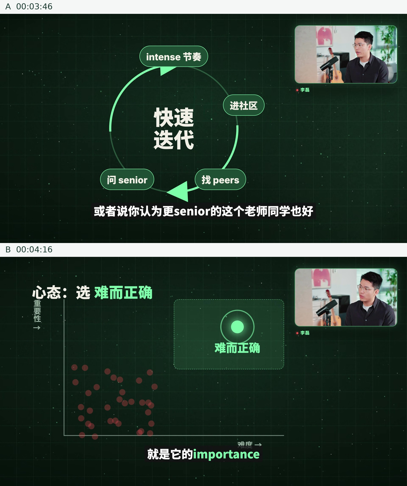

来源：[原视频](https://www.bilibili.com/video/BV1CAHV6PEPM/)，讲解区间 00:03:30–00:03:49；00:03:49–00:04:18。

> 读图
>
> 图从上到下分为 A、B 两部分。A 以“快速迭代”为环形中心，串联起“intense 节奏”“进社区”“找 peers”“问 senior”四个节点，概括日常获取反馈的动作；B 以难度为横轴、重要性为纵轴，将左下的普通散点与右上高亮的“难而正确”对照，示意选题所处的象限位置。

找准重要难题的具体切面，并用紧凑的交流迭代推进，能让局部进展也及时获得同行认可。

### 从模型的毛刺寻找研究空间

当 Astra 等前沿模型展现出强大的综合表现时，许多研究者容易产生整个细分领域被颠覆的焦虑。要判断自己的研究还有没有意义，关键在于穿过社交媒体上的高光演示，看清大模型真实的能力分布。

李磊强调，大模型实质上是一种**锯齿状的智能**。像 Astra 这样的模型乍看非常强大，但仔细审视就会发现许多能力“毛刺”——它在某些维度上表现亮眼，而在另一些基础环节上却完全缺失。社交媒体往往只放大模型最吸引眼球的效果，如果研究者只看二手信息，很容易被宣传造势吓住而陷入无力感。

因此，寻找课题考验的是研究者能否真正坐到电脑前动手实践：
- 亲自编写代码并设计**Harness**（测试框架与运行脚手架，用于组织模型输入输出、调用工具及系统化验证模型表现）；
- 实际跑通流程，直接检查底层数据与模型在具体样本上的真实表现；
- 找出宣传演示之外那些未被解决的盲区。

在主持人的追问下，李磊以他近期参与的具身智能相关实验为例，说明如何从“毛刺”中提炼问题。第一个方向是**能力溯源与泛化机制**：当模型展现出某种具身能力时，可以追溯这种能力究竟从何泛化而来；理解能力与瓶颈的来源，有助于更有针对性地改进模型。Koji 提到一种理解是 OpenAI 一直在采购具身相关数据用于训练，李磊表示他们也猜测可能如此，但这种对训练数据来源的推断目前只是外部猜测。

第二个方向是**跨环境泛化的差距**。李磊坦言自己并非具身领域的专家，但具身智能涉及诸多细分场景，比如模型在模拟器（Simulator）中的效果如何、到了真实机器（真机）上的表现又如何，二者之间会不会存在泛化差距（Gap）？诸如此类的具体疑问，正是锯齿状智能留给研究者的真实课题。

当 Astra 等前沿模型展现出强大表现时，研究者的具体切入口藏在哪里？

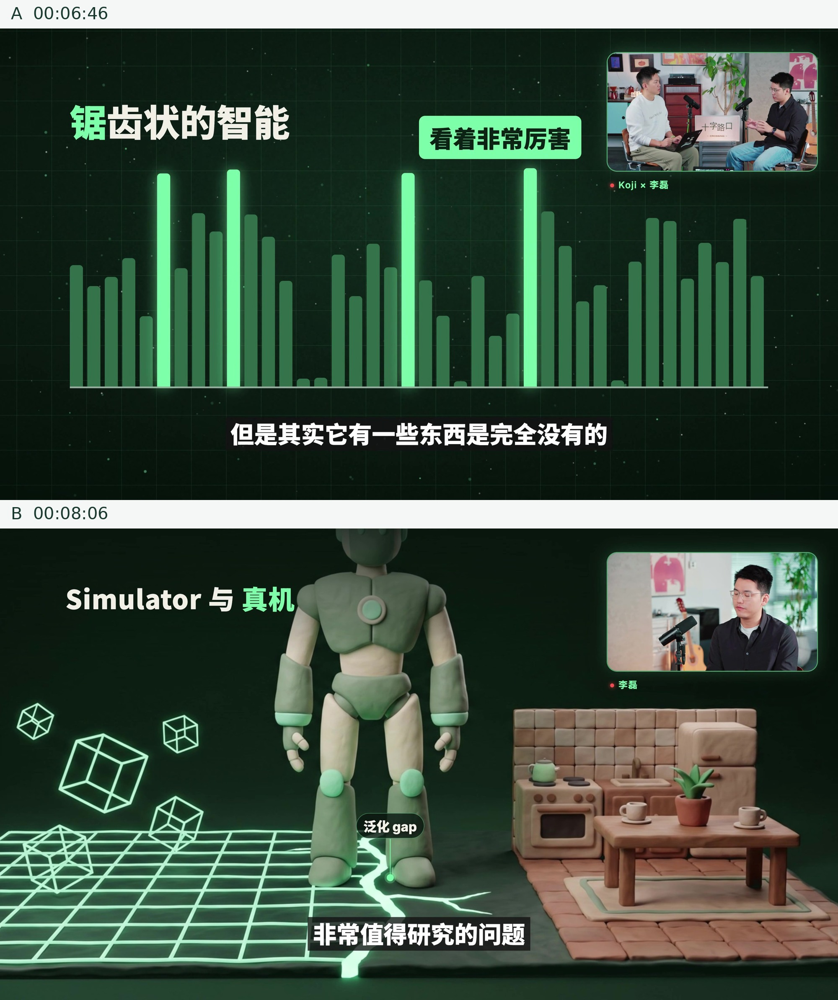

来源：[原视频](https://www.bilibili.com/video/BV1CAHV6PEPM/)，讲解区间 00:06:31–00:06:49；00:07:53–00:08:08。

> 读图
>
> A 用一组高低参差的绿色柱子示意能力分布不均，仅少数高柱被点亮并标为“看着非常厉害”，其余低矮或缺失处即能力毛刺；B 将左侧线框“Simulator”与右侧真实房间“真机”并置，中间以裂缝标出“泛化 gap”，展示具身实验中的待验证问题。

穿过高光演示，亲自搭 Harness 测试模拟器到真机等能力落差，就能把焦虑转化为具体课题。

### 先验证小假设，再投入大实验

找到了模型毛刺与研究切面后，具体推进研究时又该如何分配时间？主持人 Koji 提到，近期中美百余位学者联合发起了一份“学生慢研究倡议”，呼吁本科生不要急于发论文，而要慢下来做研究；但这与保研季、升学季看重论文的现实考核标准似乎存在冲突。

李磊阅读过具体倡议后指出，倡议的核心并非呼吁学生不做科研，而是老师们表态**不把发表的论文作为筛选候选人的唯一标准**。当所有人手里都有论文时，单纯的数量就不再重要；筛选者真正看重的是学生能否在打牢课业基础的前提下，通过一段扎实的研究经历或产出，清楚讲明白自己**“做了什么、为什么做、怎么做的”**，而不是为了装饰简历去挂名或快速拼凑粗糙的论文。

落到个人研究节奏上，李磊认为“快”和“慢”是相对的，取决于在哪个阶段投入时间。根据李磊的实践经验，早年他曾有过一次深刻教训：当时拿到一个想法，在没有做好预实验、也没有把核心假设想清楚的情况下，就直接投入了半年多时间去硬调算法，最后才发现最初的根本假设就是错的。

这次试错促使他调整了实验方法，形成了“前慢后快”的推进策略：
1. **选题阶段要“慢”**：花较长时间密集阅读论文，与景仰的研究者和老师深入讨论，确认真正值得投入的方向。前期想得越清楚，后续推进越划算。
2. **假设验证要“小而快”**：在启动大规模实验前，先抽取出一个**最小假设（Minimal Hypothesis）**，设计小规模的**玩具实验（Toy Experiments，指剥离复杂工程干扰、用极简数据或小模型快速检验核心逻辑的实验）**，端到端地验证假设是否成立。
3. **工程执行要“快”**：一旦方向和最小假设得到验证，执行落地就要提速，通过提高 GPU 利用率与数据处理速度，并借助 AI 工具并行处理任务来缩短实验反馈周期。

通过把时间花在前期问题定义与最小假设检验上，研究者既能避开盲目调参的陷阱，又能在方向明确后迅速拿到扎实的实验结果。

面对“慢科研”倡议与升学考核的张力，实验推进时该如何避免盲目耗费时间？

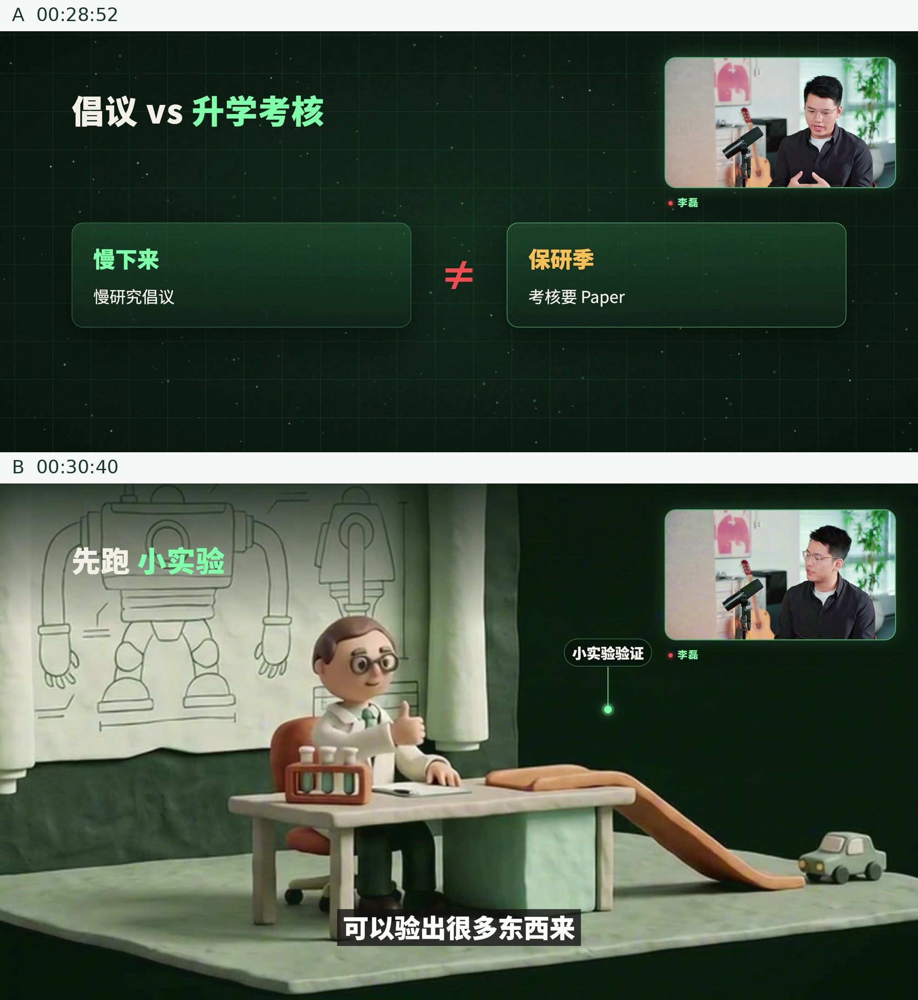

来源：[原视频](https://www.bilibili.com/video/BV1CAHV6PEPM/)，讲解区间 00:28:47–00:28:54；00:30:27–00:30:42。

> 读图
>
> A 用不等号连接左侧“慢下来 / 慢研究倡议”与右侧“保研季 / 考核要 Paper”，呈现倡议与现实考核之间的表面冲突；B 将复杂的完整机器人图纸与桌上的简易装置对照，标出“小实验验证”，对应李磊在半年调参教训后转向玩具实验的做法。

不靠粗糙论文凑数，而是先剥离最小假设做小规模端到端验证，才能把时间花在刀刃上。

个人研究节奏中的“慢”和“快”，分别对应科研流程的哪个阶段？

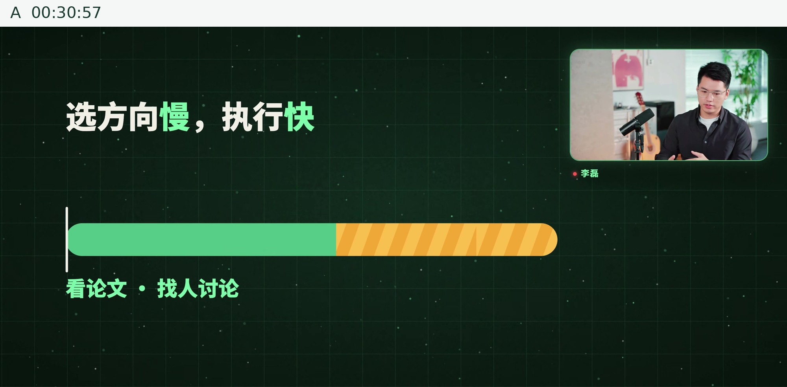

来源：[原视频](https://www.bilibili.com/video/BV1CAHV6PEPM/)，讲解区间 00:30:42–00:30:58。

> 读图
>
> 单幅画面在“选方向慢，执行快”的标题下，用连续的绿色段与橙色段示意研究过程：前段绿色标有“看论文·找人讨论”，强调前期充分思考；后段橙色代表方向明确后的快速执行。

前期在文献与讨论上花足时间，后期靠高 GPU 利用率与 AI 并行提速，构成了前慢后快的闭环。

> **锯齿状智能与 Harness 实测**
>
> 大模型的能力边界并非均匀向外扩张，而是呈现“锯齿状”：在部分基准或演示中表现突出，但在特定场景或跨环境迁移中可能存在明显短板（毛刺）。研究者不能仅凭社交媒体的演示评估模型，而需亲自编写代码、搭建 Harness，通过真实数据和样本分布测出模型的短板。

> **避免在未验证的假设上盲目调参**
>
> 研究初期的常见误区是拿到初步想法后直接进入长周期的算法调优。李磊曾因未做预实验而耗费半年多时间调算法，最终发现基础假设不成立。稳妥的做法是先剥离出一个最小假设，用低成本的玩具实验跑通端到端验证，确认假设成立后再投入大规模算力与工程资源。

研究各阶段的快慢节奏与资源取舍

| 研究阶段 | 解决的问题 | 机制与取舍 |
|---|---|---|
| 前期选题与讨论 | 确立难而重要的研究方向 | 慢下来密集读论文、与资深同行讨论，前期多花时间以降低后续返工风险 |
| 核心假设验证 | 排查核心假设错误 | 抽出最小假设，用小规模玩具实验快速做端到端检验 |
| 全量实验与执行 | 推进实验产出与验证闭环 | 在方向明确后加快推进，利用 AI 辅助并行处理数据，提高 GPU 利用率以缩短反馈周期 |

### 本章小结

1. 选题应兼顾难度与重要性：不够难的问题容易陷入同质化竞争，而在大家都关注的重要难题上找准切面，取得扎实的局部进展也能获得社区认可。
2. 大模型具有“锯齿状”能力特征：面对前沿模型带来的冲击，研究者需亲自写代码、搭 Harness、看真实数据，从模拟器与真机是否存在泛化差距等具体问题中发掘课题。
3. 区分研究不同阶段的“慢”与“快”：慢研究倡议反对粗糙凑数、强调讲清研究逻辑；实践中应在选题讨论上花足时间，先用玩具实验验证最小假设，再通过提高 GPU 利用率与 AI 并行加速执行。

## 论文之外，研究怎样被理解和使用

当一项研究真正做出来之后，在 AI 论文数量激增的环境下，它该如何穿过噪音被同行评估、采用并产生真实影响？本章顺着李磊的审稿观察、招聘筛选标准与社交媒体实践，讨论论文录用之外，研究工作如何通过扎实论证、开源维护和有效传播建立长期价值。

### 论文变多以后，怎样判断一项工作

当顶会投稿量成倍增长，研究者首先会遇到同行评审体系的压力。主持人 Koji 提问：今天所有学术顶会几乎都被 AI 论文“大水漫灌”，这套系统还能正常运转吗？

李磊结合自己做审稿人的个人观察指出，审稿负荷的增加是最直接的冲击：过去一次审稿他个人可能只需看两三篇，现在大概会分到十篇左右。由于许多审稿人习惯在截止日期（DDL）前集中处理，原本留出半天就能审完最后几篇，如今在十篇的体量下，判断的随机性不可避免地变大了；像 NeurIPS 这样的大会甚至需要分设多个会场来容纳参会者。针对这一困境，社区也在探讨限制投稿数量、让有经验的审稿人承担更大责任、引入 AI 辅助审稿，或像 AAAI 那样在讨论阶段要求两位资深程序委员会成员（SPC）共同商议决定。但他坦言，只要有人的地方就存在随机性，研究者不应把论文“是否被录用”当作唯一的回报。

听到审稿随机性变大，Koji 追问了一个尖锐的假设：现在是否有一条钻规则空子的捷径——直接用最前沿的模型批量生成 100 篇论文投出去，纯粹去拼随机录用的概率？李磊明确反对这种做法，认为这相当于对审稿系统发起 **DDoS 攻击**（分布式拒绝服务攻击，此处比喻用海量低质稿件耗尽审稿资源）。讲者强调，写论文的初衷不是为了博取中稿，而是为了进行**知识分享**。面对 100 篇批量产出的稿件，关键在于背后的作者是否真的把问题弄清楚了，是否有严密的理论或实验去支撑所提出的假设。

李磊同时补充，如果未来“人加 AI”的组合真的能提出 100 个有价值的问题，并在 AI 帮助下给出扎实的答案，那性质就不同了——就像他举例提到的放出几百个数学证明，其中部分有效、部分有误，这本身具有一定意义，但人类依然需要耗费大量精力去核验结果。反过来，正因为科研成果贵在问题定位而非堆砌数量，李磊在谈及拿到“大结果”的博士生时，举了加州大学伯克利分校博士毕业、后加入 OpenAI 从事大模型安全研究的 Eric Wallace 为例。在早前的 Hugging Face 相关安全事件后，Eric Wallace 曾作为内部研究员出来复盘。在李磊看来，他的一些研究想法本身并不复杂，但之所以能产生广泛影响，关键在于能在恰当的时机（timing）找准位置（position），把重要的问题定义清楚。

当顶会遭遇海量投稿冲击、审稿人负荷加重时，学术社区在探讨哪些维持运转的办法？

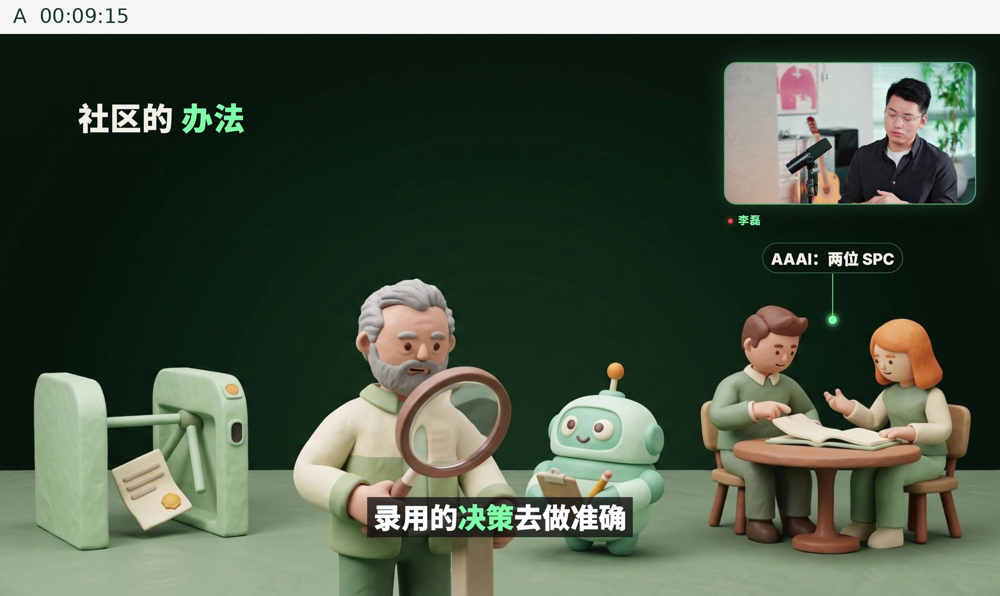

来源：[原视频](https://www.bilibili.com/video/BV1CAHV6PEPM/)，讲解区间 00:08:51–00:09:17。

> 读图
>
> 画面在“社区的办法”标题下，将论文处理通道、持放大镜的审稿人、AI 辅助机器人与桌旁的委员会放在同一场景中，上方标注“AAAI：新增 SPC”，概括访谈中提及的限制投稿、AI 辅助与资深审稿人协同讨论等思路。

评审机制虽在改进但仍难免随机性，研究者不应把是否录用当作衡量工作的唯一回报。

用前沿模型批量生成上百篇论文去拼录用率，为什么背离了科研的本意？

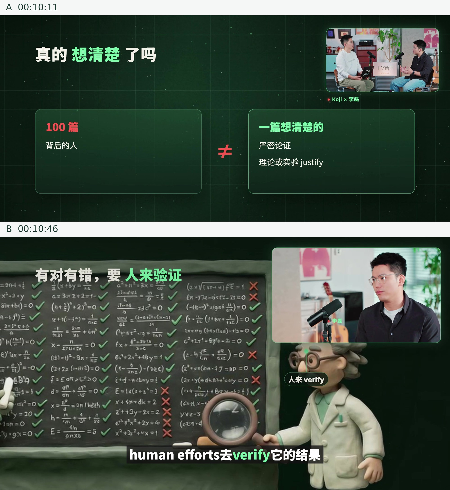

来源：[原视频](https://www.bilibili.com/video/BV1CAHV6PEPM/)，讲解区间 00:09:59–00:10:13；00:10:19–00:10:47。

> 读图
>
> A 用不等号对比左框的“100 篇 / 背后的人”与右框的“一篇想清楚的 / 严密论证 / 理论或者实验 justify”；B 展示研究者持放大镜检查黑板上打勾与打叉的推导，配文“有对有错，要人来验证（人来 verify）”。

论文的价值在于知识分享与可靠论证，即便 AI 能辅助生成海量结果，核验与把关仍需人力投入。

### 开源作品的价值在使用与维护中显现

既然顶会录用存在随机性，且论文数量激增稀释了单篇论文的信号，那么在求职和同行评估中，什么标准正在接替单纯的“数论文”？

当 Koji 问及是否会出现新的评价体系时，李磊指出，现在行业已经开始弱化单纯看发表记录的体系了。在他们筛选候选人时，论文从过去的“金标准”变成了加分项。Koji 对此感到好奇：如果 99 个人都有顶会论文，唯独一个人没有，这难道不会成为劣势吗？李磊解释说，当所有人都有论文时，没有论文反而显得与众不同——这可能意味着候选人意识到“凑论文的游戏已经坏了”而选择不盲从，团队反而很欣赏这类画像的候选人。

当然，李磊也提到，只要存在评价指标，就会出现围绕指标刷分却偏离真实价值的**奖励欺骗（Reward Hacking）**。例如，贡献开源项目原本很加分，但现在也有人用 AI 向开源仓库提合并请求（PR，Pull Request），一旦合并就在简历上宣称自己是项目贡献者。为了看清候选人的真实贡献深度，李磊分享了自己筛选有论文候选人时常用的几个观测维度：

- **代码与数据是否真正开源**：不仅看论文写得如何，还要看配套的代码和数据集有没有完整公开。
- **Issues 是否有持续维护**：开源之后，面对社区用户提出的报错和疑问（Issues），作者有没有花精力去回复和维护。
- **Hugging Face 上的采用情况**：李磊也会查看开源模型与数据集托管平台 Hugging Face 上的下载情况，并结合用户反馈了解作品的使用情况。

针对“下载量”这一指标，Koji 追问：Hugging Face 的下载量难道不能刷量作弊吗？李磊在访谈中顺着直觉回答，刷量者需要下载模型并存到昂贵的硬盘上，因此代价较大。不过从平台实际机制来看，Hugging Face 的模型下载统计是基于对仓库内指定文件（如 `config.json`）的 HTTP GET 或 HEAD 请求计数的，并不要求完整下载庞大的模型权重或占用大量本地硬盘。因此，下载量只宜作为观察社区采用度的线索之一，仍需与真实用户反馈、Issues 维护深度以及代码复现情况结合起来综合判断。

在论文之外考察开源作品的实际采用度时，该如何看待平台下载量这类指标？

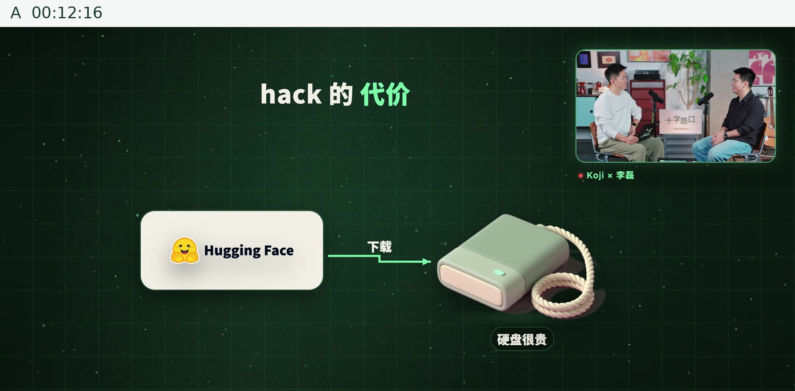

来源：[原视频](https://www.bilibili.com/video/BV1CAHV6PEPM/)，讲解区间 00:12:07–00:12:18。

> 读图
>
> 画面将 Hugging Face 图标通过下载箭头指向本地硬盘，并在下方标注“硬盘很贵”，直观呈现李磊在访谈中用存储开销来解释刷量代价的口述比喻。

由于平台实际按指定配置文件请求计数，下载量不宜单独作为防伪保证，而应与 Issues 维护和真实用户反馈结合判断。

### 传播如何成为研究的反馈环节

工作做扎实并完成开源之后，如何让潜在的使用者和同行看到这项工作？对谈进行到这里，Koji 提到自己在节目录制当天看了一眼李磊的小红书账号，发现当时已有约 2.4 万粉丝，并提起两人此前聊天时李磊开过的一个玩笑——小红书粉丝数比自己的论文引用数还要高。

李磊笑着把运营社交媒体归入博士生值得做的事情之中，并引出了博士圈子里带有调侃意味的**“大粉理论”**：即博士生在推特（X）或小红书上的粉丝量、点赞量超过自己的论文引用数。这并非学术评估公式，而是李磊借用经典论文标题“Attention Is All You Need”所做的现实引申——在论文数量激增的时代，注意力成了稀缺资源。

李磊用自己的经历对比了学术信息分发机制的变化：过去像 ACL 这样的自然语言处理顶会，每年录用也就几百篇论文；他当时会把录用列表通看一遍，根据关键词和关注的学者挑出几篇读完。但现在一个顶会动辄录用四五千篇论文，很难再靠人工逐一浏览。因此，研究者的阅读越来越依赖论文推荐或社交媒体的推荐系统。如果作者能在这些推荐渠道中被看见，工作的声量就会被放大。同时，在日常线下交流变少的当下，社交平台上的点赞与收藏能提供快速反馈，推荐算法也能帮研究者吸引到研究品味相近的同学，形成学术交流。

那么，博士生该如何运营社交媒体？李磊结合自己的账号实践总结了三条原则：
- **利他**：发有争议的观点虽然容易成为爆款，但读者往往只是点赞或评论凑热闹，并不会因此认可作者的专业价值；只有持续产出对别人有帮助的内容，影响力才会作为副产物沉淀下来。
- **坚持**：李磊坦言自己早期结合每天看论文的习惯，在小红书上发了大量论文笔记，但那段时间粉丝增长很慢；直到后来发了探讨“引用与粉丝关系”的内容，以及获奖、引用破万等动态，账号才迈上新台阶。把记录当成日常习惯、想到什么发什么，才能呈现出真实的状态。
- **做自己**：刻意模仿别人的模板会非常累，因为并不清楚别人背后的动机；不如把账号当作个人工作、生活与研究兴趣的自然外化，哪怕粉丝数没那么高，只要能聚集起一批同频的人交流，目的就达到了。

在具体的学术内容分享上，李磊举了 **on-policy distillation** 的例子——这是一种在学生模型当前策略产生的样本或轨迹上接受教师模型反馈的后训练蒸馏方法。李磊所在团队较早采纳了这一范式，他觉得很有前景，便写了一些研读笔记发在平台上，收获了不少关注；此外，当代季峰老师团队或自然意志等新实验室放出前沿工作时（其中有的工作结合了递归自我改进 RSI，并使用了小米的基座模型），他也会顺手写一些技术分析与解读。最后，当 Koji 问到博士圈除了“大粉理论”还有什么理论时，李磊补充了一个调节身心的“搏击理论”——读博过程漫长，身心健康始终是第一位的，做研究之余需要通过运动换换脑子。

为什么李磊会拿社交媒体粉丝数与论文引用数开玩笑，并认为主动传播很重要？

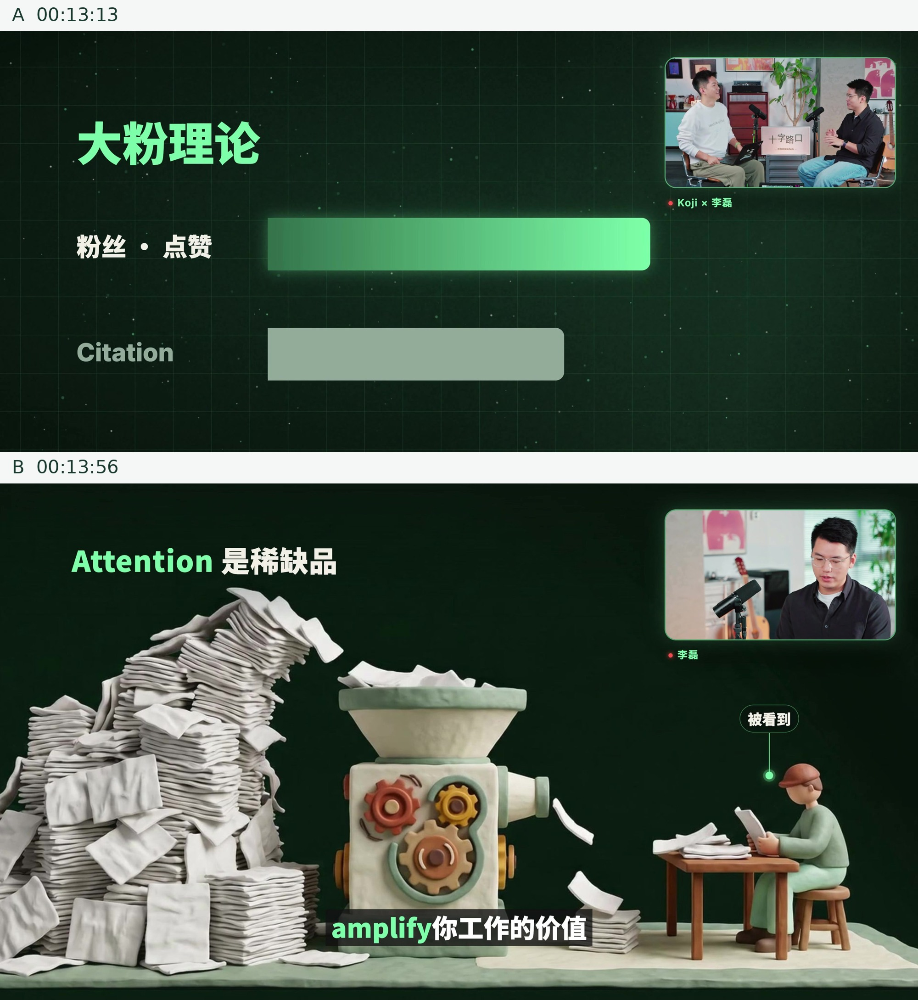

来源：[原视频](https://www.bilibili.com/video/BV1CAHV6PEPM/)，讲解区间 00:13:07–00:13:18；00:13:18–00:13:58。

> 读图
>
> A 将“粉丝·点赞”与“Citation”画成两条无刻度横条来图解“大粉理论”的调侃；B 在“Attention 是稀缺品”标题下，展示海量论文经过筛选机器才到达右侧读者并获得“被看到”的过程。

当单次顶会录用达数千篇时，借助社交与推荐渠道分享工作，能帮助研究穿过信息洪流连接同频同行。

持续的技术分享如何获得反馈，而一项研究本身又靠什么产生长远影响？

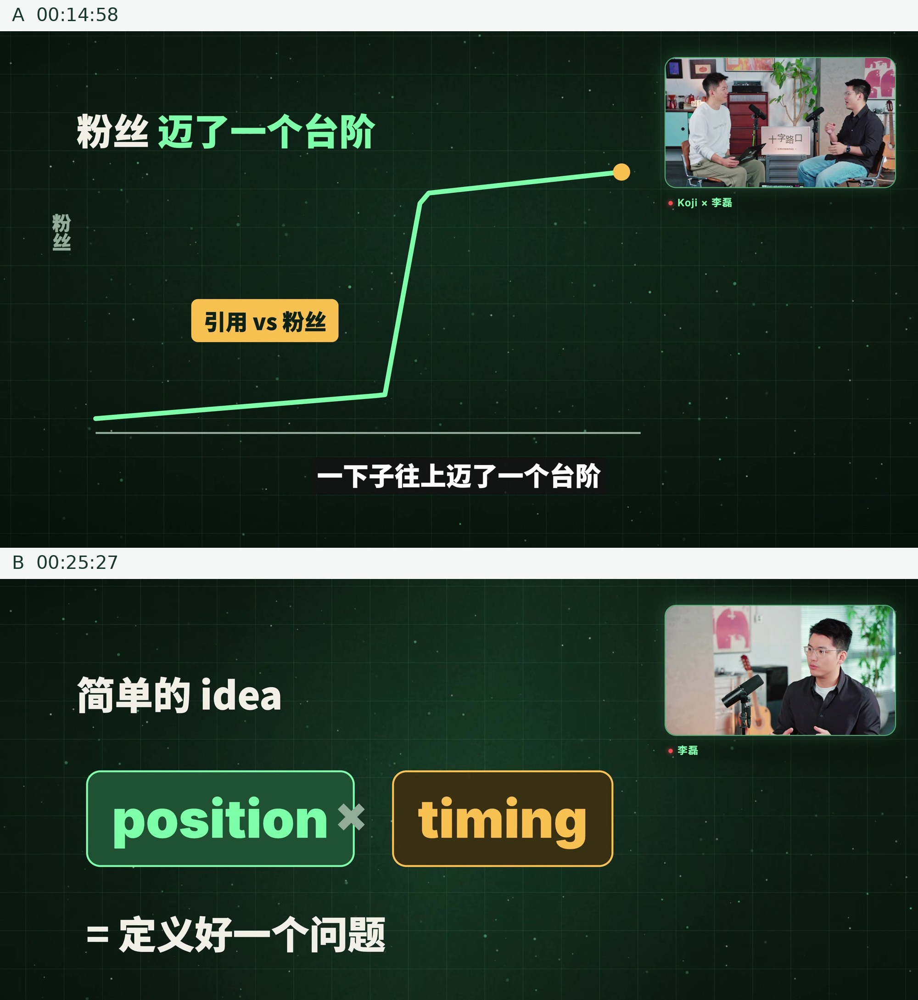

来源：[原视频](https://www.bilibili.com/video/BV1CAHV6PEPM/)，讲解区间 00:14:43–00:14:59；00:25:19–00:25:28。

> 读图
>
> A 用一条先平缓上升、后在“引用 vs 粉丝”节点处跃升的绿色示意曲线，回顾李磊长期发论文笔记到话题破圈的经历；B 用“position × timing = 定义好一个问题”的色块组合，概括 Eric Wallace 等案例中找准问题位置与时机的作用。

传播端靠日常利他输出积累连接，研究端靠在恰当时机定义关键问题，二者共同放大了工作价值。

> **警惕围绕指标的“奖励欺骗（Reward Hacking）”**
>
> 当某种指标被确立为评估标准时，容易诱发针对指标的投机行为。例如：利用大模型批量生成缺乏严密论证的论文去拼顶会录用概率，或只为混取名义上的“贡献者”头衔而刷合并请求（PR）。要穿透表面指标，需要综合核查作者是否真正理清了研究假设与论证、开源仓库的代码数据是否完整、Issues 是否有人持续维护，以及模型在社区中是否有真实的使用反馈。

> **信息过载时代的“大粉理论”与学术分发转移**
>
> “大粉理论”是博士生群体中对“社交媒体粉丝或点赞数超过论文引用数”的戏称，折射出学术注意力分发机制的转变。过去顶会一次录用几百篇论文，研究者可以靠检索关键词和学者名单浏览全部录用列表；如今单次会议录用可达四五千篇，同行越来越依赖推荐系统来筛选阅读内容。通过技术笔记、论文解读进行持续、利他的公开分享，既能放大研究工作的可见度，也能连接研究品味相近的同行。

研究工作评估维度的演变与防伪机制对比

| 评估对象 | 试图解决的问题 | 机制局限与真实性检验 |
|---|---|---|
| 顶会论文录用 | 通过同行评审筛选有价值的学术创新 | 投稿激增使审稿人负荷从两三篇增至约十篇，判断随机性变大；需追问作者是否真正理清假设与严密论证，而非仅看录用结果。 |
| 开源项目贡献 | 考察候选人的工程实现与社区协作能力 | 需区分挂名标签与实际功能修复的深度；重点核查论文配套代码与数据是否完整开源、仓库 Issues 是否有人持续维护。 |
| 模型平台下载量（Hugging Face） | 衡量模型在真实世界中的被采用程度 | 平台按指定文件（如 config.json）的请求计数；下载量需要与用户反馈、Issues 和维护情况结合来看。 |
| 技术社媒分享 | 在数千篇顶会论文中突破信息过载、获取快速反馈 | 争议性观点虽易博眼球但难沉淀专业认可；需坚持“利他、持续、做自己”，以扎实的论文笔记（如 on-policy distillation 解读）吸引同频同行。 |

### 本章小结

1. 理性看待顶会审稿与论文发表：AI 论文激增使审稿人负荷增加、录用随机性变大，论文的本质在于知识分享与严密验证假设，不应将是否录用作为唯一回报，更不应靠批量生成低质稿件消耗审稿资源。
2. 综合考察开源维护与实际采用：面对围绕指标的奖励欺骗（Reward Hacking），代码与数据是否完整开源、Issues 是否持续维护，以及结合平台下载线索与真实用户反馈的采用情况，比名义头衔更能说明工作深度。
3. 将主动传播纳入研究反馈闭环：当顶会录用规模达到四五千篇时，注意力分发高度依赖推荐渠道；研究者可通过“利他、坚持、做自己”的技术分享连接同频同行，同时兼顾运动与身心健康。

## 从基本功到作品，再到合作机会

了解了作品如何被外部同行评估与看见之后，研究者自然会面临内部能力建设的追问：从入学到走向工业界，博士阶段需要锤炼哪些核心能力？如果当前处于既没有论文、也没有实习的空白起点，又该如何完成冷启动？本章梳理李磊结合自身面向工业界成长经历所总结的三阶段路径，并拆解从打磨基本功、培养指导与协作能力，到依靠公开作品集争取早期合作机会的具体做法。

### 独立研究需要哪些基本功

当主持人 Koji 提问如果把读 PhD 从入学到毕业分成不同阶段应该如何划分时，李磊结合自己的成长路径，给出的第一个阶段性节点是：**知道怎样独立做好一项研究，并让它产生一定的影响力**。在他看来，这一阶段包含三层基本功：

1. **学科与系统基础**：涵盖机器学习、统计学以及计算机系统等基础概念。尽管今天看似可以借助 AI 跳过基础课，但李磊强调，亲手从零实现基础算法依然很有必要。他回忆自己早期学习吴恩达在 Coursera 上的课程时，曾用 TensorFlow、NumPy 和 MATLAB 亲手实现过 **SVM（支持向量机，一种经典的监督学习分类与回归算法）**。直到今天，**泛化**（模型对未见过的新数据的适应与预测能力）与**过拟合**（模型在训练数据上表现好、但在未见数据上泛化差的现象）等经典概念依然在大模型系统中运作。计算机系统基础同样在发挥作用：在大模型自回归生成时，注意力键值缓存（**KV Cache**）用于保存历史 token 的 key 和 value，以便生成后续 token 时直接复用；推理框架 **vLLM** 所采用的 **PagedAttention**，正是借用了操作系统中虚拟内存分页的思路来管理 KV Cache，从而减少显存碎片。亲手推导和实现这些基础概念，有助于建立判断系统瓶颈的研究直觉。

2. **科学验证与论文写作**：为了让研究作为知识分享有效传递，研究者需要学会提出清晰的假设，设计严密的实验设置去验证假设，并通过清晰的论文写作呈现出来。李磊提到，在这个过程中 AI 可以充当辅助审稿人或老师，帮忙提修改建议、梳理假设，但研究者本人必须真正理解并主导整个论证链条。

3. **扩大研究影响力**：独立完成一篇论文不仅包括做实验和写文章，还包含做好代码与数据开源，并为工作配备相应的博客、软件工具或社区分享。把基础训练、实验论证与开源传播这三步跑通，才算立住了独立研究的基本功。

在 AI 辅助工具普及的今天，为什么还要亲手实现基础算法并学习计算机系统课？

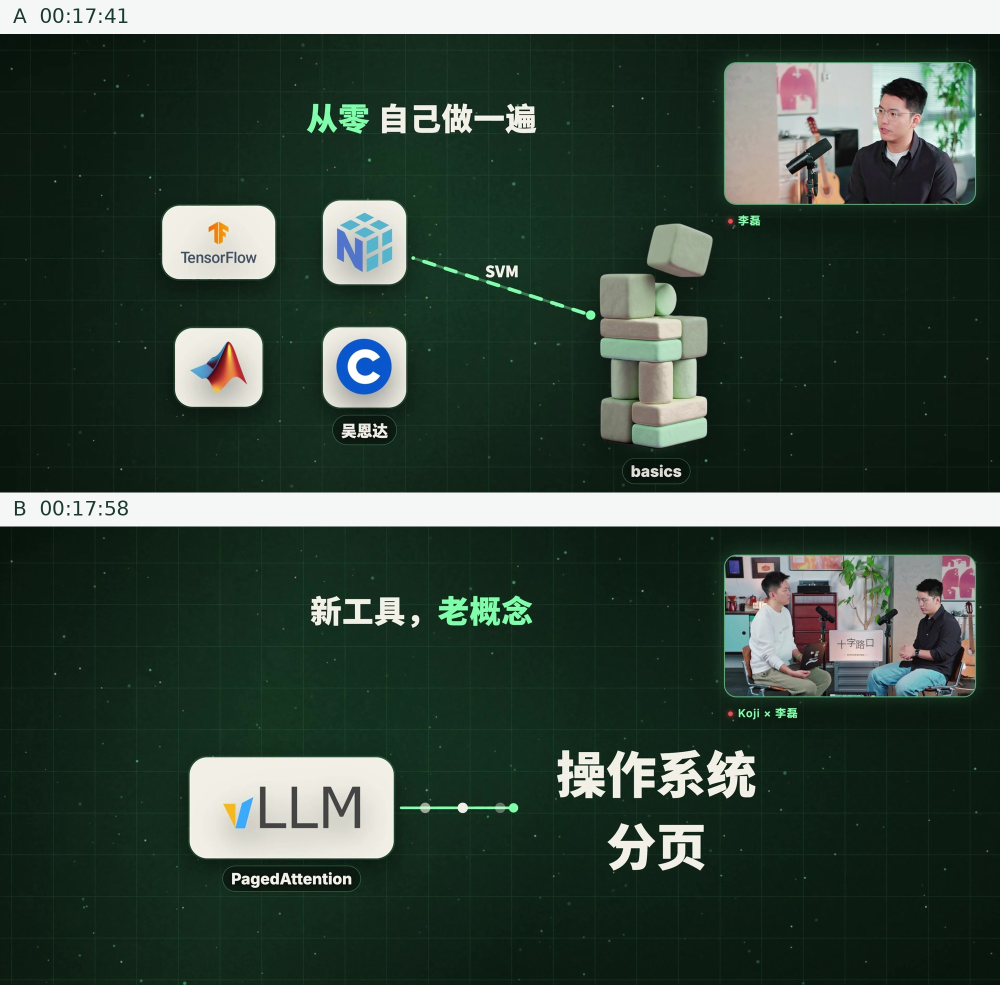

来源：[原视频](https://www.bilibili.com/video/BV1CAHV6PEPM/)，讲解区间 00:17:27–00:17:43；00:17:54–00:18:03。

> 读图
>
> A 将 TensorFlow、NumPy、MATLAB 与 Coursera 图标并列，由“SVM”箭头指向“basics”积木，示意从零动手打基础；B 在“新工具，老概念”标题下，用双向连线将“vLLM / PagedAttention”与“操作系统分页”连接起来。

统计学习与操作系统等经典概念仍在前沿大模型框架中运作，亲手实现有助于建立底层的系统直觉。

### 带别人做研究，是另一种能力

当研究者掌握了独立科研的完整流程后，下一步该如何进阶？李磊将自己体验到的第二个阶段概括为培养**指导与协作能力（Leadership）**。

他特别感谢求学路上遇到的师长——很早的时候，他的硕士导师孙栩老师便提醒学生要有意识地培养带人协作的能力。当高年级学生逐渐熟悉科研流水线之后，就要学习把这套方法传递给更低年级的同学。

在这一过程中，研究者的角色会发生转换：**从自己直接产出想法和代码的“生成器（Generator）”，转变为帮助他人审视问题、把关方向的“评判者与引导者（Critic）”**。根据李磊带低年级同学的经验，指导方式不能套用单一模板，而要根据合作者的自驱程度与所需支持来调整：

- **面对自驱力强的同学**：无论年级高低，只要对方主动性强，指导者只需在关键节点给出一定引导，对方就能迅速把整个研究链路跑通。
- **面对需要更多支持的同学**：指导者则需要提供更密集的督导，手把手地帮助对方把研究框架和实验习惯一步步建立起来。

在完成了独立科研与带人协作的历练后，李磊结合自己的职业方向，将第三个阶段定为**完成从学术界到工业界的转变**。在工业界，研究者将面对更现实的落地约束，以及算力、数据、产品化和工程效率等多维度的竞争；李磊坦言，这也是他目前正在持续学习的阶段。

博士生从完成第一篇独立工作到指导低年级同学，能力重心发生了怎样的变化？

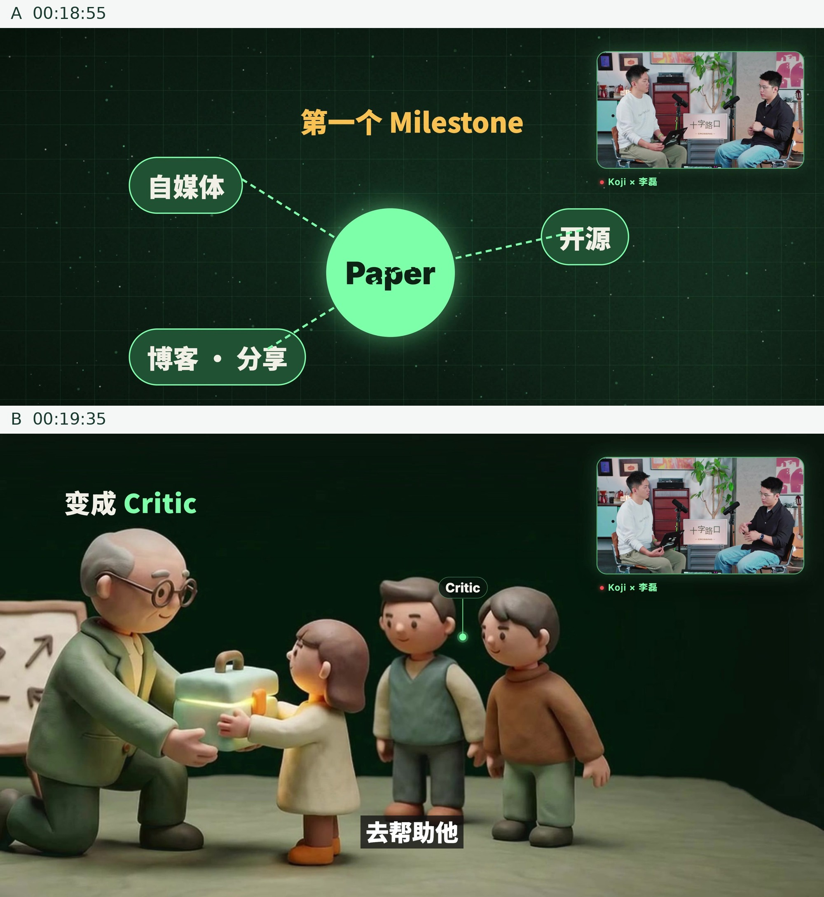

来源：[原视频](https://www.bilibili.com/video/BV1CAHV6PEPM/)，讲解区间 00:18:31–00:19:00；00:19:10–00:19:39。

> 读图
>
> A 以“Paper”为中心，用虚线连接“自媒体”“开源”“博客·分享”，标注为“第一个 Milestone”；B 在“变成 Critic”标题下，展示高年级研究者将研究模块交给学生并在旁提供反馈指导。

先跑通从实验写作到开源传播的单兵闭环，再学会根据合作者特点从 Generator 转向 Critic，是迈向成熟研究者的关键两步。

### 没有论文和实习时，从什么开始

如果一名本科生或低年级研究生既没有发表过论文，也没有实验室实习经历，该如何迈出第一步？面对 Koji 提出的“冷启动”问题，李磊首先回顾了自己的经历：在西安电子科技大学读大二升大三时，他鼓起勇气向外发送了大约十封自荐邮件（Cold Email），最终只收到了一封回复。

正是这唯一的一封回复，来自他后来的硕士导师孙栩老师。孙老师愿意给当时还没有太多科研履历的他一次进组实习的机会，帮他叩开了自然语言处理研究的大门，随后他得以发表顶会论文并顺利保研至北京大学计算语言学研究所。然而李磊指出，今天单纯靠发自荐邮件冷启动的难度已经明显上升：一方面，稍微有些名气的教授邮箱里每天都塞满了申请**研究助理（RA，Research Assistant）**或读博的邮件；另一方面，工业界的招聘名额（HC）在算力成本高昂的背景下变得稀缺。在这种环境下，破局的关键在于主动通过公开产出来展现能力。针对不同方向，他分享了两条能绕开从零训练大模型算力门槛的路径：

- **偏工程与产品方向：构建 GitHub 项目、Harness 或应用**。一个扎实的 GitHub 开源项目、一套好用的评测与调用脚手架（Harness），或者一个有创意的应用程序，通常不需要庞大的训练算力，却能直接展现编码与产品构建能力。
- **偏研究方向：撰写严谨的技术博客与推导笔记**。在许多人用 AI 生成粗糙文字的当下，静下心来把基础原理理顺，在 Notion 或个人网站上一篇篇写好研究博客，并搭配小规模实验去验证改进思路，反而很有辨识度。李磊以现为月之暗面（Kimi）研究员的苏剑林为例：苏剑林早期同样没有特别庞大的算力，但他长期在个人博客上撰写数学推导与模型分析，并由此推导出后来被广泛采用的 **RoPE（旋转位置编码，一种通过旋转矩阵在注意力机制中融入相对位置信息的方法）**。李磊自己在大二、大三时也曾因为写技术博客，被金山 Office 团队看到并主动联系提供软件开发实习机会；虽然他当时因为一心想做机器学习与自然语言处理而没有接受那个岗位，但这次经历直观说明了公开作品对冷启动的帮助。

在向外联系的过程中，收到大量未回复等负反馈是常态。李磊鼓励道，把持续输出当成学习过程，整理出清晰的作品集，就像计算机算法中的**冒泡排序（Bubble Sort）**一样——在持续迭代中把扎实的工作做出来，就更有机会一步步“冒”上去，让别人看到你的能力。

主持人 Koji 补充了《巴拉巴西成功定律》中的两个观察来呼应这种“持续构建”：其一，研究者分析诺贝尔奖得主的发表轨迹发现，代表作在何时诞生并没有固定规律，得主自己也无法预知哪一篇会成为代表作，因此需要保持持续产出；其二，艺术界中一幅画作往往无法直接进入大都会博物馆，但馆藏借展流通网络中存在一些名气不算顶尖、却更容易触达的市政博物馆充当关键节点，作品进入这些节点后更容易流向大型展馆。对应到青年研究者的冷启动，一边通过公开作品持续积累，一边主动连接那些可达性高的合作导师或开源社区节点，有助于一步步打开局面。

本科生如何从零开启科研路径，并在缺乏算力时做出有辨识度的研究输出？

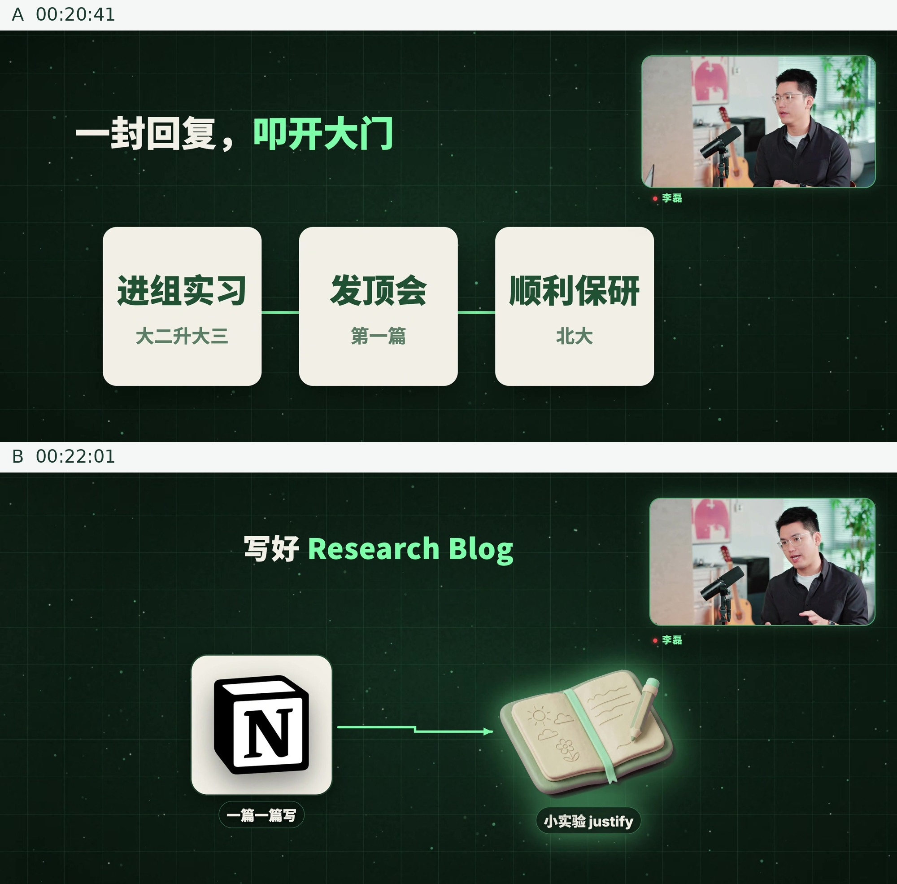

来源：[原视频](https://www.bilibili.com/video/BV1CAHV6PEPM/)，讲解区间 00:20:29–00:20:44；00:21:43–00:22:02。

> 读图
>
> A 用三张串联卡片“进组实习（大二升大三）→ 发顶会（第一篇）→ 顺利保研（北大）”回顾李磊获孙栩老师回复后的成长链路；B 将“Notion / 一想一篇写”指向标有“小实验 justify”的笔记本，示意用小实验支撑博客推导。

当自荐邮件竞争加剧时，把基础原理理顺并附上小实验验证的研究博客，能成为有力的能力证明。

公开作品集如何带来意想不到的机会，又该如何理解外部合作网络中的节点作用？

来源：[原视频](https://www.bilibili.com/video/BV1CAHV6PEPM/)，讲解区间 00:22:46–00:23:02；00:23:49–00:24:20。

> 读图
>
> A 展示“我的博客”经“联系到我”箭头指向“金山 Office 实习”，下方标注“还是想搞 ML”，对应李磊本科因博客获得机会但选择继续深耕机器学习的经历；B 用绿色路径连接小型展馆与大型博物馆，图解主持人引述的馆藏借展流通网络。

一边持续打磨公开作品集完成“冒泡”，一边主动连接可达性高的实验室或社区节点，能逐步拓宽合作通道。

> **系统与算法基础的跨界复用：以 PagedAttention 为例**
>
> 在探讨基本功时，李磊提到 vLLM 框架中的 PagedAttention。在大模型自回归生成过程中，历史 Token 的注意力键值缓存（KV Cache）体积庞大且长度动态变化，传统连续显存分配容易造成严重的显存碎片与浪费。PagedAttention 借鉴了经典操作系统中“虚拟内存分页（Paging）”的思想，将连续的 KV Cache 切分为固定大小的块（Blocks），存放在非连续的物理显存空间中，并通过块表进行映射管理。这一例子直观说明：扎实的计算机系统、机器学习与数学推导功底，往往是解决前沿大模型工程与算法瓶颈的灵感源泉。

> **Generator 到 Critic：高年级博士生的角色跃迁**
>
> 在熟悉独立科研流程后，研究者的成长不仅在于自己多写代码或论文（Generator），还在于学习指导与协作，转化为能够帮合作者审视问题、把控实验方向的引导者（Critic）。面对不同合作者，需根据其自驱力与所需支持程度调整指导方式——对自驱力强的同学重在点拨方向，对需要更多支持的同学则通过密集督导帮其建立研究流程。

科研与工程冷启动路径对比

| 对象 | 解决的问题 | 机制与取舍 |
|---|---|---|
| 传统 Cold Email 自荐 | 直接向导师或团队争取实习名额 | 在教授日均邮件激增、企业算力与 HC 受限的背景下，回复率极低，需配合公开作品集使用 |
| 工程与产品作品集（GitHub / Harness / App） | 在缺乏大规模训练算力时展示工程与创新能力 | 绕开从零训练大模型的算力门槛，直观展示编码与产品构建能力，契合偏工程或应用类岗位 |
| 深度研究博客（数学推导 / 小规模验证实验） | 在无顶会论文与算力时展现研究品味与基本功 | 以严谨推导和玩具实验区别于粗糙的生成内容，帮助研究型团队了解作者的研究基础与思考过程 |

### 本章小结

1. 面向工业界的研究能力进阶可分为三步：先通过打牢机器学习与系统基础、严密验证假设及开源传播立住独立研究基本功；再学习从单兵产出的 Generator 转向指导协作的 Critic；随后适应工业界的多维竞争环境。
2. 基础概念与系统原理依然关键：无论是泛化、过拟合等统计学习概念，还是 vLLM 中 PagedAttention 借鉴操作系统分页管理 KV Cache 的思路，亲手推导与从零实现都有助于建立研究直觉。
3. 用公开作品集辅助冷启动：当导师邮箱饱和且企业招聘名额受算力约束时，初学者可通过 GitHub 项目、Harness 工具或像苏剑林推导 RoPE 那样的严谨研究博客展示能力，并主动连接可达的合作节点。

## 导师、地域和学位，怎样围绕自己的目标选择

当个人具备了初步的研究产出与合作基础后，随之而来的是更具体的长期规划问题：在申请阶段该如何权衡学校名气与导师风格？内地、香港与美国等不同地区，以及当下的教授创业潮，会给博士生活带来怎样的资源与任务变化？当本科生也有机会进入顶尖 AI 实验室时，读博本身的价值又该如何界定？本章围绕这些选择展开讨论。

### 选择导师之前，先体验合作

在申请博士时，候选人面临的第一个具体决策往往是“选学校还是选导师”。面对主持人 Koji 的提问，李磊明确表示：**选学校的优先级低于选导师，甚至可以说远远低于选导师**。

他解释道，如果能去更好的平台当然尽量去，像计算机领域的“四大名校”与 Top 30 高校之间确实存在光环差距；但在李磊看来，Top 30 与 Top 50 的学校之间往往没有太大本质区别。相比于学校排名的细微差异，**课题组与课题组之间的差异（Variance）要大得多**。因为读博在很大程度上类似于传统的师徒制，而国内外课题组的运行模式高度因人而异：就他的观察而言，国内部分课题组更偏向“上下级”关系，而其他一些地方的导师则更像提供指导的合作者。

既然课题组的内部生态如此重要，申请者该如何提前了解？李磊建议重点看课题组已毕业校友的两个维度：一是职业或学术成果，二是**精神状态**。主持人追问“精神状态怎么看”，李磊表示，就是私下向在读博士生和已毕业的师兄师姐打听，看大家是不是在比较快乐的状态下读博。学术界确实存在一些“著作等身但过程非常痛苦”的个案；相对而言，他曾就读的北京大学计算语言学研究所以及目前所在的香港大学 NLP 组（HKU-NLP），都属于氛围轻松愉快的地方。

然而，仅靠外部检索很难看清一位导师的全貌。去浏览导师的 Google Scholar、CSRankings 或公开演讲，看到的都只是公开信息；而日常指导风格、沟通方式等私密维度的匹配度，往往需要通过一段时间的实际合作才能体会出来。李磊分享了自己的经历：在正式去香港大学读博之前，他曾在上海 AI Lab 实习，期间与现在的联合导师孔令鹏老师合作了大约半年时间，在实际共事中确认双方的风格比较契合。因此他建议，如果时间允许，同学可以先去目标课题组做 **RA（研究助理）**，在接触在读与毕业生的同时亲身体验组内风格，从而在双向选择中做出判断。

为什么说读博像传统的师徒制，且不同课题组的日常相处体验差异很大？

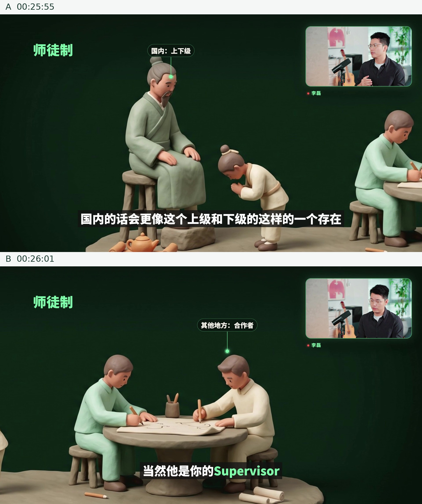

来源：[原视频](https://www.bilibili.com/video/BV1CAHV6PEPM/)，讲解区间 00:25:42–00:26:02。

> 读图
>
> A、B 两幅画面构成直观对比：A 中一人站立在高处、另一人俯身，标注为“国内：上下级”；B 中两人同桌平坐讨论，标注为“其他地方：合作者”，概括李磊对不同指导风格的印象。

由于导师风格因人而异且直接决定读博体验，选导师时不能只看学校名气，而要深入考察组内实际相处模式。

既然公开排名看不出课题组的内部差异，申请者该如何确认自己与导师是否合适？

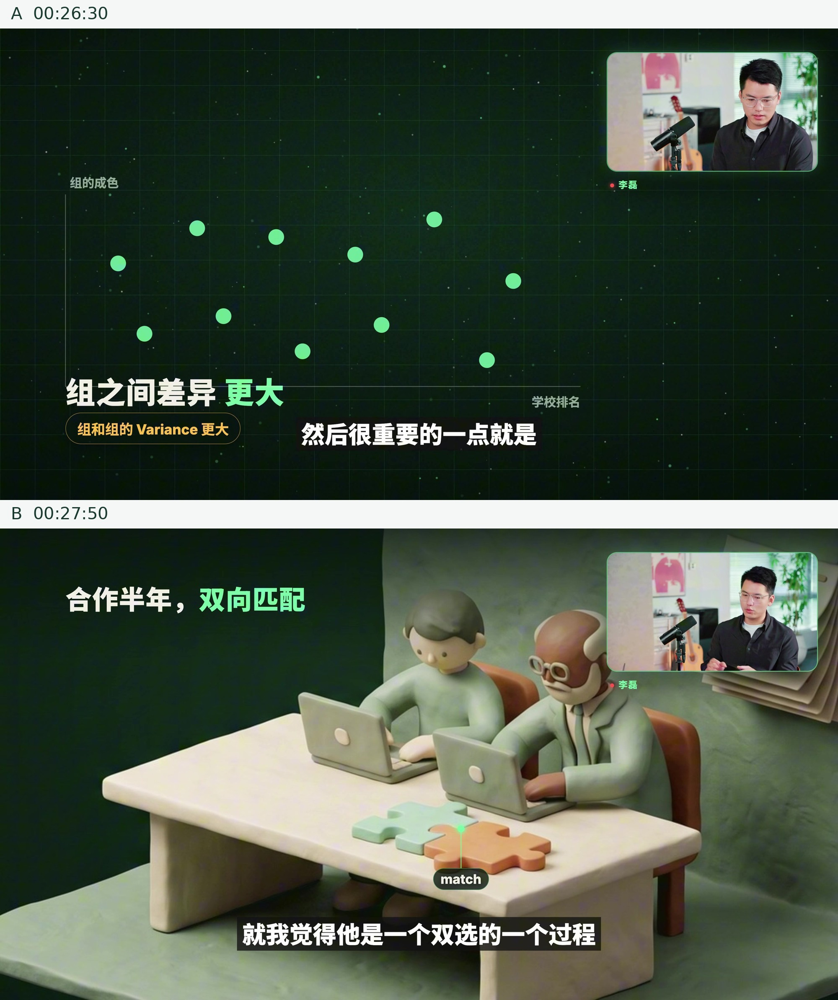

来源：[原视频](https://www.bilibili.com/video/BV1CAHV6PEPM/)，讲解区间 00:26:10–00:26:33；00:27:32–00:27:52。

> 读图
>
> A 在二维平面上分布多枚绿色散点，配文“组之间差异更大 / variance 更大”，示意课题组差异大于院校排名微小差距；B 展示师生在同一电脑前协作，桌上拼图标有“match”，标题为“合作半年，双向匹配”。

像李磊在上海 AI Lab 与孔令鹏老师合作半年那样，通过实际共事来检验沟通与科研风格，比只看公开主页更可靠。

在正式入学前做一段研究助理（RA），具体能帮申请者看清哪些信息？

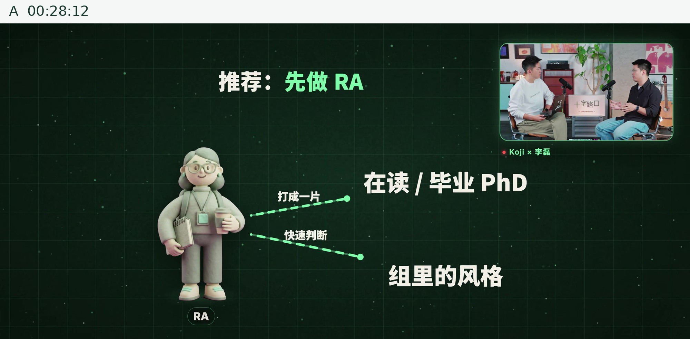

来源：[原视频](https://www.bilibili.com/video/BV1CAHV6PEPM/)，讲解区间 00:27:52–00:28:12。

> 读图
>
> 单幅画面中，中心的“RA”人物向右通过“打听一下”箭头连接“在读／毕业 PhD”，向左通过“快速判断”箭头连接“组里的风格”，呈现前置实习的两条信息获取路径。

利用 RA 机会接触组内同学、观察大家的精神状态与工作节奏，能有效降低盲目选组的风险。

### 地域和创业资源会怎样改变博士生活

选定导师的同时，博士生还身处特定的地区环境与课题组资源结构之中。针对主持人提出的“在内地、香港和美国读 PhD 各有哪些优劣”，李磊结合自身体会与身边朋友的反馈进行了对比：

- **内地高校**：优势在于贴近产业界，学生能够更快地接触并进入工业界；潜在挑战在于部分课题组带有传统师徒制色彩，且在高校考核下承受着“横向项目”（通常指与企业合作的经费项目）等压力。如果导师未能平衡好这些考核，指导动作可能变形，因此申请时需留意筛选能平衡好项目运转与学生培养的老师。
- **香港高校**：既与内地保持着密切融合，又凭借独特的区位条件吸引了背景多元、很有活力的年轻师资；同时，香港本地也有居住与生活成本方面的压力。
- **美国高校**：李磊表示自己并未亲身留美，但据身边朋友反馈，当前赴美读博面临签证以及 **CPT（美国 F-1 学生签证持有者进行校外课程相关实习的许可）** 等问题，找实习的难度有所增加；其优势则在于更接近硅谷及美国的学术与产业圈。

当主持人追问什么样的画像适合去不同地区时，李磊开玩笑说，去美国首先得“耐得住美食的寂寞”，因为每次从美国回来的同学都要大吃特吃一番；严肃来看，这取决于个人对文化氛围的偏好，而在内地和香港读博，关键在于能否在一定的外部项目或生活压力下平衡好各项事务。

除了地区差异，当前学术界另一个常见变量是“教授创业潮”。面对主持人“PhD 们怎么看自己老板创业”的提问，李磊将导师创业比作硬币的两面：正面看，原本高校课题组受限于经费管理制度，在买算力卡、招工程师和买数据方面容易受限；而导师成立初创公司并融资后，公司实体能更灵活地聚齐算力、工程与数据要素，起到杠杆加速作用，支撑更大的项目。反面看，一旦拿了投资，资金方也会有回报与进度要求，这种压力可能层层传导给学生，使学生需要承担一些学术以外的工程杂活（Dirty Work）。因此，面对导师创业，学生需要结合自身不同阶段的需求来权衡资源与代价。

在内地与香港攻读博士学位，各自面对怎样的产业连接与现实环境？

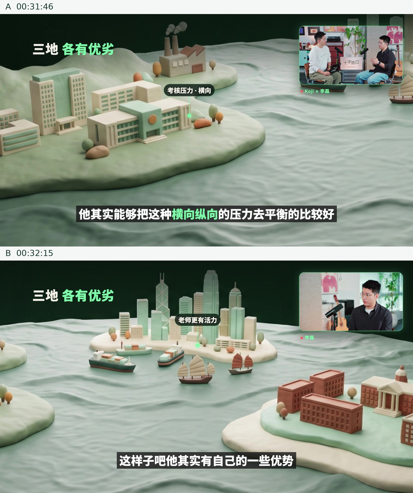

来源：[原视频](https://www.bilibili.com/video/BV1CAHV6PEPM/)，讲解区间 00:31:12–00:31:51；00:31:51–00:32:19。

> 读图
>
> A 在“三地各有优势”下将大学与工厂建筑并置，标注“考核压力·横向”，示意内地贴近产业但部分课题组有横向项目考核压力；B 展示港口与城市建筑连接多地，标注“老师更有活力”，示意香港融合内地与国际背景的师资特点。

选择内地或香港读博，关键在于筛选能平衡好项目压力的导师，并适应当地的生活与科研节奏。

结合同伴反馈，赴美读博在学术产业网络与现实约束上呈现怎样的特点？

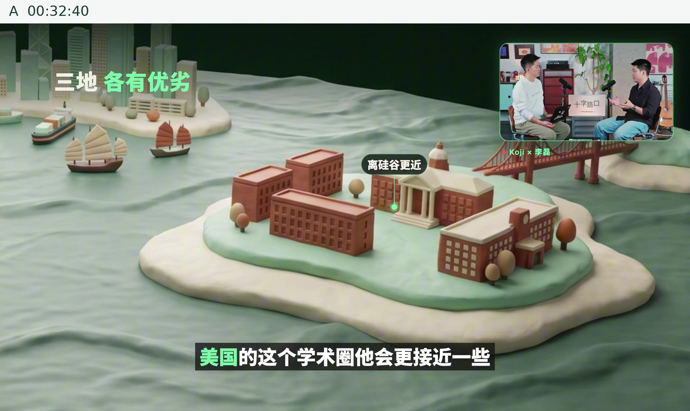

来源：[原视频](https://www.bilibili.com/video/BV1CAHV6PEPM/)，讲解区间 00:32:23–00:32:43。

> 读图
>
> 画面展示一组大学建筑并标注“离硅谷更近”，用来示意部分美国高校在接触当地核心技术圈与学术社区方面的便利。

将当地学术产业网络的接近性与签证、CPT 实习限制放在一起权衡，有助于根据个人偏好做出选择。

### 把读博的期待和进入 AI Labs 分开想

既然高校普遍面临算力与资源约束，今天在 AI 领域还有必要读 PhD 吗？在日常交流中，不同阶段博士生关心的话题本身就在分化：李磊提到，博士生们聚在一起聊学术以外的话题时，聊得最多的是薪酬总包（Package），像他自己处于博士四年级求职阶段，自然会关心工作机会；而低年级同学则更多在思考什么研究方向值得做，好奇工业界在关心什么问题，希望毕业时能顺利衔接。

针对主持人“很多人觉得学校没算力没资源，不如直接去公司，还有必要读 PhD 吗”的追问，李磊认为，这取决于**对 PhD 的期望是什么**：
- **如果读博只是为了拿一块进入大公司或 AI Labs 的敲门砖**：那未必有必要。李磊举例说，像研究员 Jason Wei 最初就是以本科生背景进入研究机构开启研究路径的，行业里甚至有做出亮眼成果的高中生。能否进入前沿实验室，关键看做出的工作本身，而不是由一纸博士学位决定的。
- **如果希望有一段相对完整的时间去探索好奇心**：那么读博依然很有价值。在博士阶段，如果能找到合适的课题组，学生相当于有四到五年相对完整的时间，去追问一些自己好奇、且自己不做别人未必会帮着回答的问题，并在这一过程中补齐知识、学习如何扩大研究影响力。人活八十岁，用五年时间去完成这样一段探索旅程，在他看来是值得的。

回到李磊自己当初的选择，他在访谈开篇坦言，硕士毕业前也曾为是否读博纠结了很久。考虑到工业界待遇与学术界的落差，读博的机会成本很大。但他最终问了自己一个问题：**如果十年以后躺在床上回想，自己会不会因为没有去读 PhD 而后悔？**想到钱可以以后再赚，而当下有一段能做自己想做之事的经历很难得，他便选择了读博。

这段旅程在 2023 年入学后不久迎来了一个戏剧性的节点。李磊在北大硕士最后阶段，曾与师弟们合作完成论文 *Label Words are Anchors: An Information Flow Perspective for Understanding In-Context Learning*。在他入学香港大学后参加的第一个国际会议 EMNLP 2023 上，他不仅有自己的工作被录用，这篇与师弟们合作的论文还获得了最佳论文奖（Best Paper Award）。李磊回忆道，尽管受过硕士阶段的科研训练，但刚入学时对于能否顺利达到博士考核标准心里其实还在“打退堂鼓”；这次获奖既验证了他此前快速迭代、选难而重要问题的研究打法，也让他提醒自己不要“出道即巅峰”，并由此开启了后续在香港大学与工业界并行的研究生活。

面对工业界优渥待遇带来的机会成本，该如何衡量是否要用五年时间去读博？

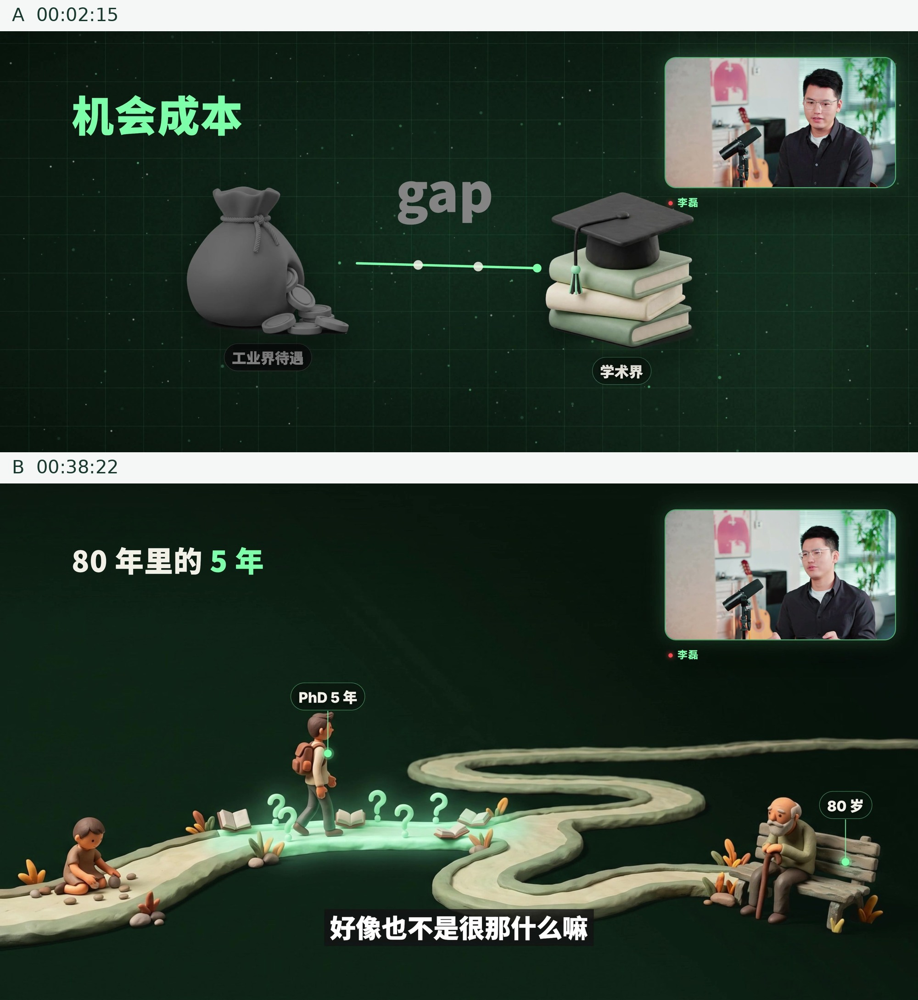

来源：[原视频](https://www.bilibili.com/video/BV1CAHV6PEPM/)，讲解区间 00:01:59–00:02:19；00:37:54–00:38:24。

> 读图
>
> A 将代表“工业界待遇”的钱袋与代表“学术界”的书本学位帽并置，中间标出“gap”示意待遇落差；B 在一条弯曲道路上标出“PhD 5 年”与“80 岁”，配文“80 年里的 5 年”，呈现李磊衡量这段经历的时间视角。

如果目标不只是拿大公司敲门砖，而是希望在八十年人生中留出五年完整时间探索好奇的问题，读博便具有独特的个人价值。

> **选导师与课题组的“穿透式”考察清单**
>
> Google Scholar 引用量、CSRankings 排名或公开演讲提供的是课题组的公开产出信息，难以完全呈现日常指导中的沟通细节。结合李磊的经验，申请者可通过以下方式了解课题组：
> 1. **看校友去向与精神状态**：除了解毕业生的去向外，私下联系在读生与毕业生，打听大家是否在相对快乐的氛围中做研究。
> 2. **了解课题组的项目与资源结构**：关注组内横向与纵向项目的平衡情况，以及若导师创业，相关商业项目对学生日常任务的具体影响。
> 3. **有条件时先通过 RA 体验合作**：在正式入学前争取担任研究助理（RA）或实习生，在实际共事中判断双方的工作节奏与风格是否匹配。

> **区分“学历通行证”与“博士训练期”**
>
> 思考是否攻读 AI 博士，可以把职业准入条件与个人探索诉求分开衡量：
> - **前沿实验室的准入逻辑**：许多研究岗位看重候选人解决实际技术问题的能力与具体作品，博士学位并非唯一通道。
> - **PhD 阶段的训练价值**：在合适的导师与课题组支持下，读博能争取到四五年相对完整的时间窗口，用于追问好奇心驱动的研究问题，并系统锻炼独立科研与指导协作能力。

不同地域与导师创业形态下的读博环境对比

| 选择维度 / 类型 | 核心优势与资源 | 潜在压力与需要权衡的代价 |
|---|---|---|
| 内地高校读博 | 贴近国内产业界，进入工业界实习与转化的路径更短 | 部分组偏传统师徒制；高校考核与横向项目压力可能使指导动作变形 |
| 香港高校读博 | 与内地产业及学术联系紧密；兼具国际化枢纽优势，师资年轻有活力 | 本地生活与居住成本高，需适应快节奏的生活压力 |
| 美国高校读博（据同伴反馈） | 据朋友反馈，更接近硅谷及美国的学术与产业圈 | 面临签证审查与 CPT 实习许可限制，校外实习难度有所增加 |
| 跟随创业型教授读博 | 融资后能快速聚齐算力卡、工程师与高价数据，发挥资源杠杆作用 | 资金方的回报与进度要求可能向学生传导，带来学术以外的工程杂活（Dirty Work） |

### 本章小结

1. 选导师的优先级高于学校排名：不同课题组在管理风格与指导模式上差异很大，申请者除查看公开信息外，可私下了解在读及毕业学生的精神状态，并在有条件时通过 RA 实习完成双向匹配。
2. 结合自身需求权衡地区与导师创业：内地贴近产业但需留意项目考核压力，香港连接内地且师资多元但生活成本高，美国接近当地核心学术产业圈但据反馈存在签证与 CPT 实习限制；导师创业能加速聚齐算力、工程与数据资源，也可能带来学术之外的工程杂活。
3. 把读博期待与进大公司分开衡量：博士学位不是进入前沿 AI 实验室的唯一通行证；读博的价值在于争取一段完整时间去探索好奇的问题、系统打磨研究能力，减少人生留白的后悔。

## 从后训练直播看数据与研究自动化

从个人的求学规划转向一线工业界的技术演进，2026 年的大模型研发呈现出几个清晰的变化：模型通过智能体（Agent）脚手架与大规模强化学习后训练深入真实工作流，数据供应链围绕模型短板快速演化，递归自我改进（RSI）的信号也在增强。理解模型能力如何落地、高价值数据因何紧缺以及研究自动化的边界，有助于看清接下来需要人类研究者发力的空间。

### Agent 和后训练，让模型能力进入工作流程

当主持人 Koji 问及 2026 年 AI 带来的“顿悟时刻（Aha Moment）”时，李磊首先提到了 **Agent（智能体，结合工具调用与外部环境交互以执行多步任务的系统）** 范式被推向前台。回顾自己的研究经历，李磊最早做自然语言处理时，处理的还是判断句子情感正负向的分类任务；随后模型能力增强，开始能做机器翻译、写作文；而到了今天，当模型配备了工具调用（Tool）和外部脚手架之后，便能自动化地帮用户完成许多复杂事务，触达日常生活的各个角落。展望下一步，李磊期待已经在数字世界展现出丰富能力的模型，未来向物理世界延伸时能碰撞出更多火花。

在模型训练侧，另一个引起广泛讨论的实践是李磊参与推动的 **MiMo-V2.6 Pro 与 Flash 两款模型的后训练直播**。这场直播展示的是大模型**后训练（Post-training）阶段的强化学习（RL，通过奖励信号优化模型策略）过程**及部分实时训练指标，而非从零开始的完整预训练。在早期内部训练中，团队观察到大规模强化学习后训练能像 R1 那样带来多方面的能力提升。当主持人追问为什么要把后训练过程搬到网上直播时，李磊解释了团队的考量：
- **建立信心与正向引导**：当时行业内有一些传言和讨论，对国内大模型的整体形象不利；同时，大规模强化学习对底层基础设施（Infra，分布式训练与集群调度系统）、数据质量及算法的要求很高。团队希望通过体面、透明的直播方式向社区展示，这条技术路线可以做出来且效果不错。
- **配合开源**：延续开源思路，把该开源的成果开放出来。
- **吸取社区反馈**：通过直播听取外部意见，对做得不足的地方及时吸收改进，把做得好的部分进一步放大。

直播上线后，团队在国内外收到了侧重点不同的反馈。李磊归纳道，在他收到的反馈中，**国内观众很关心实时花费的费用**——因为直播页面直接挂出了金额，点开网页就能看到资金消耗；而**国外不少推特（X）评论则对训练的透明程度感到惊讶**，认为这是少见的工业级训练直播。外界平时往往觉得大模型训练过程颇为神秘，而这次直播将类似 **TensorBoard（机器学习训练监控面板）** 的训练动态曲线展示出来，为研究者分析训练过程提供了丰富的参考。

从早期的自然语言处理任务到今天的智能体，模型触达现实生活的方式发生了什么变化？

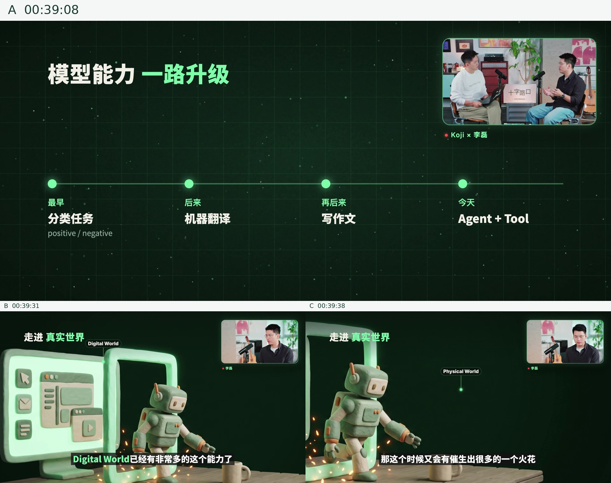

来源：[原视频](https://www.bilibili.com/video/BV1CAHV6PEPM/)，讲解区间 00:38:53–00:39:11；00:39:28–00:39:41。

> 读图
>
> 上方全宽的 A 按时间线依次列出“早年分类任务 → 后来机器翻译 → 再后来写作文 → 今天 Agent + Tool”；下方左右并排的 B 与 C 展示机器人从标有“Digital World”的网页屏幕走向标有“Physical World”的桌面场景。

工具调用与脚手架让模型在数字工作流中落地，而向物理世界具身场景的延伸则是接下来值得期待的方向。

MiMo 团队为什么要把高门槛的大规模强化学习后训练过程搬到网上公开直播？

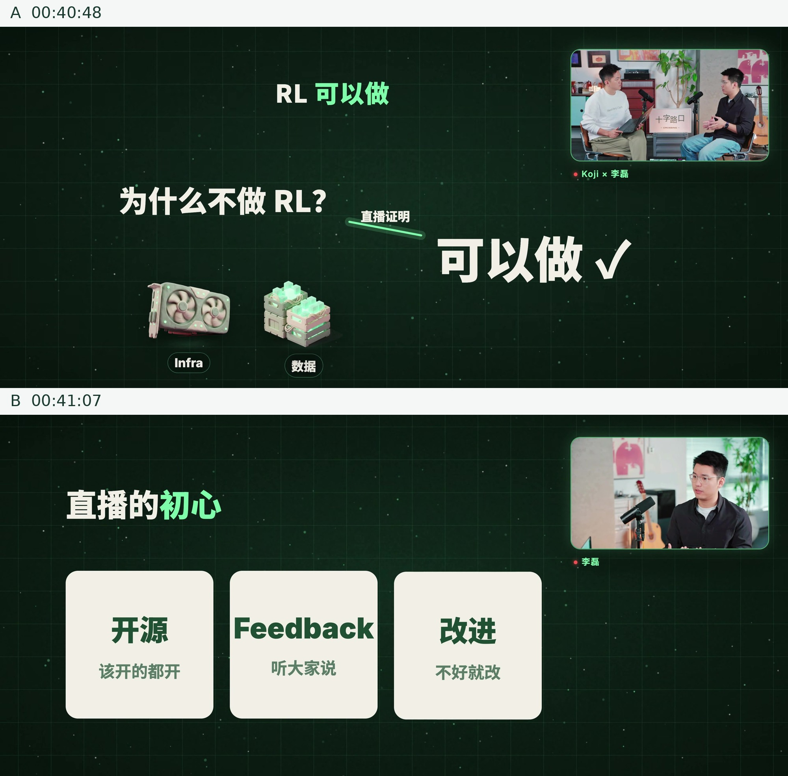

来源：[原视频](https://www.bilibili.com/video/BV1CAHV6PEPM/)，讲解区间 00:40:21–00:40:49；00:40:54–00:41:09。

> 读图
>
> A 在“为什么不做 RL”与“可以做”之间标出“工程证明”，下方列出“Infra”和“数据”两项高要求投入；B 在“直播的初心”下并列三张卡片：“开源（该开的都开）”“Feedback（听大家说）”与“改进（不好就改）”。

公开后训练过程既用实际工程表现回应了外部讨论，也建立起开源分享与吸收社区反馈的互动通道。

在工业级后训练直播中展示训练日志指标，对外部研究者意味着什么？

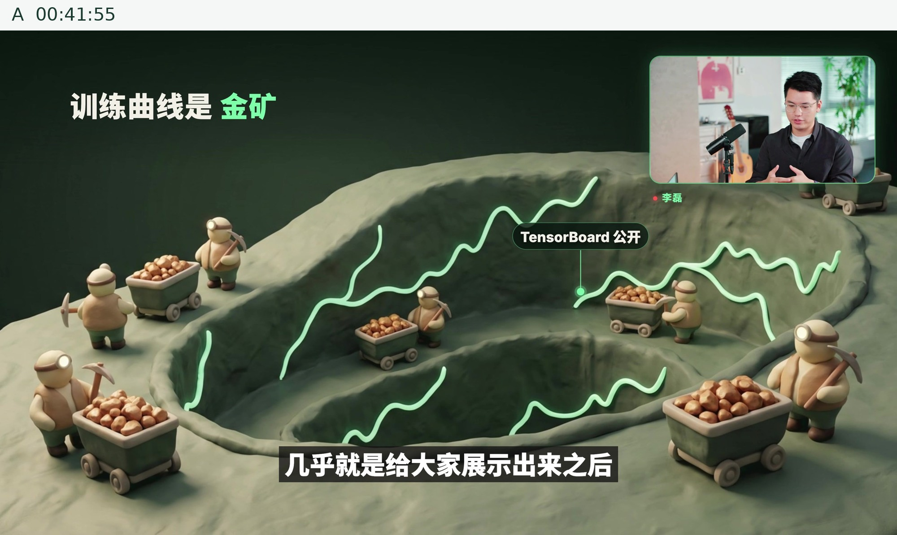

来源：[原视频](https://www.bilibili.com/video/BV1CAHV6PEPM/)，讲解区间 00:41:44–00:42:05。

> 读图
>
> 画面展示多条不同走向的绿色示意曲线，上方标有“TensorBoard 公开”，下方标题为“训练曲线是金矿”，表达公开训练动态（Dynamics）可供同行观察与分析。

将平时较少对外展示的后训练动态呈现出来，为社区理解大规模强化学习过程提供了直观线索。

### 数据的价值取决于模型还缺什么

后训练直播直观体现了基础设施、算法与数据对模型效果的共同作用。主持人 Koji 由此追问：近期市场上出现了一批高估值的“数商”（向训练团队提供专业数据集的数据供应商），它们为何受到认可，这门生意又能持续多久？

在李磊看来，大模型往下拆解，核心投入在于**算力、数据与人才**，这三样在今天都不便宜。好数据源自人类智能的源头：早期做题类等常规数据获取相对容易，但如今数据生产的复杂度和质量要求都明显提高。正如第一章所言，模型的能力边界呈“锯齿状”分布；随着模型能力演进，数据公司只有顺应能力前沿去寻找那些尚未被覆盖的缝隙，并建立起规模化的专家组织与激励体系来完成批量交付，才能持续产生新价值。

为什么大模型公司不全部自己生产数据，而要花钱向外部购买？李磊从研发资源取舍的角度解释：模型公司自己做数据会分散研发团队精力并占用算力；在推进智能前沿的过程中，**时间是不可逆的资源**，采购高质量数据是在帮训练团队节省时间。但这门生意也是动态分化的：随着模型自身能力提升，模型合成常规数据的能力随之增强，普通数据的生产成本会大幅下降，停留在常规数据区间的公司将面临激烈竞争；反之，能够持续建立高阶数据产线的团队，其优势会被放大。

面对主持人“什么样的能力才能让高质量数据产线持续运转”的追问，李磊结合一线训练经验，提出了三个关键点：
- **数据质量与难度是相对于特定模型而言的**：如果数据太难而当前接入的模型能力太弱，模型根本学不会；团队需要积累实践经验（Know-how），结合当前模型的能力水位来定义恰当的数据难度。
- **平衡演示传播价值（PR Value）与实际经济价值**：有些数据做出的模型演示（Demo）很酷炫，具有传播价值；另一些数据则让模型真正掌握某项技能，从而带来实际经济价值。团队需要在这两种价值考量之间做好权衡与平衡。
- **招募领域专家并建立规模化产线**：高阶数据依赖各领域的专业人士，如何招募专家并组织成稳定的规模化产线，决定了交付能否跑通。

为什么专业数据供应商在当前的大模型研发链条中受到重视？

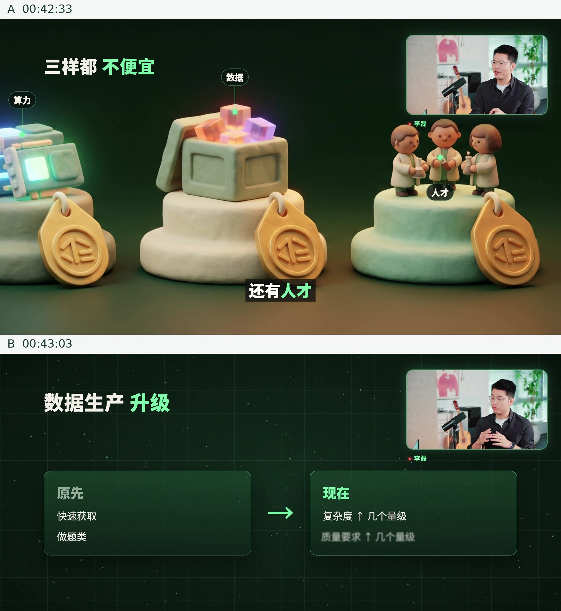

来源：[原视频](https://www.bilibili.com/video/BV1CAHV6PEPM/)，讲解区间 00:42:23–00:42:36；00:42:49–00:43:05。

> 读图
>
> A 将“算力”“数据”“人才”三组图标分别配上钱袋，标为“三样都不便宜”；B 在“数据生产升级”下，将左侧“原先：快速获取 / 做题类”与右侧“现在：复杂度提高 / 质量要求提高”进行对比。

当训练需求从常规做题转向填补模型高阶能力缺口时，能够组织专家完成高质量交付的数据团队便具备了市场价值。

随着模型自身合成数据的能力增强，外部数据供应生意会经历怎样的分化？

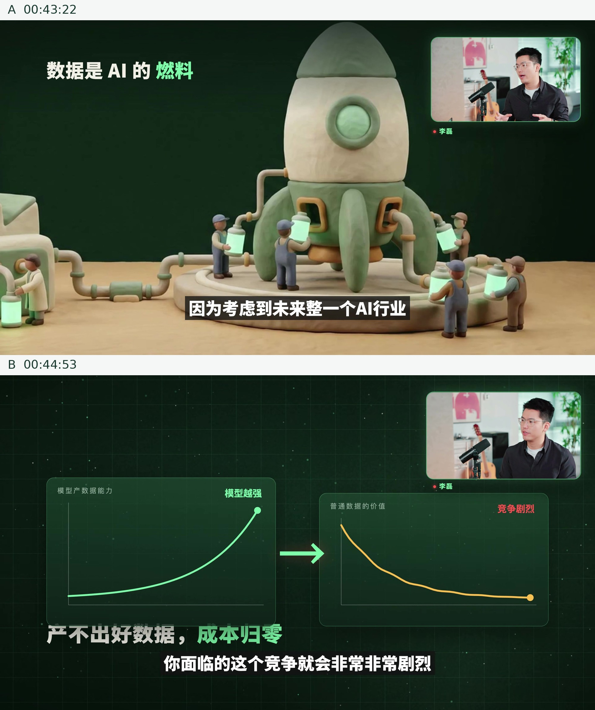

来源：[原视频](https://www.bilibili.com/video/BV1CAHV6PEPM/)，讲解区间 00:43:18–00:43:30；00:44:39–00:44:56。

> 读图
>
> A 将数据设施通过管道连向火箭，配文“数据是 AI 的燃料”，示意训练对数据的持续需求；B 左图画“模型生产能力”上升，右图画“普通数据价格”下降并标注“竞争剧烈”，示意常规数据区间面临的价格压力。

停留在模型已掌握区间的常规数据会被低成本合成替代，唯有持续针对能力前沿构建高阶数据产线才能保持优势。

在构建后训练数据产线时，为什么不能脱离具体基座模型去谈“高质量数据”？

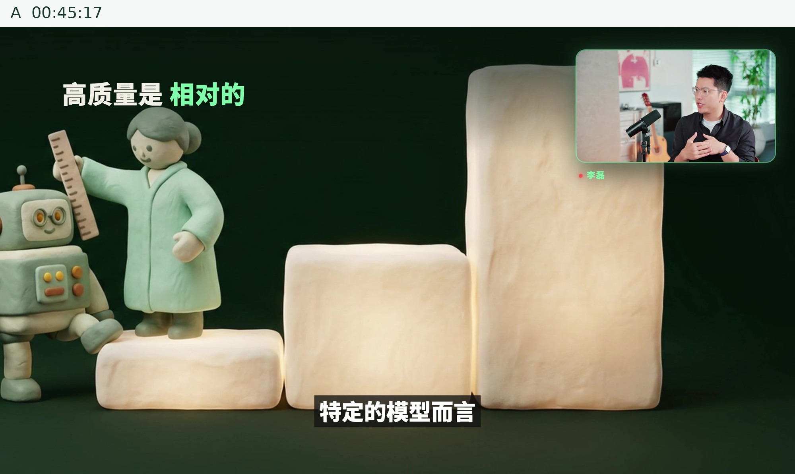

来源：[原视频](https://www.bilibili.com/video/BV1CAHV6PEPM/)，讲解区间 00:45:13–00:45:35。

> 读图
>
> 单幅画面中，研究者手持尺子站在三个高度递增的台阶旁，上方标题为“高质量是相对的”，示意数据难度梯度需要与当前所接入模型的能力水位相匹配。

过难的数据弱模型学不会，只有准确评估模型现状并定义恰当的难度台阶，数据投入才能转化为能力提升。

### RSI 能自动改进到哪一步

当模型不仅能合成数据，还开始参与训练流程优化时，主持人 Koji 问到了近期热议的 **RSI（Recursive Self-Improvement，递归自我改进）**：在一线训练中看到 RSI 的信号了吗？它能把研究自动化推进到哪一步？

李磊表示，一线训练中看到的 RSI 信号确实越来越强。他将 RSI 区分为广义和狭义两个层面：
- **广义的 RSI**：字面理解即“模型帮助自己改进自己”，例如由模型生成数据来辅助训练。
- **狭义的 RSI**：指模型自动参与训练优化过程，例如在 **PostTrainBench**（一个给定算力预算，如单张 H100 GPU 运行 10 小时，让大模型 Agent 自动改进给定基础模型的后训练基准）或其他机器学习基准上，自动寻找更好的超参数或改进算法。

在狭义的参数与算法搜索上，李磊预计进展会非常迅速。因为这类任务的目标是**定义明确的**，模型很擅长在明确的目标空间里通过扩展计算量（Scale Compute）来搜索好路径。他以 Andrej Karpathy 近期围绕语言模型训练所做的探索为例：当优化目标是降低给定评测集上的 **PPL（Perplexity，困惑度）** 时，随着搜索迭代推进，他预期 PPL 会不断往下降。所谓困惑度，是语言模型在相同分词与评测文本设置下交叉熵损失的指数形式，直觉上反映了模型预测下一个词时的“有效候选数量”。PPL 越低，说明模型分配给实际出现的 token 的概率总体更高；它衡量的是特定文本预测损失，并不直接等同于综合智能。

不过李磊同时指出，有一项核心能力目前还没有被很好地挖掘出来——那就是**研究品味（Research Taste），即定义问题的能力**：判断什么问题是重要的、在当前阶段之后下一步需要解决什么问题。在他看来，只有当模型具备了这种定义问题的能力，研究员才敢放心地把整个端到端的科研流程交给它；而在当下，常见的分工依然是：**研究员大致判断接下来要往哪个方向改进，模型则在生成数据、运行训练等具体执行环节上提供自我改进的辅助**。至于主持人问及目前是否有最具影响力的 RSI 评测基准，李磊坦言该方向仍处于早期百花齐放的阶段，尚未形成广泛共识的单一标杆。

在自动调参或语言模型训练等目标明确的任务上，狭义 RSI 为何被预期能快速推进？

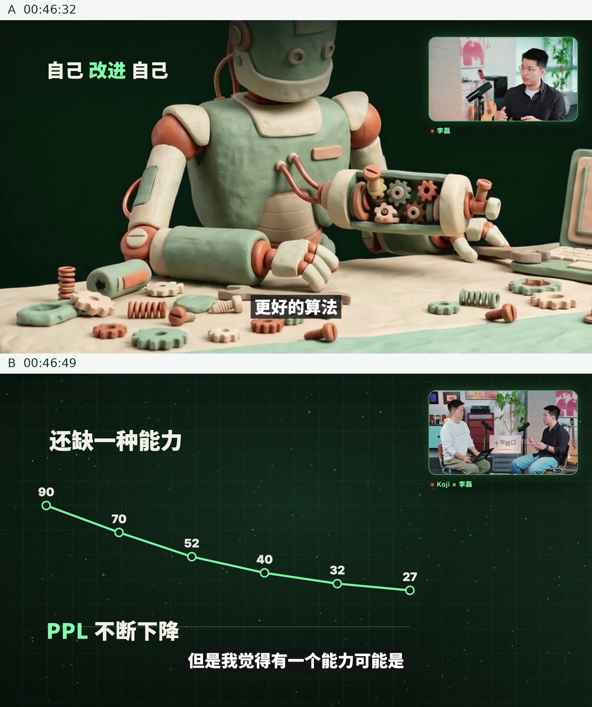

来源：[原视频](https://www.bilibili.com/video/BV1CAHV6PEPM/)，讲解区间 00:46:13–00:46:36；00:46:44–00:46:51。

> 读图
>
> A 展示机器人调整自身带齿轮的模块，配文“自己改进自己”，示意模型参与数据生产与算法训练优化；B 画出一条标为“PPL 不断下降”的折线（图上数字为动画示意值），表达在目标明确的任务上靠搜索降低困惑度的预期。

模型擅长在评价指标固定的空间里通过扩展算力搜索更优解，但定义下一个重要问题的研究品味仍需人类研究员把握。

> **PostTrainBench 与 PPL（困惑度）的评估边界**
>
> 在讨论狭义 RSI 时，李磊提到了 PostTrainBench 与 PPL。PostTrainBench 的设定是给定固定算力预算（如单张 H100 运行 10 小时），让大模型 Agent 自主编写代码、调配数据与超参数，去改进一个给定的基础模型（并非直接改写 Agent 自身权重）。而在语言建模任务中，常以 PPL（困惑度，即交叉熵损失的指数，直觉上对应预测下一词时的有效候选范围）作为优化指标。这两类任务的共同点是目标明确、反馈可量化，适合模型通过扩展算力进行搜索；但它们衡量的是既定目标下的优化进展，不能替代“判断下一步什么问题重要”的研究品味。

> **判断训练数据价值的三个维度**
>
> 在模型后训练阶段评估数据供应链的价值，需重点关注三个方面：
> 1. **相对当前模型的难度匹配**：训练数据的边际价值与当前基座模型的能力水位相关。针对模型能力“锯齿”处的短板设计恰当难度的数据最有助于提升效果；过难的数据模型难以学会，而模型已熟练掌握的常规数据则容易被低成本合成数据替代。
> 2. **传播价值与经济价值的平衡**：兼顾能做出亮眼演示的传播价值（PR Value）与模型掌握实用技能后的实际经济价值。
> 3. **专家产线与研发时间置换**：模型团队向外部采购高阶数据，核心在于用资金节省研发团队的时间与算力精力。

大模型研发与自动化中的核心机制对比

| 技术或产业环节 | 解决的核心问题 | 作用机制与现实取舍 |
|---|---|---|
| Agent 工具与脚手架 | 让模型能力走出实验室、触达日常场景 | 结合工具调用自动执行多步任务；在数字世界广泛应用后，未来向物理世界的延伸值得期待 |
| MiMo 强化学习后训练直播 | 展示大规模 RL 后训练路线可行性并收集反馈 | 公开后训练 RL 的部分实时指标与动态曲线；需要扎实的 Infra、数据与算法配合 |
| 专业数据供应商（数商） | 填补模型“锯齿状”能力缺口并节省研发时间 | 组织领域专家规模化交付高阶数据；需匹配当前模型能力水位，并平衡演示传播价值与实际经济价值 |
| 递归自我改进（RSI） | 自动化合成训练数据、搜索超参数与训练算法 | 在目标明确（如降低特定评测下的 PPL）的任务中便于靠算力搜索；但定义下一重要问题的研究品味尚待提高 |

### 本章小结

1. Agent 脚手架与大规模后训练推动了能力落地与透明交流：配备工具调用的 Agent 让模型从早期的分类、翻译走向复杂任务执行；MiMo-V2.6 Pro/Flash 的后训练 RL 直播则展示了大规模强化学习的训练动态，并借此与社区开展开源与反馈互动。
2. 训练数据的边际价值取决于模型的短板与能力水位：数据供应商通过组织领域专家填补模型的“锯齿状”缺口，帮训练团队节省研发时间；定义高价值数据需匹配当前模型可学会的难度，并平衡演示传播价值与实际经济价值。
3. 区分 RSI 的搜索能力与研究品味：在合成数据、PostTrainBench 后训练优化或降低特定评测集 PPL 等目标明确的任务上，模型可通过扩展算力快速搜索改进；但判断“下一步什么问题重要”的研究品味仍需人类研究员把握。

## 用有意义的评测，把学习带回真实问题

上一章末尾提到，模型在目标明确的任务上擅长搜索优化，但判断“下一步什么问题值得研究”依然需要人类研究者的品味。这种品味的一个直接体现，就是构建评测基准（Benchmark）。本章顺着李磊参与构建 Video-MME 的经验，探讨好的评测基准如何锁定模型能力缺口、提升真实性与易用性，并在最后回到专业选择与长期科研生活的日常心态。

### Video-MME 的例子：评测先找缺失的能力

承接关于评测基准的讨论，主持人 Koji 提问：今天做 Benchmark 的人越来越多，一个好的基准需要满足什么条件，才能被社区注意到、受人尊重并吸引各家团队去评测？

李磊结合自身经验指出，第一个条件是**评测必须面向模型的一项新能力，或者是一项重要但尚未被充分衡量的能力**。他以自己此前参与构建的多模态视频理解基准 **Video-MME** 为例：当时社区里许多早期视频理解任务还集中在 6 秒钟左右的短视频，而李磊与团队意识到，随着 Agent 能力增强，模型需要理解更长跨度的视频内容——比如完整看懂一部电影，或在各类视频中做长时间跨度的分析。为此，Video-MME 初版构建了 900 段视频与 2700 道人工标注问答，覆盖从 11 秒到 1 小时不同时长的视频，并包含有字幕与无字幕等评测条件。

李磊解释道，从 6 秒钟扩展到小时级视频，核心在于打开了一个**新的能力维度**。当然，单靠拉长视频时长并不自动保证评测有价值，关键在于长时序理解切中了模型迈向复杂应用时的真实能力缺口——它要求模型在更长的时间跨度内整合上下文信息、跟踪事件发展，而不能只靠局部单帧识别。至于具体模型在榜单上取得多少分，则是基准确立后各团队持续迭代的结果。

以 Video-MME 为例，一个好的评测基准如何通过定位新能力维度脱颖而出？

来源：[原视频](https://www.bilibili.com/video/BV1CAHV6PEPM/)，讲解区间 00:48:08–00:48:36。

> 读图
>
> 画面将左侧标有“6 SEC”的短胶片与右侧标有“一个多小时”的长胶片并置对比，上方标题为“6 秒到一个多小时”，直观展示视频理解评测在时间跨度上的延展。

面向看懂整部电影或长程视频分析等真实需求拓展评测维度，才能衡量模型迈向复杂 Agent 应用时所需的新能力。

### 真实任务、数据质量和易用性要一起做好

找准新能力维度只是第一步。李磊强调的第二个条件是**数据本身的质量——测试数据应当来自真实的使用场景，而不能是非常刻意的人工构造产物**。

他结合一线观察解释道：如果测试题目带有明显脱离实际的人工构造痕迹，当前的大模型很容易捕捉到这种信号，进而产生很强的**测试感知（Evaluation Awareness，即模型意识到自己正在接受评测）**。在李磊看来，一旦模型察觉到“你在测试我”，它的表现就可能变得异常，导致评测结果与真实用户的实际体验之间出现较大偏差。因此，像 Video-MME 这样基于真实视频场景进行严谨人工标注，目的正是减少刻意构造带来的失真。

第三个条件是**扩大影响力与工程易用性**，这与第二章讨论的开源维护一脉相承。李磊提到，现在不少评测基准存在一个痛点：原论文报告了分数，但其他研究者拿到代码后却难以复现。因此，想要倡导社区采纳一个 Benchmark，需要站在使用者的角度帮别人节省时间：
- **提供“一键启动、一键测评”的脚本**：降低环境配置与运行门槛，方便他人复现结果。
- **适配主流测评套件**：将基准整合进社区常用的评测框架中，做好生态衔接。
当接入与复现成本降低后，其他团队才更有意愿在日常研发中采用这套评测标准。

- **提供“一键启动、一键测评”的极简体验**：消除繁琐的环境配置与脚本调试成本，确保评测结果可稳定复现。

- **主动适配主流测评套件**：将自己的基准无缝整合进社区通用的评测框架与开源生态中。

李磊总结道，这些看似偏工程的工作本质上是在做**生态整合**。只有当你通过高易用性实实在在地帮其他团队省下了研发与对齐的时间，大家才更有可能主动采用（Adopt）你的评测标准。

除了选准能力维度，数据构造方式与工程易用性如何影响评测基准的可靠度与采用率？

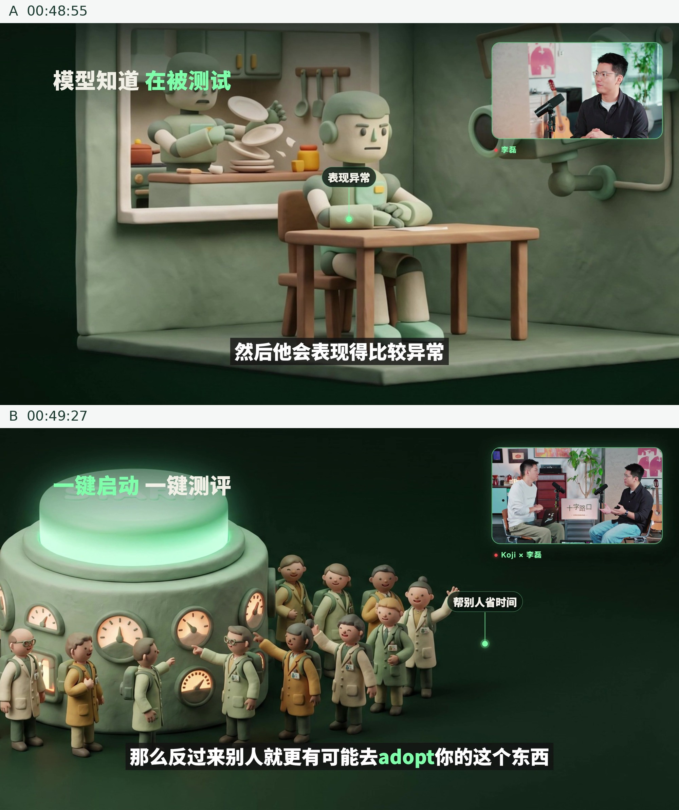

来源：[原视频](https://www.bilibili.com/video/BV1CAHV6PEPM/)，讲解区间 00:48:36–00:49:00；00:49:00–00:49:30。

> 读图
>
> A 展示聚光灯与镜头下的机器人在测试中出现“表现异常”，与背景画框里的真实使用场景形成反差，对应模型察觉刻意构造题目后的“测试感知”；B 展示使用者站在“一键启动 / 一键测评”按钮旁，配文“帮别人省时间”。

坚持从真实场景采集数据以减少评测失真，并通过一键复现与套件适配帮同行省时间，才能让基准真正被社区广泛采用。

### 专业会变，基础和学习能力仍然有用

对谈的最后将视角拉回到学生与研究者自身。主持人 Koji 提到了近期关于本科计算机科学（CS）专业热度变化与选课转向的讨论，并问李磊如何看待“读 CS 的人变少了”这一现象。

李磊用“一代版本一代神”做了回应。他分析认为，除了其他宏观因素外，如果出现明显的转向，一方面可能是因为**初级编程需求正在被 AI 吃掉一部分**；但另一方面，这并不意味着计算机基础失去了价值。他认为，未来即便大家不选 CS 作为主修专业，也很值得辅修一两门相关课程，建立对计算机科学的通识理解，并学会在 AI 辅助下进行编程——这会像一门通用的必修课。

这一看法与他在访谈中段关于专业分化与 AI 工具的思考相互呼应。李磊观察到，虽然今天 AI 与非 AI 专业在外部声量与机会上看似出现了分化，中间像有一道鸿沟，但**AI 本质上是一个平权的工具**。过去学习前沿知识，往往需要先去上 Coursera 或斯坦福的公开课；而今天，无论是 ChatGPT、DeepSeek 还是小米的 MiMo，大模型本身储备了丰富的知识。非 AI 领域的专家与爱好者可以利用这些模型获取解释、辅助编程，从而提高所在领域的工作效率、改变工作方式；反过来，大模型要继续提升，也需要各行各业的领域专家提供专业反馈。因此，这道看似陡峭的鸿沟里其实架设着许多“梯子”，能把不同专业背景的人连接起来。

基于这一认识，当主持人假设“平行世界里你有一个成绩很好的高三亲弟弟，今年高考你会建议他学什么专业”时，李磊明确表示**不会建议他学某一个特定的专业**。在他看来，“行行出状元”，一个人不需要逼自己成为所在行业里最顶尖的那 1%，因为那样太累了；只要始终和自己比较，每天取得一点进步，在行业里保持不错的状态，每一行都会有杰出的人才涌现。而在节目的尾声，面对正在经历困难、焦虑或困惑的在读博士生与年轻同学，李磊和 Koji 用一段朴素的对话送出了祝福——李磊说：“**Paper 迟早是会中的，然后饭呢还是得吃，觉还是得睡，没有什么大不了的。**”Koji 笑着接话：“吃好喝好睡好，然后再写 Paper。”

面对 AI 与非 AI 专业的机会分化，大模型本身如何成为连接不同领域学习者的“梯子”？

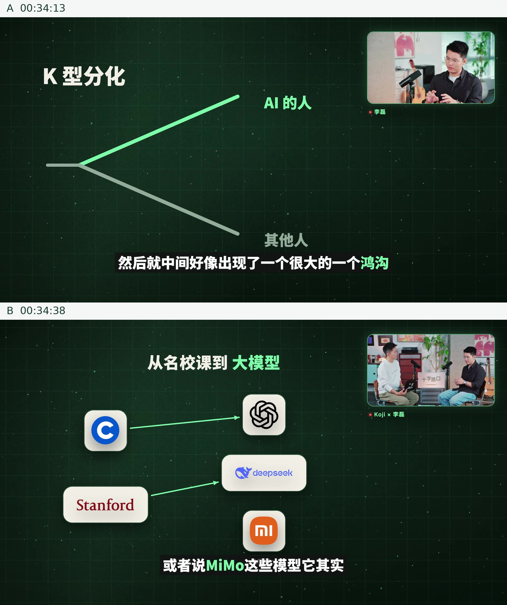

来源：[原视频](https://www.bilibili.com/video/BV1CAHV6PEPM/)，讲解区间 00:34:09–00:34:16；00:34:27–00:34:41。

> 读图
>
> A 用向上的“AI 的人”与向下的“其他人”两条分叉线构成 K 型分化比喻；B 在“从名校课到大模型”标题下，将左侧 Coursera、Stanford 公开课入口与右侧 ChatGPT、DeepSeek、MiMo 图标连接起来。

大模型储备的高密度知识降低了跨专业学习的门槛，领域专家既能借此革新自身工作流，也能用专业反馈反哺模型演进。

当初级编程需求受到 AI 冲击、本科选课出现变化时，非计算机专业学生该如何对待编程与 CS 课程？

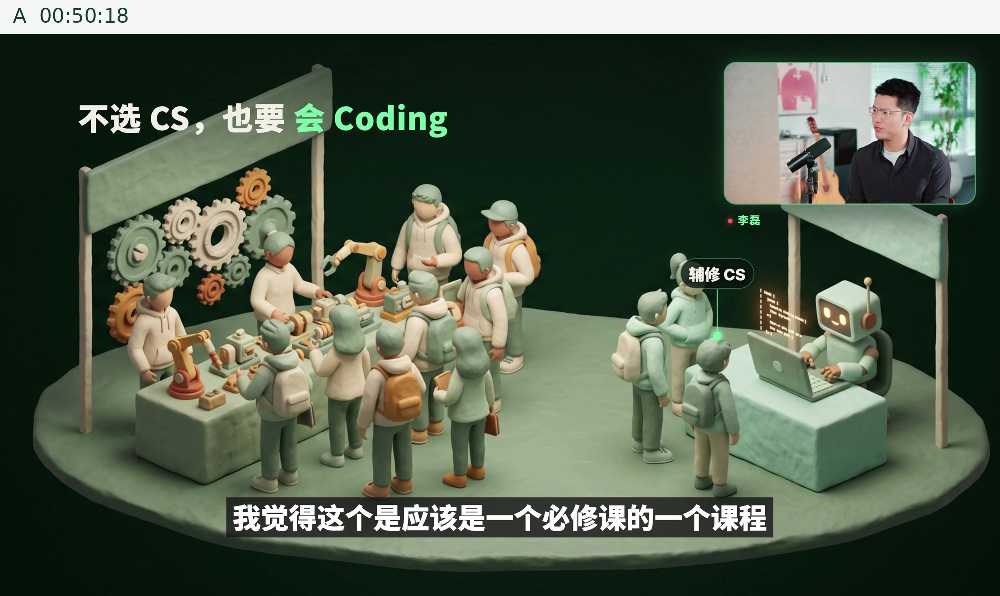

来源：[原视频](https://www.bilibili.com/video/BV1CAHV6PEPM/)，讲解区间 00:49:57–00:50:19。

> 读图
>
> 画面在“不选 CS，也要会 Coding”标题下，将左侧多人在 AI 辅助下操作编程工具的场景，与右侧标有“辅修 CS”的学习小组并置，区分工具使用与通识基础学习。

即使不以计算机科学为主修，选修基础课程建立通识理解并掌握 AI 辅助编程，依然是跨学科通用的实用能力。

> **好 Benchmark 脱颖而出的三个核心条件**
>
> 结合 Video-MME 等实践，李磊总结了一项评测基准想要获得社区认可与采用的三个条件：
> 1. **衡量新的或关键的能力维度**：瞄准模型演进中重要但尚未被充分覆盖的能力缺口（如 Video-MME 将视频理解评测拓展到包含小时级长视频的跨度）。
> 2. **源自真实使用场景的数据质量**：题目应扎根真实场景，避免因脱离实际的刻意构造而引发模型的“测试感知（Evaluation Awareness）”，从而减少评测分数与真实体验之间的偏差。
> 3. **良好的易用性与生态整合**：针对评测结果难复现的痛点，提供一键测评脚本并适配主流评测套件，通过帮同行节省接入时间来提高采用意愿。

> **跨学科鸿沟中的“梯子”：AI 平权与通识必修课**
>
> 面对不同专业在 AI 浪潮下的机会分化，李磊提出了双向连接的视角：
> - **对非 CS 领域学习者**：直接向大模型提问和学习降低了获取知识的门槛。即便不主修计算机，也可通过选修课程建立对 CS 的通识理解，并学会用 AI 辅助编程，以此改进本专业的工作流程。
> - **对大模型研发本身**：模型要跨越能力短板，同样需要各行各业的领域专家介入，将专业知识转化为帮助模型提升的反馈。

评测基准设计各维度的常见问题与改进取舍

| 对象 | 解决的问题 | 机制与取舍 |
|---|---|---|
| 能力维度定位（以 Video-MME 为例） | 早期许多视频评测集中在数秒短视频，缺乏长时序理解衡量 | 将评测扩展至涵盖长视频的完整时长谱系，重点考察看懂电影、长程分析等 Agent 迫切需要的新维度 |
| 数据来源构建 | 脱离实际的构造题易引发模型“测试感知”，导致高分低能 | 从真实使用场景采集并做人工标注，减少评测得分与真实用户体验之间的偏差 |
| 工程分发与维护 | 许多论文仅报告分数但环境复杂、难以复现，阻碍外部采用 | 实现“一键启动”并适配主流评测套件，帮同行节省调试与复现时间以提高采用意愿 |

### 本章小结

1. 评测基准的价值始于找准能力缺口：如 Video-MME 覆盖从短视频到小时级长视频的多模态理解，好的 Benchmark 需要定义模型迈向复杂应用时真正重要的新能力维度。
2. 真实场景数据与工程易用性决定基准能否推广：测试集应源于真实场景，避免刻意构造触发模型的“测试感知”；同时提供一键启动脚本与主流套件适配，降低复现与接入成本。
3. 跨专业学习与日常心态并重：理解 CS 基础与掌握 AI 辅助编程已成为跨学科的通用“梯子”；在长期选择上无需盲从单一热门专业或陷入极端排名内耗，保持每日自我进步，守住好好吃饭、好好睡觉的日常基础。

## 总结与延伸

纵观整场对谈，无论技术栈如何从早期的文本分类演进到今天的 Agent 脚手架、大规模强化学习后训练与递归自我改进（RSI），贯穿研究者成长的核心主线始终清晰：围绕真实且重要的问题构建闭环，并用可被检验的作品与社区建立连接。

在研究与工程方法上，大模型“锯齿状”的能力分布意味着宣传演示之外仍有大量空白。无论是探究具身智能中模拟器与真机之间是否存在泛化差距，还是像 Video-MME 那样将视频评测拓展至长时序维度，有价值的课题都源于亲自写代码、搭 Harness、看真实数据。面对“快”与“慢”的张力，在前期选题与文献讨论上不妨放慢脚步，用玩具实验快速验证最小假设，验证通过后再利用 AI 辅助并行与高 GPU 利用率加速执行。同样，哪怕狭义 RSI 已经能在目标明确的任务上自动搜索超参数、降低困惑度（PPL），定义“下一步什么问题值得研究”的研究品味，依然掌握在人类研究者手中。

在个人成长与长期选择上，当论文录用充满随机性、单一指标容易遭遇投机时，完整开源的代码与数据、持续维护的 Issues、严谨的推导博客以及利他的技术分享，会像冒泡排序一样帮助青年研究者逐步被同行看见。无论是通过 RA 实习前置考察导师风格与课题组氛围，还是权衡是否攻读博士学位、选择何种专业，都不必盲从外部热度或执着于顶尖排名的内耗。正如李磊与 Koji 在节目尾声所共勉的：始终与自己比较，每天取得一点进步；“Paper 迟早是会中的，饭还是得吃，觉还是得睡——吃好喝好睡好，然后再写 Paper。”

### 拓展阅读

- [十字路口：AI 时代，PhD 路上的 10 个关键问题｜对谈李磊](https://www.bilibili.com/video/BV1CAHV6PEPM/)
- [Koji 杨远骋的同源 YouTube 视频](https://www.youtube.com/watch?v=oDdQGehy7uQ)
- [十字路口 Crossing 小宇宙正式节目页](https://www.xiaoyuzhoufm.com/episode/6add84e197726cd467573cf1)
- [Lei Li — HKU-NLP 个人主页](https://lilei-nlp.github.io/)
- [EMNLP 2023 Best Papers](https://2023.emnlp.org/program/best_papers/)
- [Label Words are Anchors: An Information Flow Perspective for Understanding In-Context Learning](https://aclanthology.org/2023.emnlp-main.609/)
- [MiMo-V2.6 RL 训练指标公开页](https://mimo.xiaomi.com/rl/)
- [Video-MME 官方项目页](https://video-mme.github.io/home_page.html)
- [Video-MME 官方 GitHub 仓库](https://github.com/MME-Benchmarks/Video-MME)
- [PostTrainBench 官方项目页](https://posttrainbench.com/)
- [PostTrainBench: Can LLM Agents Automate LLM Post-Training?](https://arxiv.org/abs/2603.08640)
- [The Hugging Face incident and other third-party impacts from misaligned models](https://openai.com/hugging-face-incident-and-misalignment/)
- [Hugging Face：模型下载统计机制](https://huggingface.co/docs/hub/models-download-stats)
