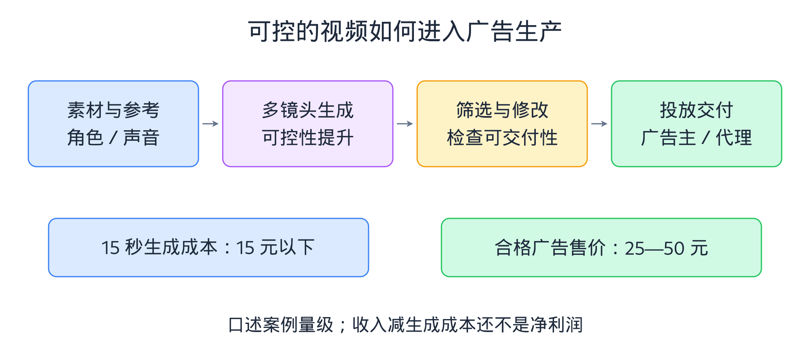
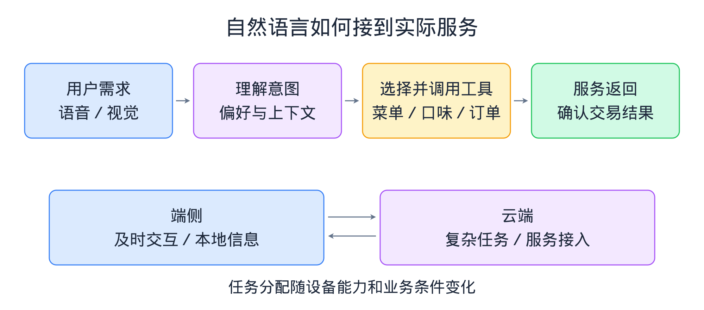
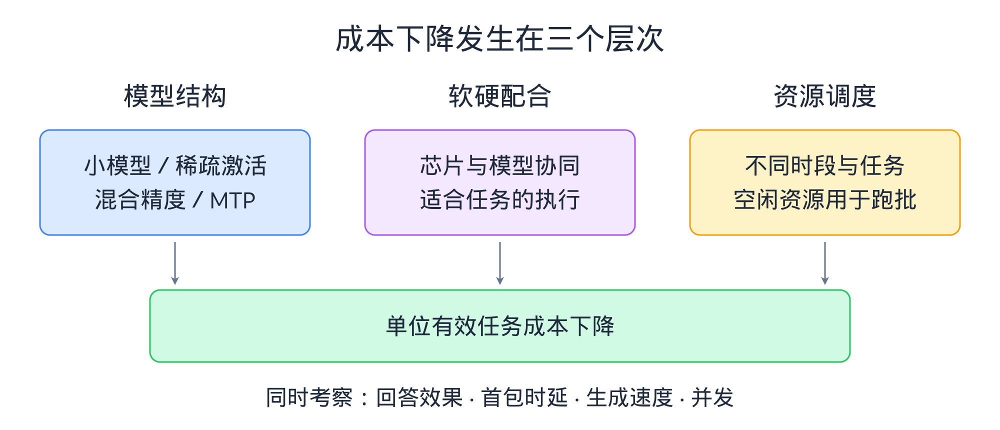
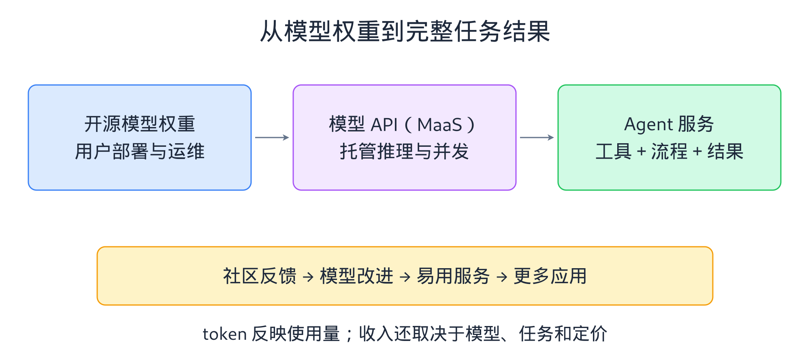
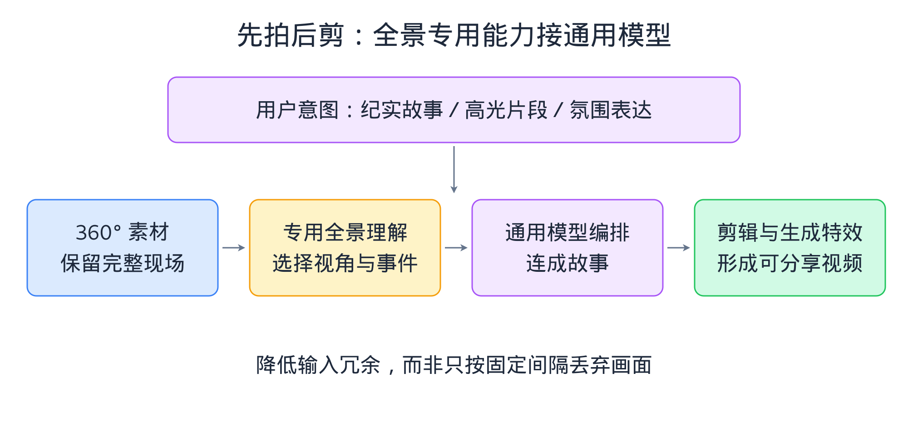
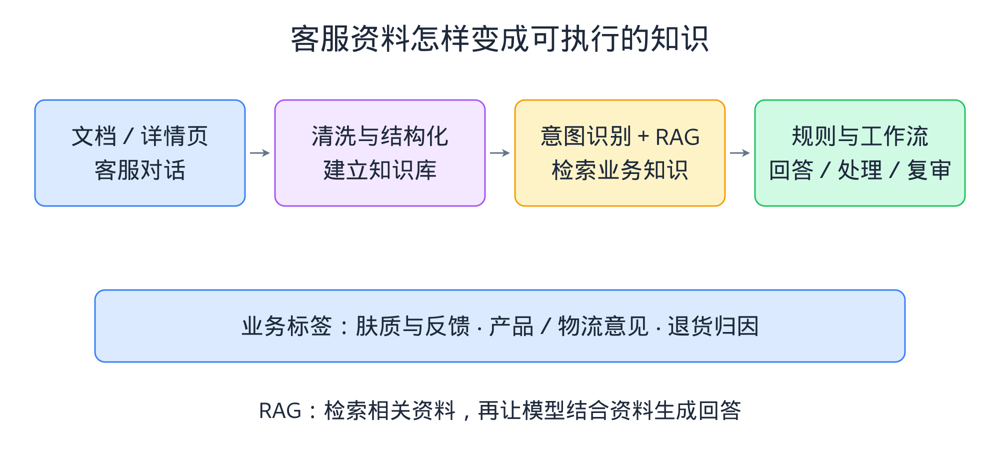
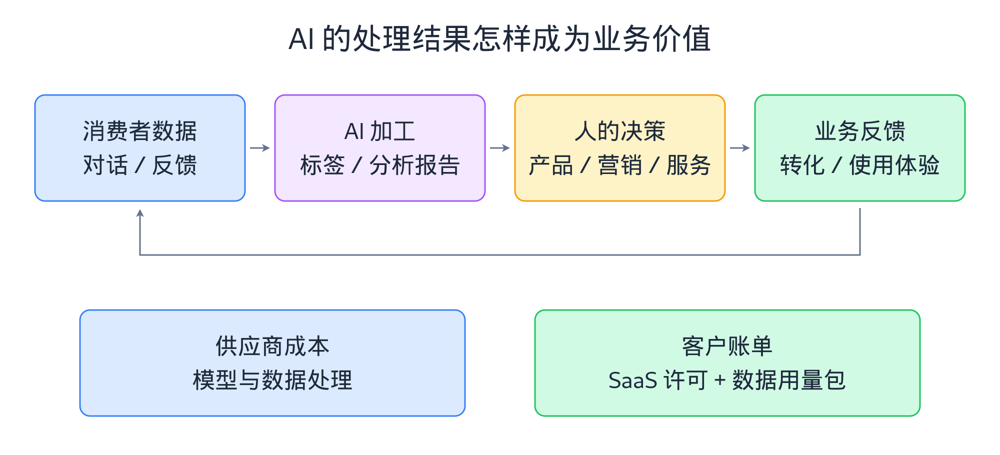

# 大模型如何变成生意：能力、成本与真实业务流程

原节目：应用爆发之年：聊聊模型技术进化与商业化【硅谷101播客】

主播：泓君。嘉宾：徐栋，阿里云千问大模型业务总经理；亓鲁教授，Insta360研究院总监；吕瀛杰，语忆科技联合创始人&CEO。

发布：2026-01-30。整理：2026-10-20。

[观看原节目](https://www.bilibili.com/video/BV1cZ6qB6EMk/)

## 导读

两年前讨论大模型，焦点常在“它能聊什么”；而当基础模型能力跨过可用门槛，企业和开发者算的是另一本账：模型如何嵌入真实生产管线，如何在高并发与延时约束下控制成本，又如何把算力消耗转化为客户愿意买单的商业结果。本讲义基于《硅谷101》与阿里云徐栋、影石Insta360亓鲁、语忆科技吕瀛杰的深度对谈整理。全篇分两条主线展开：前四章从底座视角出发，拆解视频生成可控性、Agent工具调用与端云协同、推理性能与稀疏模型降本，以及开源权重与云端付费服务的共生逻辑；后三章切入垂直应用现场，看全景相机如何用专用理解模型接力通用API完成自动剪辑，消费品牌又如何通过对话采集改造、知识清洗、业务规则嵌入以及“License+数据使用包”计费，将客服语料从降本工具升级为产品增长引擎。

## 视频生成怎样进入生产流程

大模型从早期娱乐试用走向规模化商业应用，首要考验是能否嵌入真实的内容生产流水线。本章结合阿里云千问大模型业务总经理徐栋在访谈（02:20–10:57）中的拆解，分析语言、视觉生成与音频三类基础模型如何协同分工，视频模型如何提升可控性，以及AI短剧与批量广告的成本结构如何支撑起商业循环。

### 三类基础模型承担什么工作

过去谈及大模型应用，人们的视野往往局限于单一的文本问答框；但当AI真正进入影视、动漫与电商广告等工业化内容生产环节时，单靠一个模型无法走通全流程。在访谈（02:20–04:08）中，徐栋首先梳理了支撑内容生产底座的三类结构化基础模型（Foundation Model，即在大规模数据上预训练、可适配多类下游任务的底座模型）。工业界并非追求用一个黑盒包揽一切，而是让不同模态的基础模型各司其职，通过工程管线串联成完整的生产力工具。

这三类基础模型在生产管线中的具体分工如下：
- 语言模型（千问 Qwen）：代表逻辑与认知能力，负责理解复杂指令、拆解剧本、编写分镜提示词，并作为调度中枢去调用外部工具，切入具体的业务生产流。
- 视觉生成模型（万相 Wan）：负责图像与视频的生成及编辑，近期迭代的2.5 preview与2.6版本不仅用于视觉内容创作，也被视作探索未来世界模型范式的基础。
- 纯音频模型（通义百聆 FunAudio）：覆盖ASR（Automatic Speech Recognition，自动语音识别，将人类语音转化为文本）、TTS（Text-to-Speech，语音合成，将文本转化为自然语音）以及声音克隆，核心追求高拟真度，并解决多语言、不同方言与口音的理解和表达问题。

正是建立在这三类基础模型的结构化组合之上，大模型的应用边界才得以从单一的问答扩展到多模态生产。无论是传统制造业与实体品牌商，还是互联网公司，都可以按需调用对应模块；而近年涌现的大量AI Native（AI原生，指从产品设计之初就以大模型为核心驱动力）创业公司，更是直接将千问与万相等模型组合为自动化管线，在碎片化的细分市场中跑出了可观的ROI（Return on Investment，投资回报率）。

### 从抽卡到可以控制的角色与镜头

明确了底层模型的分工后，接下来的核心问题是：为什么早期多用于特效娱乐的视频生成模型，在2025年前后能够跨入漫剧与切片广告等生产领域？徐栋认为，以万相为代表的视频生成模型已经迎来了类似语言模型从GPT-3.5迈向GPT-4的阶段（04:17–07:41）。过去创作者使用视频模型犹如“抽卡”，生成结果随机性较大，难以直接交付商业客户；而近半年的技术演进，核心在于生成内容可控性的明显提升。

这一变化具体体现在三个关键特性上：
1. 生成时长与连贯性延展：单次生成时长从过去的5秒、10秒迈入15秒时代。至于进一步延长到1分钟，或是凭几张图片、一句话直接生成3分钟连贯短视频，则是徐栋在访谈中表达的技术期待与未来演进方向。
2. 多镜头切换与光影变化：生成内容告别了枯燥的单一常见镜头，支持不同镜头多次切换与光影效果变化。过去需要专业导演配合摄像、美术等多个角色共同完成的镜头语言，如今普通创作者通过简单的提示词即可生成，降低了创作门槛。
3. 角色扮演与保ID能力：受Sora 2关于角色能力（Cameo）的启发，模型开始引入“保ID”（Identity Preservation，身份特征保持，指在后续连续创作中保持特定人物和物体背景的形态、大小与音色）能力。

嘉宾强调，生成内容可控性的提升，关键在于输入端参考维度的增加。创作者不再仅依赖随机抽卡，也从早期动漫创作中常见的“参考图”模式，扩展到信息维度更丰富的“参考视频”输入。徐栋举了一个直观的试镜场景：用户拿起手机自拍一段5秒钟的视频，期间做抬头、左右看看等动作并同时说几句话；将这段视频输入模型后，系统就能对视频里人物的形象和声音做保ID。在后续连续的故事创作中，真人无需再次出镜，模型即可复刻该角色的形象与音色完成生成。这种配合筛选与修改的参考视频输入机制，让视频生成具备了进入流水线作业的可控基础。

### 一条广告的成本如何形成

当时长、镜头与角色一致性等可控性指标提升后，技术能力便开始转化为商业市场上的成本重构。在访谈（07:41–10:57）中，徐栋指出国内短剧市场规模已超过电影市场，短剧制作正从原本依赖真人实拍或大量人工编辑的状态，按一定比重切换至AI模型。其中增长较快的是AI漫剧，尤其是以图片微动效果呈现、剧情连续连贯的“动态漫”；另一类典型场景则是自动化生成15秒切片广告。

厂商在考虑接入模型管线时，算的是一笔成本与收益账。在短剧领域，行业通常按品质差异划分为S级、A级、B级：在合理的成本控制下，AI可将一部短剧的成本做到2万元人民币以下，若算上投流费用与ROI，有机会实现打正甚至获得不错的收入；若对精品程度要求更高，则需要投入更多资源做后期制作，成本与品质也会相应提高。而在批量化AI广告领域，账目结构分为两端：
- AI生成端成本：一条15秒的视频广告，AI成本目前已能控制在10元以下或15元以下。
- 市场交付端售价：一条合格的15秒广告，在市场上的价格通常位于25元至50元之间。

这种显著的价差催生了多层级的广告生产生态。流量平台会向广告主或代理商（Agency）提供基础编辑工具，而代理商为了满足海量素材需求，又会将制作任务分包给专门做AI Native广告的创业公司。根据徐栋接触的实际案例经验，这类创业公司将千问与万相模型串联成自动化生产管线后，一个仅由五六人到十人组成的小团队，一天就能批量生成约6000条广告视频，随后交付给代理商或平台广告主。需要注意核算口径的是，15元以下的生成成本与25至50元的市场售价之间虽有充足毛利空间，但这并非企业的净利润，中间还需覆盖人工编排、抽卡损耗、后期修正及投流适配等运营开支。

> **参考视频如何提升角色与声音的一致性**
>
> 连续叙事的视频创作需要避免角色在镜头切换时轻易改变外貌或声音。相比单张参考图，5秒参考视频提供了包含抬头、转头等动作以及语音的多维信息。将这段试镜视频输入模型后，有助于在后续连续创作中保持人物形象、物体背景形态大小与音色的一致性，从而减少纯靠运气的抽卡次数，配合人工筛选与后期修改进入生产管线。

> **广告生成成本与市场售价的核算边界**
>
> 1. 账目口径：15秒广告“10元以下或15元以下”指AI生成端成本，而市场上“25元至50元”是合格成品广告的交易价格，两者差额还需覆盖团队人工、筛选修改损耗与代理分包等开支，不能直接等同于净利润。
> 2. 产能与时长阶段：“五六人至十人团队一天生成约6000个广告视频”是徐栋所接触AI原生广告创业公司的案例经验；同时，15秒属于当前已落地的生成时长，而延长至1分钟或直接生成3分钟短视频仍属于嘉宾对未来的技术期待。

内容生产管线中的基础模型与关键技术对照

| 模型与技术模块 | 解决的核心生产痛点 | 机制特征与业务实践关系 |
|---|---|---|
| 千问（Qwen）语言模型 | 剧本拆解、指令理解与跨工具流程调度 | 作为管线大脑理解复杂上下文，与视觉模型串联实现自动化批量生产 |
| 万相（Wan）视觉生成模型 | 视频时长短、机位单一与画面随机抽卡 | 突破15秒时长与多镜头光影切换，通过参考视频实现角色与场景特征锁定 |
| 通义百聆（FunAudio）音频模型 | 配音机械感强、跨语种与方言表达生硬 | 整合ASR、TTS与高拟真声音克隆，配合视觉模型保持人物音色一致性 |
| AI原生广告自动化管线 | 传统实拍与人工剪辑成本高、产能受限 | 将15秒广告AI生成成本压至15元以下，支撑小团队日产千条级素材的商业循环 |

当视频生成支持15秒时长、多镜头切换与5秒参考视频保ID后，千问与万相便能串联成批量广告生产管线。下图展示了从素材输入到商业交付的链路及账目结构：

图上方从左至右由实线箭头串联起四个节点：“素材与参考（角色／声音）”→“多镜头生成（可控性提升）”→“筛选与修改（检查可交付性）”→“投放交付（广告主／代理）”。下方并列两个账目框：左侧为“15秒生成成本：15元以下”，右侧为“合格广告售价：25—50元”。最底部文字提醒该数据为口述案例量级，由于中间还需覆盖人工筛选、修改损耗与分包开支，售价减去生成成本的差额并非净利润。

理解了批量内容生产的成本与管线后，下一章我们将探讨当大模型走出内容生成、去调用外部软件与硬件设备时，需要补齐哪些核心能力。

### 本章小结

1. AI内容生产并非依赖单一黑盒，而是由千问（逻辑与工具调用）、万相（视觉生成与编辑）和音频模型（语音识别、合成与克隆）组成结构化管线。
2. 视频生成模型进入生产领域的关键在于可控性提升：15秒生成时长、多镜头切换与光影变化，以及基于5秒参考视频的人物形象与声音保ID能力，减少了对随机抽卡的依赖。
3. 在徐栋分享的案例中，常规短剧AI成本可控制在2万元以下（精品剧需追加后期投入），15秒广告AI成本可压至10元或15元以下（市场售价25至50元），支撑起五到十人小团队日产约6000条广告的商业循环。

## Agent 与智能硬件需要哪些能力

上一章看到视频生成因可控性进入内容产线；当任务从生成画面转向执行操作，语言模型也要走出对话框。本章顺着徐栋在 10:57–24:37 的分析，拆解推理、工具调用与端云协同如何让 Agent 接上真实服务与智能硬件。

### 推理、指令遵循与工具调用如何配合

如果说视频生成模型解决的是内容素材的批量生产，那么语言模型在 2025 年前后的核心演进，则是如何从“回答问题的聊天框”变成“连续执行任务的智能体（Agent）”。在节目 10:57–16:12 的讨论中，徐栋指出语言模型虽然没有出现剧烈的范式突变，但在高质量数据集的精耕细作与多项底层能力的叠加下，正把应用推向深入。过去开发者使用大模型，担心它在多步任务中产生偏差，往往需要搭建确定性的工作流（Workflow），由人工在关键节点设置控制甚至交叉验证。确定性工作流在业务规则明确的场景中依然重要，但要让系统在复杂任务中具备更高的自主处理能力，模型需要同时提升四项能力：推理、指令遵循、工具调用与长上下文。

第一项关键演进是推理能力（Reasoning，指模型在输出结论前进行多步逻辑推演、假设与校验的能力）。自 2024 年下半年 OpenAI 推出 o1 等推理模型后，大模型在生成文本的概率基础上，进一步展现出内在的逻辑偏好与推演过程。第二项是指令遵循能力（Instruction Following，指模型准确理解复杂约束条件并按要求执行的能力）。徐栋解释，指令遵循的提升与高质量数据集的精耕细作密切相关——通过从不同角度及前后顺序调整数据以提高知识学习效率，让模型在面对边缘复杂情况（Corner Case）时也能更准确地理解上下文。随着模型参数规模扩大与预训练改进，模型的可控性变高，当输入足够准确的上下文时，它能在泛化性与准确性之间找到更好的平衡点，与外部工作流形成配合。

第三项核心能力是工具调用（Tool Use，指模型根据任务需求主动调用外部软件、数据库或接口并处理返回结果的能力）。过去模型调用单一工具尚可，现在则要求它能泛化地组合多个工具，并把单个工具往深处用。随着行业内关于任务技能封装的做法（如 Claude Skills，用于组织特定任务的知识与操作流程）以及 MCP（Model Context Protocol，模型上下文协议，用于标准化连接外部数据源与工具的开放协议）等规范逐渐被接受，越来越多的外部工具被显性化。这让大模型跳出了单纯的文本输入输出窗口，嵌入到标准的 SaaS 软件流程或硬件交互方式中。

要让多工具组合顺畅运行，还需要第四项能力——长上下文（Long Context，指模型在单次任务中能够容纳更长历史信息的窗口）与代码能力（Coding，指模型编写与理解程序代码以辅助解决问题的能力）的配合。当工具调用的轮次变多时，调用记录和返回结果会不断累积，需要更长的上下文窗口以及更精准的指令理解能力来支撑；而在外部执行环境配合下，代码能力则扩展了模型处理复杂任务的手段。徐栋展望，当这些能力叠加在一起，未来的 Agent 将不只是即时返回简单结果的聊天机器人，而是可以利用闲时计算资源连续不断地运行，去调用搜索引擎、CRM（客户关系管理系统）、ERP（企业资源计划系统）甚至仿真软件，开展 AI for Science 研究课题或生成深度报告。

### 点咖啡如何连接模型和真实服务

当模型具备了理解复杂指令和调用外部工具的能力，它与物理世界和商业服务的连接方式也随之重塑。在 17:12–20:00 聊到消费电子展（CES）上的 AI 硬件趋势时，徐栋指出，大模型与耳机、智能眼镜、相机等硬件结合，已经不再是十年前传统的语音识别（ASR）或计算机视觉（CV）那样仅仅停留在“识别信号”，而是进化到了“听懂、看懂并直接执行任务”。硬件天然拥有摄像头、屏幕和麦克风，是离用户最近的交互入口；一旦背后的语音、视觉理解与文本模型打通，用户的自然语言就能直接转化为商业世界里的真实动作（Action）。

为了说明模型如何跑通商业闭环，徐栋分享了录制当天上午千问 APP 刚刚发布的点咖啡与订座演示。在传统移动互联网逻辑下，用户点一杯咖啡需要打开应用、搜索门店、翻找冗长的菜单、勾选规格再到收银台付款；而在千问 APP 的大模型架构下，用户只需用自然语言说出需求，系统就能在一个界面内完成选店、挑口味、确认加不加糖、估算配送时间直至最终支付的全流程。

主持人在现场试用后分享了一个关键的产品交互体验：大模型时代的操作界面，如果与传统 APP 的完整菜单完全一样，操作依然会很繁琐。在实际体验中，千问 APP 生成的是一张张精简的推荐卡片，用户可以切换卡片，点开某张卡片才展开完整菜单。之所以能主动推荐卡片，是因为系统具备一定的记忆（Memory，指记录用户偏好与历史交互状态的功能），综合考量了用户当前的距离、口味偏好以及过去的历史选择。

顺着这个已经在手机端跑通的闭环，主持人和徐栋进一步探讨了它在智能眼镜上的延伸场景：假设用户戴着带摄像头的智能眼镜，看到同事手里的咖啡或扫了一眼桌上菜单，直接开口说自己也要一杯，眼镜端就可以把视觉画面与语音指令传给模型，结合个人历史偏好直接调起商业服务完成下单支付。这里需要明确区分的是，通过千问 APP 用自然语言点咖啡并生成推荐卡片是节目中已上线演示的功能，而用智能眼镜看菜单、看同事喝什么并直接语音下单，则是双方基于现有多模态与工具调用能力所推演的未来硬件交互场景。

### 端云协同如何分配任务

无论是手机 APP 里的主动卡片，还是智能眼镜、智能座舱里的实时交互，一旦大模型真正走进消费电子与企业生产，就会立刻撞上算力、功耗与响应速度的物理墙。在 20:01–24:37 谈及千问的商业化落地时，徐栋将应用方向归纳为两条主线：一条是进入企业内部改造设计、编程、研发与销售流程，提升企业生产力；另一条则是直接与互联网应用、手机、PC、汽车座舱等终端产品结合，彻底改变人机交互体验。而在第二条主线中，过去单纯依赖云端大模型的方式已经不够用了，行业正进入“端云协同”的深水区。

所谓端侧模型（On-device Model，指直接部署在手机、汽车等本地终端硬件上运行的轻量化模型），之所以受到手机厂商和车企的关注，是因为贴身智能设备有两项突出诉求：低延时与隐私保护。很多随身或车载交互任务具有高时效性与隐私性，仅靠云端模型并不够用。为此，阿里发布了轻量化端侧多模态模型。但徐栋也坦言，端侧部署目前更多局限于算力较强的手机和汽车，因为模型在本地运行必须克服功耗与发热问题，手机厂和车厂也是经过了两三年的打磨，才逐步考虑端云结合的架构。

既然本地有端侧模型，云端又有大参数模型，实际业务中该如何分配任务？在云端一侧，企业主要通过阿里云的百炼平台（提供 MaaS，即 Model as a Service 模型即服务的推理平台）与终端设备交互，云端平台的核心要求是高并发、低延时、可观测性以及企业特性所需的鉴权管控。而在本地一侧，随着小模型技术的进步，徐栋表示如今一个轻量化端侧模型的效果已经比他们两年前的超大参数模型还要好。

基于这种技术演进，徐栋给出了他对端云任务划分比例的实践判断：在终端设备面对的通用类、基本交互任务（包括日常语音识别、基础视觉理解与常规对话交互）中，未来可能有七成以上都可以直接由本地端侧模型较好地解决；只有当任务超出本地算力边界、需要更深度的复杂推理或调用庞大云端生态服务时，才会流转到云端处理。这种“本地跑高频基础交互、云端管复杂任务与高并发服务”的架构，不仅优化了用户体验，也为下一章要讨论的推理性能与全链路成本核算埋下了伏笔。

> **工具显性化：MCP 协议与任务技能封装**
>
> 要让大模型走出对话框去查数据库或下订单，除了靠人工编写确定性工作流（Workflow）做关键节点控制外，还需要让外部工具对模型变得“显性化”。行业内一方面通过 MCP（模型上下文协议）等开放标准统一外部数据源和接口的接入方式，另一方面通过 Claude Skills 等方式组织特定任务的知识与操作流程，从而降低模型泛化调用多工具的门槛。

> **场景与比例口径：APP 演示、眼镜讨论与端侧任务范围**
>
> 1. 已上线演示与讨论场景：通过千问 APP 用自然语言点咖啡、生成偏好推荐卡片并完成支付，是节目录制当天已发布并现场体验的功能；而戴着带摄像头的智能眼镜看菜单或看同事喝什么咖啡并直接语音下单，是主持人和嘉宾基于现有多模态与工具调用能力推演的硬件交互场景。
> 2. 端侧占比的适用范围：徐栋对“七成以上由端侧模型较好解决”的判断，限定在算力较强的手机、车机等终端所面对的“通用类、基本交互任务（包括语音和视觉理解）”，并非所有复杂企业级业务的统一比例。

Agent 与智能硬件核心能力及端云分工对照

| 能力或架构概念 | 解决的业务痛点 | 运行机制与实践关系 |
|---|---|---|
| 推理与指令遵循（Reasoning & Instruction Following） | 早期模型遇到复杂长指令或边缘情况容易产生偏差，需依赖确定性工作流在关键节点控制。 | 通过先推演再输出以及高质量数据集精耕细作，让模型在给定准确上下文时自主平衡泛化性与准确性。 |
| 工具调用与长上下文（Tool Use & Long Context） | 纯文本对话无法直接操作外部系统，且多轮调用工具后历史信息暴增会导致模型遗忘指令。 | 借助 MCP 等连接协议与 Skills 等技能规范将外部接口显性化，并配合长上下文与代码能力支撑多轮运行。 |
| 偏好记忆与卡片交互（Memory & Action UI） | 若大模型直接照搬传统 APP 冗长的完整菜单，在手机或穿戴设备上点单依然极其繁琐。 | 结合用户历史偏好、距离等记忆直接生成精简推荐卡片，将自然语言一步转化为真实商业动作（如点咖啡支付）。 |
| 端云协同架构（轻量化端侧模型 + 百炼云平台） | 纯云端处理难以满足贴身硬件的隐私与极低延时诉求，纯端侧又受限于终端算力、功耗与发热。 | 手机与车机本地部署轻量化多模态模型处理日常视听等基本交互，阿里云百炼平台承接高并发、鉴权管控与复杂任务。 |

从手机APP点咖啡的实际上线演示，到智能眼镜交互的延伸探讨，背后都依赖模型对指令、记忆与外部工具的协同调用，以及端侧与云端的任务分工。下图拆解了这一运行机制：

图上方从左至右由箭头连接四个节点：“用户需求（语音／视觉）”→“理解意图（偏好与上下文）”→“选择并调用工具（菜单／口味／订单）”→“服务返回（确认交易结果）”，展现点咖啡等商业闭环的执行链。下方并列两个区块：左侧“端侧（及时交互／本地信息）”与右侧“云端（复杂任务／服务接入）”之间由双向水平箭头连接，底部文字说明任务分配并非固定切分，而是随终端设备能力与业务条件动态协同。

当端云协同把海量交互请求汇集到云端生产环境，调用量往往激增数十至上百倍，这直接引出了下一章关于并发性能与推理成本的精细核算。

### 本章小结

1. 语言模型通过推理（Reasoning）、复杂指令遵循、多工具泛化调用（配合 Skills 与 MCP 等规范）以及长上下文与代码能力的叠加，正从单次问答转向可连续运行的 Agent。
2. 千问 APP 点咖啡演示表明，模型接通商业服务不仅要能调用支付等接口，还可结合用户偏好记忆（Memory）将传统菜单简化为推荐卡片；而智能眼镜看菜单直接点单则是节目对未来硬件交互的延伸讨论。
3. 智能硬件落地依赖端云协同：受功耗与发热约束，手机与车机可在本地部署轻量化端侧模型处理高频基本视听交互（徐栋判断此类基本任务占比可达七成以上），而高并发、可观测性与鉴权管控则由百炼等云端 MaaS 平台承担。

## 把效果、性能与成本算在同一本账里

前文讨论了模型如何通过端云协同完成智能硬件与点咖啡等交互。当企业把这类能力从演示推向全天候生产环境，调用规模往往扩大几十倍甚至上百倍。本章梳理客户核心诉求如何从单一的模型效果，转向高并发性能指标、大小模型选型与推理成本优化的系统工程。

### 从回答正确到高并发服务

在模型接入初期，企业最关心的是“能不能答对”，往往会针对垂直任务构建专门的评测集来验证准确率。但徐栋在 24:37–26:10 的访谈中指出，最近半年到一年，随着基础模型的效果在多数场景得到验证，应用开始进入严肃的生产环节，整体调用体量比过去增长了几十倍甚至上百倍。此时，企业算账的焦点迅速从单纯的“效果”转向了“性能”与“成本”。

进入生产环境后，性能不再是一个笼统的概念，而是拆解为具体的服务指标。首先是**首包时延**（Time to First Token，TTFT），即从发送请求到收到模型输出的第一个 token 所需的时间；其次是 **TPS**（Tokens Per Second，每秒生成的 token 数），反映单次流式生成的速度；此外还有机器层面的整体**吞吐**（Throughput，单位时间内系统处理的总 token 量）与**并发**（Concurrency，系统同时处理的请求数）。随着业务精细化，客户不再只提笼统的速度要求，而是会明确区分输入规模：例如当输入上下文为 4K token 或 10 万 token 时，分别需要达到怎样的首包时延与 TPS。徐栋举例说明这一演进趋势：结合模型结构稀疏化与多 token 预测等技术，过去首包时延若在 2 秒左右，未来视上下文长度大概率有机会压至 500 毫秒；TPS 过去在 30 到 50 已属不错，未来也有可能达到 80 到 100 以上。

除了单次请求的响应速度，真实业务还面临严苛的时段并发挑战。以智能外呼业务为例，企业不可能在凌晨给客户打电话，一天之中适合外呼的黄金时间往往只有短短几个小时。这就要求系统在例如半个小时的时间窗口内，集中打完 10 万通电话。这种高度集中的业务波峰对底层推理平台的并发承载力提出了极高要求；同样，前文提到的批量自动化生成广告视频，一旦进入规模化生产，其单次生成成本与并发吞吐也会立刻成为决定商业循环能否跑通的硬约束。

### 小模型与稀疏模型为何有用

当性能与成本成为硬约束，客户对行业与任务的理解也变得更加精细。企业不再盲目追求在所有环节都调用参数量最大的模型，而是开始根据任务特性做分级选型。徐栋观察到，近期市场上对小模型以及中小尺寸模型的需求非常旺盛，核心原因在于生产流程中存在大量高频、重复的子任务，用超大模型去跑既慢又贵，而小模型能提供好得多的性价比。

典型的高频场景是智能客服（Chatbot）或 Agent 工作流的第一步：**意图理解与意图抽取**。系统需要先判断用户输入属于哪一类诉求，再决定分发给哪个下游模块。这类任务边界相对清晰、调用极其频繁，非常适合使用小模型。为了保证小模型在特定业务上的准确率，客户在最近三个月提出了大量 **Post-training（后训练）** 与 **Fine-tuning（微调）** 的需求——即在基础预训练模型之上，利用平台能力将通用闭源数据或基座能力与企业自身的业务数据混合训练，从而定制出一个既轻量又懂行的小模型。

除了直接把模型尺寸做小，另一种兼顾较大参数容量与推理效率的技术路线是采用**稀疏模型**，常见代表为 **MoE（Mixture of Experts，混合专家模型）** 架构。在传统稠密模型中，每次推理都需要动用全部参数；而在稀疏模型中，模型的**总参数量**较大（提供更大的模型容量），但处理每个 token 时仅路由激活其中一部分参数，实际参与矩阵计算的**激活参数量**较小（有助于减少单次推理的浮点计算量，不过总权重驻留显存、专家路由与通信仍会产生相应开销）。例如徐栋在节目中提到的预研版本 **Qwen3-Next-80B-A3B**，就是在此前 30B 总参数、3B 激活的模型基础上进一步提高稀疏比：它拥有 80B（800 亿）总参数，每次推理激活 3B（30 亿）参数，在保持模型效果的同时提升了推理效率与生成速度。

### 成本下降的三条路径

在模型选型之外，底层推理成本本身也在快速下探。根据徐栋在 27:30–30:18 的业务观察，大模型推理成本基本呈现出“每半年接近一个数量级（约 10 倍）”的下降趋势。需要注意的是，这是模型厂商对历史技术演进的经验观察，而非对所有场景的固定降价承诺。支撑这一成本快速下降的，主要是模型算法、硬件协同与云端调度三条技术路径：

1. **模型结构与算法优化**：除了架构向高稀疏比演进外，模型侧还普遍结合了**混合精度**计算（在不同计算环节搭配使用不同位宽的数据格式以节省显存带宽与算力）以及 **MTP（Multi-Token Prediction，多 token 预测）** 技术（在训练或推理阶段引入对后续多个候选 token 的预测机制，可配合推测解码验证以加速生成），从模型结构层面提升机器吞吐并降低推理开销。
2. **芯片与模型垂直一体化**：硬件芯片若能针对模型算法特征做协同设计，将释放可观的工程红利。主持人在节目中以谷歌 TPU 与自身模型算法专门协同来降低推理成本为例做类比；徐栋也指出，阿里同样在推进云计算、基础模型与芯片投入的“三位一体”垂直整合，通过软硬一体设计削减算力成本。
3. **云端算力调度与利用率提升**：从云计算库存管理的视角看，推理成本与硬件资源的**利用率**紧密相关。徐栋举例，如果集群利用率只有 30% 或 50%，分摊到每次请求上的成本就会变高；反之，若能把利用率拉高，单位成本便会随之下降。

为了把利用率拉高，云平台需要一套完整的动态调度机制。由于在线交互业务具有明显的波峰波谷（例如白天客服与外呼繁忙，深夜请求骤降），平台可以通过在不同时间段切换不同模型、针对不同优先级任务做弹性分配，并在夜间算力空闲时段集中处理不要求实时响应的**跑批任务**（Batch Processing，如离线数据清洗、批量报告生成或科研计算）。通过削峰填谷填满闲置算力，整体硬件利用率得以大幅提升，进而推动推理单价持续走低。

> **生产环境性能指标与稀疏激活机制**
>
> 1. 首包时延 vs TPS vs 吞吐/并发：首包时延衡量请求发出后等多久收到第一个 token（受 4K 或 10 万 token 等输入上下文长度影响）；TPS 衡量单路流式生成 token 的速度；机器吞吐与并发则衡量系统在“半小时 10 万通外呼”这类集中波峰下同时承载请求的总能力。
> 2. 总参数 vs 激活参数：以 Qwen3-Next-80B-A3B 为例，80B 是模型包含的总参数规模，提供模型容量基础；3B 是单次推理实际激活参算的参数量，从而降低单步计算开销，但显存占用与系统服务成本仍需考虑全部权重的加载与路由开销。

> **分级选型机制：何时微调小模型，何时采用稀疏大模型**
>
> 企业在生产环境中控本增效，首要动作是按任务复杂度做分级选型：
> 1. 高频单一任务用微调小模型：在 Chatbot 或 Agent 的第一步（如意图理解、意图抽取）以及重复性高的子任务中，无需调用超大模型。企业可通过平台的后训练（Post-training）与微调（Fine-tuning）能力，将闭源数据或基座能力与自身业务数据混合，训练出高性价比的专用小模型。
> 2. 复杂生成与推理用高稀疏比模型：当任务需要更大的模型容量支撑时，可选用 Qwen3-Next-80B-A3B 等高稀疏比模型，利用 80B 总参数承载复杂能力，同时仅激活 3B 参数以兼顾推理速度与成本。

大模型生产级落地核心机制与实践对照

| 概念/技术 | 解决的核心问题 | 机制原理与业务实践关系 |
|---|---|---|
| 首包时延与高并发 | 长文本响应慢与业务波峰拥堵 | 区分 4K 与 10 万 token 输入制定时延标准；支撑半小时 10 万通智能外呼等集中并发需求 |
| 微调与后训练小模型 | 高频重复任务的性价比失衡 | 在意图理解、意图抽取等前置环节，用企业自有数据微调小模型，替代昂贵的大模型调用 |
| MoE 稀疏模型 | 模型容量与推理速度难以兼顾 | 如 Qwen3-Next-80B-A3B，以 80B 总参数提供模型容量，单次仅激活 3B 参数以降低单步计算消耗 |
| MTP 与混合精度 | 单卡吞吐率低与显存带宽瓶颈 | 通过多 token 预测与混合精度计算提升生成速度与机器吞吐，推动模型侧推理成本持续下降 |
| 云端错峰调度与跑批 | 算力波峰波谷导致的硬件闲置 | 若利用率仅 30%–50% 则单位成本高；通过多模型分时切换与夜间跑批任务削峰填谷，拉高硬件利用率 |

在调用规模成百倍放大的生产环境中，企业必须同时算清性能指标与算力账单。徐栋观察到推理成本呈半年接近一个数量级下降的趋势，下图梳理了驱动成本下探的三个技术层次：

图中上部并列三列，分别以向下箭头汇入下方的“单位有效任务成本下降”框：左列“模型结构”包含“小模型／稀疏激活、混合精度／MTP”；中列“软硬配合”包含“芯片与模型协同、适合任务的执行”；右列“资源调度”包含“不同时段与任务、空闲资源用于跑批”。三条技术路径分别从单步计算开销、软硬垂直整合与云端集群利用率推动推理降本。最底部文字提醒：核算成本时需同时考察回答效果、首包时延、生成速度与并发。

既然模型结构与云端调度能把推理成本持续压低，当模型厂商进一步把权重免费开源时，商业化收入又该如何維持？下一章将解答这一问题。

### 本章小结

1. 随着企业调用量放大几十至上百倍，评估重心从单一准确率转向首包时延、TPS 与时段并发（如半小时 10 万通外呼），并按 4K 或 10 万 token 等不同输入长度提出精细化指标。
2. 生产架构呈现分级选型趋势：意图抽取等高频重复任务倾向于通过后训练与微调定制小模型；复杂任务则借助 Qwen3-Next-80B-A3B 等高稀疏比模型，在 80B 总参数容量下每次仅激活 3B 参数参与计算。
3. 徐栋观察到推理成本呈半年接近一个数量级的下降趋势，这由模型结构（稀疏化、混合精度、MTP）、云与芯片及模型的垂直一体化、以及云平台通过多模型切换与夜间跑批提升硬件利用率三重路径共同推动。

## 开源模型与付费服务如何共存

在模型架构稀疏化、芯片协同与云调度共同把推理成本压低之后，模型厂商很快面临另一道商业算术题：既然企业与开发者可以免费拿到开源模型权重，付费的云服务与商业接口靠什么立足？沿着千问的开源实践、API 托管形态与服务计费方式的演进，可以看到开源生态与商业化收入如何形成互补正循环。

### 开源社区如何推动产品迭代

当模型推理的单次成本通过工程手段持续走低，决定一家模型厂商长期竞争力的，就不只是单点算力价格，还有模型迭代的速度与生态覆盖面。在 30:18–34:16 的讨论中，徐栋回顾了 2023 年 8 月前后千问 7B 模型开源后的市场反馈：把模型权重开放给全球社区，首先直接放大了对顶尖科研人员与在校学生的人才吸引力。许多研究者在高校阶段就已经在日常实验中使用千问，对模型特性十分熟悉；同时，千问与万相在海外开发者社区的活跃度，也帮团队打开了全球化的技术格局。

除了人才与品牌效应，开源社区更核心的工程价值在于充当了高频、广泛的外部测试与基建协同网络。越是在模型发展的早期，外部反馈的作用越明显。社区里聚集了大量专门做推理框架、推理引擎以及端侧部署的开发者，他们会最早围绕开源模型做底层适配与生态建设，并直接指出数据集缺陷或具体的 bad case（错误案例）。这种来自真实开发场景的密集反馈，反过来推动了模型本身的快速迭代。

为了让不同算力条件的开发者都能用起来，开源模型在尺寸分布上需要覆盖足够宽的跨度。徐栋提到，千问开源家族从最小的 0.5B、1.5B、3B 以下的轻量模型，一直覆盖到 235B 的较大尺寸版本；其中 32B 成为了企业内部应用很广的“甜点”尺寸，因为在适当的量化精度与上下文配置下，32B 模型可以在单张显卡上跑起来，降低了企业本地部署的硬件门槛。在更新节奏上，团队大致保持每个月推出三个左右小版本、每三个月到半年集中发布五个左右相对大版本的频率。谈及 2025 年春节前后 DeepSeek 发布开源模型带来的行业关注，徐栋认为当前市场仍处于中早期阶段，其清晰且有参考价值的论文对全行业都是良好的技术推动；在他的观察里，这反而带动了整个开源生态的活跃度，促使全球范围内更多企业和开发者把千问用起来。

### 为什么有权重仍会购买 API

既然企业可以按照开源许可证获取从 0.5B 到 235B 的开源模型权重，甚至在单卡条件下部署 32B 模型，模型厂商该如何平衡开源投入与商业化收入？首先需要区分两种交付方式：**开源权重**是指模型厂商公开的参数文件，开发者可以下载到本地或自有服务器上自行部署运行；而 **API 服务**与 **MaaS**（Model as a Service，模型即服务）则是指将模型托管在云端对外提供调用接口（托管的既可以是闭源专有模型，也可以是开源模型），由云平台负责底层算力调度与版本维护。徐栋在 31:50–33:08 中拆解了免费权重与付费服务共存的三重机制。

第一层机制是云底座的带动效应。阿里云本身是一家云计算公司，开发者和企业在获取开源模型后，无论是做训练、微调还是大规模部署，往往仍需要租用云服务器与算力资源，开源生态的活跃直接带动了底层云基础设施的发展。第二层机制来自模型生命周期的在线演进：开源模型在发布出去的那一刹那，就定格成了一个“离线版本”；而在后续运营中发现的许多具体问题，团队会在 API 版本（闭源版本）里持续做在线修正与特性提升。再加上企业级用户希望拥有更简单易用、支持更高并发的托管环境，许多开源生态用户在实际生产中依然乐意直接使用 MaaS 服务。

第三层机制则是模型尺寸与部署成本的自然分层。开源版本需要兼顾开发者的使用便利性，因此过去开源出来的模型尺寸相对适中。徐栋举例说，当时千问最大的旗舰模型 Qwen3-Max 并没有开源，因为企业如果要在自有环境中真正把这一级别的超大模型部署起来，需要花费很大的硬件与工程成本。当部分业务场景发现开源的 Qwen3-235B 模型仍无法完全满足需求时，就会转向云端选择调用 Qwen3-Max。因此，免费开源权重非但没有堵死收费路径，反而成了筛选需求、向高阶云服务导流的入口。

### 从 token 使用量到任务结果

当企业普遍通过云端调用模型后，行业自然需要一套标尺来衡量应用的真实热度与客户合作深度。在 34:19–36:25 的访谈中，泓君提到了行业内用 token 消耗量来量化应用规模的做法。**Token** 是大模型处理文本或多模态信息时的基本切分与计费单元。徐栋分析，在当前阶段，观察 token 消耗量确实能直观反映业务使用量的活跃度，甚至有不少创业公司直接以 token 调用规模来支撑自身估值；但如果把眼光放长远，衡量商业价值终究要回归到真实收入——这既包括直接售卖 token 的收入，也包括在 token 之上封装出完整任务的收入。之所以不能把 token 当成唯一的价值标尺，是因为它存在两个明显的度量局限：

1. **单价与价值跨度极大**：最小尺寸模型与最大尺寸模型之间，单次推理的成本和收入可能相差上千倍，消耗同样数量的 token，背后的商业价值截然不同。
2. **多模态度量口径不一**：语音、视觉等多模态模型与纯文本模型的 token 折算方式并不完全清晰，不同厂商之间的定义也存在差异。

围绕如何向客户交付价值，徐栋区分了内部探讨的两种服务形态：**MaaS（Model as a Service）**与 **Agent as a Service（智能体即服务）**。MaaS 强调的是底层模型的服务化能力，核心考验在于能否时刻推出最新模型、API 易用性是否足够高，以及能否支撑丰富的接口形态——例如业界从早期的 Assistants API 演进到 Responses API，再到支持低延时交互的 Realtime API，以及面向高吞吐的跑批任务，这些都属于 MaaS 层面的产品延伸。而 Agent as a Service 则往上走了一层，它面向具体场景或垂直行业，在后台协同调用多个模型与工具，最终向客户封装并交付一个标准化的任务结果，例如直接生成一份深度研究报告（Deep Research）。

商业化讨论热度的高涨，有时会让外界产生一种印象，以为行业对基础模型极限研发的投入正在放缓。徐栋表示，从他所在的模型工业内部来看，基础模型的研发投入反而变大了（36:25–39:20）。市场上许多公司和实验室都在说“不够卡”，正是因为算力投入对应的工作结果是可以被定量衡量的，底层研发依然处于高度竞争状态。只不过，今天的研发不像早期突然推出具备推理能力的 o1 或显性改变编辑体验的模型那样，频繁呈现戏剧性的范式突变，而是进入了“精耕细作”的阶段。比如数据清洗与评价标准，过去主要依赖人工规则，如今都可以用模型来迭代，大量工程细节的持续推敲，恰恰是支撑推理成本按数量级下降和智能水平稳步提升的基础。展望未来的研发方向，徐栋将其概括为广义的 Agent 能力：他期待未来的模型能够连续运行两个礼拜，期间不断与环境交互、自主思考判断并提出假设，从而拿到高质量的复杂任务结果；而要走向这一远景，靠的依然是工具调用、长上下文、复杂指令遵循与推理（Reasoning）等基础能力的扎实演进。

> **商业化演进：从离线开源权重到在线 API 与任务封装**
>
> 1. 离线权重与在线 API 的互补：开源权重是发布时刻的离线快照，企业自行部署需承担算力与运维；而云端 API 与 MaaS 服务提供持续的问题修正、能力提升、高并发托管环境，以及免部署调用未开源旗舰模型（如 Qwen3-Max）的途径。
> 2. Token 消耗量与真实收入的关系：由于极小模型与超大模型的成本和收入可能相差上千倍，且多模态与文本模型的 Token 度量标准存在差异，Token 消耗量适合作为观察当前业务使用量的阶段性参考指标，而长期商业化需回归到真实收入与 Agent 任务结果封装。

> **32B 模型的单卡部署条件与显存算例**
>
> 徐栋提到，在千问 0.5B 至 235B 的开源序列中，32B 是企业内部应用广泛的“甜点”尺寸，原因在于它具备单卡部署的可能。从工程部署机制看，单卡能否运行取决于显存容量、权重精度、上下文长度与并发需求。以 FP16（半精度，每参数占 2 字节）加载，32B 模型的纯权重约需 64GB 显存，即 $32\times10^9\times2$ 字节。INT8 或 INT4 量化后的纯权重分别约为 32GB 或 16GB，另外还需存放量化元数据、计算临时空间和 KV 缓存（保存历史 token 的键和值，供注意力计算复用）。这些空间合计能放入一张显卡时，才可采用单卡部署。

大模型开源与云端商业化服务分层对照

| 服务与交付形态 | 解决的核心问题 | 机制与工程实践关系 |
|---|---|---|
| 开源模型权重（如 Qwen 0.5B–235B） | 降低本地部署与实验门槛，汇聚全球社区反馈 | 发布即定格为离线版本；其中 32B 在适当精度与显存配置下支持单显卡运行，社区开发者协助完善推理框架并反馈 bad case |
| 闭源旗舰与托管接口（MaaS） | 免除超大模型部署成本，提供持续修正与高并发环境 | 通过 API 在线修复问题并迭代新特性；承载未开源的超大模型（如 Qwen3-Max）以及 Realtime API、夜间跑批等多样化调用 |
| 智能体服务（Agent as a Service） | 跨越底层 Token 计费，直接交付场景化或行业化结果 | 在后台组合调用多个模型与检索、软件工具，将复杂过程封装为标准化交付物（如 Deep Research 深度报告） |
| 精耕细作的模型研发 | 在缺乏极端范式突变时持续压降成本、抬升智能上限 | 用模型替代传统规则做数据清洗与评测，打磨工具调用、长上下文、指令遵循与推理能力，向更长周期的自主运行演进 |

开源模型权重与商业化付费并非零和博弈，关键在于厂商向客户交付到了哪一层价值。下图按服务商承担的工作深度，对比了三种交付形态及其演进链条：

图上方从左至右由箭头依次连接三个框，体现服务封装度的递增：“开源模型权重（用户部署与运维）”→“模型API（MaaS）（托管推理与并发）”→“Agent服务（工具＋流程＋结果）”。下方通栏长框以箭头字符标明正向演进链条：“社区反馈 → 模型改进 → 易用服务 → 更多应用”，说明开源生态能够反哺模型迭代并向托管服务导流。最底部文字提醒：token仅反映使用量，实际商业收入还取决于模型、任务和定价。

看清了通用模型厂商的服务分层后，接下来两章我们将进入具体的应用企业，先看硬件厂商影石Insta360如何组合自研模型与通用API。

### 本章小结

1. 开源与商业化并非零和博弈：开源模型（如具备单卡部署条件的 32B 等甜点尺寸）能够吸引科研人才、借助社区完善推理框架并反馈 bad case，同时带动底层云计算资源消费。
2. 免费权重与付费 API 各司其职：开源权重是发布时刻的离线版本，而云端 API 与 MaaS 服务提供持续的在线修正、高并发环境以及未开源旗舰模型（如 Qwen3-Max）的免部署调用。
3. 商业度量正从工作量走向结果：Token 消耗量是观察业务使用量的有效阶段性指标，但受限于千倍级单价差与多模态口径差异，长期商业化将由 MaaS 接口调用延伸向封装标准任务结果的 Agent as a Service，并依赖底层研发对工具调用、长上下文、指令遵循与推理能力的精耕细作（如向连续运行两周的 Agent 远景演进）。

## 影石案例：先拍后剪为什么需要专用能力

在前文讨论了通用模型的开源生态、API服务与token计费逻辑之后，本章将视角转向具体的垂直硬件与内容应用。以影石Insta360的云端自动剪辑（39:20–49:02）为例，我们将拆解当通用大模型面对360度全景视频这类特殊数据时，企业如何通过“自研专用理解模型+通用基础模型API”的混合架构解决用户体验与算力成本难题。

### 理解画面与理解剪辑意图

当基础模型通过API走向具体的消费级产品时，应用层首先撞上的往往不是模型能否识别单帧画面的问题，而是如何理解高度主观的人类需求。影石Insta360研究院总监亓鲁在访谈中（39:20–43:46）指出，影像用户往往积累了一整天甚至一整年的零散素材，云端自动剪辑的核心目标是将这些碎片转化为拿得出手、愿意分享的成片。这里需要先明确两个概念：**多模态画面理解**是指模型识别视频片段中出现的人物、动作、场景与事件；而**剪辑意图识别**则是指推断用户希望以何种叙事结构、节奏和情绪来组织这些素材。

嘉宾强调，自动剪辑真正的难点不在于把视频片段拼接起来，而在于命中用户的剪辑意图。在真实的消费场景中，不同用户的审美喜好差异很大，主要体现在三个维度：
- **纪实与故事延续性**：部分用户希望剪辑出来的视频像一部小型纪录片，具备清晰的叙事主线；
- **高光瞬间与快节奏**：部分用户追求视觉冲击力，倾向于截取高光瞬间，让成片节奏更快、更爽；
- **氛围与情绪表达**：还有一些用户格外看重配乐的情绪、镜头语言以及片段之间的转场风格。
在与阿里云的合作中，影石在通用模型侧主要聚焦两个方向：前端偏重感知与理解，结合自研全景理解能力与千问多模态理解模型看懂素材并做结构化编排；后端则接入万相系列的视频生成模型，负责转场或画面特效的生成。

即便底层模型具备了一定的语义理解能力，意图对齐依然存在显著的交互瓶颈。例如，当用户给出“剪辑所有从雪上滑下来失败的瞬间”这一指令时，“失败”是一个相对模糊的主观概念；对机器而言，必须将其转化为“人从雪板上飞出去”或“摔倒在雪地”等客观可见的视觉定义才能稳定执行。在工程与产品设计上，如果要求普通C端用户像专业提示词工程师那样写出严密、客观的指令，会严重损害使用体验。因此，如何在用户仅提供模糊自然语言甚至仅靠行为偏好的前提下，准确桥接主观意图与客观画面特征，构成了垂直应用层的核心挑战。

### 全景素材怎样接到通用模型

除了主观意图的模糊性，硬件产品自身的数据形态也会决定企业能否直接套用通用大模型。影石的核心产品全景相机遵循**先拍后剪**的产品理念：用户在拍摄时利用360度全角度覆盖，将现场所有方向的画面完整记录下来，把取景方向的选择留到后期；到了剪辑阶段，再从全景画面中挑选最佳的观察视角与合适的节奏，把内容讲成一个故事。

这种特殊的数据采集方式带来了通用模型的适配难题。虽然市面上的通用大模型在预训练阶段也会用到一部分360度全景素材，但在海量的传统平面视频数据面前，全景素材的数据量占比很小。数据分布的悬殊导致通用大模型直接处理360度全景素材时，理解效果明显不如平面视频。同时，360度视频在拍摄时，往往有二分之一到三分之二的画面方向是没有核心动作或没有动静的，如果将整幅全景画面无差别地送入通用大模型，不仅识别效果差，还会造成算力浪费。

为了解决这一矛盾，影石在架构上采取了“自研专用模型+调用通用API”的分层接力方案（43:56–46:35）：
1. **360度全景自研理解**：首先通过影石自研的多模态全景理解模型处理原始360度素材，在球面空间中定位有价值的主方向，完成高光片段提取与最佳视角选择，并可为单调场景补充动态运镜；
2. **2D平面通用模型编排**：将筛选并展平后的2D候选片段交给千问等通用大模型API，利用其强大的通用语义与逻辑能力，完成跨片段的剧情理解与结构化编排；
3. **特效生成渲染**：最后在需要视觉增强的节点调用万相视频生成模型补充特效。
通过这种架构，企业将自身的技术壁垒集中在硬件特有的数据形态理解上，同时复用了通用基座模型在平面视觉理解与生成上的演进红利。

### 输入压缩如何改变剪辑成本

当“自研全景理解+通用模型编排”的管线跑通并上线为云端360度自动剪辑服务后，商业化落地的焦点便转移到了单次任务的推理成本与长远研发支撑上。在访谈讨论中（46:36–49:07），主持人和亓鲁进一步从360度全景理解与VR无人机拍摄的全景照片/视频，聊到了**世界模型**（World Model，学习上通常指能够表征外部环境状态、空间结构及其随动作变化规律的模型）的研发方向。亓鲁表示，探索类似世界模型的方向离不开大量真实数据以及数据量与训练规模的扩展（Scaling）。在实践中，影石明确必须在得到用户许可、符合数据合规的前提下，才能将相关全景数据纳入模型开发；而在基础设施上，则需要依靠阿里云提供稳定可靠、可扩展的云端算力与持续迭代的训练工程体系来支撑研发。

回到已上线的云端360度自动剪辑业务，成本直接关系到C端功能的大规模普及。根据亓鲁在节目中的口述，用户拍摄一段约3分钟的360度全景视频，交由云端AI分析并剪出亮点成片，当时的处理成本大约需要十几元人民币。由于节目口述的是单次剪辑任务的整体成本量级，并未细分各环节开销，也不宜直接折算为固定的每分钟单价；但对于日常记录生活的消费级用户而言，十几元的成本依然偏贵。

要从技术上解决这一成本瓶颈，除了受惠于底层模型推理单价的演进外，应用层的重要驱动力在于对模型输入做**信息压缩**。多模态模型处理视频的开销与输入的token数量紧密相关，而360度全景素材包含大量静止或无核心动作的方向，可压缩率较高。因此，影石的技术优化方向是结合全景素材的特性，在送入大模型前通过技术手段压低整个输入的token数量——以保留关键高光事件为前提削减冗余信息，并在实际工程中兼顾压缩后的高光召回与成片质量。

> **先拍后剪与全景视角选择机制**
>
> 传统广角或平面相机要求拍摄者在记录瞬间确定构图方向；而360度全景相机的“先拍后剪”理念是在拍摄时用全角度覆盖记录完整现场，将取景方向的决策推迟到后期。在剪辑阶段，算法需要从360度全景画面中识别主方向、挑选最佳观察视角并调整视场与运镜玩法，再输出为符合观看习惯的平面视频。因此，全景自动剪辑不仅要在时间轴上截取片段，还要在空间维度上完成视角选择。

> **产品与研发阶段：云端360度自动剪辑与世界模型探索**
>
> 本章案例涉及两个不同阶段的工作：影石已经上线的功能是“云端360度视频自动剪辑”，核心解决全景素材的高光提取、视角选择与故事编排；而访谈中讨论的“世界模型”属于结合全景数据与算力底座开展的前沿研发方向。360度全景相机和VR无人机提供了全视角的真实视觉数据（需经用户许可合规使用），但理解全景画面或完成自动剪辑本身并不直接等同于建成了完整的世界模型。

影石云端自动剪辑管线的模型分工与机制对照

| 处理阶段 | 采用的技术或模型 | 解决的具体问题 | 架构与成本意义 |
|---|---|---|---|
| 原始全景解析与筛选 | 影石自研360度全景理解模型 | 通用模型训练集中全景数据少，直接看球面画面理解差且背景冗余多 | 构筑垂直硬件壁垒，剔除无动静视角并提取高光 |
| 内容逻辑与故事编排 | 千问多模态理解大模型（API） | 零散2D片段缺乏叙事逻辑，需按纪实、高光或氛围等意图组织成片 | 复用通用基座的语义与推理能力，降低自研负担 |
| 视觉增强与风格化 | 万相视频生成模型（API） | 普通实拍片段转场生硬或缺乏特定视觉冲击力 | 按需在局部节点生成特效，提升最终成片的分享价值 |
| 前端输入预处理 | 全景高比例信息压缩技术 | 3分钟360度视频直接推理消耗约十几元成本，视觉token冗余度高 | 结合全景高可压缩特性减少冗余输入token，以此作为压降单次剪辑成本的技术手段 |

通用大模型在预训练时接触的360度全景素材极少，直接处理不仅空间理解差，还会因三分之二以上的静止背景浪费算力。下图展示了影石“自研专用理解+通用API”的分层剪辑管线：

图上方居中为“用户意图：纪实故事／高光片段／氛围表达”框，通过向下的箭头指向底部的素材处理主链。下方从左至右由箭头连接四个节点：“360°素材（保留完整现场）”→“专用全景理解（选择视角与事件）”→“通用模型编排（连成故事）”→“剪辑与生成特效（形成可分享视频）”。这一结构体现了用自研全景模型提取视角并接力通用API的分工；最底部文字说明输入端优化的核心是降低输入冗余，而非只按固定间隔丢弃画面。

从C端消费影像转向B端消费品运营，海量非结构化客服文本同样无法直接交给通用大模型裸跑，下一章将拆解语忆科技的工程解法。

### 本章小结

1. 自动剪辑的难点在于跨越“客观画面理解”与“主观剪辑意图（纪实故事、高光快节奏、情绪氛围）”之间的鸿沟，且为了保证用户体验，不能要求普通用户编写严密客观的提示词。
2. 面对通用大模型预训练数据中360度素材占比小的短板，影石通过“自研全景理解模型提取高光视角+千问通用模型编排平面内容+万相生成模型做特效”的分层架构跑通了云端自动剪辑。
3. 剪辑一段约3分钟的全景素材口述成本在十几元量级，应用层降本的核心技术驱动力是结合全景特性对输入做高比例信息压缩，在保留高光事件的前提下压低token消耗量。

## 语忆案例：从客服对话到可用的业务信息

在影石面向消费者的全景视频剪辑案例之后，企业服务的另一类核心场景是处理海量的非结构化客服沟通文本。本章结合语忆科技联合创始人兼CEO吕瀛杰的分享（49:02–57:17），剖析消费品牌如何借助意图识别、知识清洗与检索工作流，将原本散落在客服对话中的非结构化语料转化为能直接指导产品推荐与内部判责的业务信息。

### 企业真正需要什么样的用户画像

接续前文从海量非结构化素材中提取高价值信息的逻辑，在电商与消费品领域，最具商业价值的原始数据往往沉淀在消费者进线与客服沟通的对话记录里。语忆科技服务于雀巢、宝洁、泡泡马特等国内及跨境消费品牌，提供全域消费者洞察分析（VOC，Voice of Customer，即通过多渠道收集并分析客户声音来指导运营的体系）。吕瀛杰指出（49:47–50:37），2023年之后中国电商的流量红利逐渐见顶，以往单纯靠“做产品、买流量、直接转化”的粗放模式难以为继，头部消费品企业开始从“流量思维”转向“流量加消费者思维”。企业迫切需要利用AI对客服沟通数据建立意图识别模型，以此摸清真实的消费者画像与具体诉求。

然而，电商运营真正需要的消费者画像，与传统广告投流使用的画像存在明显区别。投流画像往往偏向年龄、白领（Office Lady）等宽泛的人口统计学标签，但仅凭这些宽泛标签，并不能直接回答消费者是否对特定产品感兴趣或存在哪些具体使用诉求。以语忆科技服务的一家头部美妆品牌为例，业务端真正希望了解的是消费者的具体肤质情况、使用产品后的真实反馈，以及是否会引起过敏。这些与产品使用直接关联的业务信息，才是帮助品牌向消费者推荐合适商品的关键依据。

问题在于，如果消费者在咨询时没有主动说出自己的肤质，再强的模型也无法凭空提取。吕瀛杰在分享实践经验时强调（51:48–52:24），做AI应用不能只盯着后端算法，还要往前改造数据采集的业务环节。语忆科技会指导客户对客服的接待话术进行对话采集环节改造：当消费者进线咨询时，客服不再只是被动答疑，而是主动表明“护肤美妆顾问”的身份，说明为了更准确地推荐产品，希望先了解对方的肤质情况。通过这种前置话术的设计，消费者在对话中主动提及自身肤质的比例大幅提升，从而为后端的AI模型提供了高浓度的原始语料。

### 知识库和意图识别如何接上工作流

当对话数据经由改造后的话术源源不断地汇集进来，下一步就是将其转化为结构化的标签。很多企业最初尝试直接调用通用大模型对原始对话做意图理解、意图抽取并打上标签，但在吕瀛杰接触的客户案例中，企业自行直接调用大模型做意图标签化时，准确率往往连70%都达不到（50:38–51:15）。为了解决这一落差，语忆科技从2021至2022年便开始使用GPU训练垂直模型，针对不同消费品行业的语境构建专用的消费者意图识别小模型，并在此基础上为客户搭建意图识别Agent。在基座模型选择上，由于业务还涉及跨境客户的多语言数据，团队在对比测试后发现千问模型在电商场域内的消费者意图理解表现突出，因此将其作为重要的底层支撑。

在具体承接客服业务时，系统并不是简单地用AI全面替代人工，而是先将工作流拆解为售前接待与售后接待处理两大模块，再让基础模型、知识库与检索流程各司其职。这里用到的核心技术是RAG（Retrieval-Augmented Generation，检索增强生成，指模型在回答问题前先从外部知识库中检索相关资料作为依据，它不同于改变模型权重的微调训练，但节目口述中常将前期的知识库构建与校准通俗称作“知识库训练”）。在售前单点问答环节，基础模型先识别出消费者问题所代表的意图，随后进入下一个工作流，通过RAG方式去获取外部AI知识库中的对应内容。吕瀛杰表示，经过知识库构建与校准后，模型在单点产品问题上的回答准确率可以比人工客服更好。

但这套流程要稳定运行，重头工作往往在于前置的知识库构建与清洗（55:12–56:02）。企业内部沉淀的知识源并非都是格式整齐的标准化文档，实际交付给团队的常包含三类复杂素材：
- 内部复杂的业务文档；
- 商品详情页的图片；
- 用XMind等思维导图工具画出的分支工作流（例如针对优惠券问题，规定客户问1、2、3时应分别如何应对）。
如果未经梳理就直接用于检索，回答效果便难以保障。因此，语忆科技会利用大模型的能力，对这些图文混杂、带有分支逻辑的复杂知识源进行清洗和梳理，将其整理到相应的AI知识库中，再配合意图识别与RAG工作流对外提供服务。

### 复杂优惠与退货归因为什么需要业务规则

尽管“意图识别+RAG知识库”能够很好地解决单点售前问答，但在真实的电商咨询与内部管理中，还有大量高度依赖多重条件计算与企业特定制度的场景。在售前环节，消费者的提问往往会顺着对话不断叠加约束条件（54:31–55:00）。例如：
1. 消费者先询问某张优惠券的额度，大模型能够直接从知识库中调取并准确回答；
2. 消费者接着追问“我在浙江地区能不能参加国补”，大模型也能进一步调取对应的地区国补政策；
3. 消费者继续追问“我现在买A商品的情况下，你帮我凑B商品的单，一共能帮我减多少钱”。
当问题延展到跨商品凑单、店铺满减与地区补贴的多重叠加计算时，单纯依赖语言模型生成回答的准确率就会明显下降。

除了面对消费者的复杂优惠计算，企业在后台管理中还需要对海量对话进行系统性分类。吕瀛杰将企业在对话处理中关注的意图归纳为三大类（52:47–53:35）：
- 消费者画像类（如前文所述的肤质、使用偏好）；
- 消费者反馈意图类（涵盖消费者对产品、服务、物流、营销等方面的正面与负面评价）；
- 企业内部归因类（将具体售后问题映射到内部组织架构与考核制度中）。
其中，第三类“归因”最能体现企业专属业务规则的复杂性，也最难仅靠通用语料训练的模型直接完成。

以语忆科技服务的一家国内头部日化企业为例，该企业在处理消费者退货时，不仅需要登记表面的退货原因，还必须根据内部管理规则，将每一次退货精准归因到具体的责任部门，并以此作为依据执行部门绩效奖惩机制。过去，这家日化企业需要专门配备一个6人团队，完全依靠人工逐条阅读退货记录、登记原因并完成部门判责。语忆科技将该企业的内部判责逻辑与意图识别结合，为其搭建了一套退货归因Agent模型。系统上线后，原本需要6个人完成的登记与判责工作流实现了高度自动化，现在只需要保留1名员工在最后环节进行人工复审即可。这种将模型能力嵌入特定企业奖惩与核算规则的做法，正是AI在B端业务流中站稳脚跟的关键。

> **为什么客户直接调用通用模型做意图打标准确率不到70%**
>
> 吕瀛杰在节目中提到，许多消费品客户曾尝试自行调用通用大模型，直接对原始客服对话做意图理解、抽取与标签化，但准确率连70%都达不到。这反映的是企业在真实业务语料上直接裸跑通用模型的案例情况，而非大语言模型在所有任务上的固有上限。要在垂直电商场景中提升准确率，工程上需要结合针对具体行业训练的垂直意图识别小模型、定制打标方向，并在业务端通过评测不断定位与修正错例。

> **RAG 检索工作流与异构知识库清洗**
>
> RAG（检索增强生成）是在模型识别出用户提问意图后，通过工作流从外部知识库中调取相关政策或产品资料来生成回答，它本身不修改模型参数权重。在实际企业落地中，由于原始资料常包含复杂文档、商品详情页长图与XMind分支工作流，直接检索难以奏效；利用大模型将这些异构资料清洗梳理为结构化知识库条目，有助于提升单点问答的检索与回答质量。

电商客服与洞察场景中的AI任务、难点与解决机制对照

| 业务任务类型 | 面临的具体痛点 | 机制设计与实践方案 |
|---|---|---|
| 业务型用户画像提取 | 传统投流标签（年龄、白领）难以直接回答具体产品使用诉求；消费者咨询时不常主动透露肤质 | 将客服接待话术改为“美妆顾问”主动询问，提高消费者对肤质、过敏等信息的提及率 |
| 售前产品问答与知识库构建 | 企业原始资料多为商品详情页图片、XMind导图及复杂文档，难以直接检索 | 先用大模型清洗梳理多源异构资料，构建标准化AI知识库，再通过意图识别接RAG工作流回答 |
| 复杂优惠计算与叠加咨询 | 优惠券、特定地区（如浙江）国补政策与跨商品（买A凑B）凑单满减多层叠加，纯生成易出错 | 将对话拆分为意图识别与确定性工作流，区分单点政策调取与多条件叠加的边界 |
| 售后退货登记与部门判责 | 需根据退货原因匹配内部责任部门并执行绩效奖惩，原需6人团队人工登记判责 | 结合企业专属归因规则搭建退货归因Agent自动分类判责，人工缩减至1人负责最终复审 |

吕瀛杰接触的一些消费品客户直接调用通用大模型对原始客服对话打标时，准确率不到70%，而企业内部资料多为图文混杂的非标文件。下图梳理了从知识库清洗到分类工作流的完整机制：

图上方从左至右由实线箭头串联四个处理节点：“文档／详情页、客服对话”→“清洗与结构化、建立知识库”→“意图识别＋RAG、检索业务知识”→“规则与工作流、回答／处理／复审”，展示非标资料与对话如何转化为受业务规则约束的客服工作流。下方设有一个通栏标签框：“业务标签：肤质与反馈 · 产品／物流意见 · 退货归因”，概括从对话中沉淀的三类核心业务信息；最底部文字给出了RAG先检索资料再生成回答的定义。

当这套工作流把某日化客户的退货判责人力从6人减至1人后，企业很快会算下一笔账：省下5个人的工资就是AI的全部价值吗？最后一章将探讨从降本到增长的跨越。

### 本章小结

1. 消费品企业深度运营需要的不是“年龄、白领”等宽泛投流标签，而是“肤质、使用反馈、是否过敏”等具体业务画像；通过将客服接待话术改造为“护肤美妆顾问”主动询问，可提高消费者的主动提及率。
2. 在吕瀛杰接触的案例中，客户直接用通用大模型对原始对话打标准确率不到70%；语忆科技结合自研垂直意图小模型与千问基座能力，并利用大模型将详情页图片、XMind工作流等复杂资料清洗进知识库，使RAG工作流在售前单点产品问答上展现出比人工更好的准确率。
3. 面对优惠券、地区国补与跨商品凑单的多重叠加计算，以及关联内部绩效奖惩的退货判责，需将模型嵌入明确的业务工作流与企业规则中；在某头部日化企业案例里，退货归因Agent将该流程原本所需的6人登记判责团队缩减至1人做最终复审。

## 从降本走向增长，企业怎样购买 AI

上一章我们拆解了语忆科技如何将客服对话转化为业务标签、清洗异构知识库，并处理多条件叠加的优惠计算与退货归因。当这些能力真正跑通后，企业紧接着会算一笔经济账：引入AI究竟是为了省下几个客服编制，还是为了卖出更多高价商品？本章将顺着企业采购AI的真实算盘，梳理从节省人力到驱动产品增长的价值转向，并拆解B2B服务商如何将底层的Token消耗转化为客户愿意买单的商业计费模式。

### 为什么节省人力会遇到上限

承接上一章提到的日化企业退货归因案例，语忆科技联合创始人兼CEO吕瀛杰在访谈（57:17–60:46）中指出，企业采购AI的诉求在过去两年经历了明显的阶段变化。从2023年开始，国内企业探索AI应用时最关注的是“降本”，即如何用自动化流程替代重复性人工；但到了2024年下半年以后，越来越多企业意识到，单纯依靠AI节省人力在商业价值上存在明显的上限。

为什么省人力的账算到最后存在局限？我们可以直接看那个国内头部日化品企业的案例：在引入AI归因Agent之前，该企业的退货登记与部门判责流程需要6名员工人工完成；系统上线后，机器接管了初步归因，该环节只需保留1名员工负责复审，相当于在这个流程上省去了5个人的工作量。吕瀛杰指出，即便扣除购买模型、调用接口以及消耗Token的成本，这笔账在财务上完全能够打平；但对于一家体量庞大的头部消费品公司而言，单点流程省下5个人的费用，很难在公司整体经营层面上带来决定性的效益突破。

正是看清了“存量降本”的天花板，企业的关注点开始向“增量增效”转移。企业主不再仅仅满足于让AI少招几个客服，而是希望AI能从海量交互中挖掘出更深度的消费者需求点，或是为老产品找到新的场景化卖点。在这一过程中，技术与人的边界也变得十分清晰：模型的本质工作是做数据清洗、结构化打标，并在此基础上生成深度的Agent分析报告；但究竟要不要根据这份报告立项新产品线、如何制定营销策略，依然取决于企业CEO和业务管理层结合市场感知所做出的商业决策。

### 消费者反馈怎样进入产品决策

当企业把AI的目标进一步扩展到业务增长时，结构化的消费者反馈便开始介入产品定位与销售转化的决策过程。这里经常用到**VOC（Voice of Customer，客户之声）**的概念，它是指企业通过客服对话、售后评价、社交媒体帖子等全域渠道收集到的消费者原始反馈与诉求。吕瀛杰在节目中分享了一个国内头部家电品牌的合作案例，说明了VOC语义分析如何配合业务动作推动高端产品线的销售表现。

这家家电品牌旗下的一个品类事业部主打客单价在2万元以上的高端产品线。自2024年开始与语忆科技合作后，该事业部接入了基于语义识别的AI消费者画像与VOC分析能力（当时主要基于文本语义识别，而非语音识别；多模态识别能力在2025年下半年才逐步向客户探索上线），对进线咨询的高端客户进行了细分反馈拆解。系统从对话中识别出消费者进线后关注哪些细分功能需求——其中一些功能点是企业当初在内部设计营销卖点时并未关注到的。

围绕这些从对话中发现的细分功能诉求，该事业部跟进调整了整体的营销与接待策略：
1. **营销卖点设计**：将消费者关注却被原先忽略的细分功能转化为产品宣传卖点；
2. **主播话术调整**：优化直播间主播的产品讲解话术；
3. **客服接线话术优化**：更新一线客服的接待应答话术，促进转化。
据吕瀛杰介绍，在合作约一年半以后，该事业部观察到整体销量涨幅达到23%，同时高端线产品的客单价提高了百分之六点几。基于单一事业部的合作效果，该客户在2025年将这套语义识别模型、SaaS产品与Agent能力推广到了整个集团的各个事业部；随着销量增长带动待处理数据量变大，客户在AI上的费用投入也相应增加。

看到AI对销量的显著拉动，主持人泓君提出了一个关于长期竞争的关键问题：当所有大品牌都升级了“军火库”，把AI嵌入各自的工作流与销售环节后，AI带来的红利会不会逐渐减弱甚至被同行追平？吕瀛杰对此给出了明确的判断：当行业普及AI之后，各家通过意图识别、方向匹配乃至深度研究（Deep Research）报告生成所看到的大方向可能会趋于一致；此时，真正的竞争壁垒将重新回到“人”的手中。嘉宾强调，模型只能呈现处理后的数据与报告，而如何从这些数据中挖掘出独特的业务洞察（Insight），并拍板做出正确的产品定义与营销决策，依然高度依赖优秀产品经理与企业决策者的洞察力。与此同时，像语忆科技这样的中间层服务商，除了通过积累垂直行业标注数据形成自身的模型数据飞轮外，还必须配置带有行业专家属性的**CSM（Customer Success Manager，客户成功经理）**团队，把头部客户验证过的降本步骤与增效方法论（Know-how）输出给企业，这也是客户愿意持续付费的重要原因。

### 订阅与用量计费如何对应价值

既然企业已经认可了AI在降本和增长两端的实际价值，那么在商业采购环节，企业究竟是如何为这些AI应用买单的？在访谈的最后部分（64:20–67:05），吕瀛杰结合实践经验指出，这一波大模型浪潮对中国ToB SaaS（面向企业的软件即服务）行业最大的积极影响之一，就是完成了对企业客户的“付费意识教育”。

过去，许多中国ToB企业客户对软件的付费意愿和付费金额偏低，一个核心原因在于客户认为传统软件“谁都能写”，边际交付成本不透明，难以感知其稀缺价值。但在引入大模型后，企业客户非常清楚地认识到：AI每一次处理数据、每一次运行Agent，背后都在实实在在地消耗算力与Token；应用服务商作为基础模型之外的第三方供应商，必须真金白银地向底层平台支付成本。如果客户不支付相应的费用，服务商根本无法维持服务。这种“按消耗付费”的共识，正推动国内企业软件市场的收费逻辑向成熟的海外ToB市场靠拢。

但在具体落地计费时，语忆科技发现在面向消费品牌客户时，无法直接按照底层的“Token数量”去向客户收费，因为业务部门更习惯按实际的业务处理量来核算预算。为此，他们采用了一套将底层算力成本换算为业务概念的复合收费方式：
- **基础软件授权费（SaaS License）**：服务商提供一个用于存储和展示加工后数据的SaaS平台，客户首先根据所使用的SaaS版本支付固定的License费用；
- **按业务数据量计费的使用包**：针对人群画像、意图识别、退货归因等不同Agent应用，服务商根据年度为客户处理的数据量来收费，例如换算成“处理100万通客服对话数据”“100万通语音数据”或“100万条社媒帖子数据”的使用包概念。
在内部定价时，服务商会先预估处理这100万条业务数据对应的大模型Token成本，再换算成客户直观可理解的使用包价格。吕瀛杰在节目中分享，在AI改善国内ToB SaaS收费逻辑的背景下，他们公司去年完成了100%的业务增长率。

> **企业评估 AI 项目的两把标尺：流程降本与业务增效**
>
> 企业在引入AI时通常存在两种价值评估方式：第一种是“存量流程降本”，如日化企业将退货登记判责流程从6人减至1人复审，省下的5人工作量在扣除模型、接口与Token费用后完全可以打平，适合用来自动化重复性劳动，但受限于单一环节的人员基数，其财务收益存在天然上限；第二种是“增量业务增效”，如高端家电事业部利用VOC语义分析挖掘被忽视的细分功能需求，辅助团队调整营销卖点与主播、客服话术。理解这两种尺度，有助于企业合理设定不同AI项目的预期目标。

> **计费单位转换：从底层 Token 消耗到业务数据使用包**
>
> 基础模型平台通常按输入和输出的Token数量向开发者计费，但ToB中间层应用商在向传统品牌客户销售时，往往需要将技术成本翻译为业务语言。以语忆科技的实践为例，他们一方面按SaaS版本收取基础的License费用，另一方面将预估的大模型Token成本折算为“100万通对话/语音/社媒帖子”的数据使用包向客户报价。这种计费封装既顺应了客户认可“AI处理数据会产生算力成本”的付费共识，又降低了业务部门核算预算的门槛。

术语与机制对照

| 概念 | 解决的问题 | 机制与实践关系 |
|---|---|---|
| 退货判责与人工复审 | 纯人工登记退货原因并归属责任部门耗时费力 | 由Agent自动完成初步原因分类与部门判责，该流程人工从6人缩减至1人复审，扣除Token等成本后可实现财务打平 |
| VOC（客户之声）画像分析 | 传统内部设计卖点容易忽略高端买家的真实细分痛点 | 从进线对话中提取消费者对产品功能的细分反馈，指导营销卖点、直播话术与客服话术改造 |
| CSM（客户成功经理）与数据飞轮 | 企业空有AI工具但缺乏落地方法，且通用模型垂直准确率不足 | 中间层利用留存标注数据持续训练垂直意图模型，并由行业专家团队协助客户完成从降本到增效的指标落地 |
| License+数据使用包计费 | 传统软件收费难获认可，而直接按Token计费客户又算不清业务账 | 按SaaS版本收取基础License费，再将底层预估Token成本换算为“百万通对话/语音/帖子”的数据使用包向客户收费 |

单流程节省人力存在明显上限，大型消费品牌更看重AI如何反哺产品与销售增长，以及如何用清晰的业务单位采购AI服务。下图展示了从数据加工、人类决策到商业计费的闭环：

图上方从左至右由箭头依次连接四个同行节点：“消费者数据（对话／反馈）”→“AI加工（标签／分析报告）”→“人的决策（产品／营销／服务）”→“业务反馈（转化／使用体验）”，并由最右侧底部引出一条折线回箭头指回最左侧的“消费者数据”，标明AI负责加工数据，而产品与营销拍板仍由人完成。下方并列两个框：左侧“供应商成本（模型与数据处理）”与右侧“客户账单（SaaS许可＋数据用量包）”，对比底层算力消耗与面向客户的业务计费单位。

至此，我们完整走完了从底层基础模型能力演进、推理性能与成本优化，到垂直行业工程落地与商业化计费的全链路。

### 本章小结

1. 用AI替代重复人工的降本路径虽然能算平单点财务账（如日化客户退货判责流程从6人减至1人复审），但在公司整体效益上存在上限，促使企业在2024年下半年后更多探索用AI辅助业务增效。
2. 在客单价2万元以上的高端家电案例中，客户自2024年起通过VOC文本语义识别挖掘出被忽视的细分功能诉求，结合人工决策改造营销卖点与主播、客服话术，合作约一年半后观察到销量涨幅23%、客单价提高6%以上，并推广至全集团；普及AI后，企业间的核心差异仍在于人的洞察力与产品决策，而中间层服务商则依靠垂直模型数据飞轮与行业专家CSM团队构建壁垒。
3. AI强化了国内ToB客户“按算力消耗付费”的共识，语忆科技通过“SaaS版本License费用+按百万通对话/语音/帖子折算Token成本的数据使用包”模式，将底层Token开销转化为清晰的业务采购单位。

## 总结与延伸

纵观三位嘉宾从底层基座、智能硬件到企业级SaaS的实践拆解，大模型走向商业化的核心逻辑并非“用一个全能黑盒替代人类”，而是对业务流程、算力成本与商业计价的精细重构。在技术底座上，视频模型借助参考视频保ID与多镜头切换进入短剧和广告产线，语言模型依靠推理、指令遵循、工具调用与长上下文接通真实服务；当调用规模放大百倍后，企业不再只看准确率，而是通过微调小模型、采用高稀疏比MoE架构（如80B总参数、3B激活）、软硬协同与云端夜间跑批填谷，将首包时延、并发吞吐与单次推理成本算在同一本账里。在商业交付上，开源权重凝聚社区生态并拉动云底座消费，而MaaS与Agent as a Service则依靠持续在线修正与标准化任务结果实现商业变现。

进入垂直行业后，通用基座与专用能力的边界愈发清晰。面对360度全景视频，影石以自研全景模型提取高光视角并压缩冗余视觉token，再交由通用模型编排平面叙事；面对繁杂的电商咨询，语忆科技往前改造客服接待话术以采集肤质等业务画像，往后清洗详情页图片与思维导图构建RAG知识库，并将优惠计算与退货判责嵌入企业专属规则。更重要的是，当所有企业都升级了AI“军火库”后，单纯依靠自动化省人力的降本路径很快会触及天花板，AI输出的分析报告也会趋于同质化。最终拉开差距的，依然是产品经理与企业决策者从VOC数据中提炼洞察、拍板产品定义与营销策略的能力；而在商业落地端，将底层Token成本封装为企业易于核算的“SaaS版本License+百万条业务数据使用包”，正是ToB服务商跑通健康商业循环的关键一跃。

### 拓展阅读

- [硅谷101：本期完整节目](https://www.bilibili.com/video/BV1cZ6qB6EMk/)
- [Qwen3 官方模型说明与开源资源](https://github.com/QwenLM/Qwen3)
