# 第 3 讲：版本管理：从项目快照、工程判断到 Agent 时代的并发演进

据蒋炎岩课程讲义、课件与课堂字幕整理。正文：Gemini Argon；配图与编校：Codex。原课程采用 CC BY-NC 4.0 许可。

在前两讲探讨了大模型的能力边界以及如何通过提示词与上下文传递意图之后，本讲正式进入真实的软件工程任务：如何从零开始构建一个项目，并让它在持续的修改中始终保持**可理解、可恢复与可协作**。很多初学者以为把源码、测试和文档塞进同一个目录就算管好了项目，甚至习惯用复制目录或网页上传的方式交付成果；但在面对改坏回退、多任务中断切换和多人并行开发时，这种朴素方式会迅速崩溃。

本讲从“我想撤销”的直觉需求出发，带你推导 Git 的项目级快照模型、工作区与暂存区的状态流转，以及底层持久化数据结构与对象机制。

在此基础上，课程将深入命令之下的工程判断与实践规范——从 `.gitignore` 的取舍、约定式提交说明，到 SWE-bench 与 Astropy 真实缺陷背后的完整工程闭环。

最后，我们将提炼出“项目是由**原子变更**推进的快照”这一核心定义，并在代码产能暴涨的课堂设想下，展望面向并发 Agent 的版本控制与不变量验证机制。

### 机制总览

工作区、暂存区与提交历史保存不同层次的状态。用同一文件先暂存再修改的例子，观察普通 git commit 到底记录哪个版本。

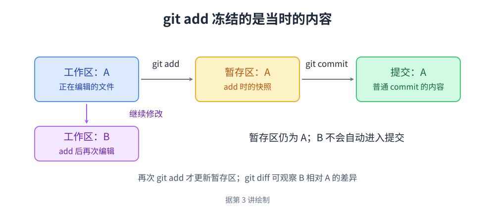

读图：文件内容 A 经 git add 进入暂存区，再由普通 git commit 形成提交 A。随后工作区改成 B，暂存区仍是 A；只有再次 add 才会改变待提交内容。

git diff 检查工作区相对暂存区的差异，git diff --cached 检查暂存区相对 HEAD 的差异。图仅描述普通 git commit，不包含 -a 或显式路径等特殊用法。

## 第一章 模型演进与软件工程项目的起点：从“一个目录”到版本管理

在前两讲探讨大模型的能力边界、提示词工程与上下文组织之后，本讲正式进入软件工程的核心任务：如何从零构建一个真实项目，并使其在持续迭代中保持可理解、可恢复与可协作。随着GPT-6等模型在逻辑推理与空间感知上取得突破，代码生成速度大幅提升，我们为什么仍然必须学习软件工程与系统基础？本章将从最新模型的使用体验出发，剖析开放的意图—规格—实现空间，并回到最朴素的工程起点，追问为什么仅仅把文件存放在一个目录里，还远远不算管好了软件项目。

### GPT-6发布与生成式模型的演进体验

在开始构建软件工程项目之前，我们需要先审视当前所处的技术坐标。当大语言模型快速迭代时，开发者的日常工作流与痛点正在发生怎样的转移？结合前两讲关于提示词与上下文的讨论，我们可以观察模型底座能力的跃升如何改变人机协作的起点，以及哪些工程问题依然留给了开发者。

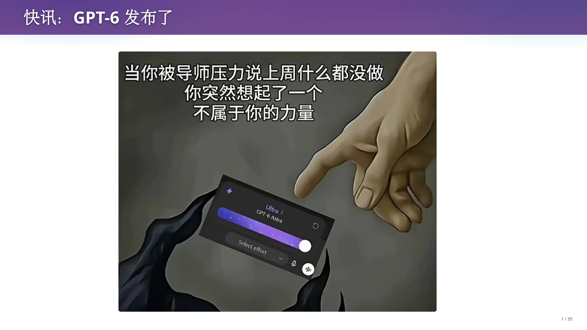

全讲以 GPT-6 发布的快讯开场。结合老师在课堂与讲义中的实际使用体验，新模型呈现出几个显著变化：第一，模型的幻觉有所减少，审美与品味有所提升，完成复杂任务时速度更快且更节省token；第二，模型的思维链（Chain of Thought）变得更加紧凑，直接导致其生成的源代码也高度紧凑，人类开发者阅读和人工审查（Review）这些代码的意愿与可行性随之降低；第三，模型在空间感知与复杂结构理解上展现出明显进步。

模型生成代码的速度越快、代码越紧凑，人类直接逐行阅读生成物就越困难。这种变化非但没有消灭软件工程，反而对项目管理提出了更高要求：当我们逐渐不再逐行阅读AI编写的实现代码时，如何保证项目在持续修改中不陷入混乱？为了看清模型的长板与人类依然不可替代的设计职责，我们需要进一步拆解软件开发中的设计空间。

### 开放的设计空间与结构不良问题

既然模型能力不断提升，为什么在实际做项目时，开发者在设计上仍然经常需要对模型提出批评与修正？这引出了软件工程的核心矛盾：从模糊的想法到精确的代码之间究竟隔着什么。这就需要审视意图、规格与实现三者的互动关系，以及赫伯特·西蒙（Herbert Simon）关于问题结构边界流动的经典理论。

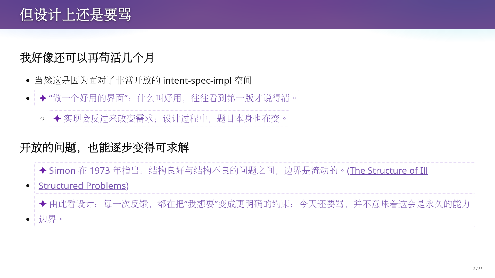

设计过程之所以仍需反复打磨，是因为软件开发面对着高度开放的意图—规格—实现（Intent-Spec-Impl）选择空间。意图（Intent）是人类主观期望达成的目标，规格（Spec）是对系统行为与约束的明确定义，实现（Impl）则是最终落地的代码与系统。例如提出“做一个好用的界面”或“做一个国民级应用”，在看到第一版实现之前，需求方往往说不清自己真正介意什么。实现会反过来改变需求，题目本身在设计过程中不断变化。西蒙（Simon，1973）指出，结构良好问题与结构不良问题（Ill-Structured Problems，指初始状态、目标状态或允许的操作算子未完全明确的问题）之间的边界是流动的。

讲义提醒我们，从西蒙的视角看软件设计，人类对模型的每一次批评与反馈，都在把模糊的“我想要”转化为更明确的约束条件，将结构不良问题逐步转化为可求解的结构良好问题。因此，今天在设计上还需要不断反馈，反映的是意图与规格对齐的过程，而模型的底层推理能力本身正在沿着另一条清晰的主线快速演进。

### 对齐到数学逻辑推理的演进路线

结构不良的开放设计问题需要靠持续反馈来收敛约束，但一旦问题被转化为具有明确规则的任务，现代模型为何能展现出“理应当做到的事就是能做到”的冲击力？从老师基于使用经验的推演来看，数学与离散逻辑推理正成为连接抽象思维与物理空间任务的基础底座。


老师从使用经验出发，将 OpenAI 的 AGI 演进路线概括为：把复杂问题对齐到数学与逻辑推理。与软件工程中缺乏唯一标准的意图—规格鸿沟不同，数学拥有全球共识的严密推理体系，定理证明的对错具有客观标准，提供了可靠的对齐基准（Grounding）。课堂上老师以中午订餐为例：根据下午会议安排与午休时间在多个选项间权衡投票，这类包含蕴含关系（A implies B）的日常决策同样可以映射为离散数学的命题逻辑。

当模型扎实地掌握了数学推理，并通过强化学习扩展到空间感知（如判断鲁班锁拆解方向、立方体投影、六面骰子展开图，或直接生成双视角光栅3D打印模型、控制机械臂抓取与叠衣服）时，许多原本需要博士生耗费数月构建搜索树或手工调优的任务被一次性解决。面对如此强大的执行工具，我们必须严肃回答一个问题：作为人类学生，今天究竟还要学什么？

### 建立核心概念：为什么我们仍需学习

当AI不仅能替代体力劳动，还能在很多具体任务上替代繁琐的脑力推演时，大学里的计算机科学课程与软件工程基础是否还有价值？这涉及到“会调用工具”与“拥有创造力”之间的区别，以及专家知识组织方式对驾驭 AI 的作用。

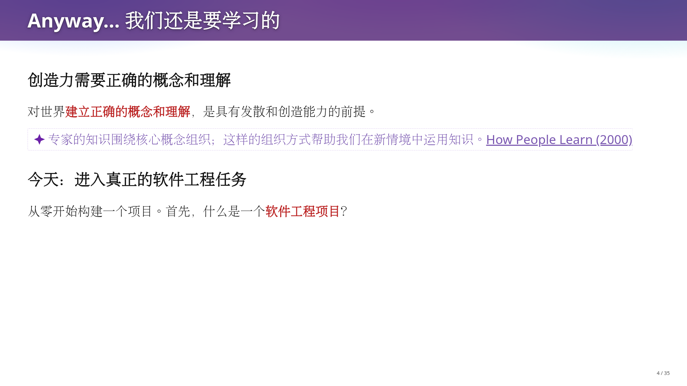

课程对此给出的回答是：创造力需要正确的概念和理解。对世界建立正确的概念和理解，是具备发散思维与创造能力的前提。认知科学著作《How People Learn》（2000）指出，专家的知识围绕核心概念（Core Concepts）组织，而非零散事实的堆砌；这种结构化的组织方式帮助人们在面对全新情境时有效迁移和运用知识。在此基础上，我们正式进入本讲的工程任务：从零开始构建一个软件工程项目。

在课堂上，老师用汽车工业作了一个生动的类比：一百多年前汽车刚发明时，开十二公里就可能抛锚，每个司机都必须精通机械原理并会修车；今天我们呼叫自动驾驶汽车，无需了解底层机械与系统栈就能到达目的地。AI虽然像自动驾驶一样解锁了强大的执行力，但在现阶段，只有建立正确的系统与工程概念，你才能看出一个设计好在哪里、知道该追问什么、懂得如何把宏大目标分解为可推进的工作。带着这一认知，我们首先来看什么是一个软件工程项目。

### 软件工程项目的朴素定义

当我们决定开始动手做软件，无论是完成课程大作业还是进行Vibe Coding（通过自然语言与AI交互来驱动编程开发），第一件具体的操作通常都是在磁盘上新建一个文件夹。从直观的文件系统视角来看，一个软件工程项目在计算机里究竟包含什么？目录中的各类文件又如何分别对应前面提到的意图、规格与实现？

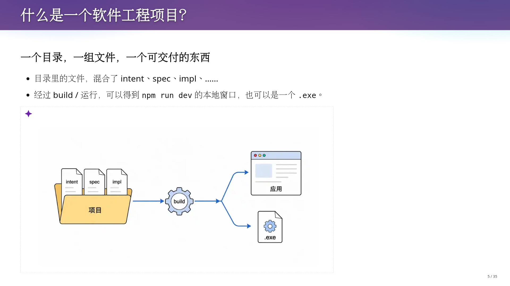

从最朴素的角度看，软件工程项目就是一个目录、一组文件，以及一个可交付的产物。软件是人类世界的需求在信息世界里的投影，而这个投影在文件系统中就表现为一个目录。目录里的文件混合了多种角色：需求说明与文档表达意图（Intent），接口定义与测试用例描述规格（Spec），源代码与构建脚本承担实现（Impl）。这些文件经过构建（Build）或运行，最终转化为可交付物，例如执行npm run dev启动的本地网页窗口，或者由C语言源码hello.c经过GCC编译生成的可执行文件（如.exe或ELF二进制程序）。

课堂提示：理解“可交付物”同样需要基础概念支撑。老师在课上分享了一个常见笑话：有人夸赞大模型极其强大，帮自己做出了好几个杀手级产品，而这些产品全都运行在http://localhost:5173上。如果缺乏计算机网络与系统的基本概念，分不清指向本机的localhost开发环境与全世界用户可访问的远端生产部署，就无法在规格文档中向AI提出准确的交付要求。那么，仅仅拥有这样一个存放着源码与可交付物的目录，是否就算管好了项目呢？

### 古早时期的项目管理：优盘与压缩包

既然软件工程项目在静态形式上表现为一个包含各类文件的目录，那么在专业版本控制工具普及之前，初学者与早期开发者是如何保存和提交这个目录的？回顾早期的真实故事可以发现，单纯依赖文件系统存放当前目录会遇到几个无法回避的工程痛点。

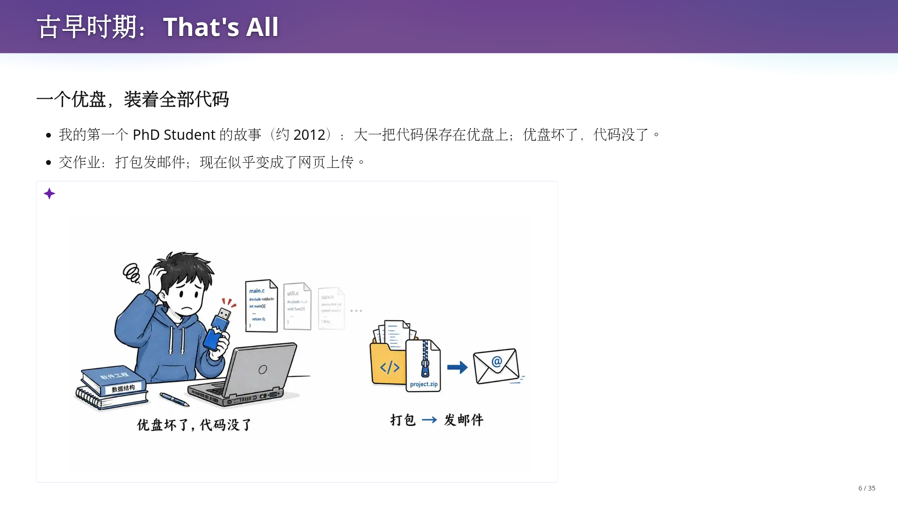

在 2012 年前后的早期阶段，许多学生认为一个目录加上里面的文件就是项目的全部（That's All）。老师的第一个博士生在 2012 年读大一时，为了在宿舍小屏幕笔记本与机房大屏幕电脑之间来回写代码，把全部代码保存在一个优盘上；结果大二时优盘物理损坏，里面保存的所有代码与编程启蒙作业全部丢失。而在作业交付方面，早期通常是将整个项目目录打包成压缩包通过电子邮件发送，后来则演变为通过课程网页上传压缩包。

从打包发邮件到网页上传，虽然交作业的操作变方便了，但单靠“目录里存着当前文件”的项目管理方式并没有发生根本改变。即便优盘不坏、存储介质完好，单目录管理依然面临三大日常痛点——第一，昨天的代码还能正常运行，今天改坏了，怎样准确退回昨天的状态？第二，新功能刚改到一半，突然需要紧急修复另一处错误，怎样暂时放下手头未完成的工作？第三，你和同伴从同一份代码出发各自修改了文件，最后怎样把两人的改动安全地汇合起来？

### 今天：用Git管理版本与课程交付

为了解决改坏回退、中断切换与多人汇合这三大痛点，软件工程界最终收敛到了怎样的标准方案？在我们的日常开发与课程作业中，版本管理工具与项目自身的构建脚本各自承担什么职责？在此需要准确区分版本控制系统的历史管理能力与项目工程规则的边界。

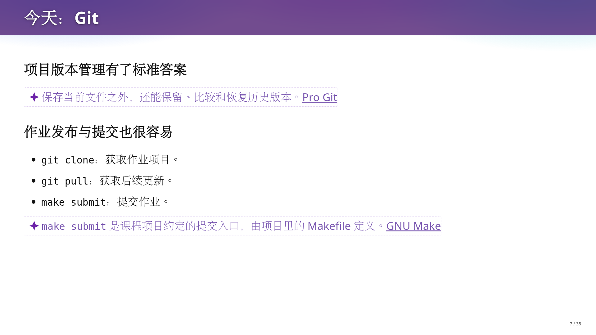

今天，项目版本管理已经有了标准方案——Git。版本管理（Version Control）是指不仅保存项目当前的文件状态，还能够完整保留、比较和恢复项目的历史状态，并记录这些状态之间的演进关系。在课程作业发布与日常协作中，这带来了极大的便利：学生使用git clone命令即可从远端获取完整的作业项目仓库；当老师更新了作业框架或说明时，无需重新群发压缩包，学生只需执行git pull即可接收后续更新；而在完成作业后，则通过执行make submit完成提交。

讲义与课件在此处给出了一个必须严格区分的技术边界：git clone和git pull是Git自身的命令，负责获取与同步版本历史；而 `make submit` 并非 Git 自带的子命令，它是课程项目在 `Makefile` 中定义并约定的构建与提交入口（由 GNU Make 解析执行，内部调用脚本完成打包、验证与上传）。概括而言，Git负责管理项目的版本演进，而项目自身的工程规则负责定义怎样构建、验证和交付。既然Git如此普及，为什么很多每天都在敲Git命令的人依然没有真正掌握它？这将引出下一章关于“留意”与脑中预演的学习方法讨论。

> 版本管理的核心动机：超越“当前目录”
>
> 把所有源码、文档和配置放在一个目录里，只能反映项目在“此时此刻”的单一横截面。真实的软件工程是一个在时间中持续演进、试错与协作的过程。版本管理之所以必不可少，是因为它不仅保存项目现在的样子，还显式保存了项目经历过哪些历史状态，以及这些状态之间“谁从谁演化而来”的因果关系，从而从根本上解决了改坏回退、任务中断切换与多人改动汇合三大工程难题。

> 课堂直觉：实现如何反过来塑造需求
>
> 面对结构不良的设计问题（如“做一个好用的界面”），人类很难在动工前写出完备无遗漏的规格说明（Spec）。大模型生成的第一版实现（Impl），往往扮演了“需求探针”的角色：正是因为看到了具体界面或原型，开发者才突然意识到自己真正介意什么、讨厌什么。每一次对AI的批评与反馈，都是在把模糊的主观意图收敛为明确的工程约束。

> 切勿混淆Git命令与Makefile项目入口
>
> 在课程与实际工程中，初学者常误以为make submit是Git提供的提交功能。务必明确职责边界：Git是分布式版本控制系统，提供git clone、git pull、git commit等命令来管理代码快照与版本历史；而make是构建自动化工具，make submit是课程在项目的Makefile中专门编写的目标（Target）规则，用于执行项目特定的测试、打包与作业上传流程。

术语消化：第一章核心概念与工具职责梳理

| 术语 | 解决的问题 | 机制与课程关系 |
|---|---|---|
| 意图—规格—实现（Intent-Spec-Impl） | 刻画从人类模糊想法到精确可执行代码之间的鸿沟 | 意图表达主观目标，规格定义接口与约束，实现提供具体源码；开放空间中实现会反向帮助明确规格 |
| 结构不良问题（Ill-Structured Problem） | 解释为何复杂软件设计难以一步到位生成完美结果 | 初始条件或目标标准未完全明确的问题；通过人类对实现的持续批评与反馈，逐步转化为约束明确的可求解问题 |
| 版本管理（Version Control） | 解决单目录管理无法回退改坏代码、难以切换中断任务及多人改动汇合的痛点 | 除保存项目当前文件外，还保存历史状态集合及状态间的演进关系，是可理解、可恢复、可协作的基础 |
| make submit | 提供课程作业标准化的打包、验证与交付入口 | 由项目根目录下的Makefile定义并由GNU Make执行，属于项目级构建与交付规则，而非Git内置命令 |

### 本章小结

本章从GPT-6等模型的使用体验出发，探讨了AI时代学习软件工程的意义。

- 尽管模型在数学逻辑推理与空间感知上进展迅速，但软件设计面对开放的意图—规格—实现空间，仍需人类围绕核心概念进行**架构分解与持续反馈**。

- 回到具体工程任务，软件项目在表面上是一个包含意图、规格与实现文件的目录，但仅靠单目录或优盘拷贝无法应对**改坏回退、中断切换与多人协作**。

- 引入Git进行**版本管理**，配合Makefile等项目构建交付规则，才真正构成了现代软件工程项目的起点。

## 第二章 AI 时代的学习方法论：保持“留意”与脑中预演

在第一章中，我们看到软件工程已经从把代码存进优盘演进为用 Git 维护项目的演进历史。然而，当开源仓库链接与 AI 生成物随处可得时，为什么很多人哪怕每天都在拉取代码、提交作业，依然处于“用过却没学懂”的状态？信息获取门槛的降低并没有自动转化为个人能力的提升。本章将在深入 Git 核心机制之前，先探讨 AI 时代最关键的学习方法论：如何打破被动执行指令的惯性，通过保持对工程细节的“留意”与脑中预演（Virtually Implement），把每一次日常浏览和命令操作都变成有效的概念外推。

### 高密度工程素材与主动观察意识

今天打开任何一个技术社区或公众号，满眼都是 GitHub 开源仓库链接；做课程实验时，第一件事也是克隆一个现成的项目仓库。面对这些触手可及的工程素材，为什么许多人浏览了几十个仓库，轮到自己从零搭建项目时依然无从下手？“看到项目”与“吸收设计”之间究竟缺失了哪一步？


课外真实世界的信息量与信息密度已经远远超过传统课堂的讲授范围，这也是课堂上戏言“上课耽误学习”的真实原因。一个维护了十余年的成熟开源项目，其目录组织、哪些文件被保留、哪些文件被忽略，背后往往凝聚着工程师经历系统崩溃与版本重构后的经验教训。然而，传统教学很少训练学生如何主动观察和使用这些高密度资源。如果还带着“老师要求拉取作业就只执行拉取命令、绝不多看一眼”的被动心态，看到再多优秀项目也不会自动内化为自己的知识。要把一次普通浏览变成有效学习，核心在于主动向自己提问：这个项目里的哪一个细节，是我自己动手做时不会想到的？

课堂提示通过一个生活中的对比阐明了怎样从优秀范例中学习：在香港复杂的地下步行系统中，每当行人走到三个岔路口面临方向不确定性时，正前方一定有一块路牌清楚标明三个方向的去向；而在南京地铁站寻找某个出口时，有时需要环顾四周甚至走很远去找地图。这背后的第一性原理是：优秀的设计总是站在使用者产生不确定性的位置，用最少的负担呈现决策所需的全部信息。带着这种观察力再去对比 GitHub 仓库，你就会发现许多直接生成的 README 充斥着冗长文字和 Unicode 字符画出的目录树框图，属于典型的低质生成物（AI slop）；而优秀老项目的 README 往往清爽简短，看完后直接给出三个核心链接通向读者最关心的文档。有了这一层观察，你就可以立刻追问 AI 为什么后者的阅读与上手体验远胜前者，从而把审美直觉沉淀为明确的设计原则。

### Virtually Implement：在脑中预演与自我解释

当我们意识到要留意工程细节后，具体应当遵循怎样的思维动作，才能避免走马观花？如果一上来就直接阅读别人的源码或采纳 AI 生成的方案，大脑很容易顺着现成结论滑过去，觉得“理所当然”。为此，课程提出了一项核心学习技巧，其关键在于“先暂停预演、再对照追问”两个阶段。

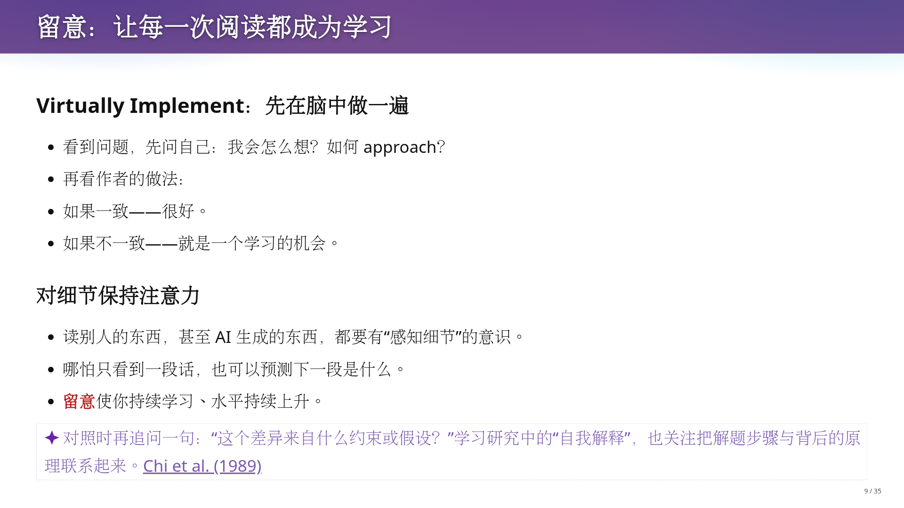

让每一次阅读都成为学习的核心技巧是脑中预演（Virtually Implement，即先在脑子里自己做一遍）。无论是读学术论文、看开源代码，还是阅读 AI 生成的一段文字，看到问题或需求时，先强迫自己停下来忽略眼前的现成答案，在脑中独立思考：如果换成我来解决，我会怎样切入（approach）？需要设计什么数据结构、依赖哪些前提假设、又会在什么边界条件下失败？想出自己的初步方案后，再去对照作者或 AI 的做法。如果双方思路一致，说明你已经掌握了该领域的常规解法，可以进一步比对实现细节；如果双方不一致，这就成了一次绝佳的学习机会——你可以立即追问：“这个差异究竟来自哪条我不知道的工程约束或前提假设？”这种把具体步骤与背后原理主动联系起来的习惯，正对应了认知科学中 Chi 等人在 1989 年提出的“自我解释（Self-Explanation）”学习机制。

在日常训练中，脑中预演的粒度可以非常细微。比如读文档时看到上一段，先预测下一段作者会展开什么；读代码时看到作者在一个看似简单的函数里多检查了一次返回值，或者为一个简单功能特意配齐了构建说明与测试，就停下来想一想如果不这样做会在什么场景下出错。对比脑中方案与眼前方案时，通常会遇到两种结果：若成熟教科书或工业级项目的方案比你的更精巧简洁，追问原因就能让原有的知识网络向外生长出一块；若偶尔发现自己的方案竟然比眼前看到的更干净，就能直接识别出低质生成物，并获得强烈的正反馈。正是这种持续感知细节、不断预测并核对的习惯，决定了开发者在 AI 时代的成长斜率。

### 从保研面试看“听说过”与“用过且留意过”的鸿沟

抽象的方法论需要在具体的工程工具上检验。Git 是计算机专业学生几乎每天都在接触的基础设施，每个人的简历上似乎都能写上“熟练使用 Git”。但“每天敲命令或点按钮”是否等于真正掌握了这个工具？下面通过一个真实的保研推免面试案例，来看看缺乏留意的日常使用会留下怎样的认知盲区。

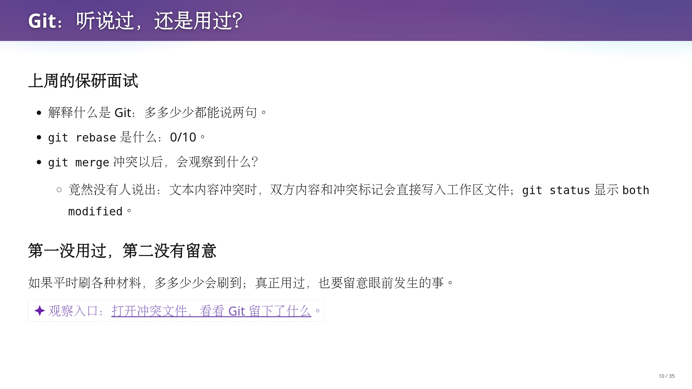

在近期的一次保研推免面试中，老师向候选同学连续提出了三个关于 Git 的问题：第一，“什么是 Git？”，大多数同学都能泛泛而谈，比如用于下载分发代码或管理版本；第二，“什么是 `git rebase`（变基，即将一串提交所代表的修改依次重放到新的起点上）？”，被问到的 10 位同学无一人答出（0/10）；第三，“执行 `git merge`（合并分支）发生冲突以后，你会观察到什么现象？”，现场没有人主动说出最直观的工程现象：当常见文本内容发生冲突时，Git 会把冲突双方的代码内容连同 `<<<<<<<`、`=======`、`>>>>>>>` 等冲突标记直接写入工作区文件中，且运行 `git status` 会报告 `both modified`（双方均已修改）。

为什么大家每天都在用 Git 拉取作业，却答不出合并冲突后的文件长什么样？原因主要有两条：一是没有亲手经历过分支协作开发，二是在冲突发生时没有留意观察。今天很多人在遇到分支冲突时，要么直接点击集成开发环境（IDE）上弹出的“Accept Incoming Change”等快捷按钮一键跳过，要么直接把报错甩给 AI Agent 自动修复，只要最后看到测试通过就立刻关掉窗口，从未花一秒钟点开冲突文件看看 Git 究竟在里面留下了什么。站在 Git 设计者的第一性原理来看，当两个人把同一行原本为 `1` 的代码分别改成 `2` 和 `3` 时，工具无法替人类做业务决定，最合理的设计就是遵循前面所说的“地铁站路牌原则”——在冲突发生的现场，把双方修改的上下文用尖括号和等号标记并排呈现在文件里，交由开发者裁决。只有亲自打开文件观察过一次，才能跨越“听说过版本管理工具”与“能准确预测下一条命令后果”之间的鸿沟，而这也正是下一章我们从头推导 Git 快照模型的起点。

> 脑中预演（Virtually Implement）的三步执行法
>
> 面对论文、源码或 AI 产出时，切忌直接顺着作者的结论往下读。
>
> - 第一步是“**遮挡与构建**”：看到问题定义后暂停，用自己的知识储备构思数据结构与处理流程；
>
> - 第二步是“**比对与定位**”：打开作者方案，找出双方在架构、边界检查或接口设计上的具体差异点；
>
> - 第三步是“**归因追问**”：向自己或向 AI 追问该差异是由什么性能约束、历史兼容性或安全假设导致的，从而把外部信息转化为可外推的概念连接。

> 第一性原理：在产生不确定性的现场提供决策信息
>
> 无论是香港地下通道在岔路口正前方设置路牌，优秀开源项目用极简 README 给出核心文档入口，还是 Git 在文本合并冲突时将 `HEAD` 与待合并分支的代码用 `<<<<<<<`、`=======`、`>>>>>>>` 直接并排写入工作区文件，背后都共享着同一条工程设计准则：当使用者面临分支选择或冲突裁决的不确定性时，系统不应只抛出错误代码让人四处翻找上下文，而应把做决定所需的全部信息直接呈现在问题发生的现场。

> 合并冲突的观察边界：并非所有冲突都表现为文本标记
>
> 讲义特别提醒，在观察 `git merge` 冲突现场时，必须养成同时检查 `git status` 状态输出与工作区文件内容的习惯。虽然最常见的源码文本行冲突会在工作区文件中直接写入 `<<<<<<<`、`=======`、`>>>>>>>` 标记，但当遇到二进制文件（如编译产物、图片）冲突，或者一方修改文件而另一方删除该文件（删除与修改冲突）等情形时，工作区文件中并不一定呈现相同的内联文本标记，此时必须依赖 `git status` 报告的具体冲突类型来判断和处置。

术语消化：AI 时代主动学习方法论与 Git 观察核心概念对照

| 术语 | 解决的问题 | 机制与课程关系 |
|---|---|---|
| Virtually Implement（脑中预演） | 克服被动阅读代码或 AI 输出时“看得懂却学不会”的浅层浏览陷阱 | 看到问题先在脑中独立设计方案并预判失败点，再与作者方案比对差异背后的约束，推动个人知识网络主动外推 |
| Self-Explanation（自我解释） | 消除机械记忆操作步骤与理解底层设计原理之间的脱节 | 源自认知科学研究（Chi et al., 1989），强调在学习中主动追问每一步实现细节与领域基本假设之间的因果联系 |
| 内联冲突标记（Conflict Markers） | 在自动合并无法裁决同一位置的多方文本修改时，降低人工比对与决策的上下文查找成本 | Git 在常见文本冲突现场将双方内容与 `<<<<<<<`、`=======`、`>>>>>>>` 写入工作区文件，并配合 `git status` 的 `both modified` 提示人工介入 |
| AI Slop（低质生成物） | 识别缺乏工程判断与读者视角的冗余生成内容（如充斥无意义目录树框图的超长 README） | 通过高频对比维护十余年的成熟开源项目与直出生成物，训练对信息密度、结构清晰度与工程品味的敏锐直觉 |

### 本章小结

本章探讨了在开源项目与 AI 生成物随处可得的时代，如何将日常浏览转化为真正的工程能力。

- 面对高信息密度的成熟仓库，学习者必须摆脱只按指令行事的被动习惯，运用**脑中预演**（Virtually Implement）与自我解释，在看现成答案前先独立构思并追问差异背后的约束。

- 保研面试中候选人对 `git rebase` 与 `git merge` 冲突现场的普遍盲区表明，过度依赖 IDE 按钮或 Agent 代劳而不去观察**工作区文件的真实变化**，会使人停留在“听说过工具”的表面。

- 保持对细节的**留意**，正是我们接下来从零推导 Git 快照与分支机制的思维基础。

## 第三章 从“我想撤销”推导 Git：项目快照、暂存区与分支合并

在上一章，我们讨论了怎样通过“脑中预演（virtually implement）”和对细节的留意，将看到的工程现象转化为自己的概念体系。现在，如果我们要从零开始设计一个管理项目版本的系统，应该怎样思考？与其死记硬背一串 Git 命令，不如退回第一性原理：当人和 Agent 犯错想要“回溯时间”时，当多人围绕同一份代码各自推进并希望汇合结果时，究竟需要保存什么数据结构？本章将从复制文件夹的朴素做法出发，顺着工程痛点一步步推导出 Git 的项目快照模型、工作区与暂存区的三棵树状态转换，以及分支引用与合并重放机制。

### 版本管理的演进：从复制目录到分布式项目历史

在没有专门工具的年代，开发者遇到“怕改坏代码”的需求时，最直觉的反应是什么？本节请先思考：如果我们通过手工复制整个项目目录来保留旧版本，或者让工具只记录单个文件的逐行补丁（delta），在版本增多和多人协作时会遇到哪些不可避免的工程瓶颈？

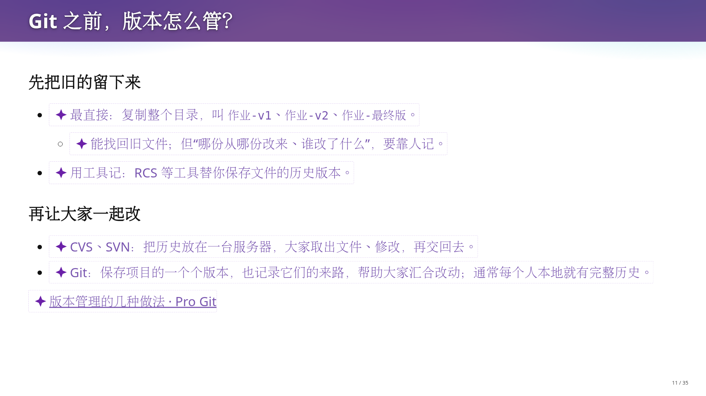

最朴素的版本留存方式是手动复制整个目录，命名为“作业-v1”“作业-v2”“作业-最终版”。这种方式虽然能找回旧文件，但版本之间的派生关系、每次修改的具体内容以及文件与配置的配套关系，完全依赖人脑记忆。随后出现的 RCS（Revision Control System，修订控制系统，早期管理单文件历史版本的本地工具）接管了单文件历史记录；CVS（Concurrent Versions System）与 SVN（Subversion）等集中式版本控制系统则将历史存放在中央服务器上，支持多人检出文件、修改后再提交回去。而 Git 不仅保存项目的一个个完整版本并记录它们的演进来源以辅助汇合改动，还让每个开发者在本地通常就拥有完整的项目历史。

课堂口述中还对比了集中式工具 SVN 与 Git 的设计取舍：早期系统倾向于保存初始版本加上每次修改的增量补丁（patch / delta），看似节省空间，但在项目规模扩大后，回退到早期版本需要逐个逆向应用变化，反而拖慢了操作。Git 回归了“想要回到过去某个版本，就应当直接切回该状态”的第一性原理。这种转向项目级版本与分布式架构的设计，源于 Linux 内核社区的真实协作需求。

### Git 的诞生背景：Linux 内核社区的真实工程需求

为什么 Git 会把速度、离线完整历史以及极低成本的分支与合并放在设计的中心位置？沿着 Linux 内核社区十余年间协作方式的变迁，可以看到一个包含成千上万文件与全球贡献者的项目是如何催生出这套版本控制工具的。

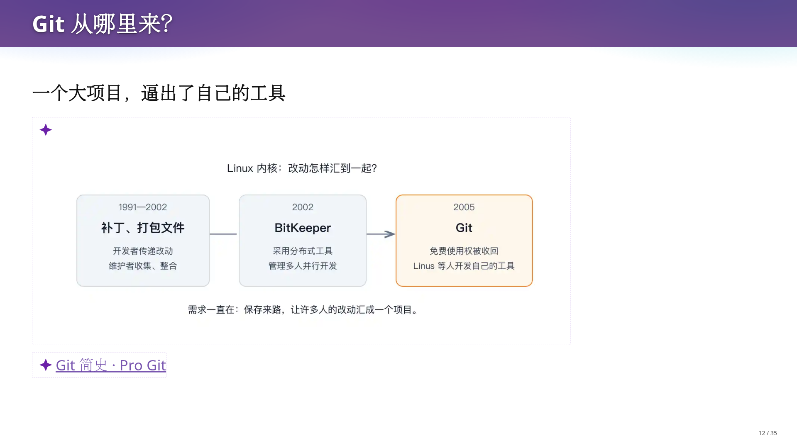

Linux 内核的版本管理经历了三个明确的历史阶段。在 1991 年至 2002 年间，内核开发并没有使用统一的版本控制仓库，全球贡献者主要依靠邮件列表传递代码补丁（patch）与打包压缩文件（tarball），由维护者手工合入核心代码并发布新版。2002 年，社区开始采用商业分布式版本控制工具 BitKeeper 来管理源码。到了 2005 年，由于 BitKeeper 的免费使用权被收回，原有的协作安排终止，Linux 缔造者 Linus Torvalds 决定针对内核开发的高并发、大规模协作需求，亲自设计并开发了 Git。

这段历史说明，Git 源于 Linux 内核这样大体量、高频率分支合并的实际工程需求。正因为经历过手工传递补丁的繁琐和分布式协作的考验，Linus 才确立了极简、高速且概念干净的底层模型。接下来我们就来看，这个模型中最核心的基石——“项目快照”究竟解决了什么问题。

### 项目级时间回溯：为什么必须管理完整快照

无论是人类开发者还是 AI Agent，在修改代码时都会犯错：原本运行良好的代码被改坏，或者某套设计探索失败需要推翻重来。请思考：为什么版本控制不能只针对单个文件各自回退，而必须以“整个项目”为单位记录状态？编辑器里的“保存文件”与版本库里的“提交”又有什么本质区别？

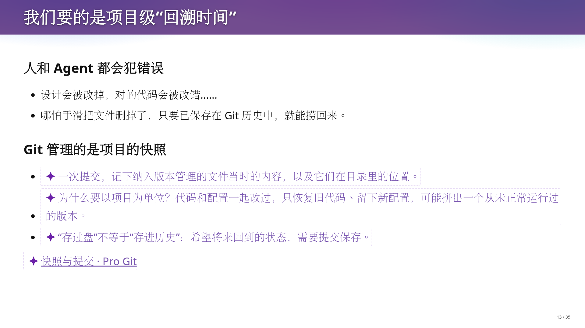

Git 最核心的概念是：Git 管理的是项目的快照（Snapshot，描述纳入版本管理的所有文件在某一特定时刻的内容及其在目录树中所处位置的完整状态记录）。为什么要以整个项目为单位保存快照？因为在真实工程中，源代码、接口定义与配置文件往往是配套修改的；如果只把某几个源代码文件恢复到旧版本，却在目录里留下了新的配置文件，就会拼凑出一个历史上从未正常运行过的畸形版本。此外，必须区分两个不同层次的状态：在编辑器里按保存键只是更新了磁盘工作区的文件，并不等于写进了 Git 历史；只有显式执行提交（Commit，将项目快照与作者、提交说明及父提交指针绑定并写入版本库的操作），该状态才会成为将来可以安全捞回的历史节点。

需要注意，逻辑上的“完整项目快照”并不等于每次提交都在磁盘上物理复制全部文件。Git 底层通过对象（Object）保存文件内容与目录结构，未发生变化的文件和子目录在新的快照中直接复用已有对象。理解了这一层，我们就不会担心频繁提交会立刻撑爆磁盘，接下来便可以从自己的日常经验把整套概念自然外推出来。

### 从已有知识网络外推 Git 的核心概念

面对一套工具的众多概念，死记硬背往往容易遗忘。如果把现在的你视为一个已有的知识网络，怎样通过自然“外推”的方式长出 Git 的概念？我们可以顺着“先预测、再核对”的思路，回答这样一个问题：删掉一个已提交的文件并再次提交后，它还存在于仓库里吗？

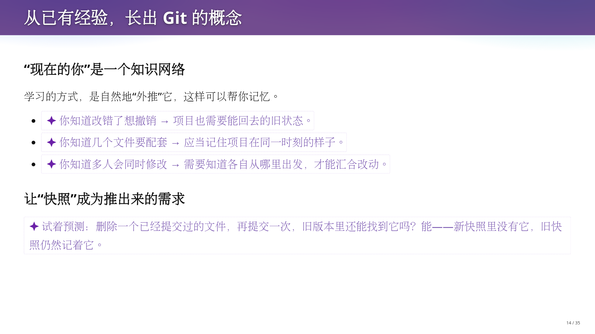

我们可以从三条最朴素的日常开发经验出发，严密推导出 Git 的数据结构需求：

- 第一，你知道代码改错了想撤销，推导出项目必须保留能够随时回去的**旧状态**；

- 第二，你知道多个源码文件与配置必须配套工作，推导出系统应当记住整个项目在同一时刻的完整样子，即**快照**；

- 第三，你知道多个人或多个 Agent 会同时修改代码，推导出每个快照不仅要记录内容，还要通过**父提交**（Parent Commit，指向当前提交直接前驱节点的引用，根提交没有父节点）记录它从哪个版本衍生而来，从而形成有向无环图结构以便汇合改动。

基于这一模型可以立即预测：删除一个已经提交过的文件并再提交一次，新快照里虽然没有它，但旧快照仍然完好地记录着它，因此随时可以从旧版本中找回。

这种从需求推导概念的思维方式，正是上一章强调的“脑中预演”。当你明白每一次提交都是在历史图谱上追加一个带有父指针的新快照节点，历史就不再是神秘的黑盒。既然快照是最终要写入历史的目标，那么在日常编辑文件到最终生成快照之间，Git 是如何让我们精细控制每一次提交内容的？这就引出了工作区、暂存区与提交历史的三层结构。

### 从 init、add、commit 到分支与合并的状态转换

许多初学者跟着入门教程学会了敲入初始化、添加和提交命令，却以为这就掌握了 Git。本节我们通过一个经典的课堂预测实验来检验你是否真正看清了水面下的状态流动：当你对同一个文件先执行添加操作，紧接着又修改了它，此时直接执行普通提交，进入历史快照的究竟是哪一版内容？

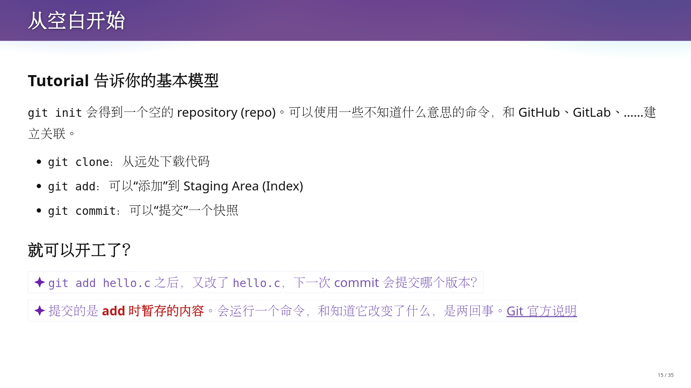

从空白目录开始，执行 git init 会在当前目录下建立一个空的仓库（Repository，简称 repo，包含隐藏的 .git 目录用于存放所有版本历史与元数据），而 git clone 则用于从已有仓库创建本地副本。在本地日常操作中，必须严格区分三个区域：工作区（Working Directory / Working Tree，磁盘上当前可见、正在直接编辑的目录与文件集合，包含已跟踪和未跟踪的当前文件状态，而非仅指未暂存的改动）、暂存区（Staging Area，也称 Index，保存下一次提交准备采用的文件内容清单）以及提交历史（Commit History，已永久记录的快照序列）。执行 git add hello.c 会将此刻 hello.c 的内容冻结并放入暂存区；如果随后又在编辑器里修改了 hello.c 却没有再次执行 add，那么紧接着运行普通的 git commit 时，提交进历史的只是 add 时暂存的那个版本，后续修改依然停留在工作区中。

为了看清这三者之间的差异，讲义给出了两个关键观察命令：使用 git diff 检查工作区相对于暂存区的未暂存改动，使用 git diff --cached 检查暂存区相对于当前提交（HEAD）准备提交的变化。更进一步，当多人沿不同方向推进时，分支（Branch，指向某个提交对象的可移动轻量引用，如松散引用形式下的 .git/refs/heads/ 分支文件）与 HEAD（通常指向当前所在分支引用的特殊指针）让项目得以分叉演进：git merge 通过 fast-forward（快进，当目标分支是当前分支的直接后续时仅向前移动指针）或三方合并（结合共同祖先与双方改动生成含两个父提交的合并提交）汇合历史；而 `git rebase`（变基，将一串提交所代表的修改依次重放到新起点上并生成新标识的提交）则能整理出线性历史，但不应对他人已依赖的共享历史擅自执行变基。

> 逻辑快照与底层持久化数据结构
>
> Git 的“项目快照”是一个逻辑概念，并不需要在每次 commit 时把全部文件在硬盘上物理拷贝一份。在 .git/objects 中，Git 采用持久化目录树结构，通过三类核心对象管理数据：blob 对象存储单个文件的原始字节内容，tree 对象记录文件名、权限模式（如 100644、100755）及对 blob 或子 tree 的哈希引用，commit 对象则指向根目录的 tree 对象、父提交及作者信息。若某次提交仅修改了目录树深处的一个文件，Git 只需新建该文件的 blob 并复制从该节点到根的路径上的 tree 节点，其余未改动分支全部通过哈希指针直接共享旧对象。

> 课堂提示：打开冲突现场，观察 Git 留下的全部信息
>
> 在推免面试中，许多同学答不出 git merge 发生冲突后会观察到什么。老师强调，优秀工具的设计遵循一条第一性原理：在一件事发生的地方，把处理它所需的全部信息直接呈现出来。当双方对同一段文本做出无法自动协调的修改时，Git 不仅在暂存区（Index）底层保留了共同祖先（base）、当前分支（ours）和合入分支（theirs）三个版本，还会直接在工作区文件中写入 <<<<<<<、=======、>>>>>>> 冲突标记，并在 git status 中报告 both modified。解决冲突就是阅读这些标记上下文，编辑为最终期望的代码，移除标记后再执行 git add 与提交。

> 易错警示：混淆工作区与暂存区，以及擅自改写共享历史
>
> 初学者常犯两类概念性错误。第一是把“编辑器保存文件”等同于“已纳入待提交范围”，忽略了 git add 暂存的是执行命令那一刻的文件快照；若暂存后又顺手改了代码却不检查 git diff，提交上去的就会是缺少最新改动的半成品。第二是在协作中滥用 git rebase：重放一串提交虽然能消除分叉、得到整洁的线性历史，但重放生成的每一个提交都会获得全新的哈希标识；如果协作者已经基于你原来的提交开展工作，改写已推送的历史会迫使他人处理混乱的重复合并，将整理成本转嫁给团队。

术语消化：Git 核心状态与分支合并机制消化表

| 术语 | 解决的问题 | 机制与课程关系 |
|---|---|---|
| 项目快照 (Snapshot) | 解决单文件独立回退导致代码与配置版本错配、拼凑出从未正常运行过的项目状态的问题 | 记录纳入管理的全部文件在某一时刻的内容与目录位置；底层通过 commit、tree、blob 对象与哈希指针共享未变数据 |
| 工作区 (Working Tree) | 提供开发者或 Agent 直接阅读、编辑、编译和运行项目的当前可见文件环境 | 包含磁盘目录中当前可见的文件状态（含已跟踪与未跟踪文件），与暂存区之间的差异可通过 git diff 观察 |
| 暂存区 (Staging Area / Index) | 避免被迫将工作区此刻所有杂乱编辑一次性全部提交，允许精心组织单次提交的边界 | 由 git add 冻结并写入待提交的文件内容清单；普通 git commit 仅依据暂存区内容生成新快照，可用 git diff --cached 对照 HEAD |
| 分支引用与 HEAD | 支持从同一项目起点沿多个独立方向并行探索或开发，而不互相破坏工作现场 | 分支名是指向某个 commit 对象的可移动引用（如松散引用下存于 .git/refs/heads/）；HEAD 通常指向当前所在分支，随新提交一起前移 |
| 合并 (git merge) 与变基 (git rebase) | 将不同开发者或不同 Agent 在各自分支上推进的修改汇合到同一条主线上 | merge 结合共同祖先与双方改动生成含两个父节点的合并提交（或直接 fast-forward）；rebase 将提交序列重放到新起点并生成新哈希，仅限未共享或约定允许的历史 |

```bash
# 1. 初始化空仓库并创建初始版本
git init demo-repo && cd demo-repo
printf 'int main() { return 0; }\n' > hello.c
git add hello.c
git commit -m "feat: add initial hello.c"

# 2. 修改文件为版本 A 并放入暂存区
printf 'int main() { return 1; } /* Version A */\n' > hello.c
git add hello.c

# 3. 再次修改工作区文件为版本 B，但不执行 git add
printf 'int main() { return 2; } /* Version B */\n' > hello.c

# 4. 分别观察两处差异：工作区 vs 暂存区，暂存区 vs HEAD
git diff            # 显示 Version A 到 Version B 的差异（尚未暂存）
git diff --cached   # 显示初始版本到 Version A 的差异（准备提交）

# 5. 执行普通提交：验证进入历史的是暂存区的 Version A
git commit -m "fix: update return value to 1"
git show HEAD:hello.c  # 输出为 Version A，而工作区仍保留 Version B
```

该脚本完整复现了讲义中的核心预测实验。输入为对同一文件 hello.c 的两次连续修改（Version A 与 Version B），其中仅在第一次修改后执行了 git add。通过对比 git diff 与 git diff --cached 的输出，并在普通 git commit 后检查 HEAD 快照内容，清晰证明了 git commit 记录的是 git add 冻结在暂存区中的版本（Version A），而非工作区的最新编辑（Version B）。

### 本章小结

本章从“撤销错误”和“多人协作”的第一性原理出发，梳理了从手动复制目录、RCS、SVN 到 Git 的演进历程与 Linux 内核背景，确立了“**Git 管理项目快照**”的核心模型。

通过剖析工作区、暂存区与提交历史的三层转换，以及分支指针、git merge 与 git rebase 的机制，我们将死记命令转化为**对状态的精确预测**。

但仅仅会执行提交还不算管好了项目，面对工作区里的编译产物、日志和配置文件，究竟哪些才应该放进快照？下一章我们将深入水面之下的 Git 工程最佳实践。

## 第四章 跨越命令表面的工程判断：从 `.gitignore` 到命名规范的细节追问

掌握了 git init、git add 和 git commit 等基础命令后，我们是否就已经懂得如何管理软件项目了？当工作区里同时躺着源代码、编译出的可执行程序、编辑器配置和临时日志时，简单的全部添加操作虽然在语法上完全合法，却会迅速把仓库拖入状态矛盾与合并冲突的泥潭。本章将跨越命令表面，追问水面之下的工程最佳实践：如何区分本地目录里有什么与项目需要共同保存什么，如何借助 AI 将每一次提交检查变成概念学习的入口，以及为什么连一条规则名称的大写还是小写都值得用第一性原理去推敲。

### 从能运行到能协作：Best Practice 的真实来历

许多初学者在看完几分钟的入门教程、学会敲打几条基本命令后，就认为自己已经掌握了版本控制。然而，真正将业余练习与工程协作区分开的，往往是潜藏在命令水面之下的下一级知识。为什么程序明明已经在本地跑通了，工程师还要额外编写忽略规则？这些工程约定又是从哪些实际问题中总结出来的？

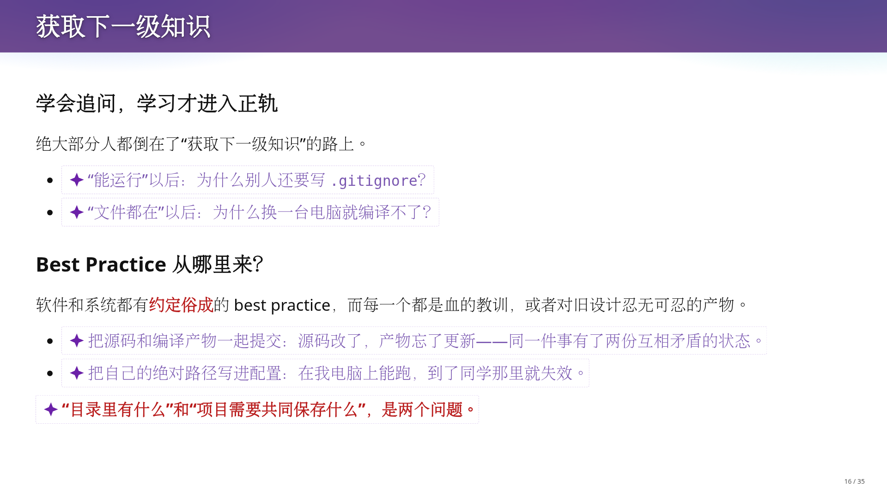

许多学习者停留在表面命令，没有继续获取下一级知识。当程序能运行、文件都在目录里之后，追问为什么需要 `.gitignore`、为什么换一台电脑就无法编译，学习才真正进入正轨。软件工程中约定俗成的良好做法（Best Practices，即在长期工程实践中总结出的推荐规范），大多来自前人踩坑后的教训或对旧设计的改进。这里有两个典型反例：一是把源码和编译产物一起提交，一旦源码修改后忘记重新编译，仓库里同一件事就会出现两份互相矛盾的状态；二是把本机绝对路径写进配置文件，导致代码在自己电脑上能跑，到了合作者电脑上却直接失效。这引出了核心判断：目录里有什么，和项目需要共同保存什么，是两个截然不同的问题。

课堂演示中，初学者常喜欢用 git add . 一把抓地提交所有文件。如果把 C 语言源码 hello.c 和编译出的二进制文件 hello 一并塞进仓库，不仅会让仓库体积膨胀，更会在多人协作时引发灾难：不同机器编译出的二进制文件往往带有日期、哈希或本机环境指纹，哪怕源码相同也会产生难以人工合并的二进制冲突。要跨过这道门槛，我们需要建立在具体文件变化上做判断的机制。

### 把具体变化变成学习入口：借助 AGENTS.md 训练工程判断

初学者在面对一个新项目时，往往因为缺乏足够的背景知识而在不知不觉中犯错，甚至分不清哪些做法是规范的、哪些只是凑巧能跑。既然今天我们已经有了大语言模型与编码 Agent，怎样才能避免无脑托管、反而让 AI 成为随时温和讲解工程规范的导师？为此，我们可以利用项目规则文件来建立持续反馈的学习循环。

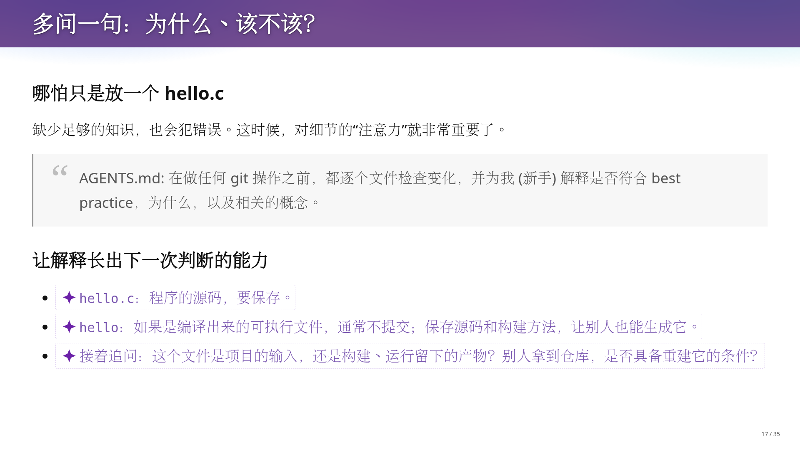

哪怕面对只有一个 `hello.c` 的简单目录，对细节保持注意力同样重要。讲义推荐新手在项目的 AGENTS.md（用于向 AI Agent 声明项目背景、工作流与协作规则的约定文件）中加入一条明确的学习约定：在做任何 git 操作之前，都逐个文件检查变化，并为新手解释是否符合 best practice、为什么，以及相关的概念。通过这种机制，每一次具体的解释都在帮助开发者长出下一次独立判断的能力。以 hello.c 和编译得到的 hello 为例，源码 hello.c 需要保存，而可执行文件 hello 通常不提交，应当保存源码和构建方法让别人也能生成它。由此提炼出的通用追问框架是：这个文件是项目的输入，还是构建与运行留下的产物？别人拿到仓库后，是否具备重建它的条件？

在课堂现场演示中，当老师故意写了一段带语法错误的代码或混杂了编译产物让 Agent 检查时，Agent 不仅指出了编译产物不应入库，还主动阻止了破坏构建的提交，并顺带引出了历史二分排错（git bisect）等概念：如果每次提交不能保证完整自洽与可编译，后续自动化排错就会失效。把这条检查约定写进 AGENTS.md，正是把日常的每次提交都变成了低压力的工程实践课。

### 进组与审稿的高血压时刻：四类活规则与忽略的边界

在没有 AI 耐心辅导的年代，研究生新生进组后的第一次代码提交，或是学术论文审稿中的开源代码检查，常常成为导师和审稿人的“高血压时刻”。究竟哪些文件最容易被误传进仓库？如果真的不小心把敏感凭据提交了上去，事后补救的正确机理是什么？理解这些规范时，需要区分按文件名执行的机械禁令与基于文件用途的工程判断。

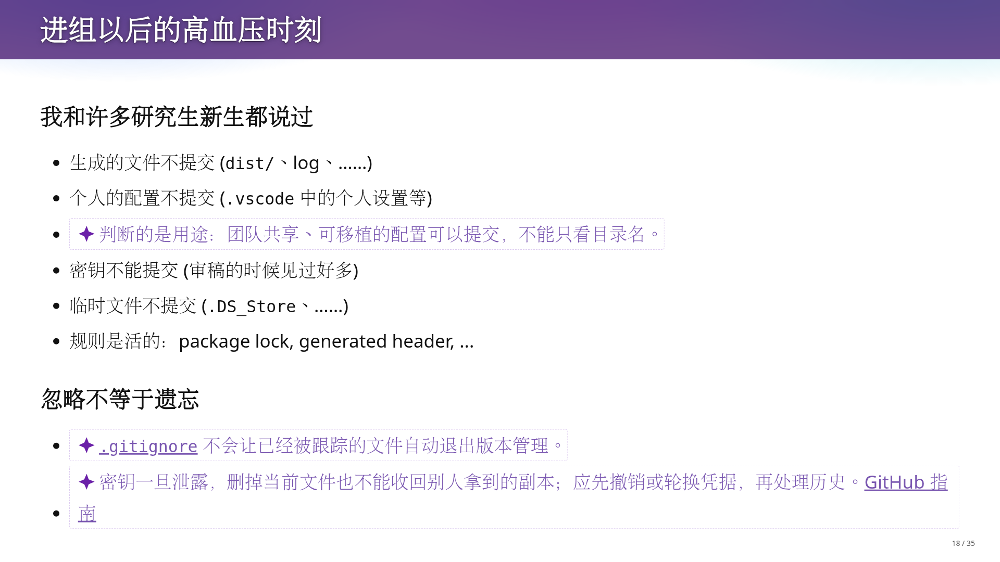

常见的提交规范可归纳为四类：

- 第一，**构建产物与运行日志**（如 `dist/` 目录、`log` 等）通常不提交；

- 第二，**个人配置**（如 `.vscode` 中包含本机硬编码路径或私人偏好的设置）不提交，但判断依据是用途而非目录名，团队共享、可移植的配置可以有意保留；

- 第三，**密钥**不能提交；

- 第四，**系统临时文件**（如 macOS 下 Finder 自动生成的目录索引文件 `.DS_Store`）不提交。

这些规则并非按文件名机械执行：依赖锁文件（如固定依赖版本的 `package-lock.json`）或特定工具链生成的头文件（generated header），为了让他人一致地复现或降低编译门槛，有时会有意纳入版本管理。此外，“忽略不等于遗忘”：`.gitignore`（指定 Git 忽略哪些未跟踪文件的配置规则）不会让已被跟踪的文件自动退出版本管理；密钥一旦提交泄露，仅删除当前文件无法收回他人已克隆的副本及历史记录，应先撤销或轮换凭据，再清理历史。

课堂上老师分享了两个真实教训：一是有同学在提交配置时带上了 C 盘的绝对路径，二是在审稿时频频看到作者把仍处于激活状态的 DeepSeek API key 直接传上公开仓库。对于隐藏文件 .DS_Store，由于以点开头的目录也可能包含 .github/workflows 等重要共享配置，Git 不会默认一刀切地忽略所有点文件。因此，面对任何文件，都不能死背扩展名，而要追问它是否构成共同维护的项目状态。

### 追问直觉：规则命名中的大写与小写之争

工程判断不仅体现在决定一个文件该不该进仓库，还体现在代码、文档与工具配置里的每一个微小设计选择中。很多时候我们对某个写法会产生“这样写似乎更好”的模糊直觉，却不习惯停下来深究原因。下面通过真实项目中的一个文档检查规则命名问题，练习如何把一闪而过的直觉转化为可讨论的工程问题。

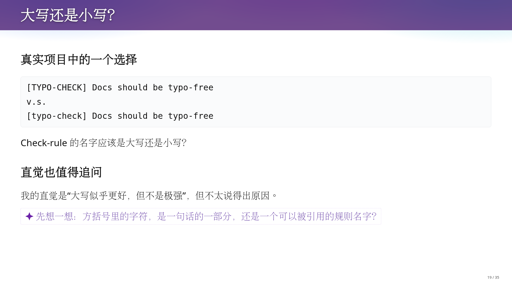

老师在真实项目中配置检查规则（check-rule，例如挂载在 Git pre-commit 钩子或检查工具中的规范条目）时遇到过一个选择：同一条要求文档无拼写错误的规则，应该写成 `[TYPO-CHECK] Docs should be typo-free`，还是 `[typo-check] Docs should be typo-free`？从功能上看，两种写法都能工作。老师当时的直觉是“大写似乎更好，但不是极强”，一时却说不出确切原因。要回答这个问题，可以先思考：方括号里的那串字符，究竟只是普通句子的一部分，还是一个需要被独立引用的规则名字？

在学习和开发过程中，我们每天都会遇到无数个类似这样的小问题，比如提交说明的冒号后要不要加空格、中英文混排时如何保持格式统一。如果轻易放过自己的直觉，觉得“反正都能跑，随便选一个就行”，就错失了提升设计品味的契机。当我们把这个问题抛给高智能模型或自己静下心来做概念剖析时，隐藏在字形表面之下的角色分工就会浮现出来。

### 字形、角色与上下文一致性：设计权衡的三个维度

顺着上一页的追问，如果我们将方括号内的字符定位为“规则标识”，将后面的英文句子定位为“规则说明”，那么全大写与全小写到底在视觉感知和工程规范上带来了什么差异？更重要的是，这种局部的视觉优势在什么条件下应该让位于更大的工程原则？由此可以从视觉角色、规范约定与上下文一致性三个维度完成设计权衡。

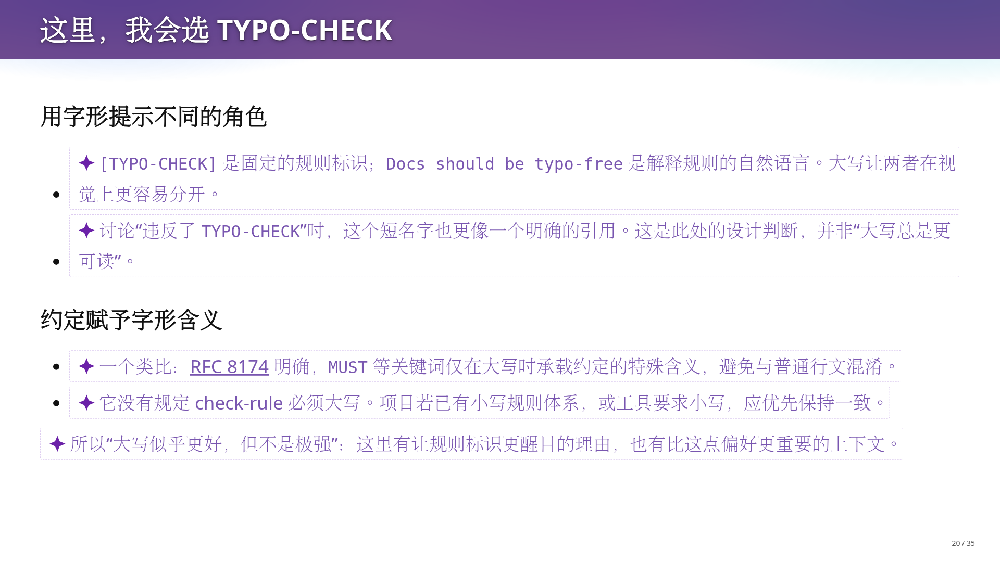

首先是用字形提示不同的角色：`[TYPO-CHECK]` 是固定的规则标识，而 `Docs should be typo-free` 是解释该规则的自然语言；采用大写能让两者在视觉上迅速分开。同时，当团队在日常审查或问题报告中讨论“违反了 `TYPO-CHECK`”时，全大写短名字更像一个明确的引用。这是针对此处角色的设计判断，并非认为大写在任何地方都更可读。其次，可以参考标准规范的做法：RFC 8174 明确规定，`MUST`、`SHOULD` 等关键词仅在全大写时才承载约定的特殊规范含义，以此避免与普通自然语言行文混淆。最后还要考虑上下文约束：RFC 8174 并没有规定项目的 check-rule 必须大写；如果整个项目已使用小写规则体系，或者处理规则的工具要求小写，保持全局一致性就比局部的醒目更重要。这也解释了为何最初的直觉是“大写似乎更好，但不是极强”。

通过这一个看似微不足道的命名选择，我们看到了完整的工程思维链条：从敏锐捕捉直觉，到剖析标识符与自然语言的角色区分、评估跨场景的可引用性，再到结合既有系统上下文权衡全局一致性。无论是配置 .gitignore 还是敲定一个规则名，养成“多问一句为什么、把每个细节做好”的习惯，正是开发者在 AI 时代持续拉开差距的核心品质。

> 判断文件是否入库的三个核心问题
>
> 面对目录中的任意文件，不要机械套用文件名黑名单，而应依次追问三个问题：
>
> - 第一，它是表达意图、规格与实现的**项目输入**，还是构建与运行留下的派生结果？
>
> - 第二，协作者克隆仓库后，是否具备工具链和构建说明来**独立重建**它？
>
> - 第三，如果将它纳入版本控制，当上游源码变化时，如何保证它与源码状态**严格一致**而不产生矛盾？

> 把 AGENTS.md 变成随身工程导师
>
> 初学者在使用 AI 辅助编程时，最忌讳完全交出控制权而不去理解发生了什么。将“在执行任何 Git 操作前逐个文件检查变化，并为新手解释是否符合 Best Practice、原因及相关概念”写入项目的 AGENTS.md，能够强制让工作流慢下来半拍。每一次真实的提交前检查，都会将抽象的软件工程教条转化为针对眼前代码的具象反馈。

> 添加 .gitignore 无法拯救已泄露的密钥
>
> .gitignore 仅对尚未被 Git 跟踪（Untracked）的文件生效。如果某个配置文件或包含激活态 API Key 的文件已经被 git add 并 commit 进了历史快照，此时再把它写进 .gitignore 或在当前工作区执行删除提交，旧快照里依然完整保留着凭据内容。一旦发生密钥误传，第一步必须立即前往服务商后台撤销或轮换凭据，随后再执行历史清理。

术语消化：版本控制中的常见文件分类与工程处理机制

| 文件或规则类型 | 解决的问题 | 机制与课程关系 |
|---|---|---|
| 构建产物与运行日志（如 hello、dist/、log） | 避免仓库体积膨胀、源码与产物状态不一致以及跨机器编译带来的二进制合并冲突 | 通过 .gitignore 忽略，仅在仓库中保存源代码与构建脚本（如 Makefile），由协作者或 CI 环境按需重建 |
| .gitignore 忽略规则 | 将团队关于“哪些本地文件不属于共同维护状态”的约定固化为自动化过滤机制 | 仅屏蔽未被 Git 跟踪的文件；对已纳入暂存区或历史快照的文件无效，体现了快照历史不可轻易假装未发生的特性 |
| 依赖锁文件与生成头文件（如 package-lock.json） | 打破“生成物一律不提交”的死板教条，确保跨环境依赖版本一致或降低特定工具链的编译门槛 | 虽然由工具生成，但因其构成了团队需要共同锁定的项目输入状态，故有意纳入版本快照维护 |
| AGENTS.md 提交前检查约定 | 解决初学者只会敲命令却不理解水面下工程规范、容易提交错误状态的痛点 | 要求 Agent 在每次 Git 操作前逐文件审查并讲解背后的 Best Practice，将日常开发动作转化为概念学习入口 |

### 本章小结

本章从基础 Git 命令迈向深层的工程判断。

我们首先区分了“本地目录里有什么”与“**项目需要共同保存什么**”，剖析了不提交构建产物、个人绝对路径配置、临时文件与密钥的深层原因，并阐明了依赖锁文件等特殊生成物的取舍逻辑与 .gitignore 的作用边界。

最后通过追问 `[TYPO-CHECK]` 的大小写选择，展示了如何从角色区分、可引用性与全局一致性三个维度锤炼对**工程细节**的注意力。

## 第五章 告别古法学习：用可视化工具展开 Git 底层对象与真实细节

前几章我们从工程需求推导出 Git 管理项目快照的核心概念，并讨论了围绕微小变更审视最佳实践的方法。然而，停留在纸面概念上的“快照”“目录树”和“引用”依然显得抽象：Git 如何在不复制整个项目目录的前提下保存每一次完整快照？`.git` 目录下的真实字节究竟记录了什么？本章将打破“只背命令、不看底层”的古法学习模式，从持久化数据结构的第一性原理出发，展示如何利用 Agent 现场构建专属可视化工具 `gitv`，把磁盘上的底层对象、压缩字节与暂存区冲突状态直观展开，将抽象命令转化为可预测、可核对的真实细节。

### 持久化数据结构与视觉化直觉

理解 Git 底层实现的第一步，是想明白它怎样在逻辑上保存完整项目快照的同时，在物理存储上避免机械复制全部文件。如果一个项目包含上百万个文件，每次提交只修改其中一行代码，系统应当如何组织数据结构？本节先从第一性原理推导目录树的共享机制，再引入借助视觉系统突破抽象概念瓶颈的学习思路。


课堂引用了一句半开玩笑的“计算机科学定律：你想要的，就一定有人做”。面对难以捉摸的底层系统机制，最高效的切入点是把关键细节以直观的图形方式呈现出来，因为人类的视觉系统在处理空间结构与状态变化时极其高效。过去几十年间，软件可视化领域由于手工编写图形界面与解析逻辑的工程成本过高，进展相对缓慢；而在大模型时代，开发者可以把自己的学习需求清晰地描述出来，让 Agent 现场生成专属的可视化探索工具，降低观察底层状态的门槛。

在让工具展开真实文件之前，我们可以先在脑中完成一次预演（Virtually Implement）：Git 本质上是一个持久化数据结构（Persistent Data Structure，即在修改时保留旧版本完整可访问、仅通过新建变更路径并复用未变更节点指针来生成新版本的数据结构）。假设目录树中有文件 `A.txt`、`B.txt` 和子目录 `D`，从版本 V1 演进到 V2 时若只修改了 `B.txt`，系统只需创建新版的 `B.txt` 对象，并复制从该文件节点到根节点的路径，而未发生变化的 `A.txt` 与子目录 `D` 则直接通过指针指向旧版本节点。接下来我们就用生成的可视化工具去验证这一物理结构。

### 用 gitv 展开真实仓库的原始字节与对象图

纸面上的持久化目录树推导完成后，我们需要检验 Git 在文件系统中是否真的如此实现。传统模拟教学工具（如 Learn Git Branching）在内存中自己实现了一套模拟的 Git 模型，无法展示磁盘上的真实字节。本节通过分析课堂构建 `gitv` 工具的提示词工程与实操演示，直接解剖真实 `.git` 目录下的对象类型、压缩格式与合并冲突现场。

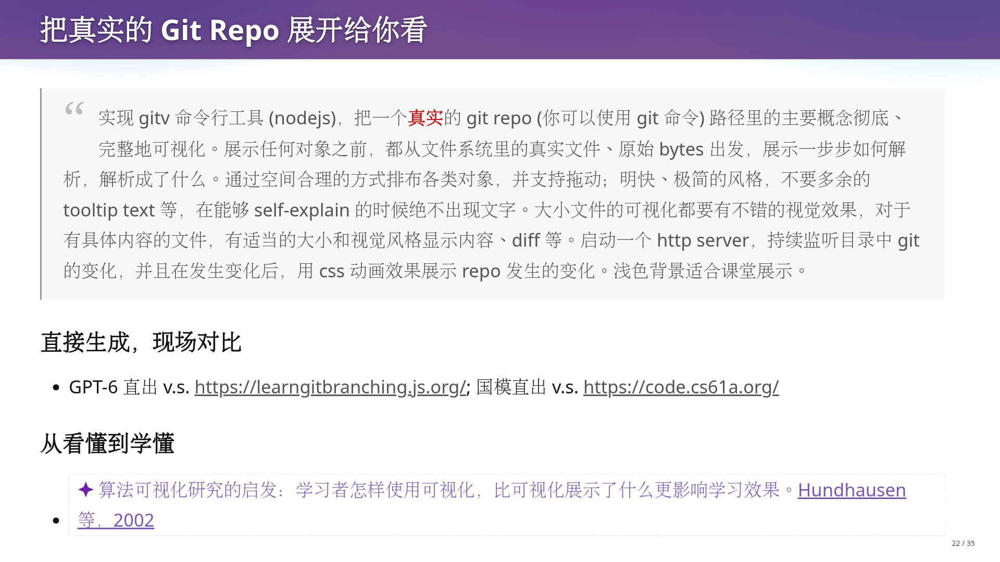

构建 `gitv`（Node.js 命令行工具）的提示词规格要求：接收一个真实 Git 仓库路径，启动 HTTP 服务持续监听目录变化，并用 CSS 动画展示仓库状态演进。提示词的核心约束在于“真实”与“自解释”：展示任何对象前，都从文件系统里的真实文件和原始字节（raw bytes）出发，一步步展示如何解压与解析；空间排布支持拖动，采用明快极简的浅色背景，减少多余的悬浮提示文字（tooltip），并对大小文件、具体内容与 diff 提供清晰的视觉呈现。课堂上将 GPT-6 直出的 `gitv` 与经典的 Learn Git Branching 对照，并将国产模型（如 DeepSeek-V4-Flash）生成的 Python 递归、汉诺塔与 3D 方块可视化编程环境与 UC Berkeley 的 61A Code（`code.cs61a.org`）对照，同时引用算法可视化研究（Hundhausen 等，2002）指出：学习者怎样使用可视化，比可视化展示了什么更影响学习效果。

课堂在 `/tmp/hello/.git/objects` 的真实演示将三类核心对象与引用彻底展开：第一是 `blob` 对象（保存文件内容的二进制字节序列），例如简短的 `hello.c` 在磁盘上经 zlib 压缩后占 31 字节，解压后为 23 字节，以 `blob 15` 头部加正文 `int main...` 构成，而可执行文件 `hello` 的 blob 解压后为 158 字节，清晰可见 `7F ELF` 二进制头；第二是 `tree` 对象（记录目录结构的对象），磁盘上 52 字节解压出 43 字节，其原始存储格式在 `tree <size>\0` 头部之后，将各个条目按 `<mode> <name>\0<20字节原始二进制对象ID>` 紧凑串接（如普通文件模式 `100644`、可执行文件模式 `100755`；平时运行 `git cat-file -p` 看到的按行十六进制展示只是命令格式化后的输出，而非磁盘原始字节格式）；第三是 `commit` 对象，包含指向根 `tree` 的引用、父提交（parent）引用与作者信息。此外，在松散引用存储形式下，创建分支 `A` 会在 `.git/refs/heads/A` 生成记录 commit 哈希的引用文件；而在触发合并冲突且尚未解决时，暂存区（Index）中会同时并存 `base`（stage 1，共同祖先）、`ours`（stage 2，当前分支）与 `theirs`（stage 3，待合并分支）三个阶段版本，工作区文件则写入尖括号冲突标记。当开发者编辑文件移除冲突标记并执行 `git add` 时，暂存区就会用正常条目（stage 0）替换并清除 stages 1–3 的冲突条目，随后再执行 `git commit` 生成带两个父节点的合并提交。

### 把细节做好：工具赋能下的学习门槛与竞争力

当 Agent 能够在几分钟内为我们生成 `gitv` 或带时间旅行调试器的三维方块编程环境时，获取知识与制作教学工具的门槛被大幅拉低。这自然引出一个严峻的现实问题：当工具唾手可得时，人与人之间在工程能力与求职市场上的核心差距将由什么决定？本节将从可视化工具的使用方式延伸到工程教育中的细节标准。

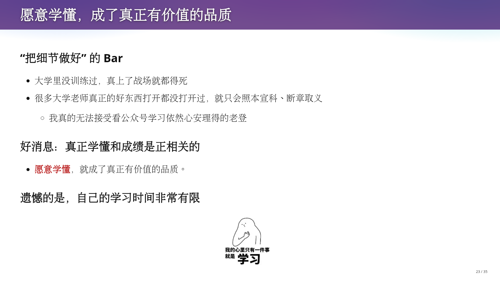

因此，“愿意学懂”成为当下真正有价值的品质。首先，在求职与科研的真实战场上，“把细节做好”的门槛（Bar）会随着工具普及而水涨船高；如果在大学阶段缺乏严格的细节训练，真正上了战场就会迅速被淘汰。老师在课上严厉批评了部分高校教学中“真正的好东西打开都没打开过，只看公众号介绍就心安理得地照本宣科、断章取义”的敷衍态度。好消息是，真正愿意投入精力把底层细节学懂，与最终的学业成绩及工程竞争力高度正相关；遗憾的是，即便探索细节充满乐趣，每个人拥有的学习时间依然非常有限。

正因为时间有限而工具强大，学习方法才必须从被动接收转向主动实验。结合上一节 Hundhausen 等人的研究结论，面对 `gitv` 这样的实时可视化工具，高效的学习流程应当是“先预测、再核对”：在终端敲下 `git add` 之前，先在脑中预测暂存区与 `.git/objects` 会新增什么对象；接着修改工作区文件却不执行 `add`，观察哪些底层指针保持原样；执行 `git commit` 后，再去图中指认新生成的 commit、根 tree 以及向前移动的分支引用。带着对细节的留意走完这一闭环，接下来第六章讨论的提交信息规范与工程最佳实践，就不再是死记硬背的教条，而是维护这套精密快照结构的自然推论。

> 课堂提示：用“预测—观察—核对”激活可视化工具
>
> Hundhausen 等人（2002）关于算法可视化的研究表明，单纯观看精美的动画并不能自动带来深入理解，学习者参与互动的方式才决定学习成效。在使用 `gitv` 或 Learn Git Branching 时，切忌把它当成走马观花的动画片。每次执行 Git 命令前，先强迫自己预测工作区、暂存区（Index）、对象库与分支引用将发生什么变化，再敲下回车观察动画演进，并点开原始字节核对差异，才能将视觉信号内化为自己的概念模型。

> 机制剖析：松散对象格式与合并冲突的三阶段暂存区
>
> Git 的松散对象（Loose Object）在磁盘上经 zlib 压缩存储；小文件（如 23 字节的 `blob 15\0...`）压缩后反而可能变成 31 字节。其解压后的通用格式为“类型 + 空格 + 字节大小 + 空字节 + 正文”。而在执行 `git merge` 发生文本冲突时，工作区文件会直接写入 `<<<<<<<` 等冲突标记供开发者编辑，同时暂存区（Index）在底层会为该文件维护 `base`（stage 1）、`ours`（stage 2）、`theirs`（stage 3）三个阶段的条目；当编辑解决冲突并执行 `git add` 时，暂存区即用 stage 0 正常条目替换这三个冲突阶段条目，无需等到最终提交才清理。

> 评测边界：单次课堂直出对比不等于模型普遍排名
>
> 课堂上展示了用 GPT-6 现场生成的 `gitv` 与经典工具 Learn Git Branching 的对比，以及用国产模型（如 DeepSeek-V4-Flash）生成的青少年 Python 汉诺塔/3D 方块可视化编程环境与 UC Berkeley 61A Code 的对比。讲义特别提醒：这些演示反映的是特定提示词、特定架构约束（如主讲人预先把控了纯函数 trace 接口与十几行全局共享状态）下的单次任务表现，切勿将其直接外推为不同大模型之间的普遍能力排名。评价工具优劣应落在关键状态是否清晰、交互是否顺畅、边界情况处理是否得当等具体工程细节上。

术语消化：Git 底层存储与可视化核心概念对照表

| 术语 | 解决的问题 | 机制与课程关系 |
|---|---|---|
| 持久化数据结构（Persistent Data Structure） | 在不复制全部未修改文件的前提下保存完整的历史项目快照 | 修改某个文件时仅新建该节点并复制其到根节点的路径，未变子树通过指针直接复用，构成 Git 快照模型的第一性原理 |
| blob 对象 | 在底层对象库中无损存储单个文件的原始内容 | 以内容哈希索引并经 zlib 压缩存储在 `.git/objects` 中，解压后含 `blob <size>` 头部与原始字节（如源码文本或 `7F ELF` 二进制内容），不包含文件名 |
| tree 对象 | 将离散的内容对象组装成带权限与文件名的目录树结构 | 在 `tree <size>\0` 头部后按 `mode SP name NUL <raw-object-id>` 紧凑串接各条目，记录权限模式（如 `100644`、`100755`）、文件名及指向 `blob` 或子 `tree` 的对象标识 |
| commit 对象 | 将某一时刻的根目录树快照连入可追溯的项目历史图 | 记录指向根 `tree` 对象的引用、一个或多个父提交（parent，根提交无父节点）引用、作者信息及提交说明 |
| 冲突暂存三阶段（base / ours / theirs） | 在合并冲突尚未解决期间保留三方原始上下文以支持比对与恢复 | 合并冲突时暂存区（Index）底层同时记录共同祖先、当前分支与合入分支三个版本，工作区写入冲突标记，解决并 `git add` 后清理临时条目 |

### 本章小结

本章从持久化数据结构的第一性原理出发，阐明了 Git 如何通过**复制变更路径与复用子树指针**高效保存项目快照。

借助 Agent 现场生成的 `gitv` 工具，我们深入 `.git/objects` 与 `.git/refs/heads/` 的真实字节，直观解析了 `blob`、`tree`、`commit` 对象及合并冲突时暂存区的 `base`、`ours`、`theirs` 三阶段状态，并强调了以“**预测与核对**”主动打磨工程细节的学习态度。

## 第六章 提交规范与真实工程闭环：从 Conventional Commits 到 SWE-bench

理解了 Git 底层如何用对象和引用保存项目快照之后，我们面临更现实的工程追问：怎样的提交说明和历史组织，才能让协作者与几个月后的自己真正读懂项目的演变？当我们在课堂上故意提交一句模糊的说明并混入编译产物时，Agent 立刻给出了严厉批评。本章将从提交信息的规范化切入，系统梳理降低丢失、理解与协调成本的四类工程实践，并走进经典评测基准 SWE-bench 与 Astropy 真实开源修复案例，观察“只改一行代码”背后怎样串联起复现、测试、审查、回移与平台命令行工具的完整工程闭环。

### 提交说明的信息量：Conventional Commits 与变更理由

在日常开发中，执行 git commit 保存快照只是第一步。如果每次提交只写 update 或课堂演示里故意输入的 I added some cool stuff，几个月后面对上万条历史记录，任何人都无法判断项目经历了怎样的演化。一条合格的提交说明，应当通过固定结构与背景解释，补足纯代码差异无法表达的信息。

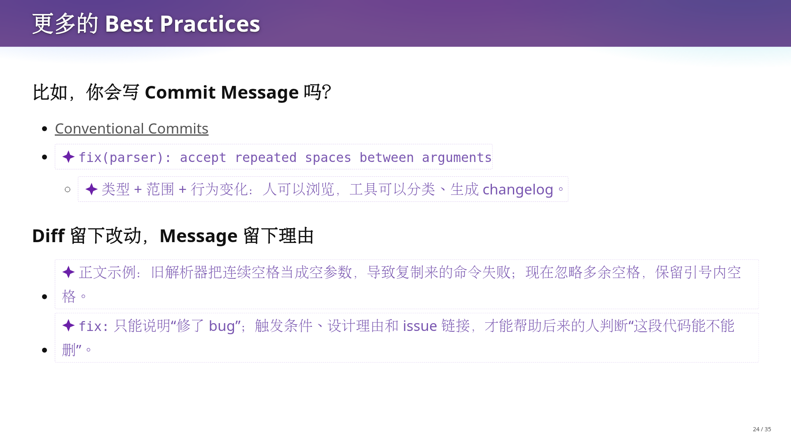

以 Conventional Commits（约定式提交，一种通过固定前缀结构化提交标题的规范）为例，我们可以拆解如何撰写有信息量的 Commit Message。示例标题 `fix(parser): accept repeated spaces between arguments` 包含三个要素：类型 `fix` 表示缺陷修复，范围 `parser` 标示受影响的模块，冒号加空格后用祈使句说明具体的行为变化。这种结构既便于人类快速浏览，也便于自动化工具归类并生成更新日志（changelog）。同时，“Diff 留下改动，Message 留下理由”：代码 diff 已经展示了怎样修改，而提交正文需要解释旧解析器为何失败、现在忽略什么、保留什么（如保留引号内的空格）。只有交代清楚触发条件、设计理由和关联的 Issue 链接，后来的维护者才能判断某段特殊逻辑究竟能否安全删除。

课堂上老师将包含模糊说明和二进制产物 hello 的提交交给 Agent 检查，Agent 不仅批评说明毫无信息量，还指出混入编译产物会造成多环境二进制冲突。此外，老师顺带探讨了两个工程细节：一是特殊场景下可通过 `git commit --allow-empty` 创建无文件改动的空提交，用于触发持续集成工作流或标记版本冻结（freeze），但不应频繁滥用；二是像 Markdown 文档中英文之间留空格这类排版约定，无论采用哪种风格，保持整个项目的高度一致性都能显著降低维护时的视觉与认知负担。

### 让错误可恢复：留退路与整理单一意图的变化

为什么有的项目在经历几十次修改后依然清晰可查，而有的项目却一旦改坏就再也回不去、也没法让别人接手？《Git Best Practices》总结了大量实践经验，我们可以先从“如何应对人的失误与探索的混乱”这一视角切入。其中，“留退路”与“整理变化”这两条原则在本地工作区与提交历史之间建立了清晰的安全边界。

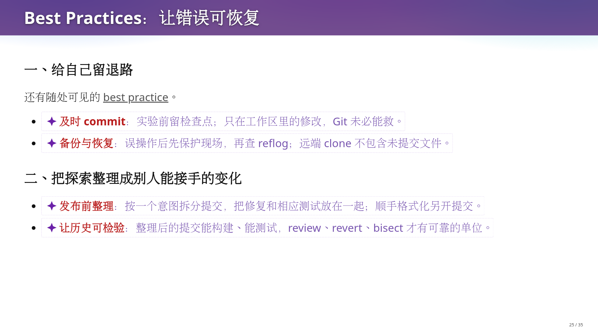

工程最佳实践的前两个核心问题可以归纳为“给自己**留退路**”和“把探索整理成别人能接手的变化”。

- 首先，留退路要求在实验或探索前及时 commit 保存检查点。仅停留在工作区（Working Tree）里的修改尚未进入 Git 对象库，一旦被覆盖，Git 未必能救回来；发生误操作后应第一时间保护现场，再借助 reflog（引用日志，Git 在本地记录 HEAD 和分支引用移动轨迹的机制）找回原有提交，同时要注意远端克隆只保存已推送的历史，不包含本地未提交文件。

- 其次，探索过程往往是曲折的，但在发布前应当按**单一意图**拆分提交：把某处缺陷修复和对应的回归测试放在同一个提交里，而顺手格式化全项目代码的改动则另开独立提交。只有保证整理后的每一步提交都能独立构建、通过测试，后续的代码审查（review）、撤销某次改动（git revert）以及二分查找引入缺陷的提交（git bisect）才有可靠的定位单位。

课堂演示中，老师故意写了一段无法编译的代码要求提交，Agent 拒绝直接提交并解释道：如果往历史里塞入无法编译的损坏快照，后续把提交历史当作有序序列做二分查找（`git bisect`）时，遇到无法构建的中间提交就只能使用 `git bisect skip` 跳过，这会干扰自动判定并降低问题定位的分辨率（从精确定位退化为一个候选提交范围）。这正呼应了口述中提到的“Commit Often, Perfect Later, Publish Once”：开发时频繁提交小检查点以防硬件损坏或误操作丢失工作；确认无误且尚未推送到公共远端前，再将凌乱的本地提交整理为边界清晰、每步可构建的原子变更。

### 让协作可预期：稳定公共历史与自动化执行机制

当项目从个人开发走向多人或多 Agent 协作时，仅靠个人的良好整理习惯还不够。如果有人擅自改写了别人正在依赖的提交历史，或者本地测试通过的代码合入主线后破坏了整体构建，协作就会陷入混乱。这就需要通过团队约定与自动化工具，把良好的工程愿望落实为可预期的协作契约。

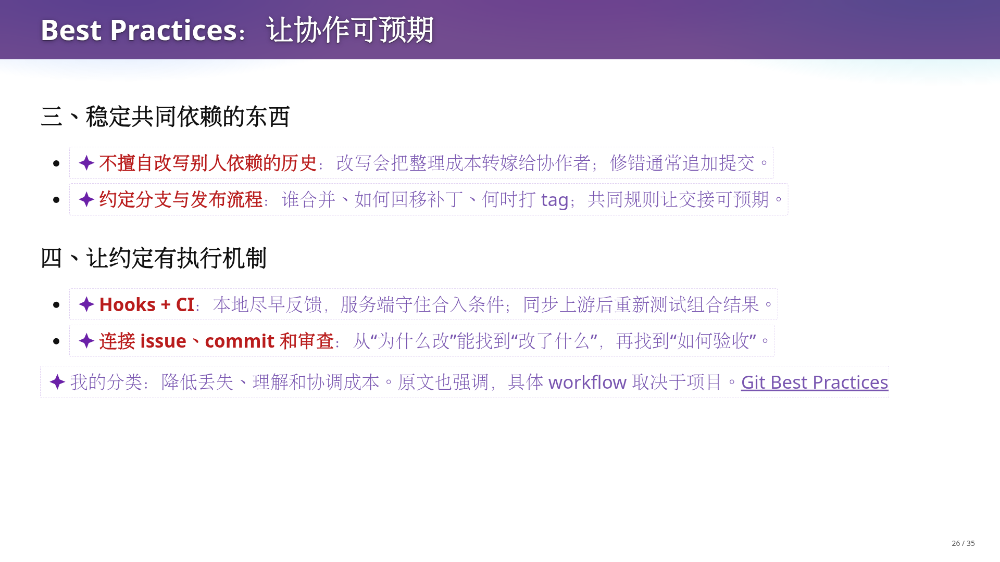

最佳实践的后两个核心问题是“稳定共同依赖的东西”与“让约定有执行机制”。在公共历史管理上，不能擅自改写（如强制 rebase）别人已经拉取并依赖的历史，因为改写会产生新的提交标识，把解决分叉的整理成本转嫁给协作者；公共分支上发现错误通常应通过追加新提交来修复。同时，团队需明确约定分支管理、谁负责合并、何时打标签（tag）以及如何将补丁回移（backport）到旧版本。在执行机制上，依靠本地 Hooks（钩子，在特定操作如提交前自动触发的脚本）尽早提供检查反馈，依靠服务端持续集成（CI）守住合入底线；尤其要注意，本地分支测试通过后，同步上游更新并合入主线时必须重新测试组合后的结果。最后，将 Issue、Commit 和代码审查连接起来，才能形成从“为什么改”到“改了什么”再到“如何验收”的完整链路。

讲义提醒我们，老师将众多经验归纳为这四类，是为了降低丢失、理解和协调成本，而具体工作流仍取决于项目语境。课堂上老师还展示了更广义的 Hook 应用：不仅 Git 的 pre-commit hook 可以用来自动检查诸如同类规则标识的大小写与拼写，在 Claude Code、Codex 等 Agent 工具中也可以配置全局 Hook，让 Agent 完成任务等待人类输入时自动播放提示音。但无论自动化机制多完善，都不能替代对组合结果的思考——格式化合规的提交说明不代表解释清了业务行为，单分支测试全绿也不等于合入最新主线后依然满足系统约束。

### 日常维护的标准缩影：SWE-bench 与双重验收准则

前面讨论的提交粒度、历史可构建性与问题追溯，并非纸面上的教条，而是每天都在真实软件维护中发生的工作。为了客观衡量大模型与 Agent 接手真实工程项目的能力，研究者构建了 SWE-bench 基准。对照日常维护的标准动作，我们可以看到该基准如何定义输入、输出以及“修好问题且不破坏原有功能”的验收标准。

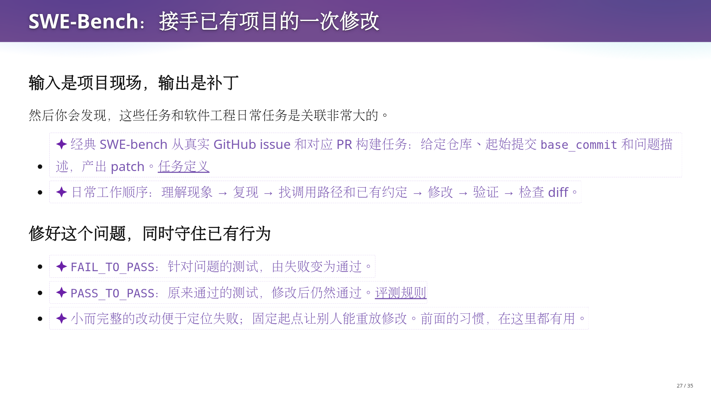

经典评测基准 SWE-bench 直接映射了软件工程的日常修改任务。SWE-bench 从真实的 GitHub Issue 和对应的修复 Pull Request（PR）中提取任务：评测给定一个真实仓库、固定的起始提交（`base_commit`）以及问题描述作为输入现场，要求模型在此上下文中产出代码补丁（patch）。这对应着标准的工程维护顺序：理解故障现象 → 复现问题 → 寻找相关调用路径和项目已有约定 → 修改代码实现 → 运行验证 → 检查最终 diff。其评测包含两项核心验收准则：

- 一是 **FAIL_TO_PASS**，即专门针对该缺陷的测试必须从修改前的失败变为修改后的通过；

- 二是 **PASS_TO_PASS**，即仓库中原本就通过的回归测试在修改后必须继续保持通过。

小而完整的改动配合固定的 base_commit 起点，使得任何人都能够重放修改并精准定位失败原因。

SWE-bench 的任务结构表明，真实的软件维护是在一个已经存在领域抽象、历史上下文与编码约定的演进系统中完成修改，而非在白纸上独立编写算法题。如果平时养成了保持原子变更、每次提交可构建可测试、仔细检查 diff 的习惯，无论是人类开发者还是 AI Agent，在面对这类给定 base_commit 的维护任务时，都能更高效地定位问题边界并守住 PASS_TO_PASS 的回归底线。

### 一行代码修复的背后：Astropy 嵌套模型依赖矩阵案例

在 SWE-bench 中有一个极具代表性的真实任务 astropy__astropy-12907。从最终提交的源码改动来看，核心实现仅仅修改了一行代码中的一个变量名。为什么“只改一行代码”背后仍然包含完整的工程推理与验证？我们先来看天文库 Astropy 中模型组合与布尔依赖矩阵的业务含义，再观察真实开源合并所需要的全套交付物。

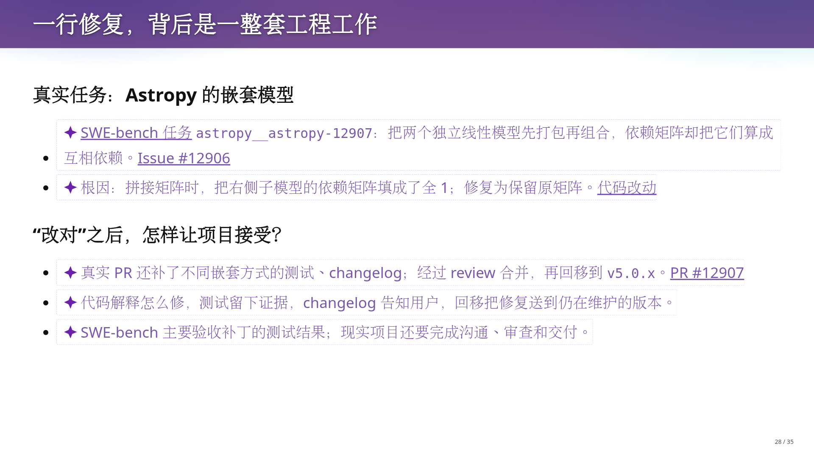

在 SWE-bench 任务 `astropy__astropy-12907`（对应 Astropy 项目的 Issue #12906 与 PR #12907）中，Astropy 的建模模块使用一个布尔矩阵（`separability_matrix`）表示复合模型中各个输出对各个输入的依赖关系：矩阵某位置为真（`True` 或 `1`），代表对应输出依赖于对应输入。当把两个独立的一维线性模型并排组合（`cm = Linear1D(10) & Linear1D(5)`）时，各自只依赖自己的输入，依赖矩阵是 2×2 的对角阵；然而，一旦把已打包好的子模型 `cm` 放到另一个模型右侧再次组合（如 `Pix2Sky_TAN() & cm`），计算出的矩阵右下角 2×2 区域却错误地全部变成了 `1`（全真），仿佛两个原本独立的线性模型突然互相依赖了。根因在于矩阵拼接函数 `_cstack(left, right)` 处理右侧已是子模型依赖矩阵的情况时，错误地将目标区域赋值为常数 `1`，丢掉了内部结构；修复只需将该处赋值改为 `right`，保留已算好的子模型矩阵。为了让项目接受这一行修复，真实 PR #12907 还补充了覆盖不同嵌套方式的回归测试、撰写了告知用户的 changelog，经过维护者代码审查（review）后合入主线，并进一步回移（backport）到仍在维护的 `v5.0.x` 分支。

通过核查 GitHub 原始记录可以更具体地看到这套工程闭环：在 astropy/modeling/separable.py 中，修复行将 cright[-right.shape[0]:, -right.shape[1]:] = 1 改为 = right；与此同时，作者在 test_separable.py 中新增了 cm8 到 cm11 四个复合模型测试条目，专门检验 rot & (sh1 & sh2)、rot & sh1 & sh2 以及 (rot & sh1) & sh2 等不同括号嵌套方式是否产生完全一致的依赖结构，并在 docs/changes/modeling/12907.bugfix.rst 中记录了修复说明。SWE-bench 评测主要通过测试集验收补丁，但真实工程中，理解领域抽象找到这一行、用测试留下证据、写文档通知用户、过审并回移旧版本，缺一不可。

### 连接 Git 与平台协作：gh 与 glab 构成的命令行闭环

在 Astropy 的案例中，我们看到了 Issue 讨论、PR 审查、CI 自动检查与分支合并。一个容易被忽视的概念边界是：这些协作信息也是保存在 Git 仓库的对象库里吗？显然不是。对照工作流闭环图，我们需要区分哪些属于 Git 原生管理的版本数据，哪些属于托管平台的非 Git（non-git）协作对象，以及命令行工具如何将二者打通。

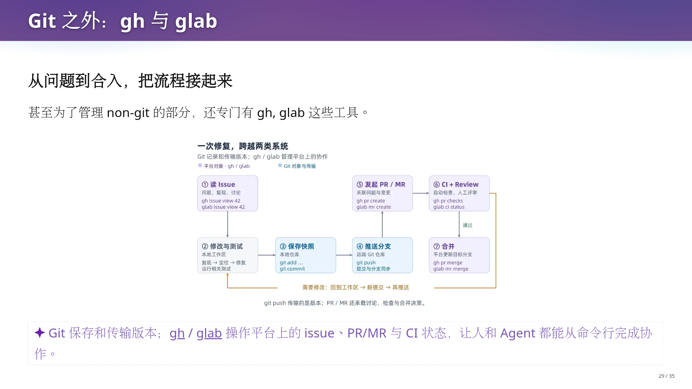

完整的工作流闭环厘清了 Git 与代码托管平台（如 GitHub、GitLab）的职责边界，并引出了专用命令行工具 `gh` 与 `glab`。流程图左侧从平台上的 Issue 出发，进入本地环境进行代码修改与测试，随后通过原生 Git 命令完成提交（commit）和推送（push）；进入平台侧后，创建 Pull Request（PR）或 Merge Request（MR），触发持续集成（CI）检查与维护者代码审查（Review）。如果 CI 失败或审查提出修改意见，流程返回本地工作区继续迭代；全部通过后才由平台合入主线。页面明确指出：Git 负责保存和传输版本快照，而 Issue 描述、PR/MR 上的审查评论以及 CI 运行状态都属于平台侧的 non-git 协作对象，不会随 git clone 自动持久化到本地 .git 目录中。GitHub 官方的 gh 与 GitLab 的 glab 命令行工具，正是为了让开发者和 AI Agent 能够直接在终端里读取 Issue、创建 PR/MR、查询 CI 状态并完成合入。

课堂上老师提醒大家留意一个有趣的现象：当把维护任务交给 AI Agent 时，Agent 往往会主动尝试在终端调用 gh 或 glab 命令去拉取分配给自己的 Issue 或查看 PR 评论；如果发现系统提示 command not found，它才会退回纯 Git 命令模式。为工作环境配置好 `gh` 或 `glab` 后，人类和 Agent 就能在命令行里把“读取需求—小步原子提交—推送分支—发起审查与检查—关闭问题”完整串联起来，这也直接引出了下一章的核心命题：如何用原子变更（Atomic Change）稳步推进软件工程项目。

> 代码 Diff 留下怎样改，Commit Message 留下为什么改
>
> git diff 已经精确记录了哪些行被增删，因此提交说明绝不应只是用自然语言复述代码变动或写一句模糊的 update。遵循 Conventional Commits 等规范写出“类型(范围): 行为变化”的标题后，正文应重点交代故障的触发条件、设计取舍以及希望保留的不变量（例如忽略参数间多余空格，但必须保留引号内的空格）。这能为未来的维护者提供关键判断依据：当有人重构代码想删掉某段看似多余的分支逻辑时，能通过 git blame 和提交说明确知删掉它会破坏什么。

> 本地检查点与公共历史整理的二阶段法则
>
> 面对复杂修改时，“害怕弄乱历史而不敢提交”是新手常见的误区。未提交的工作区修改一旦遭遇误删或机器故障，连远端仓库和 git reflog 都无法挽回。正确的工程直觉是将“本地探索”与“公共发布”分开：探索阶段频繁 commit 留足退路；在推送到他人依赖的公共分支前，再将探索过程整理为围绕单一意图、包含对应测试且每步都能独立编译通过的干净提交。一旦历史已经公开并被协作者依赖，就不要再擅自用 rebase 改写，而应通过追加新提交来修正错误。

> 切勿将“一行代码补丁”等同于全部工程工作
>
> 在 Astropy 嵌套复合模型缺陷（Issue #12906 / PR #12907）中，虽然核心源码改动只是在 _cstack 函数里把矩阵右半部分赋值的常数 1 改为变量 right，但找到这一行依赖于对“布尔矩阵表征输入输出可分离性”这一领域抽象的准确理解。此外，本地单分支测试通过或格式符合规范，并不自动保证合入更新后的主线依然正确；真实工程交付还必须补充多维嵌套回归测试、编写更新日志（changelog）、通过同行审查（Review）并将补丁回移（backport）到维护分支。

术语消化：第六章核心术语与工程机制对照表

| 术语 | 解决的问题 | 机制与课程关系 |
|---|---|---|
| Conventional Commits（约定式提交） | 提交说明随意模糊，难以快速浏览历史或自动生成更新日志 | 采用“类型(范围): 行为描述”固定前缀结构，配合正文记录修改动机与触发条件，让历史具备可读性与可审计性 |
| reflog（引用日志） | 本地误操作（如错误的重置或分支移动）后找不到原有的提交对象 | 在本地记录 HEAD 与分支引用的每一次移动轨迹，作为保护现场后找回已提交快照的退路机制（不保护未提交的工作区修改） |
| Hooks 与 CI（钩子与持续集成） | 团队工程规范仅停留在口头约定，缺乏自动化拦截与反馈 | Hooks 在本地提交等操作附近尽早执行检查（或触发 Agent 提示音），服务端 CI 在合入前自动验证构建与测试组合结果 |
| SWE-bench（软件工程基准） | 缺乏用真实开源维护上下文检验模型与 Agent 工程能力的标准 | 给定仓库、固定 base_commit 与真实 Issue，要求产出补丁同时满足 FAIL_TO_PASS（修好新问题）与 PASS_TO_PASS（守住旧行为） |
| gh / glab（平台命令行工具） | 原生 Git 不管理 Issue、PR/MR 讨论与 CI 状态等平台侧协作对象 | 在终端中直接操作 GitHub/GitLab 的 non-git 协作数据，帮助人类与 Agent 将本地版本控制与平台审查交付串联成闭环 |

```Python
def _cstack(left, right):
    noutp = _compute_n_outputs(left, right)
    # ... 省略左侧 cleft 构造 ...
    if isinstance(right, Model):
        cright = _coord_matrix(right, 'right', noutp)
    else:
        cright = np.zeros((noutp, right.shape[1]))
        # 旧实现：cright[-right.shape[0]:, -right.shape[1]:] = 1
        cright[-right.shape[0]:, -right.shape[1]:] = right

    return np.hstack([cleft, cright])
```

对应 Astropy PR #12907（固定版本 `efedd57cb088b6ca73f9540a3c6185ad7046c926`）中的 `astropy/modeling/separable.py`。输入 `left` 和 `right` 可以是 `Model` 实例或已经计算出的二维依赖矩阵（`ndarray`）。当把两个独立线性模型先用 `&` 组合成复合子模型后，递归传入 `_cstack` 的 `right` 参数已经是算好的 2×2 对角依赖矩阵。旧代码在 `else` 分支构造 `cright = np.zeros((noutp, right.shape[1]))` 后，将右下切片区域统一赋值为常数 `1`，丢掉了子模型内部结构；修复代码将 `1` 改为 `right`，在嵌套组合时保留子模型原有的依赖矩阵。

### 本章小结

本章从撰写高质量提交说明出发，阐明了代码 diff 记录“**怎样改**”、Commit Message 记录“**为什么改与保留什么**”的互补关系，并围绕留退路、整理单一意图提交、稳定公共历史与 Hooks/CI 执行机制梳理了 Git 工程最佳实践。

结合 SWE-bench 的双重验收标准与 Astropy 嵌套模型修复案例，我们看到哪怕核心代码只改一行，真实开源维护依然包含理解领域抽象、补充回归测试、编写更新记录、代码审查、版本回移以及借助 gh/glab 串联平台非 Git 协作对象的**完整工程闭环**。

## 第七章 原子变更与人机协作实践：架构收敛、有限并发与实验设计

在前一章通过 Astropy 的单行修复案例看到完整工程闭环后，我们需要将具体工具用法上升为软件工程的核心范式：为什么说软件工程项目的本质是“由原子变更推进的快照”？当代码生成速度大幅提升，而人类与当前 AI 模型依然无法直接驾驭“一团混沌”时，我们该如何把复杂目标拆解为可理解、可验证、可回退的演进序列？本章将提炼原子变更的核心法则，总结在当前 Agent 能力范围内“先单线程收敛架构、再有限并发推进实现”的人机协作经验，并结合《实验 (1)：会成长的个人助手》，探讨如何通过架构拆分与 Git 规则沉淀，走出 AI 时代的“软件焦油坑”。

### 用原子变更推进项目快照

在日常开发或完成大作业时，如果不加节制地同时修改多个模块，项目很容易陷入前文刚修好、后文又崩溃的混乱局面。即使引入 AI 编写代码，一次提交几千行改动也会在出错时让维护者无从下手。那么，什么是“原子变更”？它如何与“项目快照”共同构成软件工程项目的核心定义，并支撑起二分排查与安全回退？

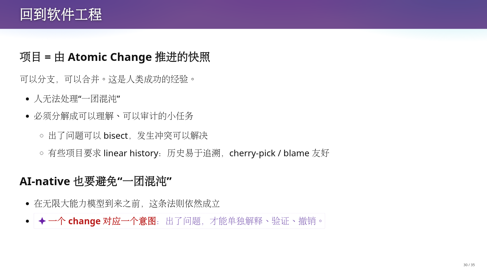

软件工程项目的本质可以概括为一个核心定义：项目是由原子变更（Atomic Change）推进的快照，可以分支，可以合并。所谓原子变更，是指围绕一个明确意图组织的完整修改。它未必只改动一个文件，也未必只有寥寥几行代码，但必须具备清晰的边界，能够被独立解释、构建验证，并在需要时单独撤销。之所以无论人类开发还是 AI-native 开发都必须避免“一团混沌”，是因为如果把修改接口、重写实现、更新依赖和代码格式化混在同一次提交里，一旦测试失败就无法判断根因。相反，当每次提交都保持原子性且可编译、可测试时，版本历史本身就变成了强大的调试工具：我们可以将提交历史视为有序数组，利用 git bisect 在已知好版本与坏版本之间通过二分查找快速定位引入缺陷的那次提交；配合 git blame 追查具体代码行的来历与修改背景；或者用 git revert 生成一次新提交来安全撤销特定变更。

此外，许多现代工程与 AI 协作项目倾向于要求线性历史（Linear History），即借助变基等操作将集成后的提交整理成一条直接的主线。线性结构不仅方便人类阅读演进脉络、降低 git blame 追踪与 git cherry-pick 跨分支拣选提交的复杂度，也能让 Agent 在读取历史上下文时更加聚焦、节省 token。但线性历史只是一种拓扑组织形式，只有当每一步提交本身都是意图明确、可构建且验证通过的原子变更时，排成直线的历史才真正有助于追溯与排错。

### Agent 能力范围内的两阶段协作与实验设计

明确了“用原子变更推进项目”的原则后，在面对像 Pico Playground 或课程实验这类处于当前 Agent 能力范围内的项目时，人类开发者具体应该如何组织日常工作流？如果直接把模糊的宏大需求甩给模型，为什么反而会消耗海量上下文并陷入泥潭？这需要区分“架构阶段”与“实现阶段”的不同人机协作与并发策略。

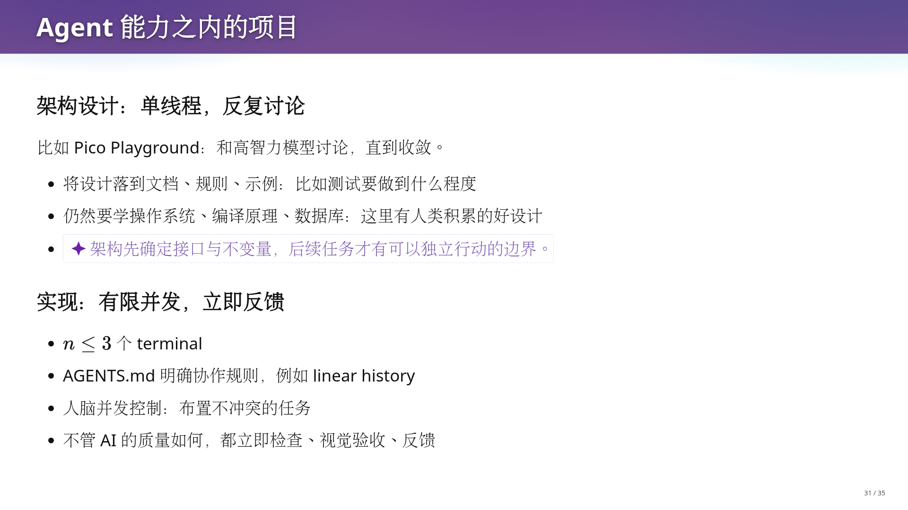

对于处在当前 Agent 能力范围内的项目，老师总结了两阶段实战方法。第一阶段是“架构设计：单线程，反复讨论”。开发者先与高智力模型深入对话，直到接口定义、核心不变量与总体设计逐渐收敛，再将共识固化为文档、规则（如 AGENTS.md 与 ARCH.md）以及测试要求。课堂以可视化编程环境 Pico Playground 为例：老师将程序追踪与推导图等绝大部分组件接口设计为纯函数（Pure Function），把光标位置、菜单状态等全局共享状态压缩到十几行代码，再配以十几行组装代码；同时明确禁止 Agent 在实现具体可视化组件时阅读底层库函数的内部实现，只允许查看接口文档。这种架构隔离将上下文消耗成功控制在几万 token 以内。这也解释了为什么今天依然要学习操作系统、编译原理和数据库——这些学科积累了划分职责、表达不变量、隔离变化与协调并发的经典范式，是人类在架构讨论中向 AI 提出好问题、判断方案优劣的知识底座。

第二阶段是“实现：有限并发，立即反馈”。在架构边界清晰后，老师个人的工作习惯是打开不超过 3 个终端（$n \le 3$）并行推进，在 `AGENTS.md` 中写明线性历史与禁止自行调用高消耗视觉模型检查等规则，由人脑承担并发调度，为不同终端分配互不冲突的原子任务；同时在副屏开启实时刷新的浏览器，对每一轮产出立即进行视觉验收与反馈，避免未确认的设计偏差累积。这一方法可直接用于《实验 (1)：会成长的个人助手》：该实验要求打通本地 Markdown 个人数据库、`smail` 邮箱草稿拟定、`ehall.nju.edu.cn` 事务保守办理与手机端跨工具联动。如果把这些半明确的需求直接丢给 Agent，往往会得到凌乱的 AI slop，每次修改都像在《人月神话》描述的“软件焦油坑”中反复消耗 token 试错。通过预先做好架构拆分，将成功流程与人类纠正（例如“不要把报名截止时间当成活动开始时间”）沉淀为由 Git 管理的脚本、技能与规则，并守住关键操作的人工确认底线，才能构建出持续改进的个人助手系统。

> 核心法则：项目是由原子变更推进的快照
>
> 软件工程项目的核心概念模型是“由原子变更（Atomic Change）推进的快照序列”。快照保证了任意历史时刻项目文件与配置的整体一致性；原子变更则要求每一次状态跃迁都严格对应一个明确意图，且自身完整、可构建、可测试。只有同时守住“状态完整”与“步进原子”两条底线，分支探索、合并汇合、二分排错（git bisect）与安全撤销（git revert）才能在工程实践中真正运转起来。

> 用系统学科的设计范式驾驭实验架构
>
> 在《实验 (1)：会成长的个人助手》中，面对个人数据库索引、邮件防重处理、ehall 表单确认与手机端异步联动等复杂需求，直接让 Agent 堆砌代码极易陷入“软件焦油坑”。借助操作系统、编译原理与数据库中学到的状态隔离、纯函数接口与幂等性设计，先在单线程讨论中把共享状态缩到最小，并规定退课、撤销申请等高危动作必须经过人工确认（防止“Agent 把你的课都退了”），是高效解锁 Agent 执行力的关键。

> 切勿将个人并发习惯或形式上的线性历史绝对化
>
> 在学习本章实践经验时需避免两个常见误区：第一，课堂提到的“打开不超过 3 个终端（n <= 3）”仅是老师基于人脑注意力上限总结的个人工作习惯，并非并发 Agent 系统的普适理论上限；第二，线性历史（Linear History）只是提交图的拓扑组织形式，如果每个提交内部依然混杂着未验证的代码或毫无意义的修改，仅仅通过 rebase 排成一条直线并不能自动消除“一团混沌”。

术语消化：原子变更与人机协作核心术语消化

| 术语 | 解决的问题 | 机制与课程关系 |
|---|---|---|
| 原子变更（Atomic Change） | 避免将多个无关改动混杂提交导致的排错困难与回退风险 | 围绕单一明确意图组织完整、可独立验证与撤销的修改，是推进项目快照的基本单位 |
| git bisect | 在漫长的提交历史中快速定位首次引入特定缺陷的变更 | 要求历史快照保持可构建与可测试，通过二分查找在好坏版本之间对数级缩小排查范围 |
| 线性历史（Linear History） | 减少复杂分支交织带来的阅读、追溯与拣选负担 | 将集成后的提交整理为单一主线，配合原子变更使 git blame 溯源与 cherry-pick 更加直观 |
| 软件焦油坑（Software Tar Pit） | 揭示模糊需求下直接堆砌代码导致的维护成本爆炸 | 源自《人月神话》的工程隐喻；在 AI 时代体现为缺乏架构边界时 Agent 消耗海量 token 反复试错的泥潭 |

### 本章小结

- 本章确立了全讲的核心定义：软件工程项目是由围绕明确意图的“**原子变更**”持续推进、可分支与可合并的快照序列。

- 无论是人类协作还是 AI 编程，保持变更的**原子性与可验证性**，才能发挥 `git bisect`、`git blame` 与线性历史的工程作用。

- 在当前 Agent 能力范围内，采用“架构阶段单线程收敛接口与不变量、实现阶段**有限并发加立即反馈**”的策略，并将人类纠正持续沉淀进 Git 管理的规则与技能中，是跨越软件焦油坑、完成个人助手实验的实战正道。

## 第八章 当代码产能提高一千倍：面向 Agent 的并发版本控制设想

在前一章中，我们探讨了人类工程师如何在先通过单线程收敛架构与接口边界后，依靠人脑并发控制同时调度不超过三个终端的 Agent 协同推进项目。然而，这套协作模式依然受限于人类的手工协调与审查速度。如果我们做一个极端推演：假设未来 Agent 生产代码的速度再提高一千倍，围绕人类手工提交、人工解决冲突和人工逐行审查设计的 Git 工作流会遇到怎样的核心瓶颈？当等待判断的变更堆积如山时，未来的 Agent 版本控制系统需要怎样的并发控制模型与不变量验证机制？本章将从这一思想实验出发，结合数据库事务与新一代版本控制理念，推演面向高并发 Agent 的项目演化架构。

### 千倍产能思想实验与变更代数

当单个或少量 Agent 的产出还在人类肉眼可及时检查的范围内时，传统 Git 工作流尚能应付。但要看清现有工程体系的隐性瓶颈，我们需要通过放大矛盾的思想实验，观察当代码生成速度与人工验收速度彻底失衡时，版本管理的核心矛盾会发生怎样的转移。

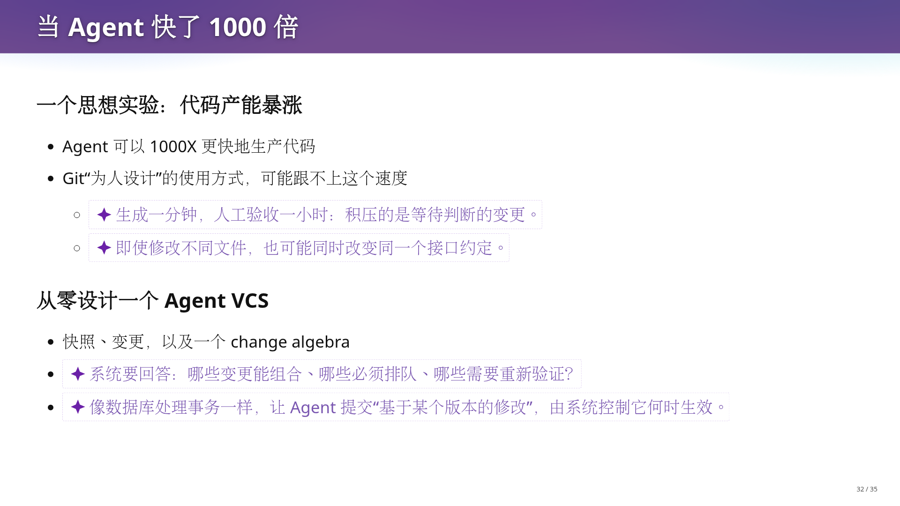

“当 Agent 快了 1000 倍”这一思想实验揭示了版本控制面临的范式挑战（这里的“1000 倍”是用于放大工程矛盾的课堂假设，而非实测数据）。当 Agent 生成代码只需一分钟，而人工理解和验收却需要一小时，系统中积压的将不再是待编写的任务，而是海量等待判断与合入的变更。Git 底层的对象存储依然能够保存这些快照，但围绕“人类手工提交、审查和协调”组织的使用方式将难以为继；即便两个 Agent 修改的是完全不同的文件，也可能在无意间同时改变同一个接口约定。为此，老师设想从零设计一个面向 Agent 的版本控制系统（Agent VCS）：把快照、变更以及描述变更组合规则的变更代数（change algebra）放到系统中心。像数据库处理事务一样，Agent 提交的是“基于某个版本的修改”，而由系统自动回答哪些变更能够独立组合、哪些存在前置依赖必须排队、哪些在冲突后需要重做或重新验证，并由系统控制变更何时正式生效。

把变更代数放到中心，意味着版本控制系统不再只是被动记录快照的账本，而是主动协调并发修改的调度器。要理解这套运算规则如何与版本快照配合，我们需要进一步引入数据库领域的多版本并发控制思想，考察并行工作与顺序发布的具体机制。

### 快照并行工作与原子发布设想

如果为了防止多个 Agent 互相干扰，直接在整个代码生成和测试期间给主线加一把大锁，所有并发工作就会退化成漫长的串行排队。如何在保证主线状态一致的前提下，让多个 Agent 真正实现高并发推进？设计这套并发机制时，关键在于锁的粒度、锁由谁持有以及验证发生的时机。

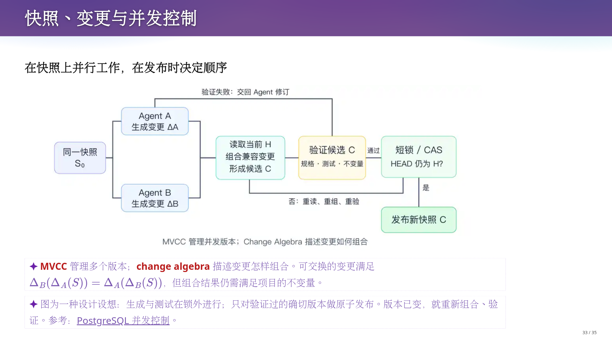

在老师设想的面向 Agent 的并发准入架构中，需要区分多版本并发控制（MVCC，即允许多个并发操作基于各自看到的快照版本推进，在生效时再由系统协调关系的机制）与变更代数的职责。MVCC 负责管理多个版本下的并发访问（它可以与锁结合，不等于乐观并发），而变更代数则描述修改之间如何衔接与组合。例如，若两项变更满足交换律，即先应用变更 A 再应用变更 B，与先应用变更 B 再应用变更 A 得到相同的项目状态，则称它们是可交换的变更；但即便操作可交换，组合后的结果仍需满足项目的不变量（Invariants，即系统在演进过程中必须始终成立的业务或架构约束）。图中给出了具体的并发控制设想：两个 Agent 读取同一快照并行修改，耗时的代码生成与测试全部在锁外进行；发布时，系统将兼容的变更与当前主线组合并验证候选结果，仅用短锁或原子比较并交换（CAS，Compare-And-Swap）保护短暂的版本读取与发布瞬间。如果发布时发现主线版本已被其他 Agent 推进，则重新将变更与新主线组合并再次验证，只对验证过的确切版本做原子发布。

这种“锁外生成测试、锁内原子发布、版本过期则重算验证”的设计，避免了长锁把并发工作重新排成串行长队。然而，现有工具离把“变更”放到中心还有多远？当两份修改在文本上毫无冲突地成功合并后，系统是否就一定安全了？接下来我们将结合新兴工具与具体反例展开剖析。

### 一等公民冲突与写偏差反例

在传统 Git 中，一旦合并或变基发生冲突，工作流就会被迫中断，等待人工清理工作区中的冲突标记。如果面向高并发 Agent，工具层需要怎样表达变更身份与冲突状态？同时，我们必须回答一个更深层的问题：没有文本冲突的自动合并，能否保证项目不变量不被破坏？

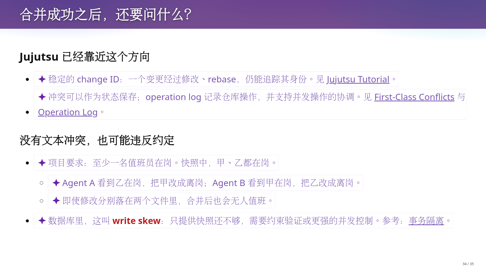

新一代版本控制工具 Jujutsu（简称 `jj`）已经具备靠近这一方向的几项机制：

- 首先，它引入稳定的**变更标识**（change ID），使一个变更即便经过反复修改或变基（rebase），系统仍能追踪其同一身份；

- 其次，它将冲突作为**一等公民状态**（First-Class Conflicts）直接保存在版本记录中，而不必阻塞后续操作；

- 最后，它使用**操作日志**（operation log）记录仓库的所有变动，并支持并发仓库操作的协调。

Jujutsu 的这些机制提供了有价值的研究方向，而前文设想的自动组合、验证与准入流程仍需进一步设计。更关键的是，仅靠文本合并存在本质局限，这可以通过一个经典反例来说明：假设项目要求“至少一名值班员在岗”这一业务不变量，初始快照中甲、乙均在岗。Agent A 读取快照看到乙在岗，便将甲改为离岗；Agent B 读取同一快照看到甲在岗，便将乙改为离岗。若甲、乙的状态分别记录在两个不同文件中，两项修改在文本合并时没有任何冲突，操作顺序也可交换，但合并后的结果却是无人值班。这种现象在数据库中称为写偏差（write skew）：并发操作各自依据旧快照作出局部合法的决定，组合后却破坏了跨文件的共同约束。

“至少一人值班”的反例清楚表明：文本无冲突或操作可交换，并不保证组合结果满足业务不变量。要想在高并发下守住系统底线，快照隔离与局部检查之外，必须对组合后的候选快照执行约束验证。这自然引出了最后一节的思考：在这样的技术底座上，未来的项目管理与人类职责将发生怎样的重构？

### 大步历史与审计范式的转向

当底层系统能够通过短锁获取快照、在锁外并发生成并通过严格的组合验证准入主线后，人类工程师在软件工程中的位置会发生什么变化？如果代码由机器海量生成，过去以“追查哪个人写错了哪行代码”为核心的工程审计习惯，又该如何演进？

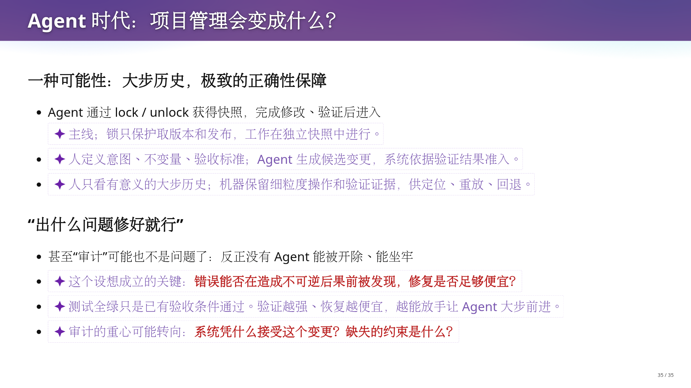

展望 Agent 时代，项目管理与审计范式可能发生深刻转型。在设想的工作流中，Agent 通过加锁与解锁（`lock` / `unlock`）仅保护获取快照版本和最终发布的短暂过程，而耗时的修改与验证均在独立快照中完成。在人机分工上，人类负责定义意图（Intent）、不变量（Invariants）与验收标准；Agent 负责生成候选变更，系统则依据验证结果决定是否准入主线。由此，历史记录也将分层：人类只阅读有意义的大步历史，而机器在底层保留细粒度的操作日志与验证证据，供故障定位、过程重放与安全回退使用。老师用一句提问挑战了传统以追责为中心的审计习惯：“反正没有 Agent 能被开除、能坐牢，出什么问题修好就行。”这一设想若要成立，取决于两个工程前提：错误能否在造成不可逆后果前被及时发现，以及修复成本是否足够便宜。测试全绿仅仅代表已有的验收条件得到了满足；验证机制越强、恢复代价越低，人类才越能放手让 Agent 大步前进。相应地，工程审计的重心将不再是惩罚执行者，而是转向追问系统：“系统凭什么接受这个变更？当时缺失的约束到底是什么？”

至此，我们完成了从“管理一个项目目录”到“持续运行的并发控制与验证系统”的完整概念推演。正是为了在未来能够设计、驾驭并审计这样复杂的 Agent 协作系统，我们今天才必须扎实掌握快照、分支、原子变更以及数据库并发控制等核心计算机科学概念。

> 写偏差（Write Skew）与不变量验证
>
> 在并发版本控制中，“没有文本冲突”绝不等于“满足项目不变量”。如课堂“值班员”反例所示：初始状态甲、乙均在岗，两个并发 Agent 基于同一快照分别修改不同文件，各自在确认另一人在岗的前提下将其中一人改为离岗。双方文本合并零冲突，组合结果却导致无人值班。消除此类写偏差异常，必须在变更组合后的候选快照上执行全局不变量验证，或引入更强的并发控制机制。

> Jujutsu（jj）把“变更”推向中心的机制
>
> 传统 Git 以不可变的提交快照为核心，变基后产生新哈希，原提交身份随之改变，遇到冲突还会阻塞工作区。新一代工具 Jujutsu 提供了更靠近 Agent 协作需求的底层机制：用稳定的 change ID 在多次修改与变基中持续追踪同一变更身份；支持将合并冲突作为一等公民状态直接存入历史；并用 operation log 记录与协调仓库的并发操作，为未来构建更高级的变更代数与并发准入系统提供了有益借鉴。

> 区分课堂架构设想与现有工具能力边界
>
> 本章讨论的“代码产能提高 1000 倍”是放大工程矛盾的思想实验，而非实测数据；“锁外生成测试 + 变更代数组合 + 短锁/CAS 原子发布”是老师面向未来 Agent VCS 提出的架构设想，并非现有 Git 或 Jujutsu 已经开箱即用的自动准入系统。同时切勿混淆“测试全绿”与“系统正确”：若业务不变量从未写入规格与检查脚本，任何自动合并与测试流水线都无法凭空保证它。

术语消化：面向高并发 Agent 的版本控制核心概念消化

| 术语 | 解决的问题 | 机制与课程关系 |
|---|---|---|
| 变更代数（Change Algebra） | 形式化判定并发修改能否安全组合及如何重放 | 定义变更间的独立性、交换律与前置依赖关系，决定冲突后需重做或重新验证的范围 |
| 多版本并发控制（MVCC） | 避免耗时的代码生成与测试因全局长锁退化为串行排队 | 允许多个 Agent 基于各自读取的独立快照版本在锁外推进工作，仅在生效时由系统协调版本关系（可与锁结合） |
| 写偏差（Write Skew） | 揭示局部合法且无文本冲突的修改为何会破坏全局业务规则 | 多个 Agent 各自依据旧快照作出局部正确的修改并写入不同位置，合并后共同违反跨文件的不变量约束 |
| 一等公民冲突（First-Class Conflicts） | 解决传统合并冲突强制中断自动化流水线与后续操作的问题 | Jujutsu 等工具将冲突直接作为合法状态保存在版本中，配合稳定的 change ID 与 operation log 支持并发协调 |

$$
\Delta_B(\Delta_A(S)) = \Delta_A(\Delta_B(S))
$$

其中 S 表示项目的某个基准快照（Snapshot），变更 A 与变更 B 分别表示两个并发生成的变更操作。该等式刻画了变更代数中的交换律：先在快照 S 上应用变更 A 再应用变更 B，与先应用变更 B 再应用变更 A，最终得到的项目状态完全一致。需要注意，操作交换律描述的是应用顺序是否影响最终状态语义，并不等同于 Git 中的“无文本合并冲突”；而且即便两项变更满足交换律且文本合并无冲突，组合后的结果状态仍必须通过项目不变量（Invariants）的验证。

### 本章小结

本章通过“代码产能提高一千倍”的思想实验，揭示了以人工提交、审查与协调为中心的传统版本控制工作流在**高并发 Agent** 时代的瓶颈。

围绕老师提出的 Agent VCS 设想，我们探讨了变更代数、基于快照的锁外并发生成与短锁/CAS 原子发布机制，借助“至少一人值班”的写偏差反例证明了无文本冲突不等于满足**业务不变量**，并展望了人类专注于定义意图、不变量与验收标准的未来工程审计范式。

## 总结与延伸

回顾本讲，我们围绕“如何让软件项目在持续演进中避免陷入一团混沌”这一核心命题，完成了一次从底层机制到前沿设想的深度穿越。

在学习方法上，当开源代码与 AI 生成内容随处可得时，真正的分水岭在于保持对细节的“**留意**”与脑中预演（Virtually Implement）——在执行命令或阅读方案前，先独立预测状态变化与设计约束，再通过观察现场（如利用 `gitv` 展开 `.git/objects` 中的 `blob`、`tree`、`commit` 对象及松散引用存储示例 `.git/refs/heads/`）来验证理解，明白 Git 快照是逻辑上的项目整体状态，底层通过复用对象避免物理复制全部文件，且根提交没有父节点。


在实际工程应用中，我们明确了工作区（Working Tree，包含开发者在本地目录中当前直接看到的所有可见文件，而非仅指未暂存改动）、暂存区与提交历史的层次边界，并将繁杂的 Git 最佳实践收敛为**四个核心工程诉求**：给自己留退路、把探索整理成他人能接手的变化、稳定共同依赖的历史、以及用 Hooks 与 CI 让约定落地（如区分 Git 命令与课程 Makefile 定义的项目交付命令 `make submit`）。

透过 SWE-bench 与 Astropy 嵌套模型修复案例，我们看到哪怕最终代码只把常数 `1` 改为 `right` 一行，也建立在对布尔依赖矩阵结构的准确理解之上，并需配套 `FAIL_TO_PASS` 与 `PASS_TO_PASS` 测试、更新记录、代码审查及分支回移，配合 `gh` 或 `glab` 串联起非 Git 的平台协作闭环。


承前启后，本讲直接回应了前两讲关于开放的“意图—规格—实现”空间的讨论：正因为需求与设计需要在持续批评和反馈中逐步收敛，我们才必须用围绕单一意图的“**原子变更**”推进项目快照。在当前 Agent 能力范围内，无论是采用单线程收敛纯函数架构、开启不超过三个终端（个人工作习惯）配合实时视觉验收，还是在构建个人助手实验中沉淀规则以避免软件焦油坑，都在践行这一原则。

而在“假设代码产能提高一千倍”的思想实验中，我们借鉴数据库多版本并发控制（MVCC，可与锁结合，不等于乐观并发）与写偏差（Write Skew）的概念，指出无文本冲突并不能保证满足业务不变量。那些关于变更代数、锁外生成验证与短锁/CAS 原子发布的课堂设想，以及随后课程即将展开的现代 CI/CD 与自动化验证体系，都将建立在本讲所奠定的快照、原子变更与**不变量约束**的概念基石之上。

### 学习练习

用下面的延伸练习检查自己能否应用本讲方法。

#### 练习 1：工作区、暂存区与底层对象的预测与核验实验

在本地新建一个空目录并执行 `git init`，创建 `hello.c`。在 `AGENTS.md` 中写入课程推荐的新手学习约定（要求 Agent 在每次 Git 操作前逐文件检查变化并解释是否符合 best practice）。随后依次执行以下操作，并在每一步操作前先在纸上或文档中写下你的预测：

- （1）写入第一版代码并执行 `git add hello.c`；

- （2）不提交，继续修改 `hello.c` 加入新语句；

- （3）直接执行普通 `git commit`；

- （4）创建两个分支对同一行代码做不同修改并执行 `git merge` 制造冲突。

利用 `git diff`、`git diff --cached`、`git status` 以及解压查看 `.git/objects`（或编写简易脚本/使用可视化工具）核对每一步的真实状态。

**验收标准：**

提交一份实验记录文档，需包含：

- （1）首版提交（根提交）的 `commit` 对象内容解析，验证其不包含 `parent` 字段，并列出其指向的 `tree` 与 `blob` 对象标识；

- （2）步骤（2）和（3）中 `git diff` 与 `git diff --cached` 的实际输出对比，证实普通 `commit` 仅提交了 `add` 冻结在暂存区的版本，且工作区包含当前所有可见文件；

- （3）合并冲突发生时，工作区文件中 `<<<<<<<`、`=======`、`>>>>>>>` 标记的现场截图或文本摘录，以及此时 `git status` 显示 `both modified`（或暂存区存在多个 stage 版本）的观察记录。

#### 练习 2：基于原子变更与约定式提交的仓库大扫除

构造或找一个存在典型工程隐患的本地练习仓库，其中混杂了源码、编译出的可执行二进制文件、`dist/` 构建目录、运行日志、带有本机绝对路径的编辑器配置、`.DS_Store` 临时文件，以及一段把“修复解析器缺陷”和“全项目代码格式化”混在一起的未整理修改，且历史中包含一条写着 `update` 的含糊提交与一个模拟误传的测试用 API Key 字符串（请使用虚构占位符如 `sk-test-dummy-12345`，切勿使用真实密钥）。请按照本讲工程判断准则对该仓库进行治理。

**验收标准：**

治理后的仓库需满足：

- （1）配置合理的 `.gitignore`，并将已被跟踪的构建产物、日志、临时文件与私人路径配置移出版本控制，同时保留必要的源码与可重建项目的构建脚本（如 Makefile），确保在干净目录下克隆后可正常编译；

- （2）针对模拟泄露的测试 Key，在文档中写明正确的应急处置顺序（先撤销/轮换凭据，再清理历史），并完成历史清理验证旧快照中不再包含该字符串；

- （3）将混杂的代码修改拆分为至少两个独立的“原子变更”提交，每个提交均可独立编译并通过测试，且 Commit Message 严格遵循 Conventional Commits 格式（包含标题与解释“为什么改、触发条件是什么”的正文）。

#### 练习 3：并发 Agent 写偏差（Write Skew）复现与准入检查设计

模拟课堂上的“值班员在岗”思想实验。创建一个 Git 仓库，用两个独立文件 `alice.json` 和 `bob.json` 分别记录甲、乙两名值班员的在岗状态（初始均为 `on_duty: true`），项目级业务不变量为“任意时刻至少有一人在岗”。编写一个验证脚本 `check_invariant.py` 检查该不变量。

开启两个独立分支（模拟两个并发 Agent 读取同一初始快照），分支 A 检查发现乙在岗后将 `alice.json` 改为 `false` 并提交；分支 B 检查发现甲在岗后将 `bob.json` 改为 `false` 并提交。尝试合并两个分支并设计防止该异常进入主线的机制。

**验收标准：**

交付代码仓库与说明文档，需达成：

- （1）演示分支 A 与分支 B 在各自独立快照上均能通过 `check_invariant.py`，且使用 `git merge` 合并时文本层面零冲突自动成功，但合并后的主线快照运行 `check_invariant.py` 失败，完整复现写偏差（Write Skew）现象；

- （2）实现一个模拟的准入控制脚本（或 Git Hook / 本地 CI 流程），落实课堂设想的“在独立快照上修改、与当前最新主线组合后重新运行全局不变量验证、验证通过才允许推进主线引用”的闭环，证明当主线已被一方推进后，另一方的变更在重新组合验证时会被成功拦截。

### 拓展阅读

- [官方讲义](https://jyywiki.cn/GSE/2026/lect3.md)
- [官方课件](https://jyywiki.cn/GSE/2026/slides3.html)
- [社区字幕校订稿（固定版本）](https://github.com/NinZeige/NJU-2026-GSE-Captions/tree/0456f3a46fd5fa2f2a86123e02b7ed48696adacb)
- [原课程许可 CC BY-NC 4.0](https://creativecommons.org/licenses/by-nc/4.0/)
- [Pro Git: About Version Control](https://git-scm.com/book/en/v2/Getting-Started-About-Version-Control)
- [Pro Git: A Short History of Git](https://git-scm.com/book/en/v2/Getting-Started-A-Short-History-of-Git)
- [Pro Git: What is Git? (Snapshots, Not Differences)](https://git-scm.com/book/en/v2/Getting-Started-What-is-Git%3F)
- [Pro Git: Git Objects](https://git-scm.com/book/en/v2/Git-Internals-Git-Objects)
- [Pro Git: Basic Branching and Merging](https://git-scm.com/book/en/v2/Git-Branching-Basic-Branching-and-Merging)
- [Pro Git: Rebasing](https://git-scm.com/book/en/v2/Git-Branching-Rebasing)
- [Git Documentation: git-add](https://git-scm.com/docs/git-add)
- [Git Documentation: gitignore](https://git-scm.com/docs/gitignore)
- [GitHub Docs: Removing sensitive data from a repository](https://docs.github.com/en/authentication/keeping-your-account-and-data-secure/removing-sensitive-data-from-a-repository)
- [Conventional Commits v1.0.0](https://www.conventionalcommits.org/en/v1.0.0/)
- [Git Best Practices (Seth Robertson)](https://sethrobertson.github.io/GitBestPractices/)
- [Learn Git Branching](https://learngitbranching.js.org/)
- [SWE-bench: Can Language Models Resolve Real-World GitHub Issues?](https://arxiv.org/abs/2310.06770)
- [SWE-bench Evaluation Harness Documentation](https://www.swebench.com/SWE-bench/api/harness/)
- [Astropy Issue #12906: Modeling's separability_matrix does not compute separability correctly for nested CompoundModels](https://github.com/astropy/astropy/issues/12906)
- [Astropy PR #12907: Fix separability_matrix for nested CompoundModels](https://github.com/astropy/astropy/pull/12907)
- [GitHub CLI (gh) Manual](https://cli.github.com/manual/)
- [GitLab CLI (glab) Documentation](https://docs.gitlab.com/cli/)
- [PostgreSQL Documentation: Transaction Isolation](https://www.postgresql.org/docs/current/transaction-iso.html)
- [Jujutsu VCS Documentation: Tutorial, Conflicts & Operation Log](https://docs.jj-vcs.dev/latest/tutorial/)
