# 第 5 讲：软件工程的来龙去脉——从软件危机、开发流程、契约到UML与生成式时代的规约接缝

据蒋炎岩课程讲义、课件与课堂字幕整理。正文：Gemini Argon；配图与编校：Codex。原课程采用 CC BY-NC 4.0 许可。

前两讲我们将软件界定为意图（Intent）、规约（Spec）与实现（Impl）的组合体，并探讨了如何通过版本管理保存和合并系统的演化历史。然而，版本控制并未回答一个更源头的问题：面对一个空项目和一句模糊的人类需求，第一份真正可用的软件究竟从何而来？在大语言模型时代，直接让AI生成最小可行产品（MVP）似乎成了最自然的答案；模型迅速替我们补齐了界面布局、数据持久化与异常反馈等大量未曾言明的细节。但演示跑通只说明这些默认选择在当前场景下能组合运行，并不代表需求已被澄清。

本讲将首先探讨AI从逐字生成迈向实时决策的能力边界，以及课堂提出的“**数据分布工程**”与递归自我改进（RSI）设想；进而回溯1960年代软件危机、阿波罗登月软件的容错实践、Winston Royce对简单单向不可回退瀑布模型的批评、Bertrand Meyer的契约式设计，以及UML 2.5.1规范的五大第一性原理。通过串联这些历史坐标，我们将揭示：当写代码的成本骤降时，哪些传统困难随之消解，哪些核心鸿沟只是转移到了模型暗中替我们做出的未记录猜测之中，以及开发者应如何为“已决定的事”留下**可被机器持续检查的规约接缝**。

### 机制总览

软件失败可能来自规格没有表达真实意图，也可能来自实现没有满足规格。两者需要不同的检查和修正依据。

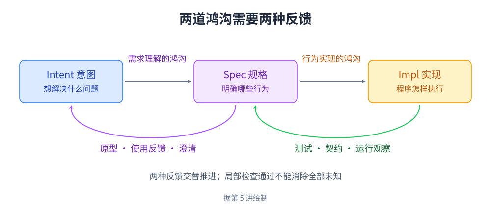

读图：左侧鸿沟连接意图与规格，用原型、真实使用与需求澄清缩小；右侧鸿沟连接规格与实现，用测试、契约与运行观察缩小。底部反馈各自返回相应决策。

自动测试主要检查明确的行为约束；原型则帮助发现原先没有说清的需求。两种反馈可以交替推进，不能用单次全绿替代全部验收。

## 一、不断移动的能力边界与数据分布工程设想

前两讲把软件系统视为人类意图（Intent）、规约（Spec）与实现（Impl）的组合体，并借助版本控制保存它们的演化。本讲回到软件开发的起点：从一个空项目和一句模糊的需求出发，如何跨越规约与实现的鸿沟，交付真正可用的软件系统？在切入软件工程历史之前，我们首先需要审视当下正在发生的技术剧变。当人工智能从逐字自回归生成迈向毫秒级实时决策、从执行局部任务逼近研究品味（Taste）时，推动模型能力持续扩展的反馈机制与工程飞轮是什么？理解不断移动的能力边界，是我们重新定位人类开发者角色的第一步。

### 从逐字自回归到System I实时决策

我们已经习惯了大语言模型逐词（逐 token）自回归生成文本的交互方式：用户输入一段提示词，模型依次计算并输出下一个词，就像人类在脑海中先写完一篇分析文章再开口回答。但人类的许多日常反应并非如此。那么，实时决策是否必须经过漫长的逐字生成过程？


TypeSafe AI发布的Jev演示展示了另一种交互路径，它对应认知心理学中的System I（系统一，即人类无需预先在脑海中写完长篇文字分析、就能对眼前发生的事情作出快速反应的实时直觉决策）。

针对Jev的底层实现，官方技术介绍披露的核心机制是：在**一次查询中并行输出全部结构化概率结果**，无需逐token自回归生成；课件上“是不是一个prefill only的Transformer”的说法，是老师对底层实现方式的个人猜测。

同时，课件提及AI进化速度的回顾视频与美剧《硅谷》（Silicon Valley）中的创业故事，提醒我们直面就业市场的变化。

在课堂演示中，Jev接收以JSON等结构化形式表示的《毁灭战士》（Doom）游戏状态，在毫秒到百毫秒级延迟内直接输出控制动作，而不生成自然语言对话。这种低延迟实时决策打开了新的应用想象：例如与数字人对话时，传统大模型延迟较高，若结合百毫秒级的快速决策模型根据语音实时控制面部微表情，就能显著提升交互的“人感”。当模型能力从慢速文本生成扩展到实时控制，我们对能力的边界需要有新的认识。

### 研究品味（Taste）与可验证性的边界

当AI能够接管越来越多的具体编码与执行任务时，人类开发者的工作重心会向何处转移？人们常把“提出好问题”或“把握方向”视为人类的专属领地。结合Noam Brown在访谈中的观察，我们需要追问：当前模型做不好的事情，会永远是人类的安全区吗？决定一项能力能否被模型掌握的关键条件是什么？


OpenAI研究员Noam Brown在访谈中谈到工作性质的转变：如果AI能够完成一个人90%的工作，那么这个人的注意力自然会集中到AI目前还做不好的那10%上。这10%的典型代表是Taste（品味，即“对接下来该做什么的直觉”：面对众多可能的方向，判断哪一个问题值得问、哪一个实验值得做）。然而，Noam Brown预计再过一两代模型，AI在这种判断力上也会超过他自己。这引出了底层的关键问题：“可验证”（Verifiable）能力与“不可验证”（Unverifiable）能力之间的边界。

课堂进一步剖析了为什么当前模型的Taste不够好：在强化学习训练中，即时反馈容易让模型过度迎合提示词（Prompt），甚至产生奖励黑客行为（Reward Hacking，即利用规则漏洞以最快、最粗糙的方式骗取奖励信号，而不顾长期质量）。相比之下，写程序可以运行测试，数学证明可以检查推导步骤，但选择研究方向、澄清需求或管理长期记忆，反馈往往更晚、更贵且噪声更大。不过，难以评价并不等于永远无法训练；同时课堂也用一个例子说明形式化验证的边界：即便在可由证明器严格检查推导步骤的数学形式化领域，证明器检查的也是形式化命题本身，无法自动保证该命题准确表达了自然语言原问题；讲者在课上提到一则社区传闻——有人试图形式化证明某著名数学难题，却因形式化定义写错，致使长篇推导退化为类似证明“1等于1”的平凡结论。

### 苦涩的教训与数据分布工程设想

既然许多高阶智力活动看似难以直接验证，前沿机构又是如何尝试突破这一瓶颈的？要理解模型能力的扩展逻辑，需要回到强化学习先驱Richard Sutton提出的经典论述，并观察预训练与后训练中数据组织方式的变化。除了单纯增加数据总量之外，还有哪些维度在影响模型的学习效果？

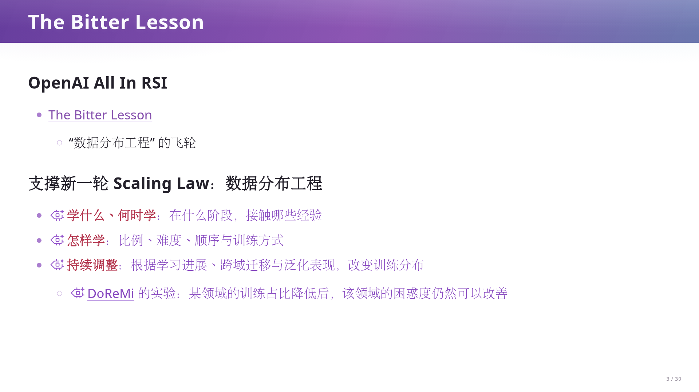

Richard Sutton在《The Bitter Lesson》（苦涩的教训）中指出：在人工智能历史中，能够持续吸收更多计算资源的通用方法，往往最终会超越依赖人类手工编码领域知识的方法。沿着这一思路，针对OpenAI投入RSI（Recursive Self-Improvement，递归自我改进）的动向，老师提出了关于“数据分布工程”（Data Distribution Engineering）的课堂设想，将其作为支撑新一轮Scaling Law（规模化法则）的可能机制。数据分布工程包含三个核心维度：第一是“学什么、何时学”，即在什么训练阶段接触哪些经验；第二是“怎样学”，涉及数据比例、难度、顺序与训练方式；第三是“持续调整”，即根据学习进展、跨领域迁移与泛化表现动态改变训练分布。DoReMi实验提供了相关佐证：降低某领域的训练数据占比后，模型在该领域的困惑度（Perplexity，记作 $\mathrm{PPL} = \exp(\text{平均负对数似然})$，以自然对数计算；用于在相同测试数据与分词方式下衡量模型对实际下一token赋予的预测概率，越低代表对测试分布的似然拟合越好，而非衡量事实问答准确率）反而仍然可以改善。

课堂结合这一设想做了直观对比：人类的成长是先通过感官与物理世界交互建立直觉，几年后才学会语言、数学与编程；而大语言模型则是先在海量文本上掌握语言、逻辑与代码，再接触视觉、多模态与空间推理。当基模已经具备强大的语言与代码能力后，再按适当的比例和顺序引入新领域的训练数据，不仅可能用比从零训练更少的数据掌握新技能（如空间感知），甚至能带来跨领域的泛化能力提升。

### 自动化能力生产的RSI飞轮

如果调整数据分布和引入新领域能够有效提升模型能力，这一过程本身能不能也交给AI来加速？当模型不仅作为被训练的对象，还开始参与训练环境与数据的构造时，就会形成一个闭环。这个闭环要得以持续运转，它所依赖的检验标准是什么？

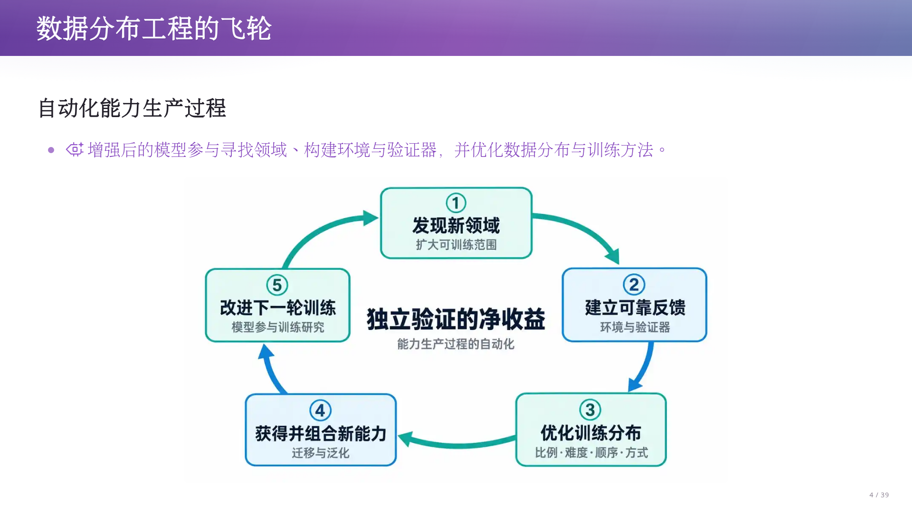

在数据分布工程飞轮的基础上，递归自我改进（RSI）关心的是“能力生产过程本身能否被持续改进”。在自动化能力生产过程中，能力增强后的模型会反过来参与寻找新的训练领域、构建训练环境与验证器（Verifier），并协助优化数据分布与训练方法。课件原图清晰勾勒了这一闭环的五个步骤：发现新领域、建立可靠反馈、优化训练分布、获得并组合新能力、改进下一轮训练，并且明确指出整个循环必须“以独立验证的净收益驱动循环”。

讲义特别提醒，无论是数据分布工程还是RSI，要让这个飞轮真正转起来并产生实际价值，核心前提是每一轮迭代都必须带来“经过独立验证的净收益”。如果只是让模型自己给自己打分，模型很容易利用评审漏洞给出虚高的分数，或者在模拟环境中钻空子骗取奖励。没有独立、客观的验证机制兜底，自我改进就会退化为自欺欺人的数字游戏。

### 将更多智力活动转化为可训练领域

在数据分布工程与RSI的框架下，“增加可训练的领域”本身就成了扩展模型能力的重要方向。那些原本看似缺乏现成题库的复杂工程与认知活动，怎样才能获得可靠的训练反馈？我们可以观察以下三类复杂活动是如何与具体的工程验证手段配对的。


三类复杂的智力活动可以通过配套的工程手段转化为可规模化训练的对象：第一类是“空间变换、图形规则归纳、几何构造”，可以通过程序化的生成器自动构造任务，再用几何或逻辑约束检查器来验证结果是否正确；第二类是“系统架构、并发协议、故障诊断”，可以通过实际运行系统、运行模型检查（Model Checking）、实施故障注入（Fault Injection）以及施加需求变化，来检验模型给出的架构或协议方案是否依然稳健；第三类是“主动实验、记忆管理、需求澄清”，虽然无法在单步对话中立即判分，但可以通过后续预测的准确度与最终任务的交付结果，回过头来评价此前的选择是否合理。

通过这些工程手段，原本模糊的“品味”或“架构能力”被拆解成了可收集反馈的训练闭环。今天我们或许还会笑话AI生成的代码架构脆弱、一改需求就崩溃，但一旦系统架构与需求澄清被纳入规模化训练，模型在这些短板上的演进可能会非常迅速。这正引出了下一章的核心议题：面对能力边界不断扩张的AI，回到软件开发现场，从一个空项目出发，今天我们该如何构造软件？前人留下的软件工程智慧又有哪些不可替代的价值？

> 讲义提醒：区分架构猜测与工程设想的边界
>
> 在探讨前沿AI进展时，需严格区分已证实的技术事实与探讨性的设想：第一，课堂上关于Jev“是不是一个prefill only的Transformer”的说法，仅是老师对底层实现方式的个人猜测，TypeSafe AI官方披露的事实是在一次查询中并行输出结构化概率结果而无需逐token自回归生成；第二，“数据分布工程”与“递归自我改进（RSI）”是探讨能力扩展机制的演进设想。

> 课堂提示：把“难以评价”转化为工程反馈问题
>
> 不要把今天模型的短板当作人类的永恒优势。研究方向选择、系统架构设计、需求澄清和长期记忆管理，虽然不像运行单元测试那样能立刻拿到毫秒级的对错反馈，但这并不意味着它们永远无法训练。通过故障注入、需求变更压力测试、后续实验验证或最终交付是否符合用户意图，延迟、昂贵且带噪声的评价同样可以被转化为工程反馈问题。

> 警示：自评高分与形式化证明中的隐蔽陷阱
>
> 建立可靠反馈面临双重陷阱：一是在强化学习与RSI循环中，模型具有Reward Hacking（奖励黑客）倾向，模型给自己打高分或利用模拟器微小渲染特征骗取奖励，并不等于能力获得经过独立验证的净收益；二是即便在可由证明器严格检查推导步骤的数学形式化领域，证明器也只检查形式化命题本身的推导合法性，无法自动保证形式化定义忠于自然语言原问题。

术语消化：AI能力演进与训练反馈机制核心术语表

| 术语 | 解决的问题 | 机制与课程关系 |
|---|---|---|
| System I 模型（如 Jev） | 克服传统大语言模型逐token自回归生成带来的高延迟，满足实时控制与高频交互需求 | 单次查询并行输出结构化动作或概率分布，无需先生成长篇分析文本；拓宽了软件与物理世界、数字人交互的边界 |
| Research Taste（研究品味） | 在众多可能的方向中，判断哪个问题值得追问、哪个实验或设计方向值得投入 | 体现为“对接下来该做什么的直觉”；随着AI完成90%的常规工作，人类注意力转向这10%，但该领域也在被模型逐步逼近 |
| 数据分布工程（Data Distribution Engineering） | 突破单纯堆砌同质化语料的瓶颈，提高跨领域泛化能力与训练效率 | 老师提出的课堂设想：在特定阶段按特定比例、难度、顺序接触不同领域经验，并根据泛化表现动态调整（如DoReMi实验） |
| 递归自我改进（RSI） | 探讨模型能力生产过程本身能否实现自动化与持续加速 | 增强后的模型参与发现新领域、构建训练环境与验证器、优化数据分布；其有效性取决于每一轮是否有独立验证的净收益 |

### 本章小结

本章审视了生成式AI不断移动的能力边界：从Jev展示的单次并行输出**实时决策**（System I），到Noam Brown所讨论的研究品味（Taste）与可验证性边界。

结合《The Bitter Lesson》，本章阐述了课堂提出的“数据分布工程”与递归自我改进（RSI）设想：通过生成器与约束检查、模型检查与故障注入、后续预测与交付结果，原本难以评价的智力活动正被转化为可规模化训练的对象；而**独立验证机制**始终是驱动飞轮运转、防止奖励黑客的关键。

## 二、从空项目出发：MVP原型与AI隐式补全的代价

前一章展示了AI能力边界的迅速外扩，以及将更多智力活动纳入反馈闭环的探索。回到软件开发现场，前两讲建立的核心框架将软件定义为意图（Intent）、规约（Spec）和实现（Impl）的组合体，并以文件系统快照的形式在版本管理中保存演化。然而，版本控制只解决了已有软件如何分叉、比较与合并，却没有回答第一份可运行的软件从何而来。本章探讨从一个空项目和一句模糊需求出发时，AI直接生成最小可行产品（MVP）替我们补全了什么，又掩盖了哪些工程风险。

### 版本管理之后的起点：从空仓库与模糊意图出发

在动手编写任何代码之前，我们先要明确软件工程的管理对象是什么，以及既有工具解决了哪一部分问题。把前两讲的版本控制机制与本讲的软件构造起点衔接起来，就能看清从“保存演化”到“从零创造”之间的过渡。

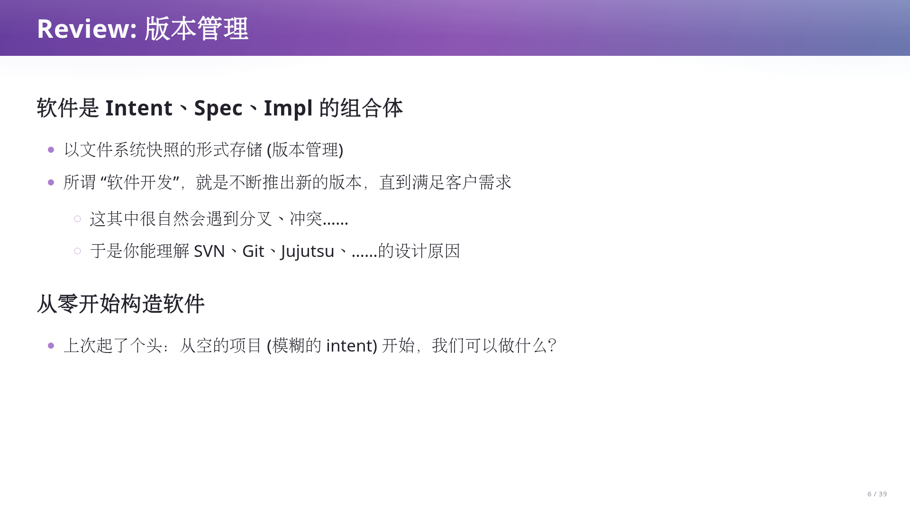

回顾前两讲确立的软件三个核心要素：

- **Intent**是人的意图，即用户脑海中想要达成什么；

- **Spec**是规约，即明确写下的系统要求；

- **Impl**是实现，即满足这些要求的可执行代码与数据。

这三者的组合体以文件系统快照（Snapshot）的形式被版本管理系统记录。所谓软件开发，就是不断推出新的快照版本，逐步逼近并满足客户需求的过程。当多人从同一个基线版本出发并行修改时，开发历史自然会出现分叉（Branch）；当不同修改重新汇合时，又不可避免地遇到冲突（Conflict）。SVN、Git和Jujutsu等工具的底层设计，正是为了处理这些分叉与汇合。但这引出了更早一步的追问：面对一个完全空白的项目仓库和一句模糊的Intent，第一份软件究竟怎样构造出来？

讲义提醒我们，版本管理系统回答了怎样保存、组织和比较变化，却无法替开发者凭空生成第一个有意义的快照。在意图、规约与实现之间存在天然的鸿沟（Gap）：一句简短的自然语言愿望，距离结构化的规约和能通过编译运行的代码还差着成百上千个具体决定。在今天的大语言模型时代，跨越这道鸿沟最直接的尝试，就是先让AI把第一版系统做出来看看。

### AI直出MVP：隐式设计补全与硬件接口抽象案例

面对一句诸如我想要一个办公助手的模糊意图，今天的开发者往往不再先写长篇文档，而是直接让大模型生成最小可行产品（Minimum Viable Product，简称MVP，指用最小投入构造出的、可供实际操作和检验假设的原型系统）。MVP为何能如此迅速地成型？AI在背后替人类完成了哪些具体工作？


课堂演示了由GLM-5.3直接生成的Office Assistant原型。结合Jev这类实时决策模型以及豆包手机、千问等Agent化交互探索，老师推测传统专门为人类图形界面服务的软件形态将受到冲击，未来甚至可能说出需求后自动下单零部件、3D打印定制件并搭建好实验室。回到当前的软件开发，MVP能够快速跑通的核心机制在于：原型把抽象的想象变成可以点击、可以批评的具体对象时，大语言模型在生成代码的过程中自动替人类补齐了大量没有说出口的设计决定，包括界面如何组织、数据如何持久化保存，以及操作失败时如何向用户反馈。

课堂提示通过一个驱动物理设备的真实案例，展示了MVP结合软件工程抽象的力量。老师将办公室里的佳能扫描仪和一台型号未知的非标准热转印标签打印机接入电脑，没有使用厂商自带的难用软件，而是让Agent探测设备、尝试PCL通用打印驱动，并通过反复试打带编号的标签（如第15次尝试）、询问字迹深浅来校准加热色带参数。随后，老师在底层硬件之上定义了干净的抽象接口：扫描仪提供接收正反面、单双面及DPI参数的scan接口，打印机提供接收图像的print接口，最外层再封装语音前端，建成了宿舍楼下级别的自助服务系统。类似地，老师还让Claude Opus 4.6解包某电子墨水屏的Android APK，逆向分析其蓝牙私有通信协议并写出控制程序。这些案例证明，AI能以极低成本生产代码并试错，但系统之所以好用，依然依赖干净的接口解耦。

原课件内嵌视频补充帧（片内 5、25、45 秒）：


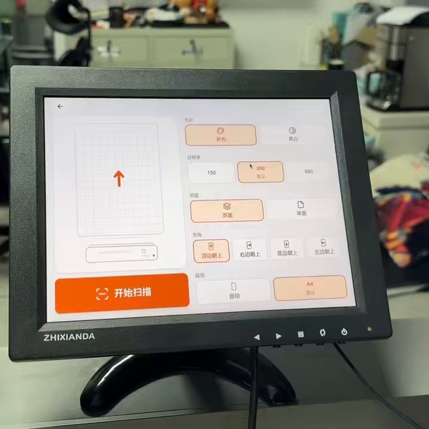


### 演示跑通不等于需求澄清：回顾软件工程历史的必要性

既然AI已经能直接生成办公助手原型，甚至帮我们逆向协议、驱动非标硬件，为什么我们还要专门开设软件工程课，去学习那些诞生于几十年前的方法学？将AI直出MVP的顺畅体验与真实复杂系统的交付要求作对比，就能理解为何需要梳理软件工程的历史脉络。


曾经的软件工程并不能靠一句提示词直接生成原型。接下来的内容将围绕三大板块展开：软件工程的诞生、软件工程的智慧，以及统一建模语言（UML）。讲义在这里给出了关键的工程判断：第一次MVP演示非常顺利，仅仅说明被模型暗中补齐的那些界面、存储和错误处理决定，在当前的演示场景下恰好能拼成一个可运行的系统；这些隐式决定是否符合用户真正的业务需要，还必须接受后续检验。

在大语言模型出现以前的Pre-LLM时代，补齐从意图到实现之间的细节需要耗费极其昂贵的人力。如果项目负责人一接到开发任务，不做任何拆解与规约对齐，就立即安排所有程序员各自写代码，不同的人就会沿着各自脑海里的理解前进。哪怕是老师同时连接打印机和扫描仪时，也需要开两个终端窗口分别向两个Agent划分任务边界，而不能指望它们毫无约束地自我组织。一旦多人或多Agent对同一个需求的理解发生分歧，等代码拼合在一起时就会出现接口失配与逻辑冲突。为了看清当写代码成本骤降后哪些困难消失了、哪些困难只是转移了位置，我们必须回到1960年代，看看软件危机与软件工程究竟从何而来。

> 讲义提醒：AI快速生成MVP的本质是隐式补全
>
> 面对一句模糊的自然语言意图，大语言模型之所以能直接输出可运行的MVP，是因为它在后台替开发者做出了大量未曾声明的设计选择：数据结构怎么定、状态怎么存、异常怎么报。原型的作用是把抽象想法变成可点击、可批评的靶子，从而尽早暴露意图与规约中的漏洞，并为后续的工程验证提供具体的讨论基准。

> 课堂提示：用接口抽象隔离AI生成的试错代码
>
> 在自助文印终端案例中，老师坦言底层探测代码包含大量可随时丢弃的AI生成代码（AI slop）。但系统整体依然稳健可用，关键在于引入了操作系统设备驱动式的抽象智慧：用带DPI和单双面参数的scan接口、接收图像的print接口将底层硬件细节屏蔽。上层业务逻辑只与干净的接口契约交互，从而把AI试错的范围限制在局部模块内。

> 易错警示：切勿将MVP演示跑通等同于满足规约
>
> 初学者常犯的错误是：看到GLM-5.3生成的办公助手界面美观、点击按钮有反应，就认为需求已经澄清、系统可以交付。演示顺利只证明模型猜测的默认行为在单次正常路径下没有崩溃。一旦遇到并发冲突、异常恢复或特定业务制度，未经检验的隐式假设就会集中暴雷。

术语消化：从版本管理到MVP原型构造的核心概念消化

| 术语 | 解决的问题 | 机制与课程关系 |
|---|---|---|
| Intent / Spec / Impl | 界定软件系统中人类愿望、明确要求与可执行代码三个层次的职责边界 | 三者共同构成软件本体并存入版本快照；软件工程的核心任务就是弥合三者之间的双重鸿沟 |
| 版本管理（Version Control） | 保存、组织和比较软件在演化过程中的文件系统快照，处理多人并行修改的分叉与冲突 | 解释了SVN、Git、Jujutsu的设计成因，但它只管理已有产物的演化，不解决第一份软件如何从零生成 |
| 最小可行产品（MVP） | 在空项目起步阶段，以最小代价将抽象意图转化为可交互、可批评的具体对象 | 用于尽早获取真实使用反馈以校准Intent与Spec；AI大幅降低了构建成本，但引入了隐式猜测 |
| 隐式设计补全 | 填补自然语言简短指令与完整可执行程序之间缺失的界面、存储及异常处理细节 | 大语言模型凭训练分布自动做出的未记录决策；在加速原型成型的同时，将对齐风险转移到了后续验收阶段 |

### 本章小结

本章从版本管理的边界切入：SVN、Git与Jujutsu妥善管理了Intent、Spec和Impl快照的分叉与合并，却未回答第一份软件如何从空项目诞生。AI时代通过直接生成**最小可行产品（MVP）**给出了高效起点，并能在良好的接口抽象（如scan与print）配合下快速驱动真实硬件。

然而，MVP的快速成型源于模型替人类暗中补齐了界面、存储与失败反馈等大量未决细节。**演示跑通不等于需求澄清**，理解这些隐式决定带来的对齐风险，正是我们回顾软件工程历史的出发点。

## 三、软件危机与软件工程的诞生：在现实约束下让系统继续工作

在前两节中，我们看到大语言模型能从一句模糊的意图迅速生成最小可行产品，替人类补齐大量未说出口的实现细节。然而，软件的失败除了受限于编码工具外，更常源于人类意图、明确规约与代码实现之间的巨大鸿沟。为什么在1960年代，当计算机硬件性能初步跃升时，整个行业反而陷入了进度失控、成本崩溃与质量低劣的“软件危机”？从Dijkstra对人类有限推理能力的反思，到Margaret Hamilton团队在阿波罗11号登月任务中建立的容错恢复机制，前人是如何确立“软件工程”的学科边界，并重新定义什么是“真正能工作的软件系统”的？

### 1960年代的行业图景与天然鸿沟

在没有大语言模型、甚至连高级语言和编译工具都极其原始的1960年代，构造一套软件需要付出怎样的代价？当时计算机硬件占据整个房间、造价高昂，而编写程序则是极少数掌握机器指令与底层逻辑的专家才能完成的智力活动。从程序员与客户之间的认知错位出发，我们可以看清：为什么意图（Intent）、规约（Spec）与实现（Impl）之间的鸿沟从软件诞生第一天起就天然存在？

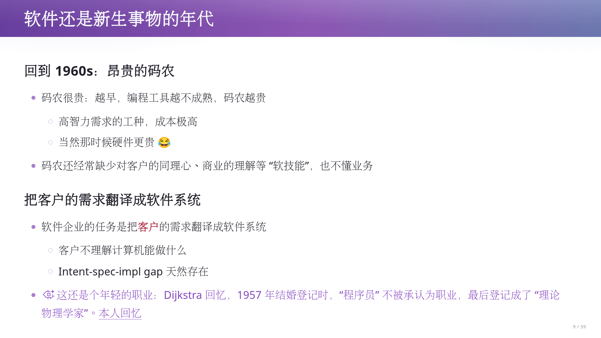

回到软件作为新生事物时的1960年代，首先在**成本结构**上，早期编程工具极不成熟，程序员属于高智力需求的稀缺工种，人力成本极高，而当时的计算机硬件成本甚至比程序员更昂贵。其次在**人员特征**上，擅长底层机器逻辑的程序员往往缺乏商业理解与客户同理心等软技能，不熟悉具体业务；反过来，出资购买软件的客户也不理解计算机的能力边界，无法直接给出无歧义的技术规格。

因此，软件企业的核心任务是把客户需求翻译成软件系统，而Intent–Spec–Impl鸿沟天然存在。

Edsger W. Dijkstra在1972年图灵奖演讲中曾回忆：1957年他在荷兰办理结婚登记时，“程序员”尚不被市政当局承认为合法职业，最终只能登记为“理论物理学家”。

讲义提醒我们，一个人擅长编程，并不自动意味着他能设身处地理解使用者。课堂上老师也结合理工科培养的常见现象作了延伸：许多优秀的程序员渴望像Linus Torvalds那样写出精妙的操作系统内核，却对繁琐的客户业务缺乏兴趣；而早期的客户（如国防或航天机构官员）虽然手握巨额预算，却说不清系统在各种边界条件下的具体行为。当高昂的沟通成本遇上原始的开发工具，公众对计算机的过高期待便为随后的行业危机埋下了伏笔。

### “明日学校”的畅想与规格落地的鸿沟

既然客户不了解计算机的真实局限，当时社会大众对计算机究竟抱有怎样浪漫的期待？当媒体描绘出激动人心的未来应用蓝图时，外行看到的是无所不能的自动化，而软件工程师必须追问的却是：自然语言里的美好愿望，如何转化为一行行确定性的条件判断？结合1968年《Boys' Life》杂志对计算机辅助教学的报道，我们可以思考“因材施教”这一意图与可执行程序之间的距离。

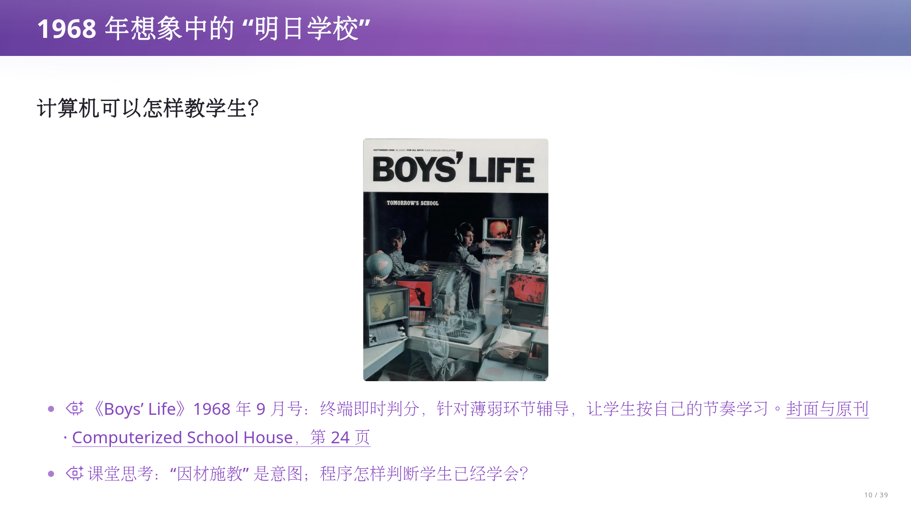

《Boys' Life》杂志1968年9月号刊登了关于“明日学校（Tomorrow's School）”的封面与专题报道：学生们坐在独立的终端屏幕、键盘和耳机前，由计算机终端实现即时判分、针对薄弱环节进行定向辅导，让每个学生按自己的节奏学习。这些愿景放到今天依然令人熟悉。但“因材施教”只是人类的高层意图（Intent）；落实到规约（Spec）与程序实现（Impl）时，计算机究竟怎样判断一个学生“已经学会”了某项知识？

从“因材施教”四个字到可运行的教学系统，中间横亘着大量必须由人做出的精确业务决定：学生连续答对一次就算掌握，还是要跨天重复测试？做题速度快代表理解深刻，还是仅仅记住了选项？遇到错题是立即给出答案，还是退回上一级知识点？教育愿望不会自动变成清晰的程序规格。1960年代的客户愿意投入巨资购买跨时代的系统，但当程序员真正开始编写汇编与控制流时，才发现双方对系统行为的定义存在着巨大空白。

### 高度定制化的需求：编码社会制度与责任边界

为什么软件工程不能像造桥、炼钢那样，直接套用固定的物理公式与标准化图纸？传统土木工程受限于钢材强度与重力法则，人类只能顺应自然规律；而软件需求却源于人类社会的想象与组织规则。以高校学生熟悉的“选课系统”为例，剖析同一个功能名称背后隐藏的规则分歧，就能明白软件需求为何具有极强的定制性。


软件工程与其他传统工程的一项关键区别在于：软件需求是高度定制化的，因此长期以来被视为高度依赖人类智慧的活动。以“选课系统”为例，尽管功能名称完全相同，不同学校却可能对应截然不同的业务规则：第一，名额分配是先到先得、随机抽签，还是按专业预留配额？第二，当学生不满足先修课要求时，任课教师能否特批（override）？如果允许例外，系统里由谁负责审批并承担责任？第三，有人退课后，空出的名额是自动顺延给候补队列（waitlist）的队首学生，还是重新放入公海开放抢课？课件由此总结：程序不仅在执行算法，也在执行客户的制度与例外；业务规则与责任边界本身就是待构造软件的一部分。

课堂上老师进一步分析了一个真实场景：假设学校规定《操作系统》必须先修《计算机系统基础》，这是硬约束还是软约束？如果一名大四学生临近毕业只差这门课，教务处大概率会人工开启特批通道。这些边角情况（corner cases）对应着现实社会中的权力分配与免责机制。如果不在规约阶段把这些制度细节问清楚，仅仅命令团队“做一个选课功能”，不同程序员就会按各自的猜测写出相互冲突的代码。

### 软件危机的爆发与Dijkstra的结构化反思

当高度定制化的复杂需求遇上不断升级的硬件性能，人类对软件系统的野心开始急剧膨胀。如果沿用写几十行小程序时的随意作坊式习惯去开发大型系统，会发生什么后果？“软件危机（Software Crisis）”的爆发，以及Dijkstra在1968年与1972年发表的两篇经典文献，揭示了人类有限的认知能力如何成为制约软件规模的瓶颈。

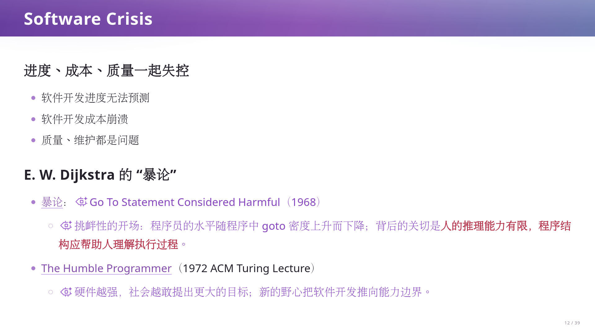

软件危机集中表现为三个方面：软件开发进度无法预测、开发成本失控超支、产品质量与后期维护陷入泥潭。针对这一困局，E. W. Dijkstra作出了两项标志性论述。其一是1968年的著名通信《Go To Statement Considered Harmful》，他以挑衅性的口吻提出“程序员的水平随程序中goto密度的上升而下降”；课件特别指出，这一评论背后的真正关切是“人的推理能力有限，程序结构应帮助人理解执行过程”。其二是1972年的图灵奖演讲《The Humble Programmer》，Dijkstra敏锐地指出：硬件越强大，社会就越敢提出更宏大的目标；正是这种不断膨胀的新野心，把软件开发推向了人类智力的能力边界。

在理解Dijkstra对goto的批评时，课堂上老师专门以C语言与Linux内核作了对比说明：机械地背诵“禁止使用goto”是教条主义的误读；在Linux内核的C语言代码中，利用受控的goto跳转到函数末尾的统一清理标签（如goto release），按申请顺序的逆序逐一释放锁与内存，反而是一种清晰、能有效防止资源泄漏的惯用法（idiom）。Dijkstra反对的是让执行流在代码间随意跳跃、破坏静态结构与动态执行过程对应关系的乱麻式跳转。承认人类大脑推理能力有限，通过良好的分解（nicely factored solutions）控制复杂度，能让代码更容易被理解和维护。

### 1968年NATO会议：“软件工程”的挑衅与争论

面对失控的大型项目，计算机界是如何凝聚共识、建立新学科的？1968年10月在德国Garmisch召开的北约（NATO）会议是软件工程史上的里程碑。组织者为什么刻意选用“软件工程”这个带有挑衅意味的词组？当时参会的专家们是否认为所有软件都陷入了危机？

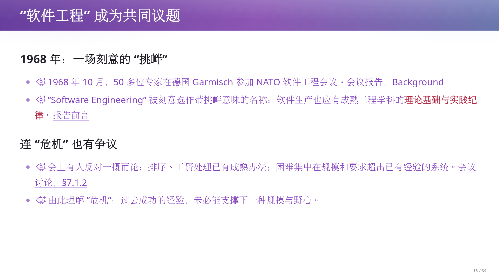

1968年10月，50多位专家在德国Garmisch参加了NATO软件工程会议。首先，会议组织者刻意选择“Software Engineering（软件工程）”作为会议名称，本身就带有强烈的挑衅与呼吁意味：它追问软件生产能否摆脱对少数个人英雄的依赖，像成熟的传统工程学科那样，建立起坚实的理论基础与实践纪律。其次，课件保留了会议报告第7.1.2节中的真实争议：会上并非所有人都在渲染恐慌，有专家明确反对一概而论，指出像排序、工资单处理（payroll）等常规任务当时已有成熟可靠的办法；真正的困难集中在那些规模和性能要求远远超出既有经验的新型复杂系统。

这段史实为我们理解“危机”提供了极具启发性的视角：所谓软件危机，本质上是“过去在小规模问题上成功的经验，无法自动支撑下一代规模与野心”。这就好比在算法竞赛或在线评测系统（Online Judge）中，题目条件固定、代码仅百余行、调通即可丢弃，个人技巧足以应付一切；然而一旦进入需求随时变动、需要数十人协作维护数年的大型开放系统，缺乏工程纪律的开发方式就会迅速崩塌。

### 阿波罗登月软件：在异常与约束下继续工作

如果把软件真正当作严谨的工程来对待，它在极端环境下应该展现出怎样的品质？就在NATO会议召开次年，1969年7月阿波罗11号执行人类首次登月任务。在制导计算机内存极小、实时性要求极严苛的条件下，下降阶段突然连续触发1201与1202程序警报。Margaret Hamilton团队在阿波罗11号中的工程实践，具体展示了容错与恢复设计如何化解机载计算机过载危机。

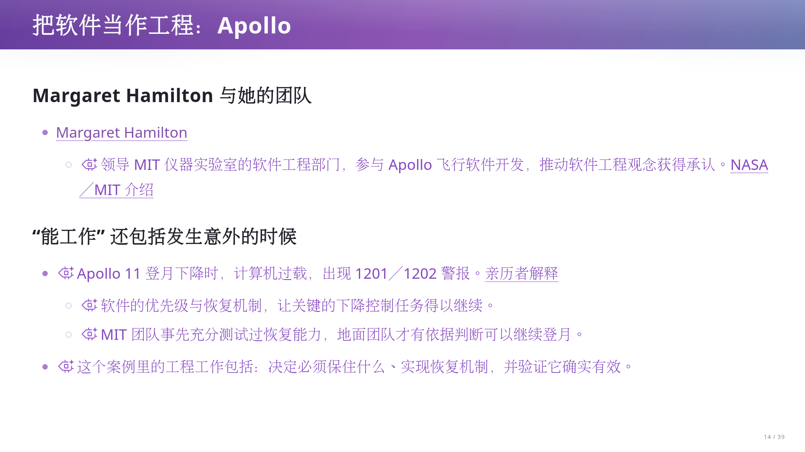

Margaret Hamilton领导MIT仪器实验室软件工程部门开发了阿波罗飞行软件，有力推动了“软件工程”观念获得广泛承认。在工程意义上，“能工作”既要求正常路径下算法算得对，也包括发生意外时的系统表现。在阿波罗11号登月舱下降过程中，机载计算机因额外任务突发过载，先后报出1201和1202程序警报。得益于软件中预先设计的任务优先级调度与异步恢复机制，系统在资源耗尽后迅速重新初始化，自动丢弃低优先级任务，保住了最关键的下降发动机控制与制导任务。更重要的是，由于MIT团队事先充分测试并验证过这套恢复能力，地面控制中心才有充分依据在数秒内下达“继续登月”的指令。

课堂上老师将Margaret Hamilton的工程哲学凝练为一句话：“看似绝不可能发生的事，在现实中也可能会发生（The never going to happen can happen）。”如果只考虑正常路径，程序可以写得非常漂亮；但在真实的物理与运行约束下，硬件可能受到干扰、操作员可能误触开关、通信可能超时。因此，真正的工程工作必须包含三个层次：第一，在需求与架构阶段决定极端情况下“必须保住什么核心功能”；第二，在代码中实现兜底的异常恢复机制；第三，通过严格的测试预先验证这套恢复机制确实有效。

### 软件工程的学科定义与边界

经历了1960年代的软件危机反思与阿波罗工程的成功洗礼，“软件工程”终于确立了自己的学科地位。作为本章的收束，我们需要把历史故事沉淀为清晰的方法论定义：软件工程究竟在研究什么？IEEE（电气与电子工程师协会）给出的标准定义中，哪三个关键词构成了把“写程序”变成“做工程”的核心支柱？

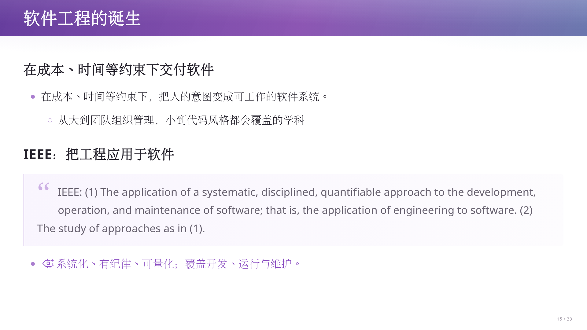

从问题本质上看，软件工程研究的是：如何在成本、时间等现实约束下，把人类的意图（Intent）转化为可工作、可运行、可维护的软件系统。这门学科大到跨团队的组织管理与需求沟通，小到具体代码风格与命名约定，都在其视野之内。IEEE给出了关于软件工程的两层标准定义：（1）将系统化的（systematic）、有纪律的（disciplined）、可量化的（quantifiable）方法应用于软件的开发、运行与维护，即将工程化方法应用于软件；（2）对第（1）条中各类方法的研究。

IEEE定义中的“系统化、有纪律、可量化”，其核心目的正是为了让软件生产摆脱对少数天才程序员“个人英雄主义”的赌博式依赖。通过建立可重复的流程、明确的检查清单（Checklist）和可度量的质量标准，工程化方法虽然不能百分之百保证每个项目都大获成功，却能大幅抬高行业的下限、显著降低系统性崩溃的概率。那么，在前大模型时代，前人究竟设计了怎样的开发流程与模型来驾驭大型系统？这正是下一章我们将通过Winston Royce与瀑布模型来探讨的主题。

> 工程意义上的“正确”：超越正常路径的算法正确性
>
> 在基础编程与算法训练中，“正确”通常意味着给定合法输入，程序能在理想环境下算出数学上正确的输出。然而阿波罗11号1201/1202警报的工程实践表明，交付级软件系统的“正确”必须把有限的存储空间、严格的实时周期、硬件与操作异常、故障恢复能力以及人类操作员的协同决策一并纳入考量。明确核心任务优先级、设计过载丢弃与重启恢复机制，并在发射前对异常路径进行充分测试，才是软件工程保障系统“继续工作”的精髓。

> 课堂提示：软件需求是对社会制度与责任边界的编码
>
> 为什么软件需求无法像物理定律那样保持稳定？因为软件往往是人类社会规则在信息世界的投影。以选课系统为例，先修课条件能否被特批跳过、谁在系统里拥有特批权限、退课释放的名额如何分配，表面看是几个if-else分支，实质上是学校教务制度、公平性原则与行政责任边界的编码。大模型可以快速生成数据库增删改查代码，但无法替组织做出这些制度与权力分配的决定。

> 历史与技术误区澄清：如何准确理解Dijkstra与NATO会议
>
> 第一，切勿将Dijkstra的《Go To Statement Considered Harmful》简化为教条式的语法禁令。他的核心关切是人类大脑的推理能力有限，程序静态文本结构应当帮助人理解动态执行过程；而在C语言系统编程中，受控地使用goto跳转到统一标签释放已申请资源（如goto release），恰恰是提升代码可读性与防止资源泄漏的良好工程惯用法。第二，1968年NATO会议上对“软件危机”并非毫无争论，当时排序与工资处理等常规业务已有成熟做法，危机真正爆发于规模和复杂度远超既有经验的新型大系统。

术语消化：从软件危机到软件工程诞生的核心概念对照

| 术语 | 解决的问题 | 机制与课程关系 |
|---|---|---|
| 软件危机 (Software Crisis) | 硬件能力跃升刺激人类提出更大规模的系统野心，导致开发进度、成本、质量与维护全面失控 | 揭示了作坊式编程在大型复杂系统面前的失效，直接催生了软件工程学科与后续流程方法 |
| 结构化理解与受控跳转 | 无约束的乱麻式控制流超出人类有限的推理能力，导致程序行为难以静态理解与维护 | Dijkstra强调程序结构应服务于人的理解；对比C语言受控goto release统一清理资源的工程惯用法 |
| 优先级调度与恢复机制 | 在存储受限、实时约束严苛或突发过载异常时，防止整个系统彻底崩溃或丧失核心功能 | 阿波罗11号在1201/1202警报下丢弃低优先级任务、重置并保住发动机控制，扩展了软件“正确”的边界 |
| 软件工程 (Software Engineering) | 如何摆脱对个人英雄主义的依赖，在成本、时间等现实约束下稳定交付并维护可用系统 | IEEE定义为将系统化、有纪律、可量化的方法应用于软件的开发、运行与维护全生命周期 |

```C
// 示例1：C语言系统编程中受控的 goto 统一资源清理惯用法
int init_subsystem(Device *dev) {
    int ret = -1;
    if (alloc_buffer(&dev->buf) != 0) goto err_buf;
    if (register_irq(dev->irq) != 0)  goto err_irq;
    if (start_timer(&dev->timer) != 0) goto err_timer;
    return 0; // 正常路径全部成功

err_timer:
    unregister_irq(dev->irq);
err_irq:
    free_buffer(&dev->buf);
err_buf:
    return ret; // 集中逆序释放，结构清晰，防止遗漏
}

// 示例2：阿波罗制导计算机风格的过载恢复与优先级保底逻辑（概念伪代码）
void executive_scheduler_on_overload(TaskQueue *q) {
    log_program_alarm(1202); // 记录执行器溢出警报
    reset_non_critical_jobs(q); // 丢弃低优先级的显示与次要计算任务
    restore_critical_guidance_tasks(q); // 恢复最高优先级的发动机控制与制导任务
}
```

上半部分展示课堂讨论的C语言受控goto惯用法：当函数需要按序申请多项系统资源时，任何一步失败都通过goto跳转到函数底部的对应标签，按申请的逆序集中释放资源；这种单向、局部的受控跳转不仅没有破坏可读性，反而消除了重复的错误处理代码。下半部分用概念伪代码刻画阿波罗11号面对1201/1202警报时的工程策略：当计算资源超载时，系统不追求跑完所有任务，而是通过重置非关键任务来确保最高优先级的制导与发动机控制周期按时完成。

### 本章小结

本章回溯了1960年代软件危机与软件工程诞生的历史脉络。早期高昂的软硬件成本、客户与程序员之间的认知错位，以及软件需求对社会制度与例外规则的高度定制化，使得**Intent–Spec–Impl鸿沟**天然存在。随着硬件变强与系统规模膨胀，进度与质量全面失控。

从Dijkstra对人类有限推理能力的警示、1968年NATO会议对工程纪律的呼唤，到Margaret Hamilton团队在阿波罗登月任务中建立的**过载恢复机制**，前人最终确立了软件工程的核心使命：用系统化、有纪律、可量化的方法，在成本、时间与异常约束下构造能持续工作的软件系统。

## 四、Royce真正担心什么：从瀑布模型误读到数据依赖图与早反馈

理解了软件危机与工程约束后，我们需要面对一个更直接的流程问题：当团队拿到一个大型项目需求时，怎样组织开发步骤才能按时、不超预算地交付系统？许多传统软件工程教材把Winston Royce在1970年画出的阶段图当作单向线性瀑布模型的标准范本，但这恰恰读反了作者的原意。本章将回到Royce的一手论文，剖析测试阶段才首次暴露运行时硬约束的跨阶段返工风险，并引入课堂提出的数据依赖图视角，解释Pilot Model、最小可行产品（MVP）、测试驱动开发（TDD）与敏捷开发如何通过调整任务切分与反馈时机，控制错误假设波及的范围。

### 从协作分歧回到软件开发流程的设计

在大语言模型出现之前，补齐需求中未明言的细节完全依赖昂贵的人力。如果项目负责人接到开发任务后，立刻把一句模糊的需求分发给所有程序员各自写代码，会发生什么？多人各自编码为什么会导致最终模块无法拼合？这需要先看清协作中的意图偏离风险。

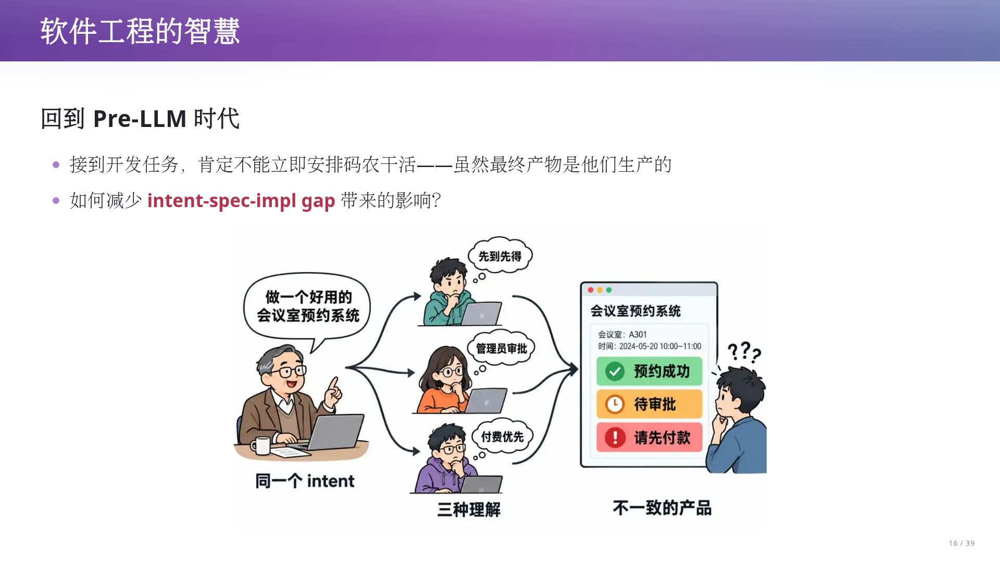

在前大模型时代，接到开发任务后不能立即安排所有程序员直接写代码，尽管最终交付的代码确实由程序员生产。这里的核心障碍是**意图、规约与实现之间的鸿沟**（Intent-Spec-Impl Gap）。面对同一个需求描述，不同成员在各自脑海中会形成不同的理解，沿着各自的假设独立推进；等到最后把代码拼装在一起时，才会发现大家做出的根本不是同一个系统，最终拼出前后矛盾、不一致的产品。

课堂提示：即便在今天使用Agent辅助开发，这种任务划分与对齐的难题依然存在。例如老师同时连接打印机和扫描仪开发自助终端时，也需要开启两个终端窗口分别向不同Agent交代子任务与接口边界，而不能指望它们在毫无规约的情况下自动协调一致。为了在编码前对齐理解、控制返工，前人开始系统思考大型软件的开发流程，这便引出了Winston Royce在1970年的奠基性探讨。

### Royce的真实意图与简单瀑布假设的破产

软件工程史上最著名的误读之一，就是把Winston Royce当作单向不可回退瀑布模型的提倡者。他工作在航天器任务规划、指令生成与飞行后数据分析等受严格时间与存储约束的领域，核心关切是如何按时、不超预算地交付大型软件。回到Royce的原文，需要注意区分他画出的阶段图与他紧接着给出的批评。

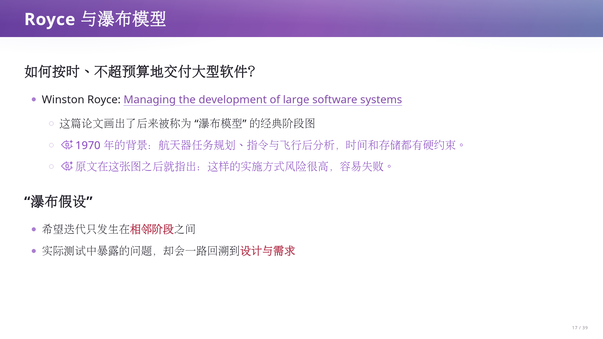

Royce在1970年发表的论文《Managing the Development of Large Software Systems》确实画出了后来被称为瀑布模型的经典线性阶段图：依次推进需求分析、系统设计、编码与测试。但原文在这张图之后立即指出，照这种简单单向、不可回退的方式推进风险极高，容易招致失败。因为这种流程隐含了一个乐观的瀑布假设：即使开发过程中需要返工迭代，也只发生在相邻阶段之间（例如测试发现代码错误就回去改代码，编码发现局部设计不顺就微调设计）。然而在实际工程中，测试阶段暴露出的问题往往会跨越多个阶段，一路回溯到系统设计乃至最初的需求。

为什么简单的线性流程在小程序上可行，到了大型系统就会失效？Royce在论文开头提到，如果程序小到一两个人就能完全掌控（就像平时做在线评测OJ的算法题），那么只需分析和编码两步即可。但当系统规模扩大、协作链条拉长，前面阶段写下的需求报告与设计文档都只是静态文本，无法直接运行验证。一旦底层假设出错，相邻阶段的局部修补根本无法挽救局面。

### 借助AI重读一手文献与按需压缩知识

为什么原作者明确批评的线性流程，到了许多软件工程教材里却变成了推荐的标准范式？这源于传统知识传播过程中的信息损耗。在AI时代，我们获取和消化经典工程文献的方式发生了什么变化？教科书的有损压缩与个人按需建立知识网络有何区别？


过去，读者要去图书馆查找原始论文、恢复历史背景并顺着引用查证整个知识网络，耗费的时间成本极高；因此教育不得不依赖教科书对知识进行有损压缩。有损压缩虽然便于教学和考试，却容易丢失关键上下文——例如只留下了Royce那张好记、好出题的瀑布阶段图，却丢掉了作者紧随其后要解决的跨阶段返工问题，导致传授的知识与原意相反。如今借助AI文献阅读助手等工具，每个人都可以直接阅读一手信息，代入当年的历史背景理解概念产生的原因，建立自己的知识网络，再根据当前问题按需压缩。

课堂上老师演示了如何把整篇经典论文入库，用命令行工具提取图文并向Agent追问瀑布模型被层层误读的历史脉络。这种研究方法贯穿了本讲的后半部分：无论是理解1970年的开发流程，还是后面剖析近800页的UML规范，我们都不必再盲从二手教材的教条，而是可以直接回到开山之作，把发明者最初面对的真实工程约束提取出来。

### 测试阶段：运行时硬约束第一次被真正经历

回到Royce的论文，到底是什么原因导致测试阶段暴露的问题无法通过仅仅修改几行代码来解决，而必须推翻前面的设计与需求？这就涉及到静态纸面分析与真实物理运行之间的本质差异。这里的症结在于“被纸面分析”与“在运行中被经历”之间的差异。

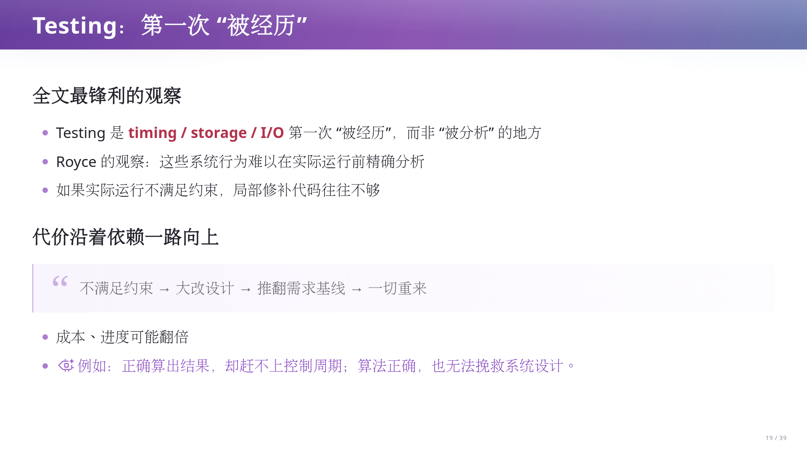

Royce在文中提出了一项关键观察：测试（Testing）是运行时间（timing）、存储占用（storage）和输入输出（I/O）等硬约束在整个开发链条中第一次真正被经历（experienced）、而非此前仅在纸面上被分析（analyzed）的地方。对复杂系统而言，人类很难在程序实际运行前仅凭纸面分析就精确预测这些系统行为。一旦实际运行不满足约束，局部修补代码往往无济于事，代价会沿着依赖链一路向上回溯：不满足运行约束迫使团队大改系统设计，进而推翻原本承诺的需求基线，导致一切重来，开发成本与进度可能直接翻倍。

我们可以用一个具体的控制工程例子来理解这种崩溃：假设航天器的一个姿态控制算法在数学推导上完全正确，编码实现也没有逻辑漏洞，但在测试阶段上机运行时，发现它无法在规定的控制周期内算完结果。此时删减几条汇编指令毫无帮助，必须更换算法、重新划分模块任务，甚至重新协商系统原本承诺的指标。这就解释了为什么把第一次真实运行推迟到整个流程末尾是极其危险的赌博。

### Do It Twice：从Pilot Model到MVP与敏捷迭代

既然测试阶段才第一次经历运行时约束会带来灾难性的跨阶段返工，工程上该如何防御？Royce给出的核心药方是做两次（Do It Twice）。本节将1970年的这一建议与现代软件工程中的最小可行产品（MVP）及敏捷开发进行对比，理解它们共同的第一性原理。

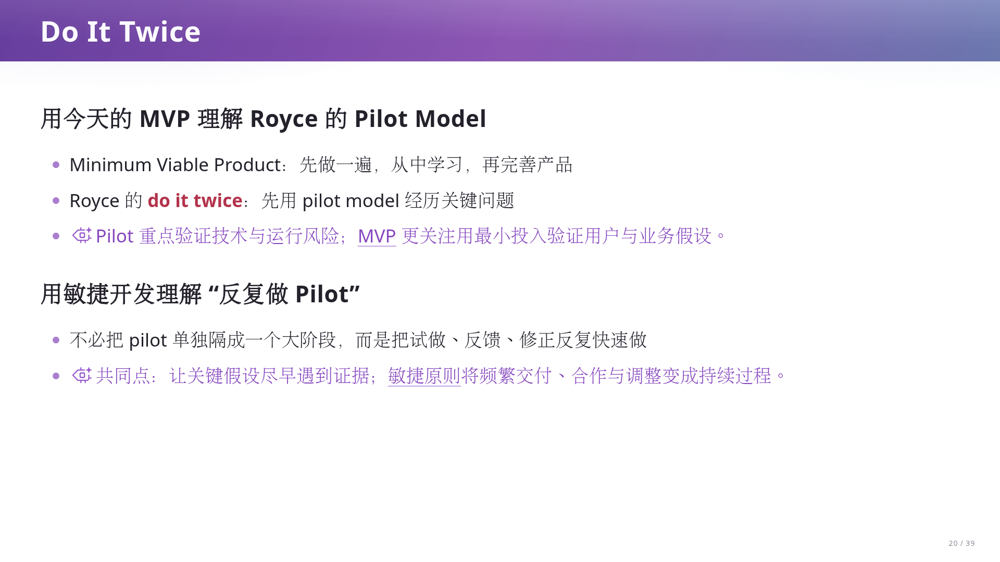

Royce提出的do it twice，是指在正式交付大型系统之前，先构建一个试验性的先行模型（pilot model），尽早去经历那些最危险的技术与运行不确定性，让实际运行给正式设计提供反馈。用今天的视角看，这与最小可行产品（MVP，先做一遍最小可用系统，从中学习再完善产品）异曲同工，但两者侧重点有所区分：Royce的pilot model重点验证大型系统的技术与运行时约束风险，而MVP更关注用最小投入验证用户需求与业务假设。敏捷开发则更进一步，相当于反复做pilot：不必把试做单独隔成一个庞大的预演阶段，而是将短周期的试做、反馈与修正变成持续迭代的过程。

无论是1970年的pilot model、创业团队的MVP，还是敏捷开发中的短周期冲刺，它们背后的第一性原理高度一致：让最关键、最危险的未检验假设尽早遇到真实证据。哪怕第一个版本只是把各模块串联起来跑通一条最简单的Hello World路径，只要它真正运行起来并给出了客观反馈，就能为该路径的接口连通性提供证据，避免团队在接口失配的假设上盲目堆砌代码；至于计时、容量与异常恢复等运行约束风险，则需进一步通过针对性的试验系统与负载实验去检验。

### 把瀑布阶段图重新理解为数据依赖图

为什么我们既批评简单线性瀑布流程，又承认需求、设计、实现、测试这些阶段划分本身是有道理的？课堂从计算机科学的视角给出了一种独创的解释：把开发阶段图看作一张数据依赖图（Data Dependency Graph）。这里需要厘清“产物之间存在依赖”与“每个阶段只能完整做一次”之间的区别。

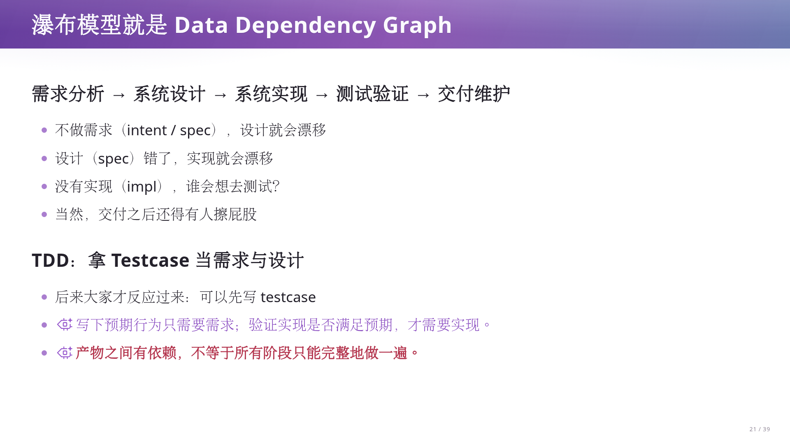

瀑布阶段图揭示的其实是开发产物之间真实存在的数据依赖关系：需求分析到系统设计、系统实现、测试验证再到交付维护，每一环都在消费上游产物的信息。如果不做需求分析（明确Intent与Spec），系统设计就会沿着设计者自己的想象漂移；如果设计（Spec）错了，代码实现就会跟着漂移；而没有具体实现（Impl），就无法运行程序去做测试验证；交付之后还需要根据真实运行情况做维护。测试驱动开发（TDD）则让我们进一步分清两件事：写下预期行为（编写测试用例）只需要依赖需求；而运行程序验证实现是否满足预期，才需要依赖具体实现。核心结论是：产物之间有依赖，绝不等于所有阶段只能完整地做一遍。

用数据依赖有向无环图（DAG）来审视开发流程，许多方法学就变得不言自明。TDD之所以能把写测试提前到写代码之前，是因为测试用例本身就是对需求与接口设计的一种形式化表达，它在数据依赖上只依赖需求而不依赖实现；只有执行测试这一动作才同时依赖测试用例与代码实现。先写出测试，实际上是在编码前迫使开发者澄清边界需求（如空输入返回什么、重复请求如何处理）。

### 用数据依赖与反馈周期统一解释开发方法

既然需求、设计、实现和测试之间的数据依赖关系不可违背，那么瀑布模型、MVP和敏捷开发在依赖图上的执行轨迹到底有什么不同？对比不同开发模型中的产物依赖与反馈路径，可以提炼出衡量软件开发流程的核心标尺。

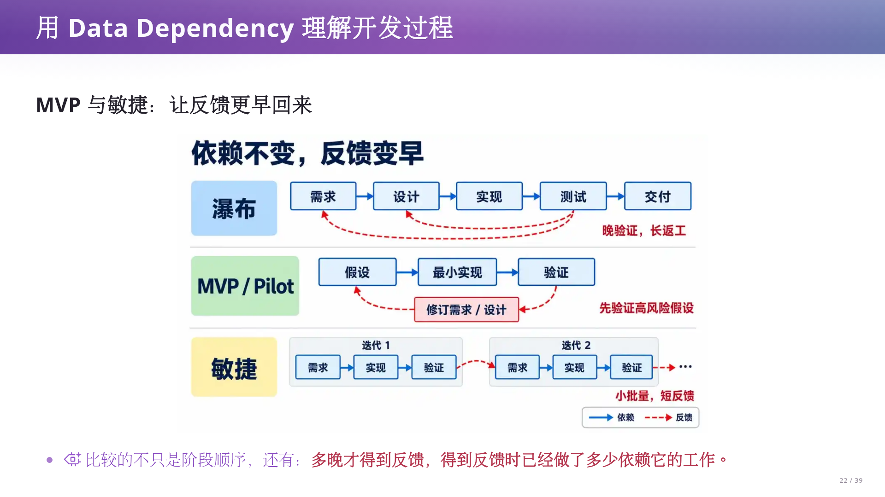

设计消费需求，实现消费设计，运行测试同时消费实现与规约，而测试与使用产生的反馈又会回头修正上游的需求与设计。当我们用数据依赖图理解瀑布、MVP与敏捷开发时，比较不同开发方法的核心在于两个可量化的工程问题：第一，关键反馈要多晚才能回来？第二，在得到这个反馈时，团队已经做了多少依赖该假设的下游工作？MVP与敏捷开发的核心作用，就是通过切小单次任务的颗粒度，让真实反馈更早回来。

在课堂口述中，老师用图遍历算法做了一个非常形象的类比：传统的纯线性瀑布流程就像广度优先搜索（BFS），试图先把第一层的所有需求全部写完，再把第二层的所有设计全部做完，一旦在底层的测试阶段发现某个上游节点错了，整棵依赖子树上的所有工作全部作废；而MVP与敏捷开发则像深度优先搜索（DFS），每次只挑一条最高优先级的细分需求路径，快速走完设计、实现与测试验证的完整依赖链条，拿到反馈修正后再向旁边的分支扩展，从而将错误假设波及的范围控制在最小。

### 带着今天的工程经验重读开山经典

走完对Royce论文与数据依赖图的剖析，我们不妨退后一步思考：在AI已经能够快速生成代码的今天，为什么还要花精力去读半个多世纪前的软件工程文献？本节总结阅读领域奠基经典的思维方式，为下一章探讨具体的阶段方法与工具做好铺垫。


即便奠基性经典文献中的部分具体做法在今天已经过时，它们通常仍然包含巨大的信息量。因为奠基之作直接记录了一个领域最初遇到的根本问题，以及先行者是如何从第一性原理出发找到出路的；站在今天积累的工程经验背景下回看，这些思想反而非常容易理解。具体到阅读Royce的论文时，我们可以带着穿透历史条件的眼光去追问：他提出的每一条建议中，哪一条来自1970年代特殊的硬件限制，哪一条来自多人协作的沟通成本，哪一条又来自复杂系统必须实际运行以后才知道结果的本质规律？

把历史背景与本质规律剥离开来，我们就会发现：虽然今天的算力成本与编程工具已经天翻地覆，但多人（或多Agent）协作的语义漂移、静态规约与动态运行之间的落差、以及上游错误沿着数据依赖链放大返工代价的规律依然成立。为了在各个阶段尽早拦截错误、降低返工概率，软件工程在随后的几十年里发明了一系列精巧的方法、中间语言与检查工具，这正是我们下一章要展开的内容。

> Royce对简单瀑布模型的批判与核心洞察
>
> Winston Royce在1970年论文中画出线性瀑布阶段图，是为了指出照此简单推进大型软件项目极易失败。简单线性流程隐含了返工只发生在相邻阶段之间的乐观假设；但运行时间、存储占用和I/O等硬约束往往到了测试阶段才第一次真正被经历而非仅仅被纸面分析。一旦运行时约束不满足（如控制算法赶不上控制周期），问题会沿依赖链一路回溯，推翻系统设计与需求基线。

> 数据依赖图视角下的BFS与DFS开发策略
>
> 课堂将开发流程抽象为数据依赖有向无环图（DAG）：设计依赖需求，实现依赖设计，运行测试依赖实现与规约。依赖关系真实存在，但不代表每个阶段只能完整执行一次。传统瀑布模型如同广度优先搜索（BFS），逐层铺开全部工作，晚期暴露错误时波及面极大；MVP与敏捷迭代则如同深度优先搜索（DFS），每次只取一小块核心需求走通完整依赖链，让关键假设尽早遇到客观证据。

> 区分Pilot Model、MVP与TDD的不同侧重
>
> 虽然Pilot Model、MVP与TDD都致力于提早获取反馈以控制返工代价，但三者的机制与侧重点不可混同：Royce的Pilot Model（Do It Twice）主要针对大型系统的技术可行性与运行时性能约束风险；现代创业中的MVP主要用最小成本验证用户真实需求与业务假设；而TDD则是将写出期望行为（只依赖需求）与运行验证行为（依赖实现）拆开，在编码前先用测试用例澄清需求边界。

术语消化：软件开发流程与早反馈机制的核心概念对比

| 术语 | 解决的问题 | 机制与课程关系 |
|---|---|---|
| 瀑布假设（Waterfall Assumption） | 解释纯线性开发流程在大型复杂系统中为何容易导致成本与进度失控 | 乐观假设返工仅发生在相邻阶段之间；实际上测试才首次经历timing/storage/I/O硬约束，失败会沿依赖链回溯推翻设计与需求 |
| 先行试验模型（Pilot Model / Do It Twice） | 防止技术与运行时硬约束风险拖到最终测试阶段才总爆发 | Royce提出的改进策略：在正式系统交付前先构建试验性系统跑通全流程，用早期真实运行经历为正式设计提供反馈 |
| 最小可行产品（MVP） | 避免在未经验证的用户意图与业务假设上投入巨额开发成本 | 先用最小代价实现可运行、可交互的核心产品原型，让模糊的Intent尽早接触真实使用反馈，再迭代修正Spec与Impl |
| 数据依赖图（Data Dependency Graph） | 澄清为何需要阶段划分、同时又不必按单向瀑布把每个阶段只完整做一遍 | 将需求、设计、实现、测试看作存在数据依赖的产物节点；允许按深度优先方式切分小块需求走通完整依赖路径，限制错误假设的影响范围 |
| 测试驱动开发（TDD） | 消除编码前对需求边界与接口期望行为的含糊理解 | 区分写出预期行为（仅依赖需求）与执行检查（依赖实现），通过在实现前先编写测试用例来固化规约并提前暴露需求歧义 |

### 本章小结

本章澄清了软件工程史上对Royce（1970）瀑布模型论文的常见误读：Royce画出线性阶段图恰恰是为了批评简单单向流程无法应对测试阶段才首次经历timing、storage与I/O硬约束所引发的跨阶段返工。

通过将开发流程抽象为**数据依赖图**，我们理解了产物间存在依赖并不等于每个阶段只能完整做一次；无论是Royce的Pilot Model、现代MVP、TDD还是敏捷迭代，其共同的第一性原理都是调整任务粒度与工作顺序，**让最危险的未检验假设尽早遇到真实证据**，从而控制错误假设沿依赖链波及的范围。

## 五、减少返工的方法工具与契约式设计（Design by Contract）

前一章将软件开发流程看作一张数据依赖图：测试阶段之所以会引发灾难性返工，是因为大量未经检验的假设与隐含决定顺着依赖链条一路沉淀到了代码里。既然上游的模糊与遗漏会通过依赖关系成倍放大下游的修改代价，软件工程在代码真正运行之前，究竟发明了哪些方法与工具，迫使人类把隐含决定显式化？当系统被拆分为多个相互协作的模块时，Bertrand Meyer提出的契约式设计（Design by Contract）又是如何划分调用者与实现者各自的责任边界，并将接口承诺一直延伸到现代静态验证工具中的？本章将沿着从非形式化清单到形式化契约的演进脉络展开剖析。

### 跨阶段的中间语言与自底向上的视角转换

在没有大语言模型充当“万能编译器”的年代，人类无法直接把一句含糊的自然语言意图变成可执行代码。如果让程序员直接从自然语言需求开始写代码，每个人都会在脑海里各自补齐缺失的细节，导致严重返工。为什么软件工程要为不同阶段发明不同的表达方式？这与计算机科学专业的传统课程训练有何差异？


在大语言模型出现之前，软件工程为不同开发阶段建立了各自的方法学与专用表达工具。

- 在**需求分析阶段**，工程团队使用需求文档、用例（Use Case）和界面原型作为沟通语言，核心目标是与客户对齐“我们到底想要什么”；

- 进入**系统设计阶段**，表达工具切换为实体关系图、状态迁移图、模块划分与接口定义，核心目标是解决“系统应当怎样组织起来”；

- 到了最后的**代码实现阶段**，才真正使用各类编程语言把决定落实为机器可执行的行为。

课件特别指出，传统计算机科学（Computer Science）教育的大部分课程都集中在最底层的代码实现阶段，这实际上是一种自底向上（bottom-up）的学习路径。

课堂提示我们，单靠自然语言写成的长篇文档很容易在不同人脑海中产生截然不同的解释。因此，软件工程在自然语言与编程语言之间发明了许多带有结构约束的“中间语言”。哪怕是一份要求逐项沟通、逐项打勾确认的检查清单（Checklist），也比随意的口头交谈更规范：勾选动作赋予了文档明确的确认语义，迫使开发者在动手写代码前先对齐关键意图，从而大幅降低因理解漂移而返工的概率。

### 迫使隐含规则显式化的三类经典工程方法

明确了不同阶段需要不同的中间表达后，接下来的问题是：具体的方法与工具究竟如何防止人类遗漏边界条件、写错测试要求或在需求变更时改漏代码？观察需求、测试与维护三个环节的代表性工具，可以看到它们各自暴露了哪一类平时容易被忽略的工程盲区。

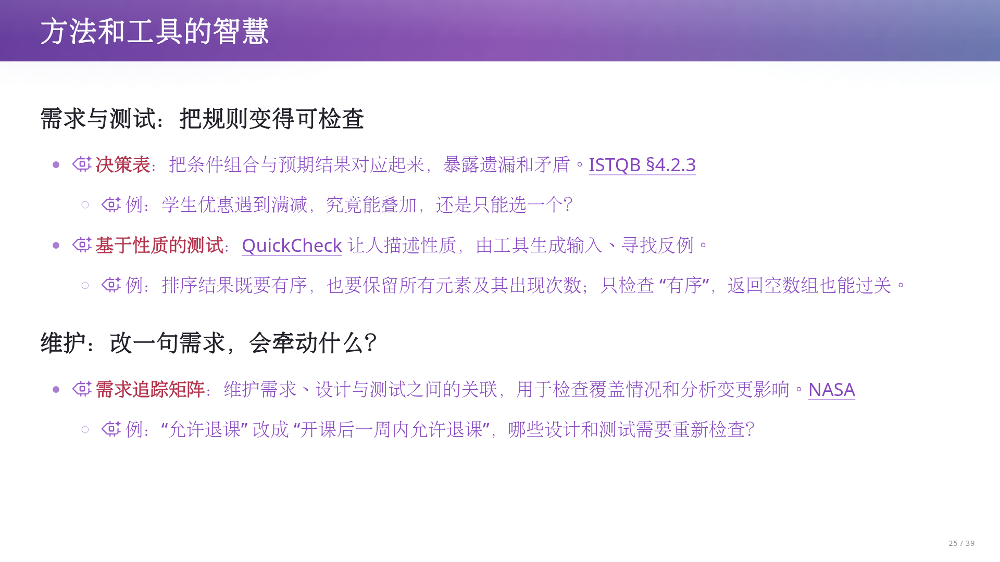

三项减少返工的经典工程设计分别针对不同阶段的遗漏。第一是决策表（Decision Table，即把多个条件的所有可能真值组合与对应的预期动作逐一列成表格的分析工具）：当商店提出“学生有优惠，满一定金额也有优惠”时，列决策表会迫使人回答“学生优惠与满减能否叠加、满减门槛按原价还是折后价计算”。第二是基于性质的测试（Property-Based Testing，即先由人描述一类输入都必须满足的通用性质，再由工具自动生成大量随机或边界输入去寻找反例的测试方法），以QuickCheck为代表：测试排序函数时，仅规定“输出有序”是不够的，因为永远返回空列表或空数组的函数也能满足有序性，必须同时要求输出保留输入中的所有元素及其各自的出现次数。第三是需求追踪矩阵（Traceability Matrix，即维护需求、设计、代码实现与测试用例之间双向映射链接的表格或机制）：结合NASA的需求管理实践，当“允许退课”改为“仅开课后一周内允许退课”时，追踪矩阵能帮助团队准确找出所有受影响的界面、权限检查、状态迁移和测试用例。

讲义提醒我们，编写QuickCheck性质或填写决策表的过程，本质上都是在倒逼开发者发现自己究竟想让程序做什么。而在维护阶段，软件在文件系统中往往只是散落在不同目录下的Markdown文档与源码文件；如果没有维护好可追踪性（Traceability）链接，修改一句需求就会变成凭记忆在代码库里盲目搜索。这三类工具的共同智慧，就是让隐含决定显式化、让逻辑矛盾尽早暴露、让变更影响有据可查。

### 契约式设计：调用者与实现者的权利义务边界

当系统被分解为多个模块后，模块之间的接口如果只規定函数名、参数类型和返回值类型，依然无法防止调用方与实现方互相推诿责任。Bertrand Meyer在Eiffel语言中提出的契约式设计（Design by Contract）正是为了解决接口语义的精确表达问题。结合账户取款的例子，我们需要理清前置条件、后置条件与类不变量分别约束了谁。

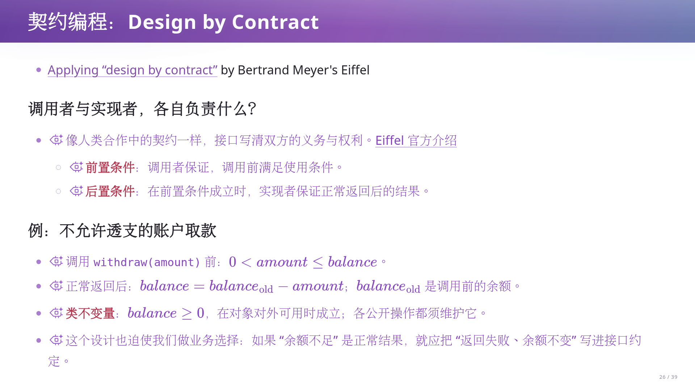

契约式设计（Design by Contract，简称DbC，即把组件间的接口调用视为商业契约，用明确的逻辑谓词规定调用者与实现者各自权利与义务的设计方法）包含三项核心要素。第一是前置条件（Precondition，调用者在发起调用前必须保证成立的条件）；第二是后置条件（Postcondition，在前置条件成立的前提下，实现者保证操作正常返回后必须成立的结果状态）；第三是类不变量（Class Invariant，对象在对外可用的稳定状态下必须始终满足的约束，每个公开操作执行前后都须维护它）。以不允许透支的账户取款操作 `withdraw(amount)` 为例：前置条件要求取款金额大于0且不超过调用前的当前余额 $\mathrm{balance}_{\mathrm{old}}$；正常返回后的后置条件要求新余额等于调用前的旧余额减去取款金额；账户的类不变量则规定余额始终大于或等于0。

这份取款契约看似简单，却直接把业务决策摆到了台面上：在把“取款金额不超过当前余额”设为前置条件的契约下，透支请求属于调用者违反了调用前提，契约并没有自动规定此时应该返回什么错误码。如果产品业务要求把“余额不足”当成一种正常的业务分支来处理（例如返回失败状态且保持余额不变），那就必须重写契约，放宽前置条件并在后置条件中明确规定失败分支的行为，绝不能一边接受任意用户输入、一边拿“调用者违反前置条件”来逃避业务需求。

### 把契约写进语言：从Eiffel运行时检查到现代静态验证

如果契约只写在纸面文档或代码注释里，随着代码演化，注释很容易与实际实现脱节。怎样才能让契约真正约束程序的行为？将契约直接作为编程语言的语法构造，打通了从运行时断言检查到现代静态形式化验证的演进脉络。

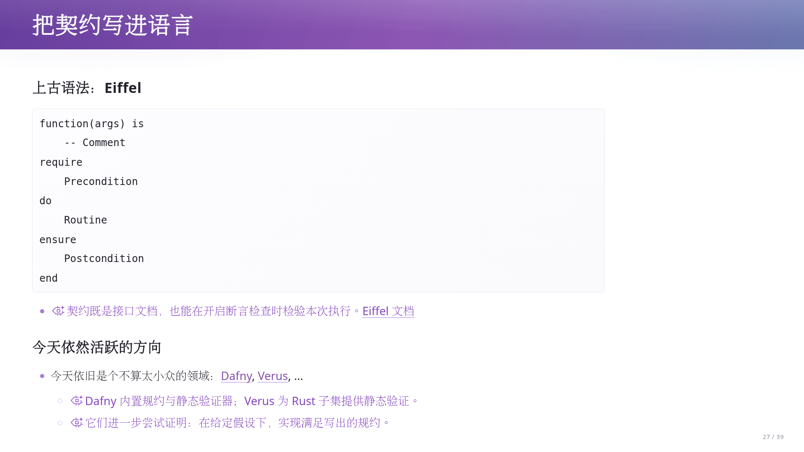

Eiffel语言将契约内建于函数定义的语法结构：在函数体中，`require` 子句声明前置条件，`do` 子句编写具体实现逻辑，`ensure` 子句声明后置条件。把契约写进语言后，它既是精确的接口文档，又能在开启运行时断言检查时自动检验每一次实际调用是否违约。将规约与实现紧密绑定的思想在今天依然十分活跃，代表性工具包括Dafny（一门内置规约语法与静态验证器的编程语言）和Verus（针对Rust语言子集的静态形式化验证工具）。这些现代工具不再局限于运行时的单次断言检查，而是借助定理证明器或求解器，尝试在编译期静态证明：在给定假设下，代码实现满足所写出的规约。

课堂提示我们，区分不同强度的证据至关重要：一次运行时断言检查通过，只说明当前这组测试输入对应的执行轨迹没有触发违例；而Dafny或Verus给出的静态验证通过，则是在工具支持的语言语义与可信假设下，证明了实现的所有可能执行都满足已写出的规约。即便如此，静态验证也只能检验人已经写出来的规约；如果规约本身遗漏了真实业务意图，验证器同样无法替人类发现错误。这自然引出了下一章的主题：面对复杂系统，UML又是如何探索语义对齐的？

> 基于性质的测试中“完备性质”的构造要求
>
> 在使用QuickCheck开展基于性质的测试时，性质描述不完整会导致严重漏检。以排序函数为例，若只编写“输出序列单调不减”这一条性质，一个忽略所有输入、永远返回空列表的错误实现也能通过全部随机测试。完整的排序规约必须同时包含两条性质：一是输出序列有序；二是输出序列是输入序列的一个排列，即保留输入中的所有元素及其各自的出现次数（重数）。

> 切勿混淆“前置条件不满足”与“业务失败分支返回”
>
> 在契约式设计中，前置条件划定的是模块拒绝承担责任的边界：一旦调用者传入的参数不满足require子句（如在要求amount <= balance的契约下请求透支），该次调用即属违约，契约并不自动定义此时返回何种失败状态。若业务场景要求允许用户发起任意金额的取款请求并在余额不足时友好提示，开发者必须修改契约，将余额不足纳入正常前置条件范围，并在ensure子句中明确规定返回失败状态码且余额保持不变。

> 运行时契约断言与静态形式化验证的证据边界
>
> 将契约写入代码后可获得两类不同强度的检验。Eiffel式的运行时检查把require、ensure和不变量转化为动态断言，某次执行通过仅证明该条特定执行路径未违约。而Dafny以及针对Rust子集的验证工具Verus则利用求解器开展静态验证，旨在不运行代码的情况下证明所有可能执行均满足已写出的规约。但静态验证严格受限于已写出的规约、可信假设与所支持的语言子集，无法自动发现人类未写出的真实业务需求。

术语消化：减少返工的方法工具与契约式设计核心术语消化

| 术语 | 解决的问题 | 机制与课程关系 |
|---|---|---|
| 决策表（Decision Table） | 自然语言描述多条件业务规则时容易遗漏组合分支或隐藏逻辑冲突 | 将所有条件组合与对应预期动作列成二维表格，迫使人在编码前明确叠加规则与计价基准 |
| 基于性质的测试（Property-Based Testing） | 手工编写少量样例测试难以覆盖边界输入，且容易掩盖对需求本身理解不清的问题 | 以QuickCheck为代表，由人写出输入输出应满足的通用性质，工具自动生成测试输入寻找反例 |
| 需求追踪矩阵（Traceability Matrix） | 需求发生变更时，难以准确评估哪些设计文档、代码模块和测试用例受到波及 | 维护需求、设计、实现与测试之间的映射链接，支持覆盖率检查与变更影响范围分析 |
| 契约式设计（Design by Contract） | 模块接口仅靠类型签名无法界定调用方与实现方各自的语义责任与错误归属 | 通过前置条件（require）、后置条件（ensure）和类不变量显式规定双方的权利与义务边界 |
| 静态验证器（如Dafny / Verus） | 运行时测试与动态断言只能检验有限次执行，无法穷尽所有可能的输入与交错路径 | 将规约写进语言（Verus支持Rust子集），借助求解器静态证明给定假设下所有执行均满足已写规约 |

```text
withdraw (amount: INTEGER)
    require
        positive_amount: amount > 0
        sufficient_balance: amount <= balance
    do
        balance := balance - amount
    ensure
        balance_decreased: balance = old balance - amount
    end

-- 配合账户类的类不变量（Class Invariant）：
-- invariant
--     non_negative_balance: balance >= 0
```

该代码片段展示了Bertrand Meyer在Eiffel语言中设计的契约语法。输入参数amount为取款金额。require子句规定调用者必须保证amount > 0且amount <= balance；do子句执行状态更新；ensure子句规定实现者必须保证调用结束后的新余额balance等于调用开始前的旧余额（由old balance引用）减去amount。外围配合类不变量balance >= 0，共同构成接口的完整语义承诺。

$$
\underbrace{0 < \mathrm{amount} \le \mathrm{balance}_{\mathrm{old}}}_{\text{Precondition (require)}} \;\Longrightarrow\; \underbrace{\mathrm{balance} = \mathrm{balance}_{\mathrm{old}} - \mathrm{amount}}_{\text{Postcondition (ensure)}} \;\wedge\; \underbrace{\mathrm{balance} \ge 0}_{\text{Class Invariant}}
$$

该公式形式化概括了不允许透支的账户取款操作契约。其中 `amount` 表示本次请求的取款金额，`balance_old` 表示操作调用开始前的账户余额，`balance` 表示操作正常返回后的账户余额。蕴含号左侧为调用者在发起调用时必须满足的前置条件（基于调用前状态 `balance_old` 求值）；蕴含号右侧为在前置条件成立且操作正常返回后，实现者必须保证的后置条件与对外稳定状态下恒成立的类不变量。

### 本章小结

本章梳理了软件工程为减少跨阶段返工而创造的中间表达与方法工具：**决策表**迫使人补齐多条件组合下的业务决定，基于性质的测试（QuickCheck）通过定义完整性质并自动寻找反例来检验实现，需求追踪矩阵则保障变更影响有据可查。

在此基础上，Bertrand Meyer的契约式设计通过**前置条件、后置条件与类不变量**明确划分了调用者与实现者的责任边界，这一思想从Eiffel的运行时断言检查一路延续到Dafny与Verus等现代静态形式化验证工具中。

## 六、重新阅读UML（上）：语义对齐、图与模型分离、契约与实现分层

上一章我们看到，契约式设计通过前置条件、后置条件与类不变量，在代码接口层明确了调用者与实现者各自的承诺。然而在大型软件工程中，系统在真正落成编程语言之前，还需要经历需求探讨与架构设计。自然语言虽然容易沟通，却极易在不同人脑中唤起不同的想象。在大语言模型已经能从自然语言直接生成代码的今天，我们为什么还要重读近800页的UML 2.5.1规范？本章前半部分将揭示UML作为“语义对齐”工具的初衷，并剖析其前两条第一性原理：如何通过“图与模型分离”确立单一语义基座，以及如何通过“契约与实现分层”区分“这次碰巧跑通”与“每次都必须成立”的界限。

### 统一建模语言：在代码诞生前对齐语义

当系统跨越需求、设计与实现等多个阶段时，不同角色往往使用各自的语言交流。自然语言能直接调动人类经验，却极易产生歧义；编程语言精确，却过早陷入实现细节。在代码尚未编写之前，团队依靠什么机制防止各自脑海中的系统设计发生漂移？

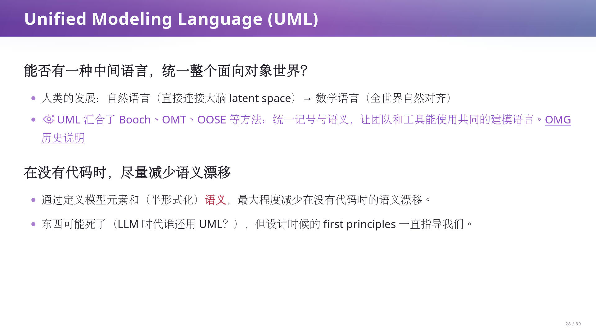

UML（Unified Modeling Language，**统一建模语言**）是面向对象建模领域的集大成者，它汇合了早期的Booch、OMT、OOSE等面向对象方法，旨在为工程团队和开发工具提供一套统一的记号与共同的建模语言。

课件对比了人类表达方式的演进：自然语言直接连接大脑的潜在空间（latent space），每个人对同一句话（如“设计一个选课模块”）会脑补出不同画面；而数学语言则能凭借共同定义在全世界实现自然对齐。

UML正是试图在软件设计阶段扮演这种“中间语言”的角色，通过定义明确的模型元素和半形式化语义，规定一个箭头表示什么关系、一个对象处于某种状态意味着什么、一个接口承诺了什么，从而在还没有代码时最大程度**减少语义漂移**。

课堂提示指出，在LLM时代，也许很少有人还手绘完整的UML图，但这套工具即便不再流行，创造它时所面对的工程难题和采用的第一性原理（First Principles）依然指导着今天的生成式开发。以前我们靠画图减少人与人之间的误解；今天我们向AI描述需求时，同样面临自然语言多义性带来的偏移。理解UML如何剥离歧义，能直接帮助我们写出边界更清晰的规约。

### 借助AI重读近八百页UML一手规范

许多人在本科软件工程课上学过UML，但印象往往停留在死记硬背各种空心箭头、实心菱形的画法，考完试便迅速遗忘，甚至连授课老师也未必通读过底层标准。面对厚达796页的UML 2.5.1官方规范文档，今天的学习者该如何高效提取其中的工程智慧？


传统教学受限于阅读成本，只能把庞大的标准压缩成几页图形语法口诀；而教师利用长上下文大模型与多子智能体（Sub-agent）分工协作，将近800页的UML 2.5.1规范切分为带有重叠区域的约50页片段，逐段读取并结合课程讲义提取软件工程第一性原理，剔除AI时代不再必要的纯机械细节。这一整套针对一手规范的深度消化过程，仅消耗了Kimi套餐五小时额度的18%（折合人民币约5.3元）。

讲义与课堂讨论借此提醒我们，AI大幅降低了检索、翻译和串联长篇一手规范的门槛。我们不必再被动接受二手教材对知识的“有损压缩”，也不必为了应付考试去背诵过时的图形细节，而是可以直接打开原始标准文档，追问设计者当年究竟遇到了什么结构性矛盾，并按自己的问题需求提取核心思想。接下来我们就看这次重读提炼出的总纲。

### 核心追问：哪些意图必须显式钉死，哪些可以留白

把796页的UML 2.5.1规范从头读到尾，如果只允许用一句话概括它的设计主线，这句话是什么？当我们与团队协作者、AI智能体，甚至是“下一个月的自己”合作时，为什么不能只靠脑海里的默契，而必须用一套语言机制来划定边界？

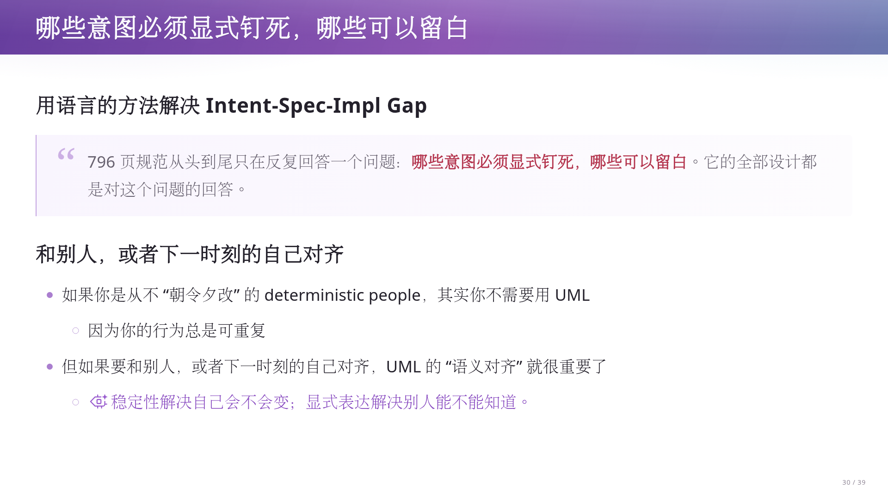

796页的UML规范从头到尾都在反复回答一个核心问题：“哪些意图必须显式钉死，哪些可以留白”。它的全部语法和元模型设计都是对这一追问的回答。原因在于：如果世界上的开发者都是从不朝令夕改、对同一句话永远给出完全相同解释的确定性个体（deterministic people），且单枪匹马完成所有工作，那确实不需要UML，因为其行为总是可重复的。但真实的软件开发必须与别人对齐，或者与下一时刻的自己对齐。在这场跨越人与时间的协作中，“稳定性”解决的是自己会不会变，而“显式表达”解决的是别人（以及工具和未来的自己）能不能准确知道你的决定。

这一洞见直接连通了Intent–Spec–Impl之间的鸿沟。无论是多人协作还是人机协作，只要存在信息传递，未显式钉死的意图就会被接收方用各自的经验补齐。把关键意图用明确的语言机制固定下来，同时把允许实现者自由发挥的空间显式留白，是控制大型系统演化不失控的根本前提。

### 模型的真正价值：把决定存下来，把自由留出来

既然建模是为了明确哪些钉死、哪些留白，那么一个好的软件模型在项目生命周期中到底扮演什么角色？当底层实现代码被重构、甚至被大模型整段重写时，什么东西应当保持不变？当多个视图共享同一模型、多种实现受同一组约束检验时，模型是如何逼出隐藏业务问题的？

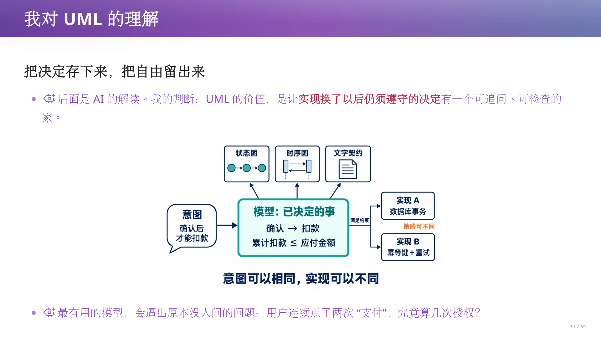

建模的核心价值，是让“实现换了以后仍须遵守的决定”有一个可追问、可检查的家。在架构关系上，多个不同的视图（如结构视图、交互视图、状态视图）共同指向并共享同一个底层模型；而下方的多种不同具体实现，则必须同时满足该模型所规定的一组约束。除了保存决定，一个有用的模型还能充当思维的探针，逼出原本没人意识到的问题。例如在设计支付流程时，一旦被迫画出严格的状态或交互模型，就会立刻暴露出一个尖锐的业务追问：“用户连续点击了两次‘支付’按钮，系统究竟应该算作一次授权，还是两次授权？”

这正是“把决定存下来，把自由留出来”的工程含义。像“连续点击两次算几次授权”这样的业务规则，一旦拍板决定，无论后端用Java还是Rust重写、无论由人类还是AI生成代码，都必须严格遵守；而底层究竟用哪款数据库存储状态，则属于留给实现者的自由。为了看清UML如何支撑这一理念，我们首先进入它的第一条第一性原理。

### 第一性原理之一：图不等于模型，意义保存在哪里

在日常讨论中，人们常把“画一张UML图”等同于“建立一个UML模型”，甚至直接在协作群里发送白板拍照或绘图软件的PNG截图来交付设计。如果一张类图上没有标出选课人数的上限，能否说明系统允许无限选课？当多张图各自修改时，语义为什么会分裂？

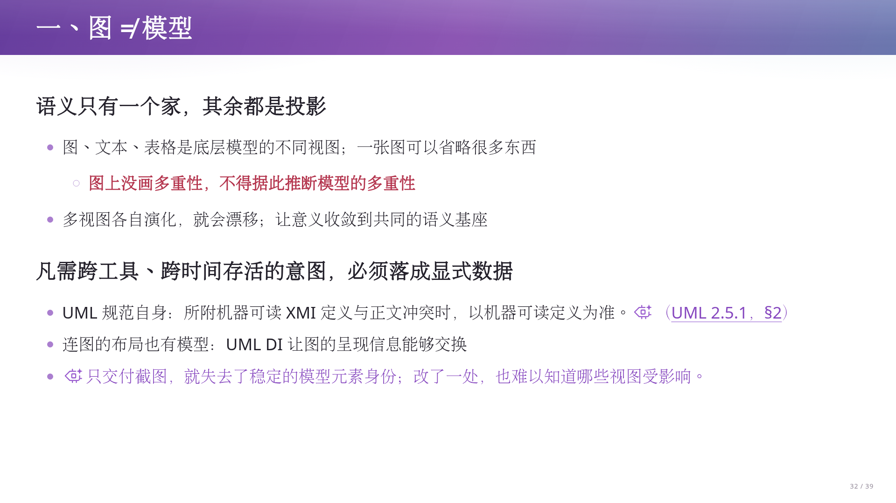

UML的第一条第一性原理是：图不等于模型（Diagram ≠ Model），语义只有一个家，其余都是投影。底层模型包含完整的元素、关系和约束；而图、文本、表格都只是底层模型面向不同读者的视图（投影）。一张介绍整体结构的图完全可以省略许多细节，因此**图上没画多重性（Multiplicity），绝不得据此推断底层模型没有多重性约束**。如果多个视图脱离底层模型各自演化，语义就会迅速漂移。为了确保跨工具、跨时间存活的意图不丢失，意义必须落成具有稳定元素身份的显式数据。例如UML 2.5.1规范第2节明确规定：当规范正文与随附的机器可读XMI（XML Metadata Interchange，模型信息交换格式）定义发生冲突时，以机器可读的XMI文件为准；甚至连图形的几何布局和呈现信息，也有专门的交换模型UML DI（Diagram Interchange）。

讲义特别提醒：UML规范中“XMI优先于正文”的规则，针对的是UML规范自身的元模型定义文件，切勿错误引申为“在任何日常软件项目中都应无条件相信代码而忽略需求文档”。这里的真正教训在于：如果只交付一张位图截图，工具就失去了稳定的模型元素身份（ID），当需求文档改了某项规则时，根本无法自动追踪哪些设计图和测试用例受到了影响。

### 第一性原理之二：契约与实现分层，这次成立还是每次成立

确定了模型数据保存在哪里之后，第二条第一性原理追问的是：模型里的行为描述应该怎样组织？在生成式开发时代，我们让大模型生成一段代码并跑通了几个测试样例，这和“系统真正满足了业务要求”之间究竟隔着什么？


将设计切分为“契约”与“实现”两个层次，是为了区分“必须恒真”与“碰巧成立”。具体实现说明“怎样做”，而高层契约声明“在哪些条件下，必须保证什么”。UML提供了前置条件、后置条件、不变量、协议状态机、`isQuery`属性以及多重性等机制来表达高层承诺。例如，当操作的前置条件不满足时，规范将其行为视为“未定义”，以此划定契约责任边界；若一个查询订单是否付费的操作被标记为`isQuery`（纯查询操作），它就承诺绝不改变系统状态，绝不能在查询时顺手触发一次扣款。在面向对象继承中，`isSubstitutable`属性表达了子类可替换父类的承诺，特征重定义也必须遵守兼容规则。

但必须注意规范第6.3.3节的明确界定：在模型中勾选`isSubstitutable`或`isQuery`，本身并不构成行为满足契约的形式化证明，保证详细行为符合高层契约仍是建模者与验证过程的责任。自然语言能写出“任何重试都不能重复扣款”，但不会自动检查代码；LLM生成的代码跑通几个样例，也只说明在当前输入下“这次碰巧成立”，远未覆盖超时、重试与并发组合。因此，高层意图必须从单次实现中独立出来，转化为持续检验实现的依据。

> 图与模型分离的工程启示
>
> 模型是承载元素、关系与约束的单一语义基座，而图、表格和文档只是按需裁剪的视图投影。选课系统结构图省略了选课人数多重性，绝不代表底层模型没有容量限制。如果只用截图保存设计，元素就失去了可跨工具追踪的唯一身份；一旦某处规则变更，多张视图无法同步更新，必然导致需求、设计与测试之间的语义分裂。

> 切勿误读规范中XMI与正文的优先级
>
> UML 2.5.1规范第2节规定“当规范正文与随附的规范性XMI文件冲突时以XMI为准”，这一规则仅针对OMG组织发布UML标准自身时的元模型定义文件，体现了将核心语义落实为机器可读数据的设计思想。在实际软件工程项目中，绝不能将该条款曲解为“永远无条件相信现有实现代码而忽略业务需求文档”。

> 属性标记不是自动证明器
>
> 在UML中为操作标上isQuery（不修改系统状态的查询）或为泛化关系标上isSubstitutable（子类可替换父类），只是显式写下了高层契约承诺，建模工具并不会因此自动完成形式化证明。正如UML 2.5.1规范第6.3.3节所强调，确保底层详细行为真正遵守高层契约，依然需要建模者借助测试、运行时断言或静态验证来落实。

术语消化：UML语义基座与契约分层核心概念消化

| 术语 | 解决的问题 | 机制与课程关系 |
|---|---|---|
| 模型（Model）与视图（View/Diagram） | 防止多张设计图各自修改导致语义分裂，或因画面省略被误读为无约束 | 模型保存完整的元素身份、关系与约束（如选课人数多重性）；图只是底层模型的局部投影 |
| XMI与UML DI | 解决跨建模工具、跨时间传输模型语义与图形布局时丢失结构信息的问题 | XMI以机器可读格式交换底层模型元素与关系；UML DI专门保存并交换图的呈现与布局信息 |
| isQuery（查询操作约束） | 防止本应只读的状态查询操作在执行中暗中产生修改系统状态的副作用 | 在操作契约层声明调用不改变系统可见状态，如“查询订单是否付款”绝不能顺手触发扣款 |
| isSubstitutable（可替换性声明） | 明确面向对象继承中子类对象能否在不破坏原有契约的前提下替换父类对象 | 在泛化关系中声明高层可替换性承诺；根据规范第6.3.3节，建模者仍需负责确保详细行为符合该契约 |

### 本章小结

本章开启了对UML 2.5.1规范的重新阅读。UML的本质是在代码诞生前实现跨人与跨时间的语义对齐，其796页规范始终在回答“哪些意图必须显式钉死，哪些可以留白”。我们剖析了前两条第一性原理：

- 第一，“**图不等于模型**”，图只是底层模型的投影，跨工具跨时间存活的意图必须落成具有稳定元素身份的显式数据；

- 第二，“**契约与实现分层**”，必须用前置条件、isQuery、协议状态机等高层承诺约束具体行为，警惕把LLM跑通几个样例的“这次碰巧成立”误当作系统在所有场景下“每次都恒真”。

下一章将继续探讨欠规约、维度分离与模型检查。

## 七、重新阅读UML（下）：有意的欠规约、正交语义维度与元模型约束

上一章我们明确了模型与视图的分离，以及契约承诺必须独立于单次实现。然而在真实的工程演进中，任何团队都无法在项目第一天穷尽所有设计细节；同时，自然语言和随手画出的连线往往把多种截然不同的工程决定混为一谈。本章继续深入UML 2.5.1规范的后三条第一性原理，探讨三个核心问题：优秀的建模语言如何显式表达“尚未决定的事”？为什么必须把导航、聚合、所有权与执行顺序拆解为相互正交的语义维度？以及当模型本身接受机器检查（如元模型与OCL约束）时，这种形式化检验的边界究竟在哪里？

### 有意的欠规约：合法、非法与尚未规定

在需求探索与架构设计早期，试图一次性规定系统在所有极端情况下的反应既不现实也不经济。如果语言只允许表达“合法”与“非法”二元对立，建模者就会被迫过早锁定实现细节，或者把遗漏的空白误认为默许。UML交互语义是如何将执行轨迹划分为三个集合的？这又怎样支撑“按歧义付费”的渐进形式化？

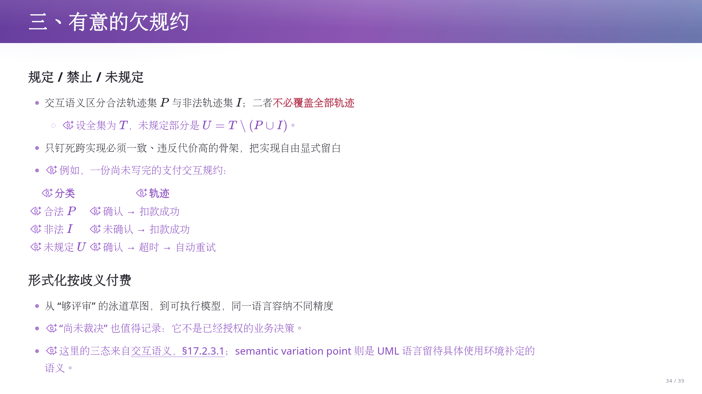

根据UML 2.5.1规范第17.1.2节与第17.2.3.1节的交互语义，轨迹（Trace）指系统事件发生的一种序列。设所有可能轨迹的全集为 T，交互模型将其区分为合法轨迹集 P 与非法轨迹集 I，但二者不必覆盖全部轨迹，从而留下未规定轨迹集 U = T \ (P ∪ I)。以支付交互规约为例：

- “用户确认→扣款成功”属于**合法集合 P**；

- “用户未确认→扣款成功”属于明确禁止的**非法集合 I**；

- 而“用户确认→请求超时→系统自动重试”则落在**未规定集合 U** 中。

此外，还需要区分具体模型中的三态划分与UML语言层面的语义变化点（Semantic Variation Point，即语言规范故意留给具体使用环境或工具去补定的语义选择）。

讲义提醒我们，落在未规定集合 U 中的行为代表“尚未裁决的业务决定”或“显式留给实现的自由度”，绝不能直接当成已获业务授权的合法行为。如果开发人员或大语言模型在实现时自行选择了超时自动重试，就必须继续追问：超时前上一次请求是否已经扣款成功？如何防止重试引发重复扣款？形式化是有成本的，工程上应当只钉死跨实现必须一致、违反代价高的骨架，把成本花在歧义大或需要机器推导的地方。随着设计从泳道草图演进到可执行模型，再逐步收窄 U 的范围。

### 正交语义维度：一根线不能回答所有问题

为什么草图和自然语言描述极易引发下游实现偏离？因为人们习惯用一个模糊的词汇或一根简单的箭头同时暗示好几种彼此独立的工程属性。当不同程序员或AI模型按照各自的经验去解包这根连线时，语义漂移便不可避免。剖析UML的关联关系，可以看到规范如何将混杂的意图拆解为正交的语义维度。

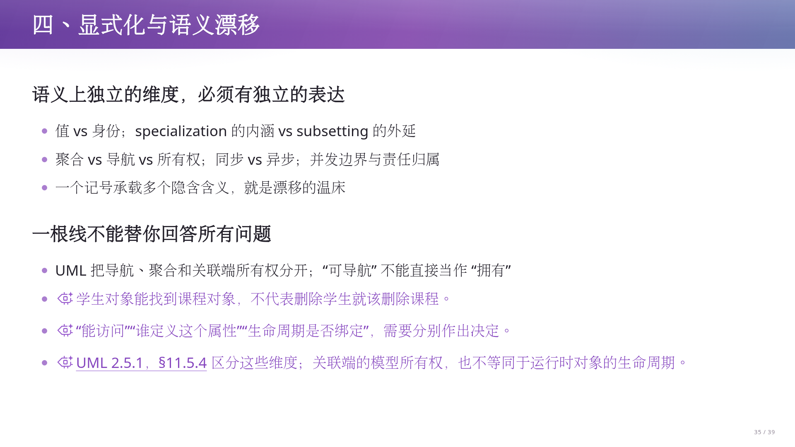

语义上独立的维度需要拥有独立的表达方式。例如对象的值（Value，当前属性数据相同）与身份（Identity，是否为同一个对象实体，修改其一是否影响另一方）不同；特化（Specialization，类定义内涵的继承扩展）与子集（Subsetting，集合外延的包含约束）也分属不同层面。在UML 2.5.1规范第11.5.4节中，关联关系被拆解为三个正交维度：可导航性（Navigability，能否从一个对象访问另一个对象）、关联端所有权（Ownership，该关联属性定义在哪个类或关联自身名下）以及聚合种类（Aggregation，区分无聚合 `none`、共享聚合 `shared` 与复合聚合/组合 `composite`，其中仅 `composite` 具有强所有权与随整体一同销毁的生命周期约束，而 `shared` 并无统一的销毁绑定语义）。规范明确废弃了早期把“可导航”直接等同于某种所有权的旧约定。

结合讲义中的选课系统例子可以清晰看到这三个维度的正交性：第一，从学生对象能够查找到所选的课程对象，这首先回答的是运行时或查询上的“可导航性”；第二，选课关联端的属性归学生类还是归独立的选课关联拥有，回答的是模型静态结构的“所有权”；第三，聚合种类（尤其是否为带生命周期约束的 `composite` 组合）才决定部分对象是否随整体对象一起销毁。如果仅凭画了一根从学生指向课程的箭头，就把可导航性、属性所有权与 `composite` 组合混为一谈，那么当系统删除一名学生的选课记录或注销学生对象时，难道要顺手把整门课程从学校里删掉吗？显式拆分这些维度，正是为了逼迫设计者分别作出明确决定。

### 顺序的语义边界：交互图中的弱顺序

除了静态结构上的连线，动态行为图中的空间位置同样容易诱发隐式假设。阅读序列图（交互图）时，人类直觉往往把纸面上从上到下的排列默认等同于全局串行执行。依据UML交互片段规范，我们可以解析“并发作为默认背景”的欠规约思想，并明确弱顺序操作符的语义边界。


UML 2.5.1规范第17.6.3.11节对交互图的顺序语义作出了明确规定。生命线（Lifeline）表示交互过程中单个参与者随时间推移发生的行为序列。当多个交互片段组合在一起时，默认的组合操作符 seq 表示弱顺序（Weak Sequencing），其规则为：第一，保留各个操作数片段内部的事件顺序；第二，保留同一条生命线上跨操作数片段的事件先后顺序；第三，来自不同生命线、不同操作数片段的事件，在不违反已有约束的前提下完全可以交错（Interleaving）并发执行。如果业务确实要求前一个片段的所有事件全部结束后才能启动后一个片段，则必须显式使用 strict（严格顺序）操作符或添加额外约束。

用讲义中的订单处理场景来检验这一机制：假设交互图上方画了“短信服务发送通知”，下方画了“仓库服务开始备货”，且两者分属不同的生命线。在默认的 seq 弱顺序语义下，纸面上的上下位置并不构成“必须等短信全部发送完毕，仓库才能开始备货”的全局同步承诺，两条生命线上的事件完全可以并行或交错发生。课堂提示我们，少画一条同步依赖，就会多留出一批并发交错的执行轨迹。无论是分布式调用中的同步与异步，还是并发边界与失败责任归属，都必须显式陈述哪些顺序必须成立，而不能依赖画面排布的视觉错觉。

### 语义即约束：元模型、OCL与机器检查的边界

既然前四条原理要求把模型落成显式数据、区分契约、划定未规定边界并拆解正交维度，那么谁来保证建模者画出的模型本身没有自相矛盾？UML的第五条第一性原理指出“模型本身也需要检查”：通过元模型与约束语言为设计模型引入类似编程语言的“类型检查”，同时厘清机器检查的能力范围。

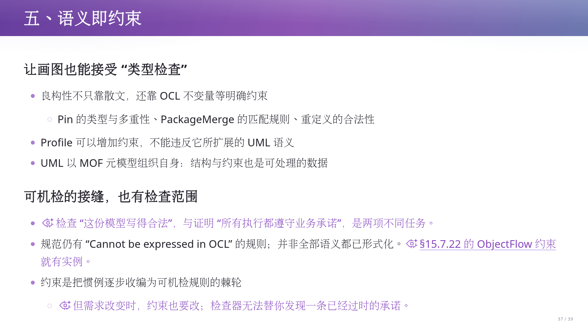

UML通过元对象设施（MOF，Meta Object Facility，即定义“模型可以由哪些元素组成、它们怎样关联”的元模型基础）将自身结构数据化，并配合对象约束语言（OCL，Object Constraint Language，一种用于表达模型结构条件与不变量的形式语言）来定义良构性（Well-formedness）规则。例如活动图中引脚（Pin）的输入输出类型与多重性兼容、包合并（PackageMerge）的匹配规则、子类重定义的合法性，均由OCL不变量严格约束。此外，用于特定领域扩展的Profile机制也只允许增加约束，绝不能违反所扩展的基础UML语义。但可机检接缝也有明确的检查范围：规范中如第15.7.22节对象流（ObjectFlow）的部分约束仍标注了“Cannot be expressed in OCL”。

讲义与课件在此给出了至关重要的工程警示：必须把“检查这份模型写得符合语法与良构性规则”与“证明所有运行时实现都遵守业务承诺”严格区分开来。一个完全通过MOF元模型与OCL良构性检查的支付模型，只说明它的图形元素、引脚类型和重定义关系没有拼装错误，却依然可能在业务逻辑上遗漏超时重试引发的重复扣款问题。形式化约束就像把工程惯例逐步收编为可机检规则的棘轮；但当外部业务需求发生改变时，机器检查器无法自动替人类发现某条旧约束已经过时。维护规则的有效性始终是人的责任，这也自然引出了下一章的核心议题：在大语言模型直接生成代码的时代，这些约束与鸿沟转移到了哪里。

> 执行轨迹的三态划分与按歧义付费
>
> UML交互语义并未将行为简单归为非黑即白，而是把全集 T 划分为合法集 P、非法集 I 与未规定集 U = T \ (P ∪ I)。未规定部分 U 既包含留给下游实现的自由度，也包含尚未裁决的业务问题（如支付超时后是否自动重试）。工程形式化应当“按歧义和违规代价付费”：在早期评审阶段保留合理的欠规约，而在涉及资金安全、并发一致性等高代价边界上，必须将 U 中的模糊地带显式归入 P 或 I。

> 关联关系的三维正交分解
>
> 随手在两个类之间画一根箭头是最常见的语义漂移源头。UML 2.5.1第11.5.4节强制将关联拆解为三个独立问题：一是可导航性（运行时能否从学生查到课程）；二是关联端所有权（静态属性定义归属学生类还是关联自身）；三是聚合种类（区分 `none`、`shared` 与带生命周期删除传播约束的 `composite` 组合；学生与课程关系绝不能据箭头推断为 `composite`）。废弃“可导航即拥有”的旧习惯，能防止人类程序员或AI在生成代码时做出错误级联删除或越权修改。

> 切勿混淆“模型良构”与“业务正确”，切勿误读 seq 弱序
>
> 第一，通过MOF与OCL的良构性检查，仅代表模型符合UML语法与静态结构规则（且规范中仍有无法用OCL表达的约束），绝不自动证明系统满足防重扣款等业务承诺，也无法自动识别过时的需求。第二，交互图默认操作符 seq 是弱顺序，仅保片段内部顺序及同一生命线上的先后顺序，允许不同生命线事件交错；既不可将其误作完全无序，也不可把纸面上下位置直接当成全局严格串行（strict）。

术语消化：UML后三条第一性原理的核心术语与机制消化

| 术语 | 解决的问题 | 机制与课程关系 |
|---|---|---|
| 未规定轨迹集 U (Unspecified Traces) | 防止在建模早期被迫锁死所有实现细节，或把尚未讨论的异常分支误认为已获批准的合法行为。 | 在全集 T 中扣除合法集 P 与非法集 I 得到 U = T \ (P ∪ I)，显式标记留白与待裁决项，指导渐进形式化。 |
| 语义变化点 (Semantic Variation Point) | 解决通用建模语言在不同工程领域和运行环境中无法共用唯一硬编码执行语义的问题。 | 由UML语言规范故意留出语义选择空间，交由具体使用环境或Profile补定，区别于具体业务模型未写完的轨迹集 U。 |
| 弱顺序 (Weak Sequencing, seq) | 消除把交互图纸面上的上下位置盲目解释为全局跨组件串行阻塞的视觉误导。 | 仅保持各操作数片段内部顺序及同一生命线（Lifeline）上跨片段的先后顺序，允许不同生命线上的事件自由交错。 |
| 元对象设施与对象约束语言 (MOF & OCL) | 解决仅靠自然语言散文描述建模规则时，无法由工具自动检查模型结构拼装错误的难题。 | MOF用元模型定义模型的合法组成结构，OCL用形式化不变量表达良构性约束，使设计模型能接受类似编译器的静态检查。 |

$$
U = T \setminus (P \cup I), \quad P \cap I = \emptyset
$$

其中 T 表示系统所有可能执行轨迹（事件序列）的全集，P 表示规约明确允许的合法轨迹集合，I 表示规约明确禁止的非法轨迹集合，U 表示模型尚未表态的未规定轨迹集合。该公式适用条件为交互规约具有内部一致性（即合法集 P 与非法集 I 互不相交），用于形式化界定“已决定、明确禁止与有意留白”的三态边界。

### 本章小结

本章深入剖析了UML 2.5.1规范的后三条第一性原理：

- 第一，通过将执行轨迹划分为合法 P、非法 I 与未规定 U，支持**有意的欠规约**并按歧义代价渐进形式化；

- 第二，将可导航性、所有权、生命周期以及交互图中的弱顺序（seq）与严格顺序（strict）拆解为**正交维度**，杜绝一符多义引发的语义漂移；

- 第三，借助MOF元模型与OCL约束实现模型的**良构性检查**，同时认清机器检查与业务正确性之间的边界。

## 八、LLM时代差距移到了哪里：给“已决定的事”留下一条可检查的接缝

在前一章中，我们通过重读UML 2.5.1规范提炼出了五条建模第一性原理：模型与视图分离、契约与实现分层、有意的欠规约、独立语义维度显式化以及语义即约束。然而来到大语言模型时代，开发者不再需要手工绘制繁琐的中间图形，往往只需写下一段自然语言提示词，模型就能跨越中间建模步骤直接生成可运行的代码。这立刻引出了本讲收束全篇的核心追问：当大语言模型能够直接从散文生成程序时，意图（Intent）、规约（Spec）与实现（Impl）之间的差距就此消失了吗？它们究竟移到了哪里？在代码生成成本骤降的今天，开发者应当如何守住对软件行为的控制权？

### LLM时代：差距没有消失，只是移位

在传统软件工程中，UML试图通过半形式化的中间语言，把散文式的意图析出为形式骨架；而在生成式软件工程中，大语言模型可以直接将自然语言散文转化为可执行代码。这种跨越中间步骤的高效体验容易造成一种假象，仿佛规约与实现之间的鸿沟已经被模型自动填平。这里需要区分“约束集合圈定的合法行为空间”与“某个具体实现做出的特定选择”，并观察当人类尚未对业务细节做出裁决时，模型是如何在代码里暗中完成选择的。

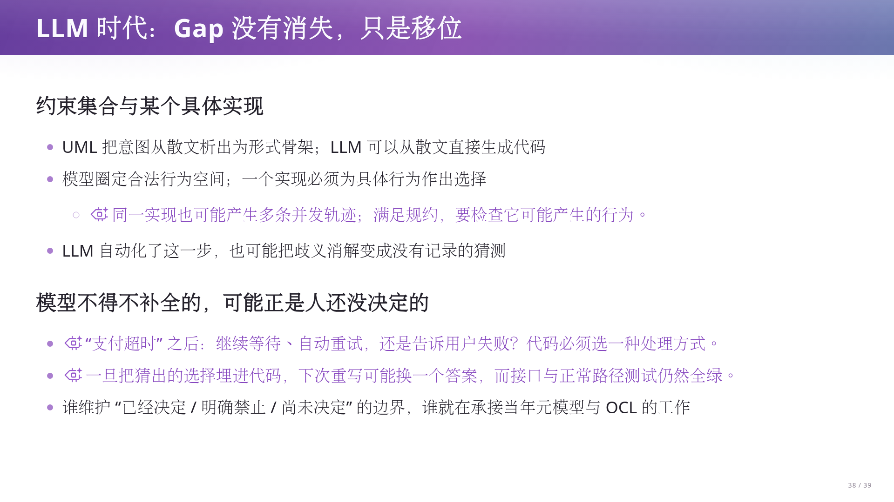

对比UML路径与大语言模型路径在处理规约与实现关系上的异同，可以看到：从本质上看，模型或规约的作用是圈定系统允许出现的**合法行为空间**，而任何一个具体的程序实现，都必须为底层数据结构、算法逻辑、状态更新以及异常处理做出明确选择。尤其在并发系统中，同一个实现本身在运行时还会产生多条不同的并发执行轨迹；判断一个实现是否满足规约，需要检查它可能产生的所有相关行为是否都落在承诺的边界之内。

大语言模型虽然将“从散文到代码”的补全过程自动化了，却也带来了一个隐蔽的移位：它可能把原本需要暴露出来的歧义消解过程，变成了没有留下任何记录的**隐式猜测**。

例如面对“支付超时之后怎么办”这一未说明的场景，代码为了能够编译运行，不得不选定一种处理方式——继续等待、自动重试，或者直接告诉用户失败。

讲义对这一风险给出了极其具体的推演：当用户在提示词中没有规定支付超时的后续动作时，模型在第一次生成代码时可能选择阻塞等待，第二次重写时可能改成自动发起重试，第三次重写又可能变成直接报错返回失败。这三份代码都能顺利运行，对外暴露的函数接口外观完全一致，甚至针对正常付款路径编写的测试用例也会全部显示全绿通过；但在这三份代码内部，模型其实已经替人类做出了截然不同的业务决定。因此讲义提醒我们，今天谁在持续维护“已经决定的行为、明确禁止的行为、尚未决定的行为”这三类信息的清晰边界，谁就是在承接当年元模型与OCL约束的工作。

### 给“已决定的事”留下一条可检查的接缝

既然大语言模型会在重写代码时随时更换对未规定细节的猜测，单纯依赖单次对话中的长提示词，或者满足于正常路径的样例测试全绿，就无法保证核心业务承诺在迭代中持续成立。那么，我们应当如何把前文总结的契约与UML第一性原理真正落地到生成式开发流程中？结合支付系统的三类决策对照，我们可以理解如何把实现细节留在不透明（Opaque）的另一侧，同时在系统边界上为“已决定的事”构造机器可检查的接缝。

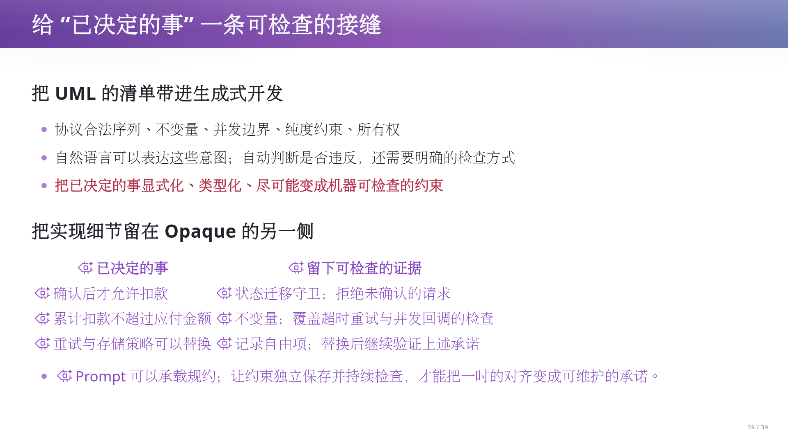

在生成式开发中，我们可以把UML的五项关键清单——协议合法序列、不变量、并发边界、纯度约束与所有权——转化为工程实践：将已经决定的事项显式化、类型化，并尽可能转化为机器可检查的约束，同时把具体实现细节留在不透明（Opaque）的屏障另一侧。针对支付系统的三个具体决策，表格展示了如何留下可检查的证据：第一，对于“确认后才允许扣款”这一已决定的事，不能只停留在口头要求，而要落实为状态迁移守卫，在代码与测试中明确拒绝未确认的扣款请求；第二，对于“同一订单累计扣款不超过应付金额”，要将其定义为系统不变量，并设计覆盖超时重试与并发回调交错场景的检查；第三，对于“重试与存储策略可以替换”，则将其显式记录为允许变化的自由项，当底层替换了存储结构或重试实现后，继续运行上述守卫与不变量检查，以验证核心承诺未被破坏。

围绕这一落地机制，我们可以结合课程总结的“两道鸿沟需要两种反馈”来收束全讲：软件失败既可能源于规约没有表达出人类的真实意图，也可能源于代码实现违背了已定规约。面对从意图（Intent）到规约（Spec）的左侧鸿沟，我们应当利用大语言模型快速生成最小可行产品（MVP）或试验系统（Pilot），通过真实使用、界面点击与需求澄清尽早获取反馈；面对从规约（Spec）到实现（Impl）的右侧鸿沟，则必须依靠接口契约、状态机、基于性质的测试与运行时断言来获取验证反馈。提示词（Prompt）固然可以在某次交互中承载规约，但让约束独立于单次聊天记录和单份代码被版本化保存，并通过需求可追踪性与自动化检查持续生效，我们才能在享受AI高速改写实现的同时，持续保有对软件系统行为的控制权。

> 生成式开发中的三态边界维护
>
> 在借助大语言模型开发软件时，工程控制权的核心在于明确区分并持续维护三类信息：第一是“已经决定的行为”，如扣款前必须获得用户确认，必须用状态守卫或契约钉死；第二是“明确禁止的行为”，如任何超时重试与并发回调下累计扣款绝不能超过应付金额，必须转化为不变量持续检查；第三是“尚未决定的行为”或实现自由项，应当显式记录留白，避免把模型某次随机补全的猜测误认为已经获得业务授权的决定。

> 两道鸿沟与两种反馈的协同机制
>
> 生成式软件工程并非用AI替代软件工程，而是用两类反馈分别弥合两道经典鸿沟。针对Intent与Spec之间的鸿沟，利用模型低成本生成MVP和原型，把抽象想法变成可操作、可批评的对象，通过真实体验修正需求假设；针对Spec与Impl之间的鸿沟，则将高代价的业务规则落实为类型、前置后置条件、状态机与并发测试。两种反馈交替推进，才能既跑得快又不失控。

> 警惕“提示词生成加正常路径全绿”的闭环幻觉
>
> 切勿认为“写好一段长Prompt生成代码，并跑通几个正常路径的测试样例”就完成了软件工程闭环。模型为了交付可编译的代码，会自动填补需求中的未决歧义；当下次修改Prompt重新生成时，模型完全可能在保持函数签名和正常路径测试全绿的前提下，暗中更改超时处理、异常恢复或并发交错逻辑。因此，关键约束必须从单次聊天和单次实现中独立出来，沉淀为版本库中可持续运行的检查。

术语消化：支付系统在生成式开发中的边界划分与可检查接缝

| 术语与边界分类 | 解决的问题 | 机制与课程关系 |
|---|---|---|
| 隐式猜测（Implicit Guessing） | 揭示模型在需求欠规约时被迫自行做决定所带来的静默漂移风险 | 面对“支付超时怎么办”等未规定场景，模型每次生成可能分别选择等待、重试或报错，接口与正常测试虽一致但业务语义已变 |
| 状态迁移守卫（State Guard） | 钉死协议合法序列，防止非法状态下的越权或乱序操作 | 将“确认后才允许扣款”落实为状态机前置守卫，在运行时与测试中主动拒绝一切未经确认的扣款请求 |
| 业务不变量（Business Invariant） | 跨多条并发轨迹与异常路径，守住绝不可违反的资金与状态底线 | 规定“同一订单累计扣款不超过应付金额”，通过覆盖超时重试与并发回调的测试或验证来持续检验 |
| 不透明实现自由项（Opaque Freedom） | 在不破坏外部承诺的前提下，为底层重构与AI快速重写保留空间 | 将内部存储结构与具体重试策略记录为可替换项，每次模型重写底层代码后，继续运行上述守卫与不变量检查以完成验收 |

### 本章小结

本章总结了大语言模型时代软件工程的核心转变：LLM虽然跨越了从自然语言到代码的中间步骤，但规约与实现之间的差距并未消失，而是转移到了模型对未规定业务细节的**隐式猜测**上。

开发者必须承接元模型与契约的职责，划清已决定、明确禁止与尚未决定的边界，将核心承诺转化为独立于单次Prompt的**可检查接缝**，在快速迭代中守住对软件行为的控制。

## 总结与延伸

- 纵观本讲，软件工程六十余年的演进史始终围绕“Intent–Spec–Impl双重鸿沟”持续寻找**早反馈与硬约束**。在1960年代软件危机与阿波罗11号1201/1202警报的考验中，前人确立了工程的底线：软件不仅要在正常路径上算得对，更要在成本、时间与硬件资源约束下具备处理异常并继续工作的恢复机制。随后，Royce在1970年画出的经典阶段图，其真实本意恰恰是批判简单的单向不可回退瀑布流程——因为计时、存储与I/O等硬约束往往到测试阶段才第一次被真正“经历”，一旦失败便会沿数据依赖图一路冲垮设计与需求基线。用Pilot Model（Do It Twice）、MVP与敏捷迭代重构工作顺序，本质上都是在控制未经检验的假设所波及的返工范围。


- 为了在代码运行前或演化中锁住意图，软件工程发明了决策表、基于性质的测试（如QuickCheck要求排序不仅有序，还必须保留原输入的所有元素及其重复次数）、需求追踪矩阵、契约式设计（DbC）以及UML。无论是Eiffel中明确划分调用者义务与实现者承诺的前置/后置条件（需注意前置条件不满足是在划定契约边界，并不等于自动定义了业务失败返回值），还是UML 2.5.1所体现的五大原理——图与底层模型分离、契约与实现分层、合法/非法/未规定轨迹的有意欠规约、将导航/所有权/聚合以及弱顺序（`seq`）拆分为正交语义维度、以及明白MOF/OCL良构性检查不等于业务逻辑正确——其核心都在回答同一个问题：**哪些意图必须显式钉死，哪些自由可以留白？**


- 这直接照亮了我们从前两讲（版本管理）迈向后续生成式开发实践的道路。大语言模型虽然能跨过中间语言直接从散文生成代码，却也把“支付超时后怎么办”这类未决业务歧义变成了模型内部没有记录的随机猜测。在未来的软件开发中，我们既要用MVP和真实交互反馈去弥合Intent与Spec的鸿沟，更要承接当年元模型与契约的工作，明确区分“已经决定、明确禁止与尚未决定”的边界。**将关键承诺显式化、类型化**并转化为状态机守卫、不变量、属性测试或静态验证（如Dafny、Verus相对于给定规约的检查），使之独立于单次Prompt保存在版本库中，我们就能在AI高速重写代码的时代持续守住对软件行为的控制权。

### 学习练习

用下面的延伸练习检查自己能否应用本讲方法。

#### 练习 1：基于决策表与契约式设计的业务边界澄清

针对课程提及的“高校选课与退课系统”或“不透支账户取款”，编写一份包含至少3个正交条件（如：是否满足先修课、是否有教师特批override、名额状态/退课时间窗）的决策表；随后用代码或伪代码为其核心操作编写显式的接口契约（包含前置条件、后置条件与类不变量）。请分别写出两个版本的取款或选课契约：版本A将“余额不足/名额已满”作为违反前置条件处理；版本B将其作为正常业务失败分支处理，并对比两者的调用方责任差异。

**验收标准：**

1. 决策表覆盖所有条件真假组合，无遗漏或自相矛盾的动作定义；

2. 版本A与版本B的前置条件、后置条件（含旧状态引用）及类不变量表述准确；

3. 书面说明清晰指出“前置条件不满足”不等于自动定义了失败返回值，版本B必须在放宽前置条件的同时于后置条件中明确规定失败返回状态及状态不变性（如余额或已选名单不变）。

#### 练习 2：基于性质的测试（Property-Based Testing）与AI隐式猜测探测

使用任意主流语言的测试框架（如Python Hypothesis、Rust proptest或TypeScript fast-check），为两个模块编写性质测试：（1）一个自定义排序函数；（2）一个由LLM根据模糊Prompt（仅要求“实现订单确认与扣款接口，处理网络超时”）生成的模拟支付模块。通过注入并发回调与超时模拟，运行测试并观察LLM重写两次代码后的行为差异。

**验收标准：**

1. 排序函数的性质测试必须同时断言“输出序列有序”以及“输出保留输入的所有元素及其各自的出现次数（重数）”，并能成功拦截返回空数组或丢失重复元素的错误实现；

2. 支付模块的测试需显式验证“未确认不得扣款”与“同一订单在超时重试及并发回调下累计扣款不超过应付金额”两条不变量；

3. 提交实验记录，准确归类LLM在未规定轨迹（U）上暗中替开发者做出的业务猜测（如等待、自动重试或直接报错）。

#### 练习 3：UML正交语义审查与可检查规约接缝设计

针对一个包含“用户下单、短信服务发送通知、仓库服务备货、支付状态查询”的电商子系统，建立一份结构化的文本模型清单（YAML/JSON或Markdown表格）而非单纯手绘截图。在清单中明确界定类关联的三个正交维度及交互片段的顺序语义，并将关键业务承诺落地为独立于实现代码的自动化断言或状态机守卫检查脚本。

**验收标准：**

1. 关联关系清单必须显式分离并定义“可导航性”“关联端属性所有权”与“聚合种类（区分none、shared与带生命周期约束的composite组合）”，说明学生与课程、订单与商品不宜仅据箭头推断为composite组合，从而确保删除订单或选课记录不会错误级联删除商品或课程实体；

2. 交互顺序说明必须准确区分UML默认弱顺序（`seq`，仅保片段内部及同一生命线先后，允许不同生命线事件交错）与全局严格顺序（`strict`），明确标出“短信通知”与“仓库备货”是否允许并发交错；

3. 支付状态查询接口须落实`isQuery`无副作用检查（断言调用前后账户与订单状态严格不变），且所有检查脚本可在替换底层存储与重试实现后直接复用运行。

### 拓展阅读

- [官方讲义](https://jyywiki.cn/GSE/2026/lect5.md)
- [官方课件](https://jyywiki.cn/GSE/2026/slides5.html)
- [社区字幕校订稿（固定版本）](https://github.com/NinZeige/NJU-2026-GSE-Captions/tree/0456f3a46fd5fa2f2a86123e02b7ed48696adacb)
- [原课程许可 CC BY-NC 4.0](https://creativecommons.org/licenses/by-nc/4.0/)
- [Jev 演示视频 (Bilibili)](https://www.bilibili.com/video/BV1x1ex6TEFu/)
- [TypeSafe AI: Introducing System One Models and Jev](https://typesafe.ai/blog/introducing-system-one-models-and-jev)
- [Richard Sutton: The Bitter Lesson](https://www.cs.utexas.edu/~eunsol/courses/data/bitter_lesson.pdf)
- [DoReMi: Optimizing Data Mixtures Speeds Up Language Model Pretraining](https://arxiv.org/abs/2305.10429)
- [Boys' Life (1968年9月号): Computerized School House](https://books.google.com/books?id=gmA305LImsYC&pg=PA24)
- [E. W. Dijkstra: The Humble Programmer (EWD340)](https://www.cs.utexas.edu/~EWD/transcriptions/EWD03xx/EWD340.html)
- [E. W. Dijkstra: Go To Statement Considered Harmful](https://homepages.cwi.nl/~storm/teaching/reader/Dijkstra68.pdf)
- [NATO Software Engineering Conference Report (1968)](https://www.scrummanager.com/files/nato1968e.pdf)
- [NASA: Margaret Hamilton Biography](https://science.nasa.gov/people/margaret-hamilton/)
- [Apollo 11 Lunar Surface Journal: 1201 and 1202 Program Alarms](https://history.nasa.gov/wp-content/uploads/static/history/alsj/a11/a11.1201-pa.html)
- [Winston W. Royce: Managing the Development of Large Software Systems (1970)](https://dl.acm.org/doi/10.5555/41765.41801)
- [Principles behind the Agile Manifesto](https://agilemanifesto.org/principles)
- [ISTQB Certified Tester Foundation Level Syllabus v4.0.1](https://istqb.org/wp-content/uploads/2024/11/ISTQB_CTFL_Syllabus_v4.0.1.pdf)
- [Koen Claessen & John Hughes: QuickCheck: A Lightweight Tool for Random Testing of Haskell Programs](https://www.cs.tufts.edu/~nr/cs257/archive/john-hughes/quick.pdf)
- [NASA Systems Engineering Handbook: 6.2 Requirements Management](https://www.nasa.gov/reference/6-2-requirements-management/)
- [Bertrand Meyer: Applying "Design by Contract"](https://ieeexplore.ieee.org/document/161279)
- [Eiffel Software: An Introduction to Design by Contract](https://www.eiffel.com/values/design-by-contract/introduction/)
- [Dafny Programming Language and Verifier](https://dafny.org/)
- [Verus: Verified Rust for low-level systems code](https://github.com/verus-lang/verus)
- [OMG Unified Modeling Language (UML) Specification Version 2.5.1](https://www.omg.org/spec/UML/2.5.1)
